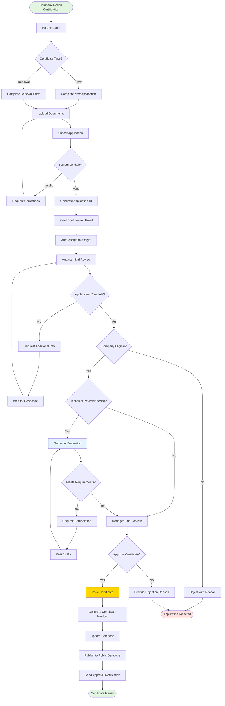
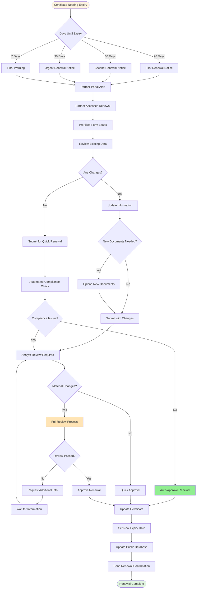
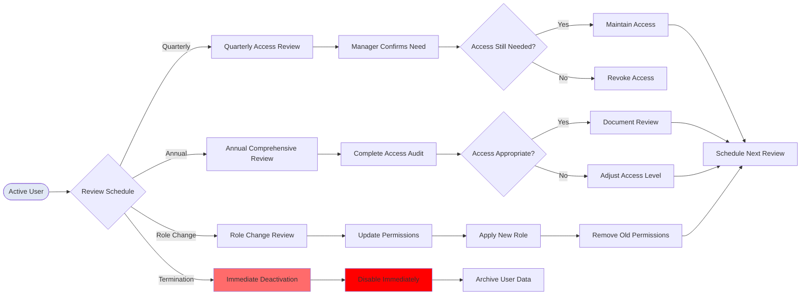
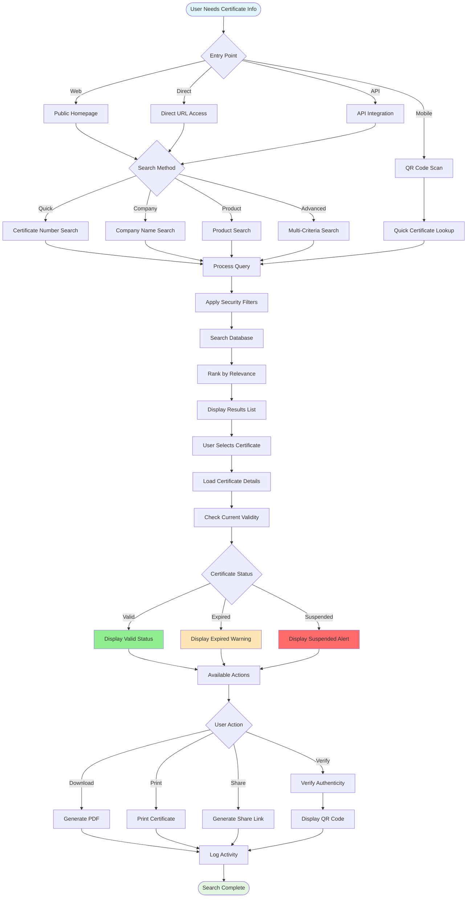
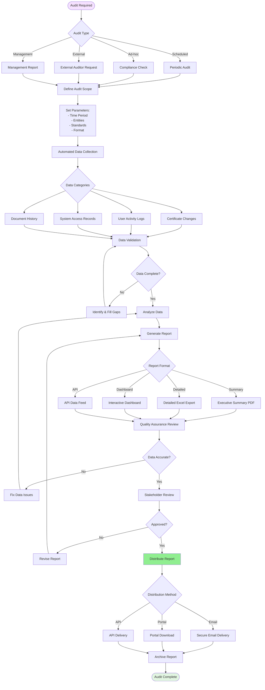
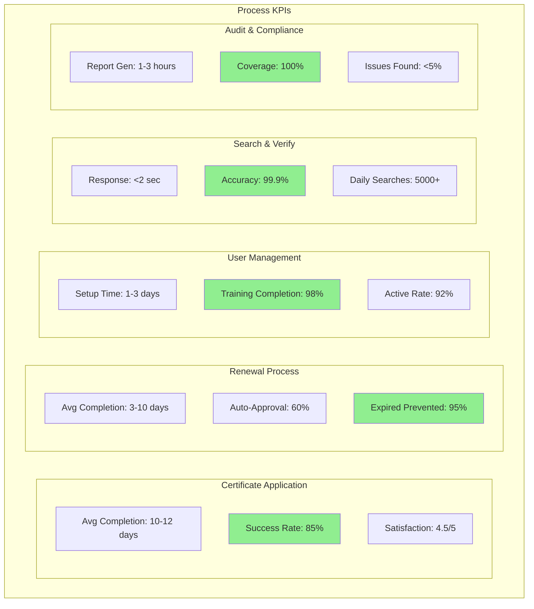
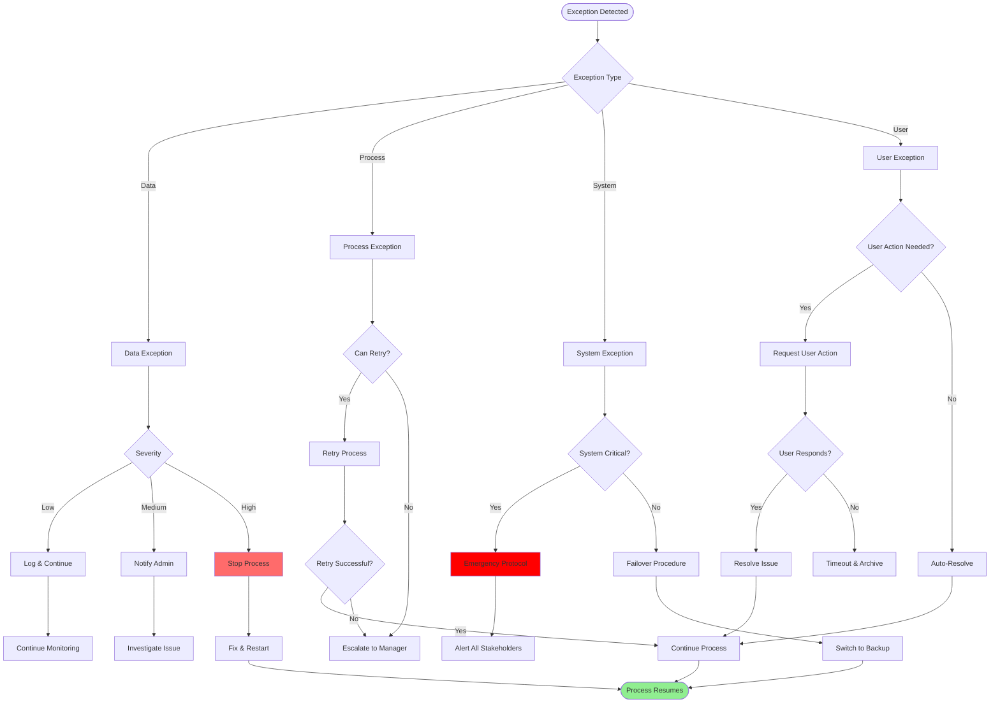

# GCC Database System - Process Flow Visual Diagrams

## Process 1: Certificate Application & Approval Workflow

### Complete Process Flow



### Process Phases with Timing

```mermaid
gantt
    title Certificate Application Process Timeline
    dateFormat HH:mm
    axisFormat %H:%M
    
    section Phase 1
    Application Submission    :done, phase1, 00:00, 30m
    Document Upload          :done, phase1doc, after phase1, 30m
    
    section Phase 2
    Initial Validation       :active, phase2, after phase1doc, 2h
    Assignment to Analyst    :active, phase2assign, after phase2, 30m
    
    section Phase 3
    Analyst Review          :phase3, after phase2assign, 4h
    Document Verification   :phase3doc, after phase3, 2h
    
    section Phase 4
    Technical Evaluation    :phase4, after phase3doc, 8h
    Compliance Check       :phase4comp, after phase4, 4h
    
    section Phase 5
    Manager Review         :phase5, after phase4comp, 3h
    Final Approval        :phase5app, after phase5, 1h
    
    section Phase 6
    Certificate Generation :phase6, after phase5app, 30m
    Database Update       :phase6db, after phase6, 15m
    Notification         :phase6not, after phase6db, 15m
```



## Process 2: Certificate Renewal & Maintenance

### Renewal Process Flow



## Process 3: User Account & Access Management

### User Lifecycle Management Flow

```mermaid
flowchart TB
    Start([New User Required]) --> RequestType{Request Source}
    
    RequestType -->|Manager| MgrRequest[Manager Submits Request]
    RequestType -->|HR System| HRRequest[HR System Integration]
    RequestType -->|Admin| AdminRequest[Direct Admin Request]
    
    MgrRequest --> CollectInfo[Collect User Information]
    HRRequest --> CollectInfo
    AdminRequest --> CollectInfo
    
    CollectInfo --> Details[Name, Email, Department, Role]
    Details --> Approval{Approval Level}
    
    Approval -->|Standard| MgrApprove[Manager Approval]
    Approval -->|Elevated| DeptApprove[Department Head Approval]
    Approval -->|Admin| SecReview[Security Review Required]
    
    MgrApprove --> CreateAccount
    DeptApprove --> CreateAccount
    SecReview --> SecApproved{Security Approved?}
    
    SecApproved -->|No| Denied[Access Denied]
    SecApproved -->|Yes| CreateAccount[Create User Account]
    
    CreateAccount --> AssignRole[Assign Role(s)]
    AssignRole --> ConfigSecurity[Configure Security Settings]
    
    ConfigSecurity --> GenCreds[Generate Credentials]
    GenCreds --> TempPass[Create Temporary Password]
    TempPass --> MFA{MFA Required?}
    
    MFA -->|Yes| SetupMFA[Configure MFA]
    MFA -->|No| SendWelcome[Send Welcome Email]
    SetupMFA --> SendWelcome
    
    SendWelcome --> FirstLogin[User First Login]
    FirstLogin --> ChangePass[Force Password Change]
    ChangePass --> Training{Training Required?}
    
    Training -->|Yes| AssignTraining[Assign Training Modules]
    Training -->|No| Activate[Activate Account]
    
    AssignTraining --> CompleteTraining[User Completes Training]
    CompleteTraining --> Activate
    
    Activate --> FullAccess[Full System Access]
    FullAccess --> End([User Active])
    
    Denied --> EndDenied([Request Denied])
    
    style Start fill:#e1e8f5
    style End fill:#e1f5e1
    style EndDenied fill:#ffe1e1
    style FullAccess fill:#90EE90
```

### Access Review Process



## Process 4: Certificate Search & Verification

### Public Search and Verification Flow



## Process 5: Audit & Compliance Reporting

### Audit Process Flow



## System Integration Overview

### Integration Points Map

```mermaid
graph TB
    subgraph "Core GCC System"
        DB[(Database)]
        AppServer[Application Server]
        FileStore[File Storage]
        AuthSys[Authentication System]
    end
    
    subgraph "Internal Integrations"
        Email[Email System]
        Notify[Notification Service]
        Report[Reporting Engine]
        Cache[Cache Layer]
    end
    
    subgraph "External Integrations"
        CRM[CRM System]
        ERP[ERP System]
        Payment[Payment Gateway]
        TestLabs[Testing Labs]
        Regulatory[Regulatory Systems]
        Marketing[Email Marketing]
    end
    
    subgraph "Security Layer"
        Encrypt[Encryption Service]
        Audit[Audit Logger]
        RBAC[Role-Based Access]
    end
    
    AppServer <--> DB
    AppServer <--> FileStore
    AppServer <--> AuthSys
    AppServer <--> Cache
    
    AppServer --> Email
    AppServer --> Notify
    AppServer --> Report
    
    AppServer <--> CRM
    AppServer <--> ERP
    AppServer --> Payment
    AppServer <-- TestLabs
    AppServer --> Regulatory
    AppServer --> Marketing
    
    AppServer --> Encrypt
    AppServer --> Audit
    AppServer --> RBAC
    
    style DB fill:#e6f3ff
    style AppServer fill:#ffd700
    style AuthSys fill:#90EE90
```



## Process Performance Metrics Dashboard

### KPI Monitoring Structure



## Process Exception Handling

### Exception Management Flow



---

## Summary

These visual diagrams provide comprehensive documentation of the five core end-to-end processes in the GCC Database System:

1. **Certificate Application & Approval** - Complete workflow from submission to issuance
2. **Certificate Renewal & Maintenance** - Proactive renewal management and processing
3. **User Account & Access Management** - Full user lifecycle from creation to deactivation
4. **Certificate Search & Verification** - Public access and verification capabilities
5. **Audit & Compliance Reporting** - Comprehensive audit trail and reporting processes

Each diagram can be rendered using Mermaid-compatible viewers and provides clear visualization of:
- Process flows and decision points
- System interactions and integrations
- Exception handling procedures
- Performance metrics and KPIs
- Security and compliance checkpoints

The diagrams support multiple stakeholder perspectives and can be used for:
- Training and onboarding
- Process optimization
- System documentation
- Compliance audits
- Stakeholder communication