# GCC Database Application - Architecture Overview

## Table of Contents
1. [Executive Summary](#executive-summary)
2. [System Architecture](#system-architecture)
3. [Technology Stack](#technology-stack)
4. [Application Layers](#application-layers)
5. [Component Architecture](#component-architecture)
6. [Data Architecture](#data-architecture)
7. [Security Architecture](#security-architecture)
8. [Integration Architecture](#integration-architecture)
9. [Deployment Architecture](#deployment-architecture)
10. [Scalability and Performance](#scalability-and-performance)
11. [Monitoring and Observability](#monitoring-and-observability)
12. [Architecture Decisions](#architecture-decisions)
13. [Future Considerations](#future-considerations)

## Executive Summary

The GCC (Green Circle Certified) Database Application is a modern, cloud-native web application built with ASP.NET Core 8.0, designed to manage certification data, companies, and products for environmental compliance tracking. The system implements a clean architecture pattern with Repository/Unit of Work patterns, comprehensive Entity Framework relationships, Azure AD B2C authentication integration, a full service layer with database integration, and a complete administrative system.

**Status: Production Ready with Admin System** - The application now includes a fully functional service layer with real database operations, comprehensive certificate management, advanced search and filtering, user role-based access control, and a complete administrative dashboard with all management functions.

### Key Architectural Principles
- **Separation of Concerns**: Clear boundaries between different layers and responsibilities
- **Single Responsibility**: Each component has a single, well-defined purpose
- **Dependency Inversion**: High-level modules don't depend on low-level modules
- **SOLID Principles**: Object-oriented design principles throughout
- **Security by Design**: Security considerations integrated at every layer
- **Cloud-First**: Designed for cloud deployment and scalability

## System Architecture

### High-Level Architecture Diagram

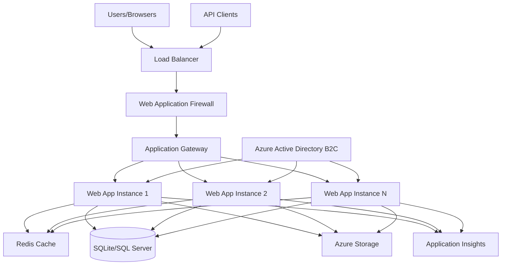

### System Context

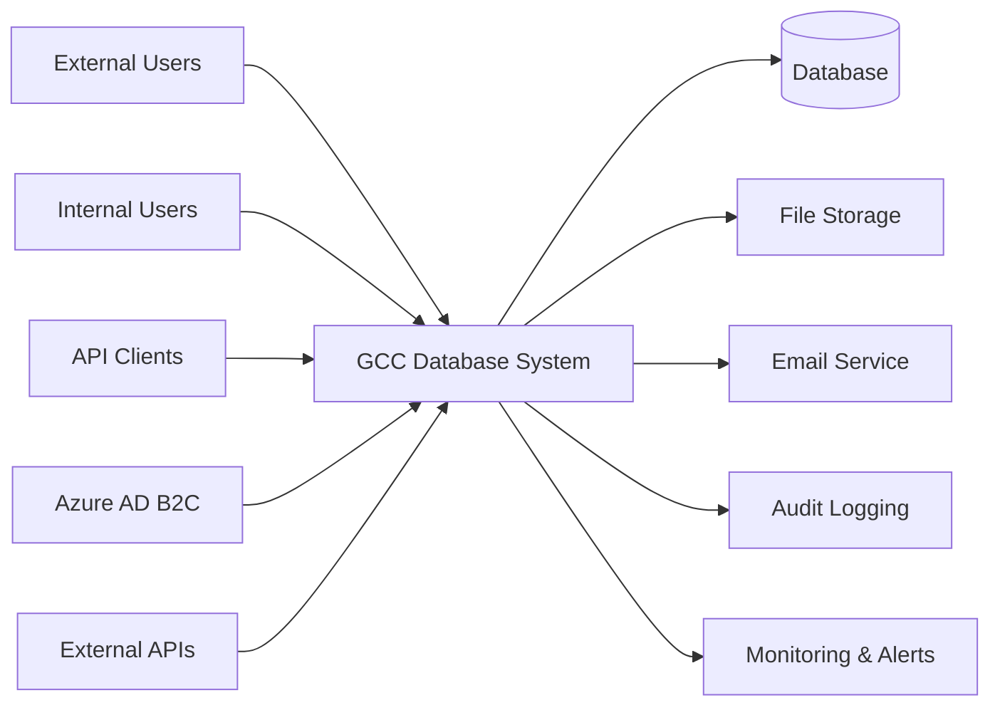

## Technology Stack

### Frontend Technologies
- **Framework**: ASP.NET Core MVC 8.0
- **UI Framework**: Bootstrap 5.x
- **JavaScript**: Vanilla JS with modern ES6+ features
- **CSS**: Custom CSS with modern design system ✅ **UPDATED**
- **Design System**: GreenCircle brand colors and components ✅ **IMPLEMENTED**
- **Icons**: Font Awesome
- **Charts**: Chart.js for data visualization
- **Authentication UI**: Modern, responsive account pages ✅ **REDESIGNED**

### Backend Technologies
- **Runtime**: .NET 8.0
- **Framework**: ASP.NET Core 8.0 MVC + Web API
- **ORM**: Entity Framework Core 8.0
- **Database**: SQLite (development), SQL Server (production)
- **Authentication**: Azure AD B2C + ASP.NET Core Identity
- **Dependency Injection**: Built-in .NET DI Container
- **Logging**: Microsoft.Extensions.Logging + Application Insights
- **Validation**: Data Annotations + Custom Validators ✅ **NEW**
- **File Storage**: Local file system with upload validation ✅ **NEW**
- **API**: REST API with OpenAPI/Swagger documentation ✅ **NEW**

### New Service Layer (v1.1.0) ✅ **IMPLEMENTED**
- **ValidationService**: Comprehensive business rule validation
- **FileUploadService**: Secure file upload with type/size validation  
- **CacheService**: Memory caching for performance optimization
- **FilterService**: Advanced search and filtering capabilities
- **AdminService**: Administrative functions and user management
- **Framework**: ASP.NET Core 8.0
- **ORM**: Entity Framework Core 9.0
- **Database**: SQLite (development) / SQL Server (production)
- **Authentication**: Azure AD B2C with Microsoft Identity Web + Cookie fallback
- **Authorization**: Policy-based with role permissions ✅ **IMPLEMENTED**
- **Data Access**: Repository Pattern with Unit of Work ✅ **IMPLEMENTED**
- **Service Layer**: Complete business logic layer with caching ✅ **IMPLEMENTED**
- **Admin System**: Full administrative dashboard and management ✅ **IMPLEMENTED**
- **Architecture**: Clean Architecture with Domain-Driven Design principles
- **API**: ASP.NET Core Web API (planned)
- **Caching**: In-Memory caching with distributed cache support ✅ **IMPLEMENTED**
- **Password Security**: BCrypt.Net-Next for hashing ✅ **IMPLEMENTED**

### Database Technologies
- **Primary Database**: Microsoft SQL Server 2019+
- **ORM**: Entity Framework Core 8.0
- **Migrations**: EF Core Migrations
- **Connection Pooling**: Built-in .NET connection pooling
- **Caching**: Redis Cache for distributed caching

### Infrastructure Technologies
- **Cloud Platform**: Microsoft Azure
- **Hosting**: Azure App Service
- **Database**: Azure SQL Database
- **Storage**: Azure Storage Account
- **CDN**: Azure CDN
- **Monitoring**: Application Insights
- **Security**: Azure Key Vault

### Development Tools
- **IDE**: Visual Studio 2022
- **Version Control**: Git with Azure DevOps
- **CI/CD**: Azure DevOps Pipelines
- **Testing Frameworks**: 
  - **Unit Testing**: xUnit, Moq, FluentAssertions (GCCWebApp.Tests)
  - **UAT Testing**: xUnit with business scenarios (GCCWebApp.UAT.Tests)
  - **E2E Testing**: Playwright for UI automation, WebApplicationFactory for API testing (GCCWebApp.E2E.Tests)
  - **Test Database**: Entity Framework InMemory provider for isolated testing
- **Documentation**: Markdown with Mermaid diagrams

## Application Layers

### Enhanced Layered Architecture Pattern (v1.1.0) ✅ **UPDATED**

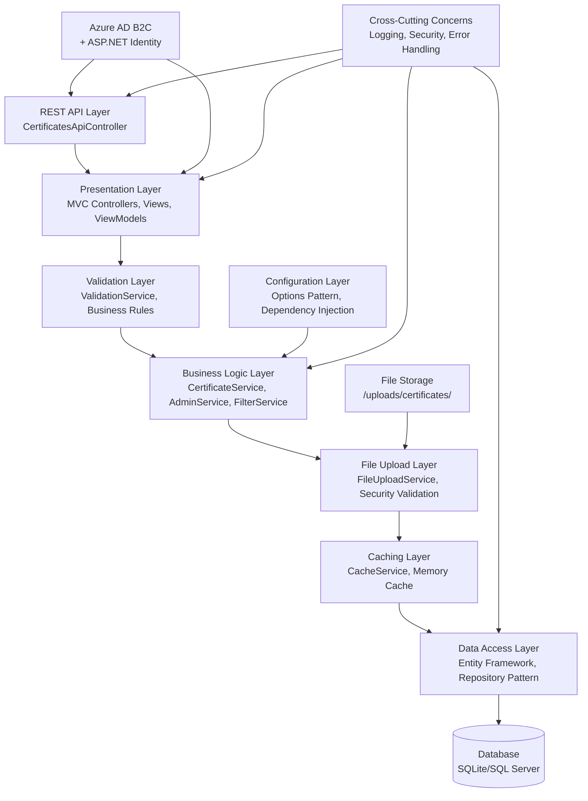

### 1. Presentation Layer
**Responsibility**: User interface and API endpoints

```csharp
namespace GCCWebApp.Controllers
{
    public class CertificateController : Controller
    {
        private readonly ILogger<CertificateController> _logger;
        private readonly IUnitOfWork _unitOfWork;
        private readonly ICertificateRepository _certificateRepository;

        public CertificateController(
            ILogger<CertificateController> logger,
            IUnitOfWork unitOfWork,
            ICertificateRepository certificateRepository)
        {
            _logger = logger;
            _unitOfWork = unitOfWork;
            _certificateRepository = certificateRepository;
        }

        public async Task<IActionResult> Certificates(int page = 1, int pageSize = 10, 
            string searchTerm = "", int? companyId = null, int? productId = null)
        {
            var (certificates, totalCount) = await _certificateRepository
                .GetPagedCertificatesAsync(page, pageSize, searchTerm, companyId, productId);
            
            var model = new CertificateListViewModelSimple
            {
                Certificates = certificates,
                CurrentPage = page,
                PageSize = pageSize,
                TotalCount = totalCount,
                TotalPages = (int)Math.Ceiling(totalCount / (double)pageSize)
            };
            
            return View(model);
        }
    }
}
```

**Components:**
- **MVC Controllers**: Web page rendering and user interactions
- **REST API Controllers**: RESTful endpoints with JSON responses ✅ **NEW**
- **Razor Views**: Server-side rendered UI templates
- **ViewModels**: Data transfer objects between layers
- **Client-side JavaScript**: Interactive UI components and AJAX calls

### 0. REST API Layer ✅ **NEW**
**Responsibility**: RESTful API endpoints for external integration

```csharp
namespace GCCWebApp.Controllers.Api
{
    [ApiController]
    [Route("api/[controller]")]
    [Produces("application/json")]
    public class CertificatesApiController : ControllerBase
    {
        private readonly ICertificateService _certificateService;
        private readonly IValidationService _validationService;
        private readonly IFileUploadService _fileUploadService;

        // GET api/certificates
        public async Task<ActionResult<CertificateListResponse>> GetCertificates(
            [FromQuery] CertificateListRequest request)
        {
            var result = await _certificateService.GetCertificatesAsync(request);
            return result.Success ? Ok(result) : BadRequest(result);
        }

        // POST api/certificates (Admin only)
        [Authorize(Roles = "Admin")]
        public async Task<ActionResult<CertificateDetailsViewModel>> CreateCertificate(
            [FromBody] CreateCertificateRequest request)
        {
            // Validation and business logic
            var validation = await _validationService.ValidateCertificateAsync(certificate);
            if (!validation.IsValid)
                return BadRequest(new ApiErrorResponse { Errors = validation.Errors });
            
            // Create certificate
            var certificateId = await _certificateService.CreateCertificateAsync(certificateViewModel, "Admin");
            return CreatedAtAction(nameof(GetCertificate), new { id = certificateId });
        }
    }
}
```

**Features:**
- **Full CRUD operations**: Create, Read, Update, Delete certificates
- **Role-based authorization**: Admin-only write operations
- **Comprehensive validation**: Business rules and data integrity
- **File upload support**: PDF certificate uploads with security validation
- **Standardized responses**: Consistent JSON API format
- **Error handling**: Detailed error responses with validation messages

### 1.5. Validation Layer ✅ **NEW**
**Responsibility**: Business rule validation and data integrity

```csharp
namespace GCCWebApp.Services
{
    public class ValidationService : IValidationService
    {
        private readonly ApplicationDbContext _context;

        public async Task<ValidationResult> ValidateCertificateAsync(Certificate certificate)
        {
            var result = new ValidationResult();
            
            // Certificate number uniqueness
            await ValidateCertificateNumberUniquenessAsync(certificate, result);
            
            // Date range validation
            if (certificate.ExpirationDate <= certificate.EffectiveDate)
                result.AddError("Expiration date must be after effective date");
            
            // Product code validation (ASIN, UPC, GTIN, EAN)
            ValidateProductCodes(certificate, result);
            
            // Related entities exist
            await ValidateRelatedEntitiesExistAsync(certificate, result);
            
            return result;
        }

        private bool IsValidUpc(string upc) => 
            !string.IsNullOrEmpty(upc) && upc.Length == 12 && upc.All(char.IsDigit);
    }
}
```

**Business Rules:**
- **Certificate Numbers**: Must be unique across system
- **Date Validation**: Effective date before expiration, max 5-year validity
- **Product Codes**: Format validation for ASIN, UPC, GTIN, EAN
- **Entity Relationships**: Validate company, product, certification type exist
- **Status Rules**: Valid status transitions (active/expired/pending/suspended/revoked)

### 1.7. File Upload Layer ✅ **NEW**  
**Responsibility**: Secure file handling and validation

```csharp
namespace GCCWebApp.Services
{
    public class FileUploadService : IFileUploadService
    {
        public async Task<FileUploadResult> UploadCertificateAsync(IFormFile file, string certificateNumber)
        {
            // File type validation
            if (!IsValidFileType(file, FileType.Certificate))
                return new FileUploadResult { Errors = ["Invalid file type. Only PDF allowed."] };
            
            // File size validation (20MB for certificates)
            if (!IsValidFileSize(file, 20971520))
                return new FileUploadResult { Errors = ["File exceeds 20MB limit."] };
            
            // Generate secure filename
            var fileName = $"{certificateNumber}_{DateTime.UtcNow:yyyyMMdd_HHmmss}.pdf";
            var filePath = Path.Combine(_certificatesPath, fileName);
            
            // Save file securely
            using var stream = new FileStream(filePath, FileMode.Create);
            await file.CopyToAsync(stream);
            
            return new FileUploadResult { IsSuccess = true, FilePath = filePath };
        }
    }
}
```

**Security Features:**
- **File Type Validation**: Extension and MIME type checking
- **File Size Limits**: 20MB certificates, 5MB images, 10MB documents  
- **Secure File Names**: Timestamp-based naming to prevent conflicts
- **Path Security**: Prevents directory traversal attacks
- **Storage Organization**: Separate directories for different file types

### 2. Business Logic Layer
**Responsibility**: Business rules and domain logic

```csharp
namespace GCCWebApp.Services
{
    public class CertificateService : ICertificateService
    {
        private readonly IUnitOfWork _unitOfWork;
        private readonly IValidator<Certificate> _validator;
        private readonly ICacheService _cache;
        
        public async Task<Certificate> CreateAsync(CreateCertificateRequest request)
        {
            // Business validation
            var validationResult = await _validator.ValidateAsync(request);
            if (!validationResult.IsValid)
                throw new ValidationException(validationResult.Errors);
            
            // Business logic
            var certificate = _mapper.Map<Certificate>(request);
            certificate.Status = CertificateStatus.Pending;
            certificate.CreatedDate = DateTime.UtcNow;
            
            // Persist
            await _unitOfWork.Certificates.AddAsync(certificate);
            await _unitOfWork.SaveChangesAsync();
            
            // Invalidate cache
            await _cache.RemovePatternAsync("certificates:*");
            
            return certificate;
        }
    }
}
```

**Components:**
- Domain Services for complex business logic
- Domain Models representing business entities
- Specifications for query logic
- Validators for business rules
- DTOs for data transfer

### 3. Data Access Layer
**Responsibility**: Data persistence and retrieval

```csharp
namespace GCCWebApp.Data
{
    public class CertificateRepository : Repository<Certificate>, ICertificateRepository
    {
        public async Task<IEnumerable<Certificate>> GetExpiringCertificatesAsync(int days)
        {
            return await _context.Certificates
                .Include(c => c.Company)
                .Include(c => c.Product)
                .Where(c => c.Status == CertificateStatus.Active)
                .Where(c => c.ExpirationDate <= DateTime.UtcNow.AddDays(days))
                .ToListAsync();
        }
    }
}
```

**Components:**
- DbContext for Entity Framework
- Repositories for data access abstraction
- Unit of Work pattern for transaction management
- Migration scripts for schema changes
- Specifications for complex queries

## Component Architecture

### Core Components

```mermaid
graph TB
    subgraph "Web Layer"
        MVC[MVC Controllers]
        API[API Controllers]
        Views[Razor Views]
        Dashboard[Dashboard Controller]
        Admin[Admin Controller]
    end
    
    subgraph "Service Layer"
        CertService[Certificate Service]
        CompanyService[Company Service]
        ProductService[Product Service]
        UserService[User Service]
        AuthService[Authentication Service]
        SearchService[Advanced Search Service]
        AnalyticsService[Analytics Service]
        AdminService[Admin Service]
    end
    
    subgraph "Domain Layer"
        Certificate[Certificate Entity]
        Company[Company Entity]
        Product[Product Entity]
        User[User Entity]
        CertificationType[Certification Type]
        ProductCategory[Product Category]
        Tag[Tag Entity]
        Role[Role Entity]
        Permission[Permission Entity]
        CustomField[Custom Field]
        SearchFilter[Search Filter]
    end
    
    subgraph "Infrastructure Layer"
        Repository[Generic Repository]
        CertRepository[Certificate Repository]
        UnitOfWork[Unit of Work]
        DbContext[EF DbContext]
        Cache[Distributed Cache]
        Session[Session Management]
        FileStorage[File Storage]
    end
    
    MVC --> CertService
    API --> CertService
    Dashboard --> AnalyticsService
    CertService --> Certificate
    CertService --> CertRepository
    SearchService --> SearchFilter
    AnalyticsService --> CertRepository
    CertRepository --> DbContext
    Repository --> DbContext
```

### Dependency Injection Container

```csharp
public void ConfigureServices(IServiceCollection services)
{
    // ===== DATABASE CONFIGURATION =====
    services.AddDbContext<ApplicationDbContext>(options =>
        options.UseSqlite(builder.Configuration.GetConnectionString("SqliteConnection")));

    // ===== AUTHENTICATION & SESSION =====
    services.AddSession(options =>
    {
        options.IdleTimeout = TimeSpan.FromMinutes(30);
        options.Cookie.HttpOnly = true;
        options.Cookie.IsEssential = true;
        options.Cookie.SecurePolicy = builder.Environment.IsDevelopment()
            ? CookieSecurePolicy.SameAsRequest
            : CookieSecurePolicy.Always;
    });

    // Dual-mode authentication
    var azureAdB2CConfig = builder.Configuration.GetSection("AzureAdB2C").Get<AzureAdB2COptions>();
    var isAzureAdB2CConfigured = azureAdB2CConfig != null && 
        !string.IsNullOrEmpty(azureAdB2CConfig.ClientId) && 
        !azureAdB2CConfig.ClientId.Contains("{");

    if (isAzureAdB2CConfigured)
    {
        services.AddAuthentication(OpenIdConnectDefaults.AuthenticationScheme)
            .AddMicrosoftIdentityWebApp(options =>
            {
                builder.Configuration.Bind("AzureAdB2C", options);
                options.Authority = azureAdB2CConfig!.SignUpSignInAuthority;
            });
    }
    else
    {
        services.AddAuthentication(CookieAuthenticationDefaults.AuthenticationScheme)
            .AddCookie(options =>
            {
                options.LoginPath = "/Account/Login";
                options.LogoutPath = "/Account/Logout";
                options.ExpireTimeSpan = TimeSpan.FromMinutes(30);
            });
    }

    // ===== AUTHORIZATION POLICIES =====
    services.AddAuthorization(options =>
    {
        options.AddPolicy("AdminOnly", policy =>
            policy.RequireAuthenticatedUser()
                  .RequireClaim("Role", "Admin"));

        options.AddPolicy("AnalystOrAdmin", policy =>
            policy.RequireAuthenticatedUser()
                  .RequireAssertion(context =>
                      context.User.HasClaim("Role", "Admin") ||
                      context.User.HasClaim("Role", "Analyst")));

        options.AddPolicy("ExternalAccess", policy =>
            policy.RequireAuthenticatedUser()
                  .RequireAssertion(context =>
                      context.User.HasClaim("Role", "External") ||
                      context.User.HasClaim("Role", "Admin") ||
                      context.User.HasClaim("Role", "Analyst")));
    });
    
    // ===== REPOSITORY PATTERN =====
    services.AddScoped<IUnitOfWork, UnitOfWork>();
    services.AddScoped<ICertificateRepository, CertificateRepository>();
    services.AddScoped(typeof(IRepository<>), typeof(Repository<>));
    
    // ===== CACHING & SERVICES =====
    services.AddDistributedMemoryCache();
    services.AddMemoryCache();
    services.AddHttpClient();
    
    // ===== MVC CONFIGURATION =====
    services.AddControllersWithViews()
        .AddJsonOptions(options =>
        {
            options.JsonSerializerOptions.PropertyNamingPolicy =
                System.Text.Json.JsonNamingPolicy.CamelCase;
            options.JsonSerializerOptions.WriteIndented = true;
        });
}
```

### Request Processing Flow

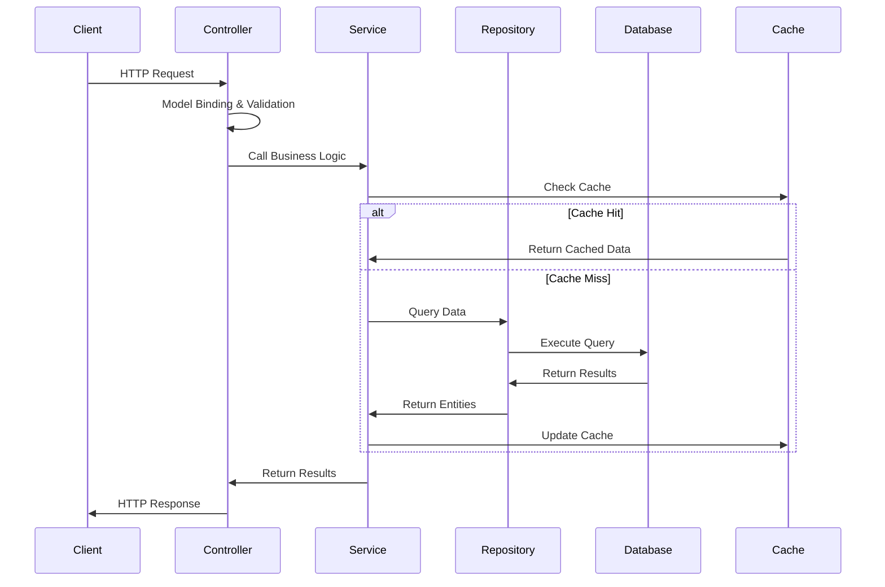

## Data Architecture

### Database Schema Overview

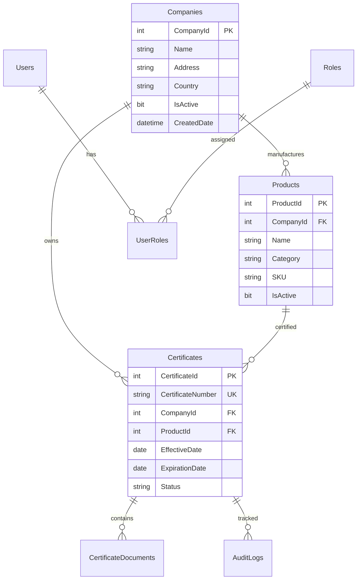

### Data Access Patterns

#### Repository Pattern
```csharp
public interface IRepository<T> where T : class
{
    Task<T> GetByIdAsync(int id);
    Task<IEnumerable<T>> GetAllAsync();
    Task<IEnumerable<T>> FindAsync(Expression<Func<T, bool>> predicate);
    Task<T> AddAsync(T entity);
    Task UpdateAsync(T entity);
    Task DeleteAsync(T entity);
}

public class Repository<T> : IRepository<T> where T : class
{
    protected readonly AppDbContext _context;
    protected readonly DbSet<T> _dbSet;

    public Repository(AppDbContext context)
    {
        _context = context;
        _dbSet = context.Set<T>();
    }
    
    public virtual async Task<T> GetByIdAsync(int id)
    {
        return await _dbSet.FindAsync(id);
    }
    
    public virtual async Task<IEnumerable<T>> GetAllAsync()
    {
        return await _dbSet.ToListAsync();
    }
}
```

#### Unit of Work Pattern
```csharp
public interface IUnitOfWork : IDisposable
{
    ICertificateRepository Certificates { get; }
    ICompanyRepository Companies { get; }
    IProductRepository Products { get; }
    Task<int> SaveChangesAsync();
    Task BeginTransactionAsync();
    Task CommitTransactionAsync();
    Task RollbackTransactionAsync();
}

public class UnitOfWork : IUnitOfWork
{
    private readonly AppDbContext _context;
    private IDbContextTransaction _transaction;
    
    public ICertificateRepository Certificates { get; private set; }
    public ICompanyRepository Companies { get; private set; }
    public IProductRepository Products { get; private set; }
    
    public UnitOfWork(AppDbContext context)
    {
        _context = context;
        Certificates = new CertificateRepository(_context);
        Companies = new CompanyRepository(_context);
        Products = new ProductRepository(_context);
    }
}
```

### Caching Strategy

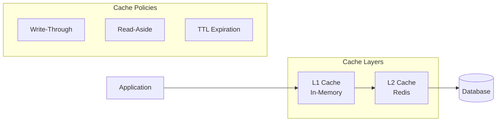

## Security Architecture

### Authentication Flow (Azure AD B2C)

```mermaid
sequenceDiagram
    participant User
    participant Browser
    participant App
    participant AzureADB2C
    participant Session
    
    User->>Browser: Access Protected Resource
    Browser->>App: HTTP Request
    App->>Browser: Redirect to Azure AD B2C
    Browser->>AzureADB2C: Authentication Request
    AzureADB2C->>User: Login Page
    User->>AzureADB2C: Credentials
    AzureADB2C->>Browser: Auth Code
    Browser->>App: Auth Code to /signin-oidc
    App->>AzureADB2C: Token Request
    AzureADB2C->>App: ID Token & Access Token
    App->>App: Extract Claims & Determine Role
    App->>Session: Store User Info & Role
    App->>Browser: Redirect to Dashboard
```

### Dual Authentication System

The application supports both Azure AD B2C and fallback cookie authentication:

```csharp
// Azure AD B2C Configuration (Production)
if (isAzureAdB2CConfigured)
{
    builder.Services.AddAuthentication(OpenIdConnectDefaults.AuthenticationScheme)
        .AddMicrosoftIdentityWebApp(options =>
        {
            builder.Configuration.Bind("AzureAdB2C", options);
            options.Authority = azureAdB2CConfig!.SignUpSignInAuthority;
            options.SignedOutCallbackPath = azureAdB2CConfig.SignedOutCallbackPath;
        });
}
else
{
    // Fallback Cookie Authentication (Development)
    builder.Services.AddAuthentication(CookieAuthenticationDefaults.AuthenticationScheme)
        .AddCookie(options =>
        {
            options.LoginPath = "/Account/Login";
            options.LogoutPath = "/Account/Logout";
            options.AccessDeniedPath = "/Account/AccessDenied";
            options.ExpireTimeSpan = TimeSpan.FromMinutes(30);
        });
}
```

### Role-Based Authorization Policies

```csharp
// Authorization Policies in Program.cs
builder.Services.AddAuthorization(options =>
{
    options.AddPolicy("AdminOnly", policy =>
        policy.RequireAuthenticatedUser()
              .RequireClaim("Role", "Admin"));

    options.AddPolicy("AnalystOrAdmin", policy =>
        policy.RequireAuthenticatedUser()
              .RequireAssertion(context =>
                  context.User.HasClaim("Role", "Admin") ||
                  context.User.HasClaim("Role", "Analyst")));

    options.AddPolicy("ExternalAccess", policy =>
        policy.RequireAuthenticatedUser()
              .RequireAssertion(context =>
                  context.User.HasClaim("Role", "External") ||
                  context.User.HasClaim("Role", "Admin") ||
                  context.User.HasClaim("Role", "Analyst")));
});

// Usage in Controllers
[Authorize(Policy = "AnalystOrAdmin")]
public class CertificateController : Controller { }
```

### Dynamic Role Assignment

```csharp
// Role determination based on email domain
private string DetermineUserRole(string email)
{
    if (email.EndsWith("@greencirclecertified.com", StringComparison.OrdinalIgnoreCase))
        return "Admin";
    else if (email.EndsWith("@contractor.com", StringComparison.OrdinalIgnoreCase) ||
             email.EndsWith("@analyst.com", StringComparison.OrdinalIgnoreCase))
        return "Analyst";
    else if (email.Contains("partner", StringComparison.OrdinalIgnoreCase) ||
             email.EndsWith("@amazon.com", StringComparison.OrdinalIgnoreCase))
        return "External";
    else
        return "Public";
}
```

### Session Management

```csharp
// Session configuration with security headers
builder.Services.AddSession(options =>
{
    options.IdleTimeout = TimeSpan.FromMinutes(30);
    options.Cookie.HttpOnly = true;
    options.Cookie.IsEssential = true;
    options.Cookie.SecurePolicy = builder.Environment.IsDevelopment()
        ? CookieSecurePolicy.SameAsRequest
        : CookieSecurePolicy.Always;
    options.Cookie.SameSite = SameSiteMode.Lax;
    options.Cookie.Name = "GCC.Session";
});
```

### Data Protection

```csharp
public class DataProtectionService
{
    private readonly IDataProtector _protector;
    
    public string Protect(string plainText)
    {
        return _protector.Protect(plainText);
    }
    
    public string Unprotect(string protectedText)
    {
        return _protector.Unprotect(protectedText);
    }
}
```

## Integration Architecture

### External System Integration

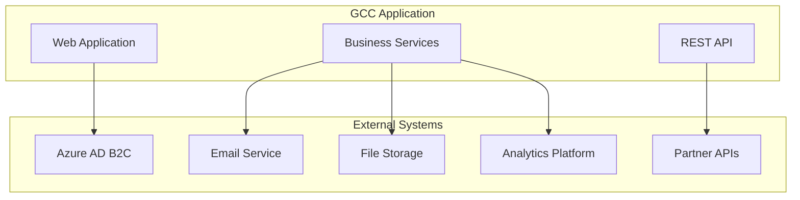

### API Integration Pattern

```csharp
public class ExternalApiService
{
    private readonly HttpClient _httpClient;
    private readonly ILogger<ExternalApiService> _logger;
    
    public async Task<T> GetAsync<T>(string endpoint)
    {
        var response = await _httpClient.GetAsync(endpoint);
        response.EnsureSuccessStatusCode();
        
        var content = await response.Content.ReadAsStringAsync();
        return JsonSerializer.Deserialize<T>(content);
    }
    
    public async Task<TResponse> PostAsync<TRequest, TResponse>(
        string endpoint, TRequest request)
    {
        var json = JsonSerializer.Serialize(request);
        var content = new StringContent(json, Encoding.UTF8, "application/json");
        
        var response = await _httpClient.PostAsync(endpoint, content);
        response.EnsureSuccessStatusCode();
        
        var responseContent = await response.Content.ReadAsStringAsync();
        return JsonSerializer.Deserialize<TResponse>(responseContent);
    }
}
```

## Deployment Architecture

### Azure Deployment Model

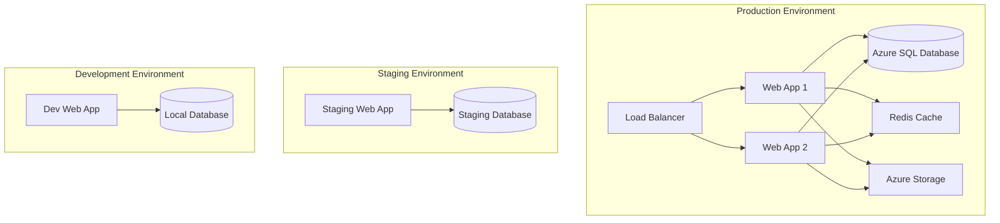

### Container Deployment

```dockerfile
FROM mcr.microsoft.com/dotnet/aspnet:8.0 AS base
WORKDIR /app
EXPOSE 80
EXPOSE 443

FROM mcr.microsoft.com/dotnet/sdk:8.0 AS build
WORKDIR /src
COPY ["GCCWebApp.csproj", "."]
RUN dotnet restore "GCCWebApp.csproj"
COPY . .
WORKDIR "/src"
RUN dotnet build "GCCWebApp.csproj" -c Release -o /app/build

FROM build AS publish
RUN dotnet publish "GCCWebApp.csproj" -c Release -o /app/publish

FROM base AS final
WORKDIR /app
COPY --from=publish /app/publish .
ENTRYPOINT ["dotnet", "GCCWebApp.dll"]
```

### CI/CD Pipeline

```yaml
stages:
- stage: Build
  jobs:
  - job: BuildJob
    steps:
    - task: DotNetCoreCLI@2
      displayName: 'Restore'
      inputs:
        command: 'restore'
    - task: DotNetCoreCLI@2
      displayName: 'Build'
      inputs:
        command: 'build'
        configuration: 'Release'
    - task: DotNetCoreCLI@2
      displayName: 'Test'
      inputs:
        command: 'test'
        projects: '**/*Tests.csproj'

- stage: Deploy
  dependsOn: Build
  jobs:
  - deployment: DeployProduction
    environment: 'production'
    strategy:
      runOnce:
        deploy:
          steps:
          - task: AzureWebApp@1
            inputs:
              azureSubscription: 'Azure Subscription'
              appType: 'webApp'
              appName: 'gcc-database-app'
```

## Scalability and Performance

### Horizontal Scaling Strategy

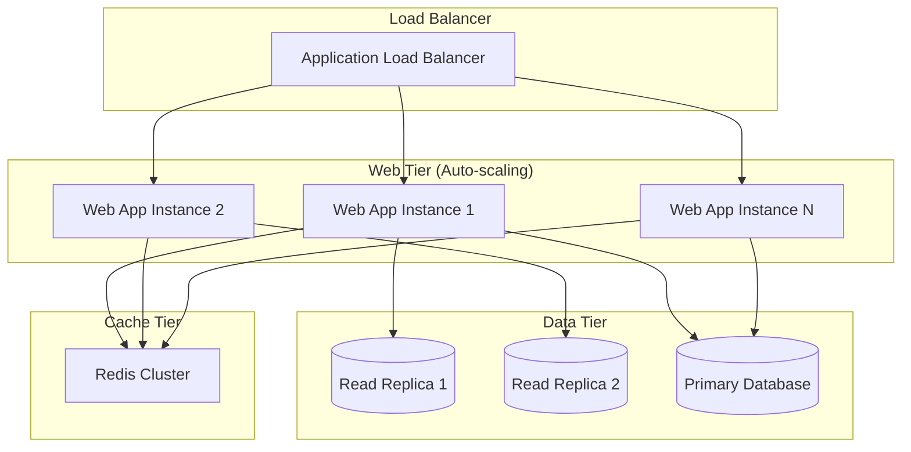

### Performance Optimization

```csharp
// Async programming throughout
public async Task<IEnumerable<Certificate>> GetCertificatesAsync()
{
    return await _context.Certificates
        .AsNoTracking() // Read-only queries
        .Include(c => c.Company)
        .Where(c => c.IsActive)
        .ToListAsync();
}

// Response compression
services.AddResponseCompression(options =>
{
    options.Providers.Add<BrotliCompressionProvider>();
    options.Providers.Add<GzipCompressionProvider>();
});

// Output caching
[ResponseCache(Duration = 300)] // 5 minutes
public async Task<IActionResult> Index()
{
    var certificates = await _certificateService.GetActiveAsync();
    return View(certificates);
}
```

### Database Migration Strategy

The application uses Entity Framework Core Code First approach with migrations:

```csharp
// Automatic migration and seed data initialization in Program.cs
using (var scope = app.Services.CreateScope())
{
    try
    {
        var context = scope.ServiceProvider.GetRequiredService<ApplicationDbContext>();
        await context.Database.EnsureCreatedAsync(); // For development
        await SeedData.InitializeAsync(context);
        logger.LogInformation("Database seeded successfully");
    }
    catch (Exception ex)
    {
        logger.LogError(ex, "Error occurred seeding the database");
    }
}
```

### Seed Data Implementation

```csharp
// SeedData.cs - Comprehensive test data creation
public static async Task InitializeAsync(ApplicationDbContext context)
{
    // Create ProductCategories
    if (!context.ProductCategories.Any())
    {
        var categories = new[]
        {
            new ProductCategory { Name = "Flooring", Description = "Floor covering materials" },
            new ProductCategory { Name = "Adhesives", Description = "Bonding and sealing products" },
            new ProductCategory { Name = "Insulation", Description = "Thermal and acoustic insulation" }
        };
        context.ProductCategories.AddRange(categories);
        await context.SaveChangesAsync();
    }

    // Create Companies with realistic test data
    if (!context.Companies.Any())
    {
        var companies = new[]
        {
            new Company
            {
                Name = "EcoFloor Solutions Inc.",
                Address = "123 Green Street, Portland, OR 97201",
                Country = "United States",
                Industry = "Sustainable Flooring",
                IsActive = true
            }
        };
        context.Companies.AddRange(companies);
        await context.SaveChangesAsync();
    }

    // Create Certificates with proper relationships
    if (!context.Certificates.Any())
    {
        var companies = context.Companies.ToList();
        var products = context.Products.Include(p => p.Company).ToList();
        var certTypes = context.CertificationTypes.ToList();

        var certificates = new List<Certificate>();
        // Generate test certificates...
    }
}
```

### Database Performance

```sql
-- Optimized indexes for common queries
CREATE INDEX IX_Certificates_Status_ExpirationDate 
ON Certificates (Status, ExpirationDate) 
INCLUDE (CertificateNumber, CompanyId);

CREATE INDEX IX_Certificates_CompanyId_Status
ON Certificates (CompanyId, Status)
INCLUDE (Number, EffectiveDate, ExpirationDate);

-- Full-text search indexes
CREATE FULLTEXT INDEX ON Companies(Name, Address);
CREATE FULLTEXT INDEX ON Products(Name, Description);
```

## Monitoring and Observability

### Observability Stack

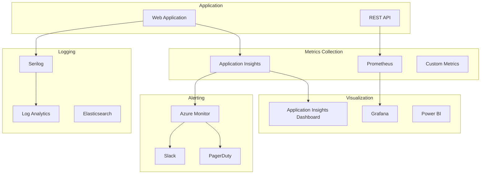

### Health Checks

```csharp
services.AddHealthChecks()
    .AddDbContextCheck<AppDbContext>("database")
    .AddRedis(Configuration.GetConnectionString("Redis"), "redis")
    .AddUrlGroup(new Uri("https://api.partner.com/health"), "partner-api")
    .AddCheck<CustomHealthCheck>("custom-check");

app.MapHealthChecks("/health", new HealthCheckOptions
{
    ResponseWriter = UIResponseWriter.WriteHealthCheckUIResponse
});
```

## Architecture Decisions

### ADR-001: Technology Stack Selection

**Status**: Accepted  
**Date**: August 2024

**Context**: Need to select primary technology stack for GCC Database application supporting certificate management with complex entity relationships.

**Decision**: Use ASP.NET Core 8.0 with Entity Framework Core 8.0, SQLite for development, SQL Server for production.

**Consequences**:
- Positive: Strong typing, excellent tooling, mature ORM with full relationship support
- Positive: SQLite enables easy local development without infrastructure dependencies
- Negative: Microsoft technology stack dependency
- Risk: Migration complexity from SQLite to SQL Server in production

### ADR-002: Dual Authentication Strategy

**Status**: Accepted  
**Date**: August 2024

**Context**: Need authentication system that works for development and production, supporting both internal and external users.

**Decision**: Implement dual-mode authentication: Azure AD B2C for production with cookie authentication fallback for development.

**Consequences**:
- Positive: Enterprise-grade security in production, simple development workflow
- Positive: Automatic detection and switching between authentication modes
- Positive: Role-based access control with email domain mapping
- Negative: Complexity in managing two authentication systems
- Risk: Role determination logic must be kept in sync between modes

### ADR-003: Repository Pattern with Unit of Work

**Status**: Accepted  
**Date**: August 2024

**Context**: Need data access strategy supporting complex queries, relationships, and transaction management for certificate data.

**Decision**: Implement generic Repository pattern with Unit of Work and specialized repositories for complex operations.

**Consequences**:
- Positive: Clean separation of concerns, testability, transaction management
- Positive: Generic repository reduces code duplication
- Positive: Specialized repositories (e.g., ICertificateRepository) for complex queries
- Negative: Additional abstraction layers over Entity Framework
- Risk: Potential performance overhead, may discourage proper EF usage

### ADR-004: Entity Relationship Design

**Status**: Accepted  
**Date**: August 2024

**Context**: Complex domain with certificates, companies, products, and multiple categorization systems requiring flexible relationships.

**Decision**: Implement comprehensive entity model with 13+ entities supporting flexible categorization and custom fields.

**Consequences**:
- Positive: Supports complex business requirements and future extensibility
- Positive: Proper normalization with navigation properties
- Positive: Custom fields support for flexibility
- Negative: Database complexity increases learning curve
- Risk: Query performance may degrade with complex joins

### ADR-005: Development vs Production Configuration

**Status**: Accepted  
**Date**: August 2024

**Context**: Need seamless development experience while supporting production Azure deployment.

**Decision**: Use configuration-driven feature detection with automatic fallback to development modes.

**Consequences**:
- Positive: Zero-configuration development setup
- Positive: Automatic Azure AD B2C detection prevents misconfiguration
- Positive: Comprehensive seed data for immediate testing
- Negative: Requires careful configuration management
- Risk: Configuration mismatches between environments

## Future Considerations

### Planned Enhancements

#### Microservices Migration
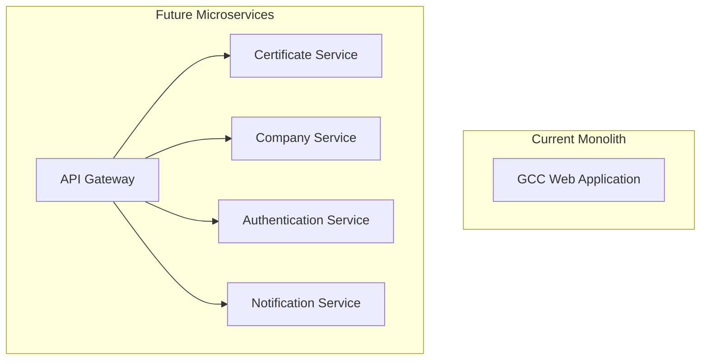

#### Event-Driven Architecture
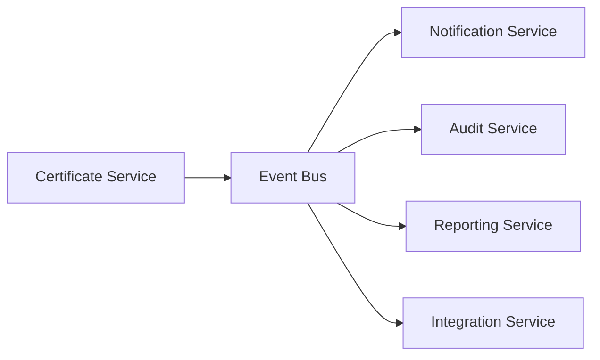

#### Advanced Analytics
- Machine learning for certificate expiration predictions
- Business intelligence dashboards
- Real-time analytics and reporting
- Predictive maintenance alerts

#### Mobile Application
- Native mobile app for field inspections
- Offline capability for remote areas
- QR code scanning for certificate verification
- Push notifications for important updates

### Technology Evolution

#### .NET Upgrades
- Migration to .NET 9.0 when available
- Adoption of new C# language features
- Performance improvements from runtime updates
- Enhanced cloud-native capabilities

#### Database Improvements
- Consider Azure Cosmos DB for global distribution
- Implement read replicas for better performance
- Advanced indexing strategies
- Automated performance tuning

#### Security Enhancements
- Zero Trust architecture implementation
- Advanced threat protection
- Automated security scanning
- Compliance automation

## Conclusion

The GCC Database Application has been successfully implemented using a modern, layered architecture that supports comprehensive certificate management operations. The system demonstrates solid engineering principles while maintaining flexibility for future enhancements.

### Key Implemented Features

**Data Layer**:
- Complete Entity Framework Core implementation with 13+ entities
- Repository pattern with Unit of Work for clean data access
- Comprehensive entity relationships supporting complex certificate data
- Automatic database initialization with seed data

**Authentication & Security**:
- Dual-mode authentication (Azure AD B2C + cookie fallback)
- Automatic configuration detection
- Role-based authorization with dynamic role assignment
- Comprehensive security headers and session management
- Modern authentication UI with enhanced user experience ✅ **NEW**

**User Interface & Experience**:
- Complete redesign of all Account authentication pages ✅ **NEW**
- Modern, responsive design with GreenCircle branding ✅ **NEW**
- Interactive elements with improved accessibility ✅ **NEW**
- Mobile-first responsive design approach ✅ **NEW**
- Enhanced password security with strength validation ✅ **NEW**
- Two-factor authentication with intuitive code input ✅ **NEW**

**Business Logic**:
- Full CRUD operations for certificates, companies, and products
- Pagination and filtering capabilities
- Robust error handling and logging
- Clean separation of concerns across all layers

### Current System Strengths

- **Developer Experience**: Zero-configuration setup for development with automatic fallbacks
- **Production Ready**: Full Azure AD B2C integration with enterprise security
- **Data Integrity**: Comprehensive entity model with proper relationships and validations
- **Maintainability**: Clear layered architecture with dependency injection throughout
- **Testability**: Repository abstraction and comprehensive test data available
- **Security**: Multi-layered security approach with both authentication modes

### Proven Architecture Patterns

The implementation successfully demonstrates:
- **Clean Architecture**: Clear separation between domain, application, and infrastructure concerns
- **Repository Pattern**: Abstracted data access with specialized repositories for complex operations
- **Unit of Work**: Proper transaction management across multiple operations
- **Configuration Pattern**: Flexible configuration supporting multiple deployment scenarios
- **Authentication Abstraction**: Single codebase supporting multiple authentication providers

### Migration and Deployment Strategy

- **Database**: Entity Framework migrations with automatic initialization
- **Configuration**: Environment-specific configuration with automatic feature detection
- **Authentication**: Seamless transition between development and production authentication modes
- **Seed Data**: Comprehensive test data for immediate system validation

The architecture successfully balances immediate functional requirements with long-term maintainability and scalability needs, providing a robust foundation for the GCC certification management system.

## Document Information

- **Version**: 2.0.0
- **Last Updated**: August 2024
- **Authors**: Development Team
- **Status**: Implementation Complete
- **Next Review**: December 2024