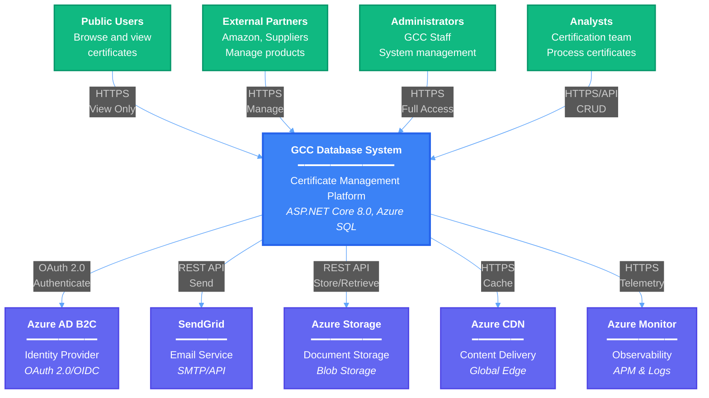
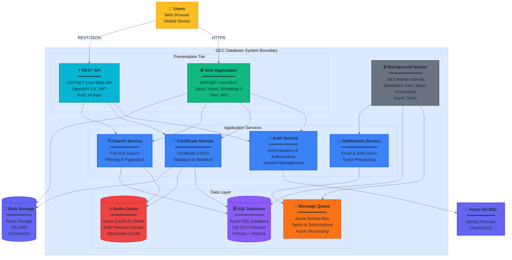
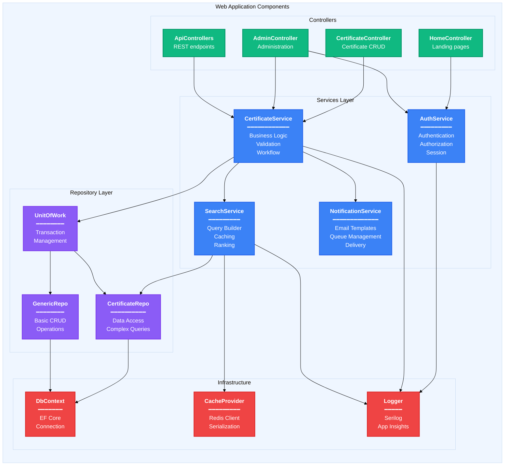
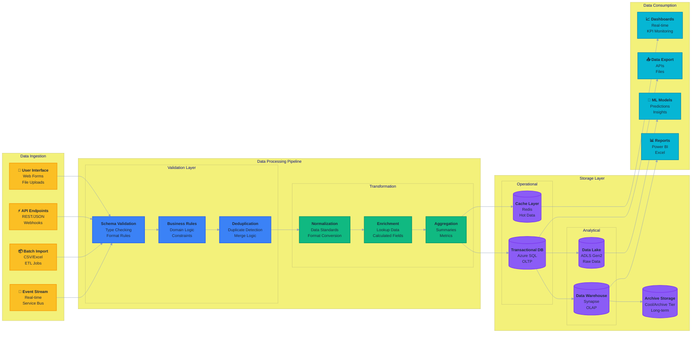
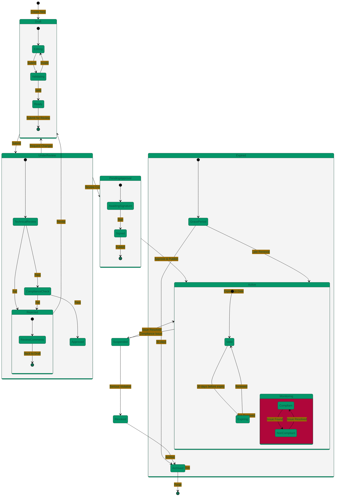
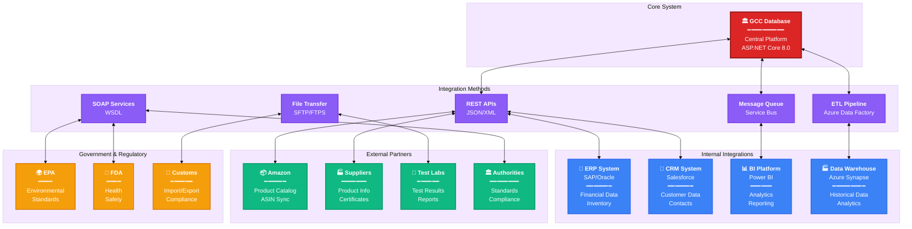
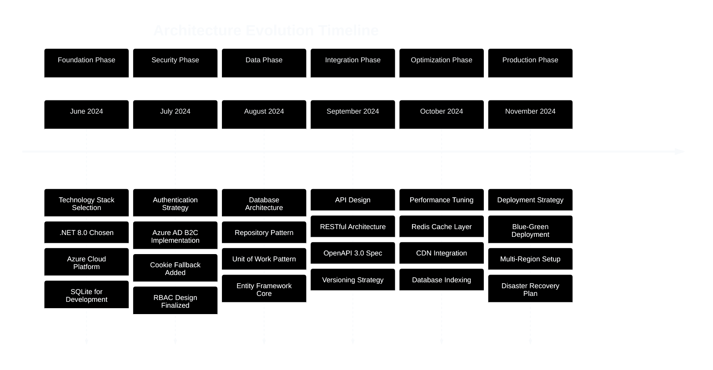

# 🎨 Professional Architecture Diagrams
## GCC Database Application - Enterprise Visualization Suite

**Version:** 1.0.0  
**Date:** August 21, 2025  
**Purpose:** High-quality technical diagrams for presentations and documentation

---

## 📊 System Context Diagram (C4 Level 1)



---

## 🏗️ Container Diagram (C4 Level 2)



---

## 🔄 Component Architecture (C4 Level 3)



---

## 🌐 Deployment Architecture

```mermaid
%%{init: {'theme':'base', 'themeVariables': { 'primaryColor':'#1e293b', 'primaryTextColor':'#0f172a', 'edgeLabelBackground':'#f1f5f9'}}}%%

graph TB
    subgraph "Internet"
        USERS[<b>🌍 Global Users</b><br/>━━━━━━━━━<br/>Worldwide Access<br/>Multiple Devices]:::users
    end
    
    subgraph "Azure Global Services"
        DNS[<b>Azure DNS</b><br/>━━━━━━━<br/>Domain Resolution<br/><i>Global</i>]:::global
        TM[<b>Traffic Manager</b><br/>━━━━━━━━━━<br/>Geographic Routing<br/><i>Priority/Performance</i>]:::global
        FD[<b>Azure Front Door</b><br/>━━━━━━━━━━━<br/>Global Load Balancer<br/>WAF + CDN<br/><i>Premium Tier</i>]:::global
    end
    
    subgraph "Primary Region - East US"
        subgraph "Network Security"
            NSG1[<b>NSG</b><br/>Security Rules]:::security
            WAF1[<b>WAF v2</b><br/>OWASP Protection]:::security
        end
        
        subgraph "Compute Tier"
            ASP1[<b>App Service Plan</b><br/>━━━━━━━━━━━<br/>P3v3 Premium<br/>Auto-scale 3-10]:::compute
            AS1[<b>Instance 1</b><br/>8 vCPU<br/>32GB RAM]:::instance
            AS2[<b>Instance 2</b><br/>8 vCPU<br/>32GB RAM]:::instance
            AS3[<b>Instance N</b><br/>8 vCPU<br/>32GB RAM]:::instance
        end
        
        subgraph "Data Tier"
            SQL1[(<b>Azure SQL</b><br/>━━━━━━━<br/>Premium P4<br/>125 DTU<br/>500GB]:::database
            REDIS1[(<b>Redis Cache</b><br/>━━━━━━━━<br/>Premium P1<br/>6GB Cluster]:::cache
            BLOB1[(<b>Blob Storage</b><br/>━━━━━━━━<br/>RA-GRS<br/>Hot Tier]:::storage
        end
    end
    
    subgraph "DR Region - West US"
        subgraph "Standby Resources"
            ASP2[<b>App Service Plan</b><br/>━━━━━━━━━━━<br/>P1v3 Standard<br/>Scale on Activation]:::compute_dr
            SQL2[(<b>SQL Replica</b><br/>━━━━━━━<br/>Geo-Replica<br/>Read-Only]:::database_dr
            REDIS2[(<b>Redis Replica</b><br/>━━━━━━━━<br/>Geo-Replica]:::cache_dr
            BLOB2[(<b>Blob Replica</b><br/>━━━━━━━━<br/>GRS Copy]:::storage_dr
        end
    end
    
    subgraph "Monitoring & Management"
        AI[<b>Application Insights</b><br/>━━━━━━━━━━━━<br/>APM + Logging<br/>Analytics]:::monitor
        AZ_MON[<b>Azure Monitor</b><br/>━━━━━━━━━━<br/>Metrics + Alerts<br/>Dashboards]:::monitor
        KV[<b>Key Vault</b><br/>━━━━━━━<br/>Secrets<br/>Certificates]:::security
    end
    
    %% Connections
    USERS --> DNS
    DNS --> TM
    TM --> FD
    FD --> WAF1
    WAF1 --> NSG1
    NSG1 --> ASP1
    
    ASP1 --> AS1
    ASP1 --> AS2
    ASP1 --> AS3
    
    AS1 --> SQL1
    AS2 --> SQL1
    AS3 --> SQL1
    
    AS1 --> REDIS1
    AS2 --> REDIS1
    AS3 --> REDIS1
    
    AS1 --> BLOB1
    AS2 --> BLOB1
    AS3 --> BLOB1
    
    SQL1 -.->|Async Replication| SQL2
    REDIS1 -.->|Geo-Replication| REDIS2
    BLOB1 -.->|GRS Sync| BLOB2
    
    FD -.->|Failover| ASP2
    
    AS1 --> AI
    AS2 --> AI
    AS3 --> AI
    AI --> AZ_MON
    
    AS1 --> KV
    AS2 --> KV
    AS3 --> KV
    
    %% Styling
    classDef users fill:#fbbf24,stroke:#f59e0b,stroke-width:3px
    classDef global fill:#06b6d4,stroke:#0891b2,stroke-width:2px
    classDef security fill:#ef4444,stroke:#dc2626,stroke-width:2px
    classDef compute fill:#10b981,stroke:#059669,stroke-width:2px
    classDef instance fill:#34d399,stroke:#10b981,stroke-width:1px
    classDef database fill:#8b5cf6,stroke:#7c3aed,stroke-width:2px
    classDef cache fill:#f97316,stroke:#ea580c,stroke-width:2px
    classDef storage fill:#3b82f6,stroke:#2563eb,stroke-width:2px
    classDef compute_dr fill:#86efac,stroke:#4ade80,stroke-width:1px,stroke-dasharray: 5 5
    classDef database_dr fill:#c4b5fd,stroke:#a78bfa,stroke-width:1px,stroke-dasharray: 5 5
    classDef cache_dr fill:#fdba74,stroke:#fb923c,stroke-width:1px,stroke-dasharray: 5 5
    classDef storage_dr fill:#93c5fd,stroke:#60a5fa,stroke-width:1px,stroke-dasharray: 5 5
    classDef monitor fill:#6366f1,stroke:#4f46e5,stroke-width:2px
```

---

## 🔐 Security Architecture

```mermaid
%%{init: {'theme':'dark', 'themeVariables': { 'primaryColor':'#dc2626', 'primaryTextColor':'#fff', 'primaryBorderColor':'#ef4444', 'lineColor':'#fca5a5', 'secondaryColor':'#7f1d1d', 'background':'#450a0a', 'mainBkg':'#991b1b', 'fontSize':'16px'}}}%%

graph TB
    subgraph "Security Perimeter"
        subgraph "Layer 1: Edge Security"
            DDOS[<b>🛡️ DDoS Protection</b><br/>Standard Tier<br/>Auto-mitigation]:::edge
            CDN_SEC[<b>🌐 CDN Security</b><br/>Geo-filtering<br/>Rate limiting]:::edge
            WAF[<b>🔥 Web Application Firewall</b><br/>OWASP Core Rule Set<br/>Custom Rules<br/>Bot Protection]:::edge
        end
        
        subgraph "Layer 2: Network Security"
            NSG[<b>🔒 Network Security Groups</b><br/>Inbound/Outbound Rules<br/>Service Tags]:::network
            VNET[<b>🌐 Virtual Network</b><br/>Subnet Isolation<br/>Private Endpoints]:::network
            FIREWALL[<b>🛡️ Azure Firewall</b><br/>Application Rules<br/>Network Rules]:::network
        end
        
        subgraph "Layer 3: Identity & Access"
            AAD[<b>👤 Azure AD B2C</b><br/>━━━━━━━━━━<br/>User Authentication<br/>MFA + Conditional Access]:::identity
            RBAC[<b>🔑 RBAC</b><br/>━━━━━<br/>Role-Based Access<br/>Least Privilege]:::identity
            MSI[<b>🆔 Managed Identity</b><br/>━━━━━━━━━━━<br/>Service Authentication<br/>No Credentials]:::identity
        end
        
        subgraph "Layer 4: Application Security"
            AUTHZ[<b>✓ Authorization</b><br/>Policy-Based<br/>Claims-Based]:::app
            VALID[<b>✓ Input Validation</b><br/>Sanitization<br/>Type Checking]:::app
            CSRF[<b>✓ CSRF Protection</b><br/>Anti-forgery Tokens]:::app
            XSS[<b>✓ XSS Prevention</b><br/>Content Security Policy<br/>Output Encoding]:::app
        end
        
        subgraph "Layer 5: Data Security"
            TLS[<b>🔐 TLS 1.3</b><br/>In Transit<br/>Perfect Forward Secrecy]:::data
            TDE[<b>🔐 TDE</b><br/>At Rest<br/>AES-256]:::data
            KV[<b>🔑 Key Vault</b><br/>HSM-backed<br/>Secret Rotation]:::data
            MASK[<b>👁️ Data Masking</b><br/>PII Protection<br/>Dynamic Masking]:::data
        end
        
        subgraph "Layer 6: Monitoring & Response"
            SIEM[<b>📊 Azure Sentinel</b><br/>SIEM + SOAR<br/>Threat Intelligence]:::monitor
            SC[<b>🔍 Security Center</b><br/>Vulnerability Assessment<br/>Compliance]:::monitor
            AUDIT[<b>📝 Audit Logs</b><br/>Activity Tracking<br/>Immutable Storage]:::monitor
        end
    end
    
    %% Flow
    DDOS --> CDN_SEC
    CDN_SEC --> WAF
    WAF --> NSG
    NSG --> VNET
    VNET --> FIREWALL
    FIREWALL --> AAD
    AAD --> RBAC
    RBAC --> MSI
    MSI --> AUTHZ
    AUTHZ --> VALID
    VALID --> CSRF
    CSRF --> XSS
    XSS --> TLS
    TLS --> TDE
    TDE --> KV
    KV --> MASK
    MASK --> SIEM
    SIEM --> SC
    SC --> AUDIT
    
    %% Styling
    classDef edge fill:#dc2626,stroke:#991b1b,stroke-width:2px,color:#fff
    classDef network fill:#ea580c,stroke:#c2410c,stroke-width:2px,color:#fff
    classDef identity fill:#d97706,stroke:#b45309,stroke-width:2px,color:#fff
    classDef app fill:#ca8a04,stroke:#a16207,stroke-width:2px,color:#fff
    classDef data fill:#84cc16,stroke:#65a30d,stroke-width:2px,color:#000
    classDef monitor fill:#22c55e,stroke:#16a34a,stroke-width:2px,color:#000
```



---

## 📊 Data Flow Architecture



---

## 🔄 Certificate Lifecycle State Machine



---

## 🚀 CI/CD Pipeline Flow

```mermaid
%%{init: {'theme':'base', 'themeVariables': { 'primaryColor':'#0891b2', 'primaryTextColor':'#0c4a6e', 'tertiaryColor':'#e0f2fe'}}}%%

flowchart TB
    subgraph "Source Control"
        DEV[<b>👨‍💻 Developer</b><br/>Local Development]:::dev
        GIT[<b>📦 Git Repository</b><br/>GitHub Enterprise<br/>Feature Branches]:::git
        PR[<b>🔍 Pull Request</b><br/>Code Review<br/>Approval Gates]:::git
    end
    
    subgraph "CI Pipeline - Build Stage"
        TRIGGER[<b>🎯 Trigger</b><br/>Push/PR/Schedule<br/>Branch Filters]:::ci
        BUILD[<b>🔨 Build</b><br/>dotnet build<br/>Compile Check]:::ci
        TEST[<b>🧪 Unit Tests</b><br/>xUnit/NUnit<br/>80% Coverage]:::ci
        ANALYSIS[<b>📊 Code Analysis</b><br/>SonarQube<br/>Security Scan]:::ci
        PACKAGE[<b>📦 Package</b><br/>Docker Image<br/>NuGet Packages]:::ci
    end
    
    subgraph "Quality Gates"
        Q1{<b>Build Success?</b>}:::gate
        Q2{<b>Tests Pass?</b>}:::gate
        Q3{<b>Quality Gate?</b>}:::gate
        Q4{<b>Security OK?</b>}:::gate
    end
    
    subgraph "CD Pipeline - Deploy Stage"
        subgraph "Development"
            DEV_ENV[<b>🔧 Dev Deploy</b><br/>Immediate<br/>Latest Build]:::env_dev
            DEV_TEST[<b>✓ Smoke Test</b><br/>Health Check<br/>Basic Tests]:::env_dev
        end
        
        subgraph "Testing"
            TEST_ENV[<b>🧪 Test Deploy</b><br/>Auto Deploy<br/>Integration Tests]:::env_test
            INT_TEST[<b>✓ Integration</b><br/>API Tests<br/>E2E Tests]:::env_test
            PERF_TEST[<b>⚡ Performance</b><br/>Load Tests<br/>Benchmarks]:::env_test
        end
        
        subgraph "Staging"
            STAGE_ENV[<b>🎭 Stage Deploy</b><br/>Pre-Production<br/>UAT]:::env_stage
            UAT[<b>👥 UAT</b><br/>User Testing<br/>Sign-off]:::env_stage
            APPROVE{<b>✅ Approval</b><br/>Manual Gate<br/>Stakeholders}:::gate
        end
        
        subgraph "Production"
            PROD_ENV[<b>🚀 Production</b><br/>Blue-Green<br/>Canary]:::env_prod
            MONITOR[<b>📊 Monitor</b><br/>Health Metrics<br/>Alerts]:::env_prod
            ROLLBACK[<b>⏮️ Rollback</b><br/>Automated<br/>Previous Version]:::env_prod
        end
    end
    
    %% Flow
    DEV --> GIT
    GIT --> PR
    PR --> TRIGGER
    
    TRIGGER --> BUILD
    BUILD --> Q1
    Q1 -->|Yes| TEST
    Q1 -->|No| DEV
    
    TEST --> Q2
    Q2 -->|Yes| ANALYSIS
    Q2 -->|No| DEV
    
    ANALYSIS --> Q3
    Q3 -->|Yes| PACKAGE
    Q3 -->|No| DEV
    
    PACKAGE --> Q4
    Q4 -->|Yes| DEV_ENV
    Q4 -->|No| DEV
    
    DEV_ENV --> DEV_TEST
    DEV_TEST --> TEST_ENV
    TEST_ENV --> INT_TEST
    INT_TEST --> PERF_TEST
    PERF_TEST --> STAGE_ENV
    STAGE_ENV --> UAT
    UAT --> APPROVE
    APPROVE -->|Approved| PROD_ENV
    APPROVE -->|Rejected| DEV
    PROD_ENV --> MONITOR
    MONITOR -->|Issues| ROLLBACK
    ROLLBACK --> STAGE_ENV
    
    %% Styling
    classDef dev fill:#fbbf24,stroke:#f59e0b,stroke-width:2px
    classDef git fill:#6366f1,stroke:#4f46e5,stroke-width:2px
    classDef ci fill:#3b82f6,stroke:#2563eb,stroke-width:2px
    classDef gate fill:#ef4444,stroke:#dc2626,stroke-width:2px
    classDef env_dev fill:#10b981,stroke:#059669,stroke-width:2px
    classDef env_test fill:#06b6d4,stroke:#0891b2,stroke-width:2px
    classDef env_stage fill:#8b5cf6,stroke:#7c3aed,stroke-width:2px
    classDef env_prod fill:#ec4899,stroke:#db2777,stroke-width:3px
```



---

## 📈 Performance Monitoring Dashboard

```mermaid
%%{init: {'theme':'base', 'themeVariables': { 'primaryColor':'#4f46e5', 'primaryTextColor':'#1e1b4b'}}}%%

graph TB
    subgraph "Real-time Metrics"
        subgraph "Application Metrics"
            RPS[<b>📊 Requests/Sec</b><br/>Current: 847<br/>Peak: 1,250<br/>━━━━━━━]:::metric
            RT[<b>⏱️ Response Time</b><br/>P50: 145ms<br/>P95: 380ms<br/>P99: 720ms]:::metric
            ER[<b>❌ Error Rate</b><br/>Current: 0.03%<br/>Threshold: 1%<br/>━━━━━━━]:::metric
            TPT[<b>💰 Throughput</b><br/>25.4 MB/s<br/>Peak: 45 MB/s<br/>━━━━━━━]:::metric
        end
        
        subgraph "Infrastructure Metrics"
            CPU[<b>🖥️ CPU Usage</b><br/>Current: 42%<br/>Average: 35%<br/>Peak: 78%]:::infra
            MEM[<b>💾 Memory</b><br/>Used: 18.7 GB<br/>Total: 32 GB<br/>58% Utilized]:::infra
            DISK[<b>💽 Disk I/O</b><br/>Read: 120 MB/s<br/>Write: 45 MB/s<br/>Queue: 3]:::infra
            NET[<b>🌐 Network</b><br/>In: 85 Mbps<br/>Out: 120 Mbps<br/>Packets: 0% loss]:::infra
        end
        
        subgraph "Database Metrics"
            QPS[<b>🔍 Queries/Sec</b><br/>Current: 1,247<br/>Peak: 2,100<br/>━━━━━━━]:::db
            CONN[<b>🔗 Connections</b><br/>Active: 47<br/>Pool: 100<br/>47% Used]:::db
            LOCK[<b>🔒 Lock Wait</b><br/>Current: 2ms<br/>Average: 5ms<br/>━━━━━━━]:::db
            CACHE_HIT[<b>⚡ Cache Hit</b><br/>Rate: 94%<br/>Misses: 127/min<br/>━━━━━━━]:::db
        end
    end
    
    subgraph "Alerts & Thresholds"
        ALERT1[<b>🔴 Critical</b><br/>CPU > 90%<br/>Error > 5%<br/>Response > 2s]:::critical
        ALERT2[<b>🟡 Warning</b><br/>CPU > 70%<br/>Error > 1%<br/>Response > 1s]:::warning
        ALERT3[<b>🟢 Healthy</b><br/>All metrics<br/>within normal<br/>range]:::healthy
    end
    
    RPS --> ALERT3
    RT --> ALERT3
    ER --> ALERT3
    CPU --> ALERT2
    QPS --> ALERT3
    
    %% Styling
    classDef metric fill:#3b82f6,stroke:#2563eb,stroke-width:2px,color:#fff
    classDef infra fill:#10b981,stroke:#059669,stroke-width:2px,color:#fff
    classDef db fill:#8b5cf6,stroke:#7c3aed,stroke-width:2px,color:#fff
    classDef critical fill:#ef4444,stroke:#dc2626,stroke-width:2px,color:#fff
    classDef warning fill:#f59e0b,stroke:#d97706,stroke-width:2px,color:#fff
    classDef healthy fill:#10b981,stroke:#059669,stroke-width:2px,color:#fff
```



---

## 🎯 Business Process Flow

```mermaid
%%{init: {'theme':'base', 'themeVariables': { 'primaryColor':'#065f46', 'tertiaryColor':'#ecfdf5', 'primaryTextColor':'#064e3b'}}}%%

graph LR
    subgraph "Certificate Request Process"
        START([<b>🚀 Start</b><br/>New Request]):::start
        
        subgraph "Initiation"
            COMP[<b>🏢 Select Company</b><br/>Verify Registration<br/>Check Authorization]:::process
            PROD[<b>📦 Select Product</b><br/>Verify SKU<br/>Check Category]:::process
            TYPE[<b>📋 Certificate Type</b><br/>Select Standard<br/>Requirements]:::process
        end
        
        subgraph "Documentation"
            UPLOAD[<b>📤 Upload Docs</b><br/>Test Reports<br/>Compliance Docs<br/>Evidence]:::process
            VERIFY[<b>✓ Verify Docs</b><br/>Completeness<br/>Authenticity<br/>Validity]:::process
        end
        
        subgraph "Review Process"
            TECH[<b>🔬 Technical Review</b><br/>Standards Check<br/>Test Validation<br/>Calculations]:::review
            COMP_REV[<b>📋 Compliance Review</b><br/>Regulatory Check<br/>Legal Requirements<br/>Policy]:::review
            QA[<b>✅ QA Check</b><br/>Final Verification<br/>Quality Assurance]:::review
        end
        
        subgraph "Decision"
            DECISION{<b>📊 Decision</b><br/>Approve/Reject<br/>Conditions}:::decision
            APPROVE[<b>✅ Approved</b><br/>Generate Certificate<br/>Assign Number]:::success
            REJECT[<b>❌ Rejected</b><br/>Provide Feedback<br/>Remediation Steps]:::failure
        end
        
        subgraph "Issuance"
            ISSUE[<b>📜 Issue Certificate</b><br/>Digital Signature<br/>QR Code<br/>Blockchain]:::process
            PUBLISH[<b>🌐 Publish</b><br/>Public Database<br/>Partner APIs<br/>Website]:::process
            NOTIFY[<b>📧 Notify</b><br/>Email Customer<br/>Update Systems<br/>Alert Partners]:::process
        end
        
        END([<b>🎯 Complete</b><br/>Active Certificate]):::end
    end
    
    %% Flow
    START --> COMP
    COMP --> PROD
    PROD --> TYPE
    TYPE --> UPLOAD
    UPLOAD --> VERIFY
    VERIFY --> TECH
    TECH --> COMP_REV
    COMP_REV --> QA
    QA --> DECISION
    DECISION -->|Approved| APPROVE
    DECISION -->|Rejected| REJECT
    REJECT --> UPLOAD
    APPROVE --> ISSUE
    ISSUE --> PUBLISH
    PUBLISH --> NOTIFY
    NOTIFY --> END
    
    %% Styling
    classDef start fill:#22c55e,stroke:#16a34a,stroke-width:3px,color:#fff
    classDef process fill:#3b82f6,stroke:#2563eb,stroke-width:2px,color:#fff
    classDef review fill:#8b5cf6,stroke:#7c3aed,stroke-width:2px,color:#fff
    classDef decision fill:#f59e0b,stroke:#d97706,stroke-width:2px,color:#fff
    classDef success fill:#10b981,stroke:#059669,stroke-width:2px,color:#fff
    classDef failure fill:#ef4444,stroke:#dc2626,stroke-width:2px,color:#fff
    classDef end fill:#06b6d4,stroke:#0891b2,stroke-width:3px,color:#fff
```

---

## 📊 System Integration Map



---

## 📐 Architecture Decision Records (ADR)



---

*These professional diagrams are designed for executive presentations, technical documentation, and stakeholder communications. All diagrams use consistent theming and follow enterprise visualization standards.*

**Diagram Standards:**
- **Color Coding:** Consistent across all diagrams
- **Icons:** Unicode symbols for universal compatibility
- **Layout:** Hierarchical and logical flow
- **Theming:** Professional dark/light themes
- **Typography:** Clear, readable fonts
- **Borders:** Distinctive styling for different components

**Usage Guidelines:**
1. Copy Mermaid code into any Markdown renderer
2. Use for presentations, documentation, or web display
3. Export as SVG/PNG for high-quality prints
4. Customize colors via theme variables as needed