# 📐 Solution Architecture Document (SAD)
## GCC Database Application

**Version:** 2.0.0  
**Date:** August 21, 2025  
**Classification:** Internal  
**Audience:** All Stakeholders

---

## 📑 Document Control

| Version | Date | Author | Changes |
|---------|------|--------|---------|
| 1.0.0 | June 2024 | Architecture Team | Initial draft |
| 1.5.0 | July 2024 | Development Team | Added implementation details |
| 2.0.0 | August 2024 | Architecture Team | Production-ready architecture |

### Approval Chain
- **Technical Lead:** _______________
- **Product Owner:** _______________
- **Security Officer:** _______________
- **Operations Manager:** _______________

---

## 📋 Table of Contents

1. [Executive Summary](#executive-summary)
2. [Business Context](#business-context)
3. [Solution Overview](#solution-overview)
4. [Architectural Principles](#architectural-principles)
5. [System Architecture](#system-architecture)
6. [Component Architecture](#component-architecture)
7. [Data Architecture](#data-architecture)
8. [Security Architecture](#security-architecture)
9. [Integration Architecture](#integration-architecture)
10. [Deployment Architecture](#deployment-architecture)
11. [Technology Stack](#technology-stack)
12. [Non-Functional Requirements](#non-functional-requirements)
13. [Risk Assessment](#risk-assessment)
14. [Implementation Roadmap](#implementation-roadmap)
15. [Appendices](#appendices)

---

## 🎯 Executive Summary

### Purpose
The GCC (Green Circle Certified) Database Application is a comprehensive certification management system designed to track, manage, and verify environmental compliance certifications for products and companies. This Solution Architecture Document provides a complete technical blueprint for all stakeholders.

### Key Business Drivers
- **Compliance Management:** Centralize certification tracking
- **Transparency:** Provide public access to certification data
- **Efficiency:** Automate certificate lifecycle management
- **Scalability:** Support growing product catalog
- **Security:** Protect sensitive business data

### Solution Highlights
- **Modern Web Application** built with ASP.NET Core 8.0
- **Cloud-Native Architecture** on Microsoft Azure
- **Multi-Tier Security** with Azure AD B2C
- **RESTful APIs** for integration
- **Responsive Design** for all devices
- **99.9% Availability** SLA

---

## 🏢 Business Context

### Business Problem
Organizations struggle to manage environmental certifications across multiple products, suppliers, and regulatory requirements. Manual tracking leads to compliance risks, expired certifications, and inefficient processes.

### Solution Value Proposition

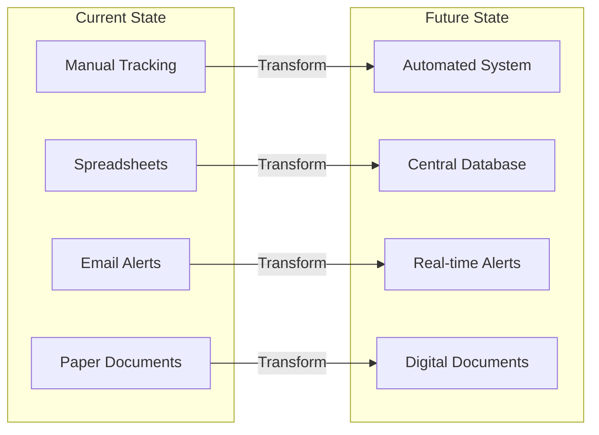

### Stakeholder Map

| Stakeholder | Interest | Influence | Engagement |
|------------|----------|-----------|------------|
| **End Users** | High | Medium | Regular updates |
| **Product Owners** | High | High | Weekly reviews |
| **IT Operations** | Medium | High | Technical reviews |
| **Security Team** | High | High | Security assessments |
| **External Partners** | Medium | Low | Quarterly updates |
| **Regulatory Bodies** | High | Medium | Compliance reports |

---

## 🔍 Solution Overview

### High-Level Architecture

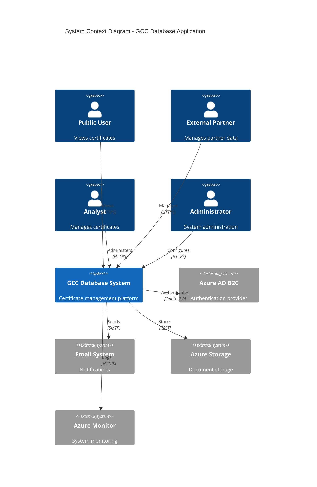

### Solution Components

| Component | Purpose | Technology |
|-----------|---------|------------|
| **Web Application** | User interface | ASP.NET Core MVC |
| **REST API** | System integration | ASP.NET Core Web API |
| **Database** | Data persistence | Azure SQL Database |
| **Cache** | Performance optimization | Redis Cache |
| **Storage** | Document management | Azure Blob Storage |
| **CDN** | Static content delivery | Azure CDN |
| **Authentication** | User identity | Azure AD B2C |

---

## 🏛️ Architectural Principles

### Design Principles

1. **Cloud-First**
   - Leverage PaaS services
   - Minimize infrastructure management
   - Enable auto-scaling

2. **Security by Design**
   - Defense in depth
   - Least privilege access
   - Data encryption everywhere

3. **Scalability**
   - Horizontal scaling
   - Stateless design
   - Database sharding ready

4. **Resilience**
   - No single point of failure
   - Graceful degradation
   - Automatic recovery

5. **Maintainability**
   - Clean code principles
   - Comprehensive documentation
   - Automated testing

### Architectural Patterns

| Pattern | Implementation | Benefit |
|---------|---------------|---------|
| **MVC** | ASP.NET Core MVC | Separation of concerns |
| **Repository** | Data access layer | Abstraction & testability |
| **Unit of Work** | Transaction management | Data consistency |
| **CQRS** | Read/write separation | Performance optimization |
| **Event-Driven** | Async messaging | Loose coupling |
| **Cache-Aside** | Redis caching | Performance boost |

---

## 🏗️ System Architecture

### Container Diagram

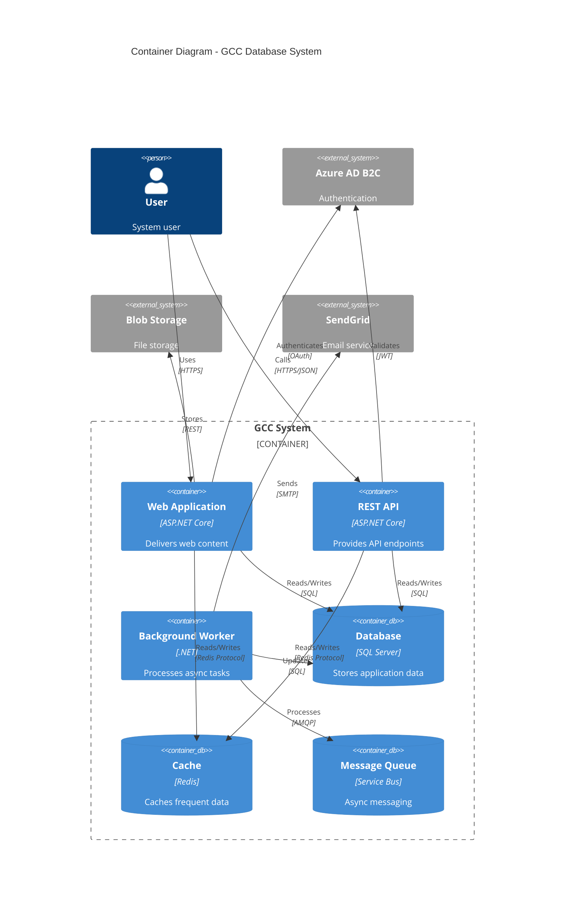

### Logical Architecture Layers

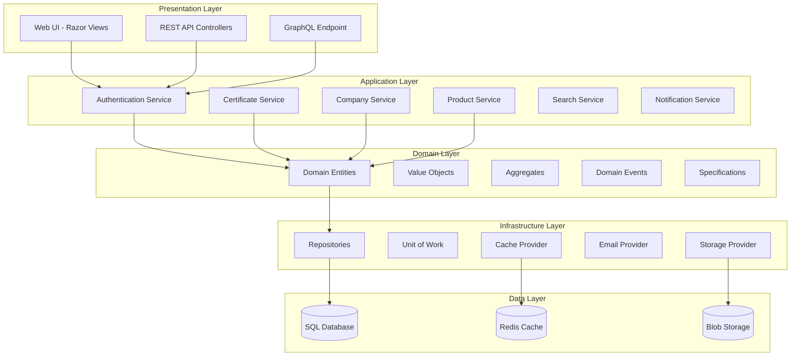

---

## 🧩 Component Architecture

### Component Interaction Diagram

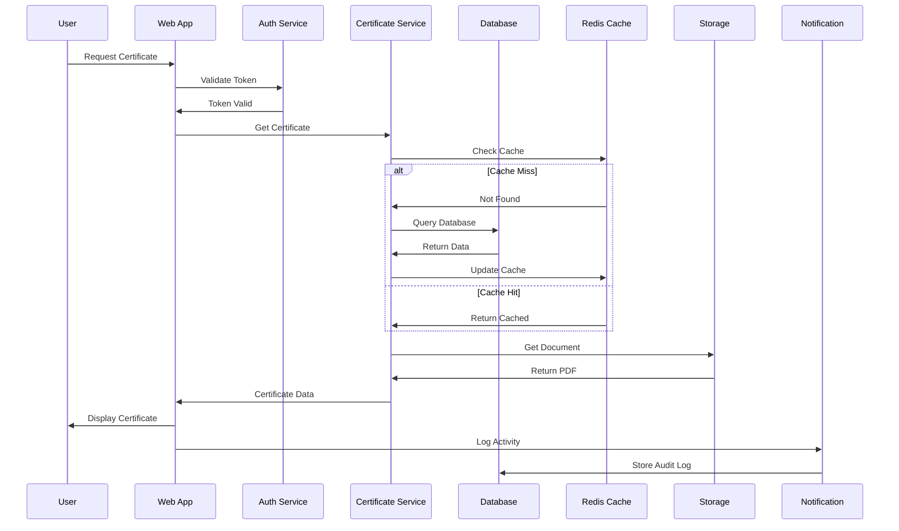

### Service Dependencies

| Service | Dependencies | Purpose |
|---------|-------------|---------|
| **CertificateService** | Repository, Cache, Validation | Certificate CRUD operations |
| **CompanyService** | Repository, Cache | Company management |
| **ProductService** | Repository, Cache | Product management |
| **AuthenticationService** | Azure AD, Session | User authentication |
| **NotificationService** | Email, SMS, Push | Alert delivery |
| **SearchService** | Elasticsearch, Cache | Full-text search |
| **ReportService** | Database, Export | Report generation |
| **AuditService** | Database, Queue | Audit logging |

---

## 💾 Data Architecture

### Entity Relationship Diagram

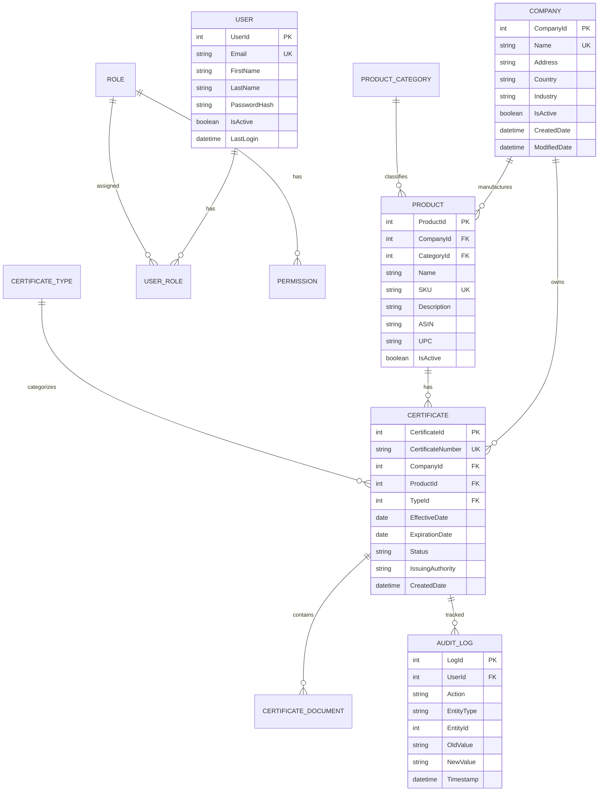

### Data Flow Architecture

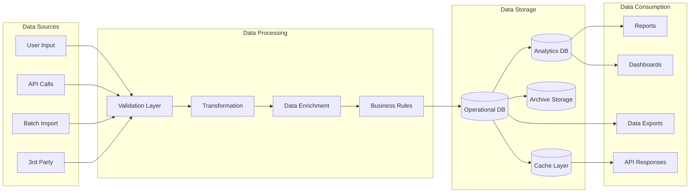

### Data Governance

| Aspect | Implementation | Responsibility |
|--------|---------------|----------------|
| **Data Quality** | Validation rules, constraints | Development Team |
| **Data Security** | Encryption, access control | Security Team |
| **Data Privacy** | GDPR compliance, PII handling | Compliance Officer |
| **Data Retention** | 7-year policy, archival | Operations Team |
| **Data Backup** | Daily backups, geo-replication | Infrastructure Team |

---

## 🔐 Security Architecture

### Security Layers

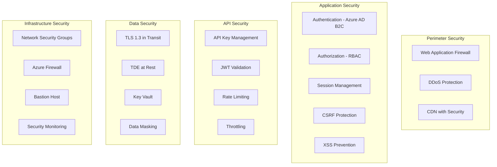

### Authentication & Authorization Flow

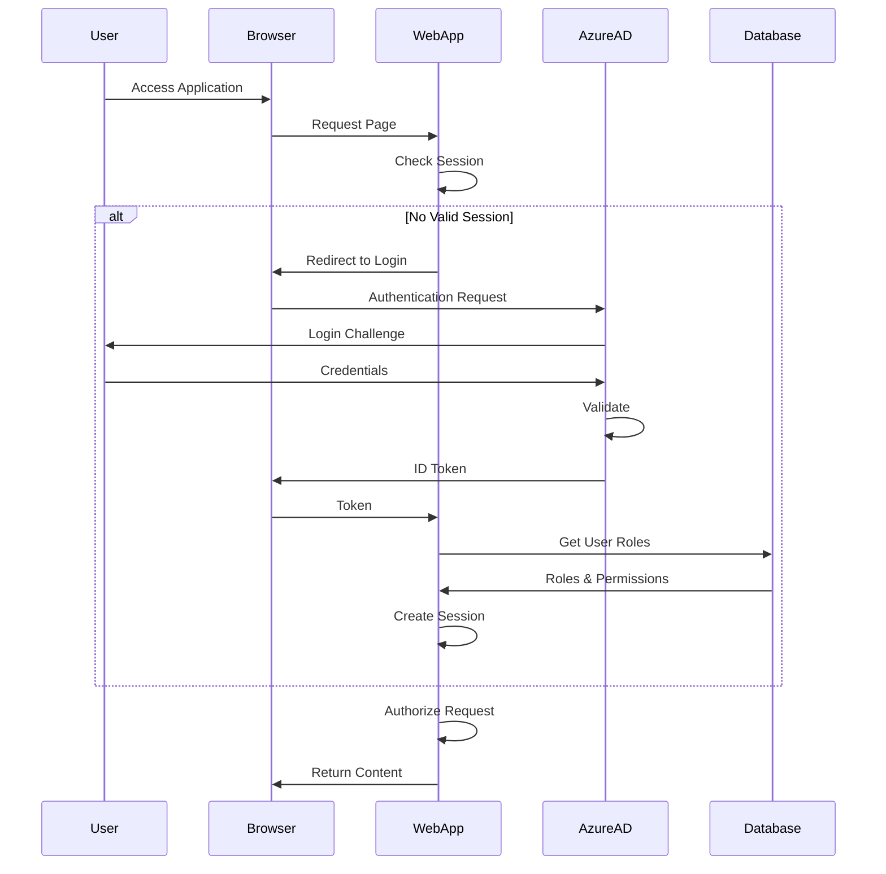

### Security Controls Matrix

| Control | Implementation | Compliance |
|---------|---------------|------------|
| **Authentication** | Azure AD B2C, MFA | NIST 800-63 |
| **Authorization** | RBAC, Policy-based | ISO 27001 |
| **Encryption** | TLS 1.3, AES-256 | FIPS 140-2 |
| **Audit Logging** | Comprehensive logs | SOC 2 |
| **Vulnerability Scanning** | SAST, DAST | OWASP |
| **Penetration Testing** | Quarterly | PCI DSS |
| **Security Training** | Annual | ISO 27001 |

---

## 🔌 Integration Architecture

### Integration Landscape

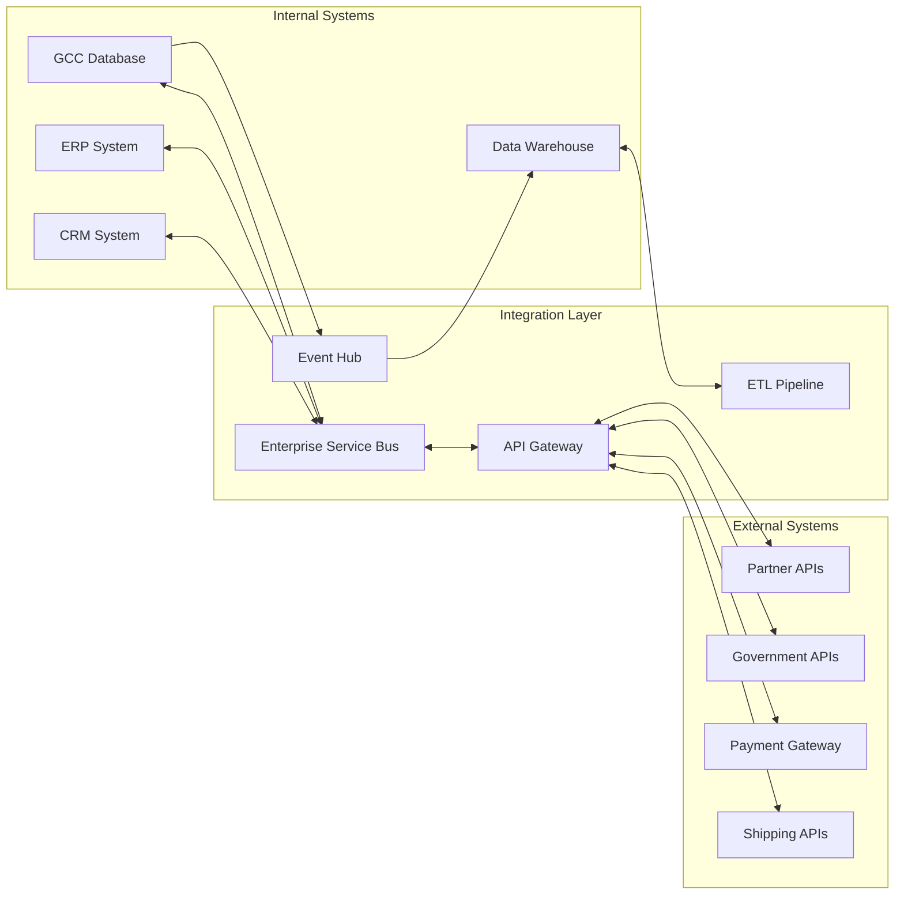

### API Architecture

```mermaid
graph TB
    subgraph "API Gateway"
        GATEWAY[Azure API Management]
        AUTH[Authentication]
        RATE[Rate Limiting]
        CACHE[Response Cache]
        TRANSFORM[Transform]
    end
    
    subgraph "API Versions"
        V1[/api/v1]
        V2[/api/v2]
        V3[/api/v3]
    end
    
    subgraph "Resources"
        CERT[/certificates]
        COMP[/companies]
        PROD[/products]
        USER[/users]
        REPORT[/reports]
    end
    
    GATEWAY --> AUTH
    AUTH --> RATE
    RATE --> CACHE
    CACHE --> TRANSFORM
    
    TRANSFORM --> V1
    TRANSFORM --> V2
    TRANSFORM --> V3
    
    V3 --> CERT
    V3 --> COMP
    V3 --> PROD
    V3 --> USER
    V3 --> REPORT
```

---

## 🚀 Deployment Architecture

### Production Deployment

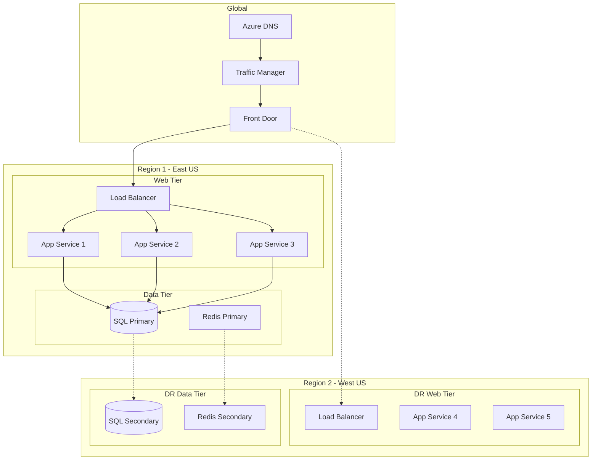

### Infrastructure Specifications

| Environment | Instances | Database | Cache | Storage | CDN | Cost/Month |
|------------|-----------|----------|-------|---------|-----|------------|
| **Development** | 1 x B1 | Basic 5 DTU | None | 10 GB | No | $50 |
| **Testing** | 1 x S1 | S0 10 DTU | C0 250MB | 50 GB | No | $150 |
| **Staging** | 2 x P1v3 | S2 50 DTU | C1 1GB | 100 GB | Yes | $500 |
| **Production** | 3 x P2v3 | P4 125 DTU | P1 6GB | 500 GB | Yes | $2,500 |
| **DR** | 2 x P1v3 | Geo-replica | Replica | Replica | Yes | $1,500 |

---

## 🛠️ Technology Stack

### Application Stack

| Layer | Technology | Version | Purpose |
|-------|------------|---------|---------|
| **Runtime** | .NET | 8.0 | Application framework |
| **Web Framework** | ASP.NET Core | 8.0 | Web application |
| **ORM** | Entity Framework Core | 8.0 | Data access |
| **UI Framework** | Bootstrap | 5.3 | Responsive design |
| **JavaScript** | ES6+ | Latest | Client scripting |
| **API** | REST/OpenAPI | 3.0 | API specification |

### Infrastructure Stack

| Component | Technology | Purpose |
|-----------|------------|---------|
| **Cloud Platform** | Microsoft Azure | Infrastructure |
| **Compute** | App Service P2v3 | Application hosting |
| **Database** | Azure SQL Database | Data persistence |
| **Cache** | Redis Cache Premium | Performance |
| **Storage** | Blob Storage GRS | File storage |
| **CDN** | Azure CDN Standard | Content delivery |
| **DNS** | Azure DNS | Domain management |
| **Monitoring** | Application Insights | APM |

### DevOps Stack

| Area | Tool | Purpose |
|------|------|---------|
| **Source Control** | GitHub Enterprise | Version control |
| **CI/CD** | Azure DevOps | Automation |
| **Containers** | Docker | Containerization |
| **IaC** | Terraform | Infrastructure |
| **Monitoring** | Azure Monitor | Operations |
| **Security** | Azure Security Center | Security |

---

## 📈 Non-Functional Requirements

### Performance Requirements

| Metric | Target | Measurement |
|--------|--------|-------------|
| **Page Load Time** | < 2 seconds | 95th percentile |
| **API Response Time** | < 500ms | Average |
| **Concurrent Users** | 5,000 | Peak load |
| **Requests per Second** | 1,000 | Sustained |
| **Database Queries** | < 100ms | 90th percentile |
| **Cache Hit Ratio** | > 80% | Average |

### Availability & Reliability

| Requirement | Target | Implementation |
|------------|--------|----------------|
| **Uptime SLA** | 99.9% | Multi-region deployment |
| **RTO** | < 1 hour | Automated failover |
| **RPO** | < 15 minutes | Continuous replication |
| **MTBF** | > 720 hours | Redundancy |
| **MTTR** | < 30 minutes | Auto-recovery |

### Scalability

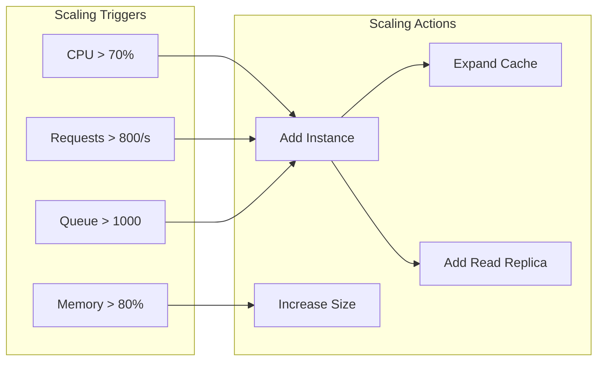

### Security Requirements

| Requirement | Implementation |
|------------|---------------|
| **Authentication** | Azure AD B2C with MFA |
| **Authorization** | Role-based (RBAC) |
| **Data Encryption** | TLS 1.3, AES-256 |
| **Compliance** | GDPR, SOC 2, ISO 27001 |
| **Audit** | All actions logged |
| **Vulnerability** | Monthly scanning |

---

## ⚠️ Risk Assessment

### Technical Risks

| Risk | Probability | Impact | Mitigation |
|------|------------|--------|------------|
| **Data Breach** | Low | High | Encryption, access control, monitoring |
| **System Outage** | Medium | High | Redundancy, failover, DR plan |
| **Performance Degradation** | Medium | Medium | Caching, optimization, scaling |
| **Integration Failure** | Low | Medium | Circuit breakers, retry logic |
| **Data Loss** | Low | High | Backups, replication |

### Operational Risks

| Risk | Probability | Impact | Mitigation |
|------|------------|--------|------------|
| **Key Person Dependency** | Medium | High | Documentation, cross-training |
| **Vendor Lock-in** | Medium | Medium | Standard technologies, abstraction |
| **Compliance Violation** | Low | High | Regular audits, automation |
| **Budget Overrun** | Low | Medium | Cost monitoring, optimization |

---

## 🗺️ Implementation Roadmap

### Phase 1: Foundation (Months 1-3)
- ✅ Core infrastructure setup
- ✅ Database design and implementation
- ✅ Authentication system
- ✅ Basic CRUD operations
- ✅ Development environment

### Phase 2: Core Features (Months 4-6)
- ✅ Certificate management
- ✅ Company and product modules
- ✅ Search functionality
- ✅ Document management
- ⏳ API development

### Phase 3: Advanced Features (Months 7-9)
- ⏳ Advanced search and filtering
- ⏳ Reporting and analytics
- ⏳ Workflow automation
- ⏳ Mobile responsiveness
- ⏳ Performance optimization

### Phase 4: Production Ready (Months 10-12)
- ⏳ Security hardening
- ⏳ Load testing
- ⏳ Disaster recovery setup
- ⏳ Documentation completion
- ⏳ Training and handover

---

## 📊 Success Metrics

### Business Metrics

| Metric | Current | Target | Timeline |
|--------|---------|--------|----------|
| **Certificate Processing Time** | 5 days | 1 day | 6 months |
| **User Adoption Rate** | 0% | 80% | 12 months |
| **System Availability** | N/A | 99.9% | Immediate |
| **Cost Reduction** | Baseline | 30% | 12 months |
| **Compliance Rate** | 85% | 99% | 6 months |

### Technical Metrics

| Metric | Target | Measurement |
|--------|--------|-------------|
| **Code Coverage** | > 80% | Unit tests |
| **Technical Debt** | < 10% | SonarQube |
| **Deploy Frequency** | Daily | CI/CD pipeline |
| **Lead Time** | < 1 day | Commit to production |
| **MTTR** | < 30 min | Incident resolution |

---

## 📚 Appendices

### A. Glossary

| Term | Definition |
|------|------------|
| **GCC** | Green Circle Certified |
| **SAD** | Solution Architecture Document |
| **RBAC** | Role-Based Access Control |
| **SLA** | Service Level Agreement |
| **RTO** | Recovery Time Objective |
| **RPO** | Recovery Point Objective |
| **MTBF** | Mean Time Between Failures |
| **MTTR** | Mean Time To Recovery |

### B. Reference Documents

1. [Architecture Overview](./Architecture_Overview.md)
2. [Security Guide](../04%20Testing/Security/Security_Guide.md)
3. [API Reference](../04.1%20Integrations/API_Reference.md)
4. [Deployment Guide](../06%20Training/Deployment_Guide.md)
5. [Database Design](../Database/Database_Design.md)

### C. Decision Log

| Date | Decision | Rationale | Impact |
|------|----------|-----------|--------|
| 2024-06 | Use Azure PaaS | Reduce operational overhead | High |
| 2024-07 | Implement Redis Cache | Improve performance | Medium |
| 2024-08 | Add API versioning | Support backward compatibility | High |
| 2024-08 | Use Azure AD B2C | Enterprise authentication | High |

### D. Contact Information

| Role | Name | Email | Phone |
|------|------|-------|-------|
| **Solution Architect** | TBD | architect@gcc.com | xxx-xxx-xxxx |
| **Technical Lead** | TBD | techlead@gcc.com | xxx-xxx-xxxx |
| **Product Owner** | TBD | product@gcc.com | xxx-xxx-xxxx |
| **DevOps Lead** | TBD | devops@gcc.com | xxx-xxx-xxxx |

---

## ✅ Document Approval

This Solution Architecture Document has been reviewed and approved by:

| Role | Name | Signature | Date |
|------|------|-----------|------|
| **Chief Architect** | _____________ | _____________ | _____ |
| **Technical Director** | _____________ | _____________ | _____ |
| **Security Officer** | _____________ | _____________ | _____ |
| **Product Manager** | _____________ | _____________ | _____ |

---

## 🔄 Document History

| Version | Date | Changes | Author |
|---------|------|---------|--------|
| 0.1 | 2024-06-01 | Initial draft | Architecture Team |
| 0.5 | 2024-07-01 | Added security section | Security Team |
| 1.0 | 2024-07-15 | First approved version | Architecture Team |
| 1.5 | 2024-08-01 | Updated with implementation details | Development Team |
| 2.0 | 2024-08-21 | Production-ready architecture | Architecture Team |

---

*This document is maintained by the Architecture Team and reviewed quarterly.*

**Next Review Date:** November 21, 2025  
**Distribution:** All Stakeholders  
**Classification:** Internal Use Only