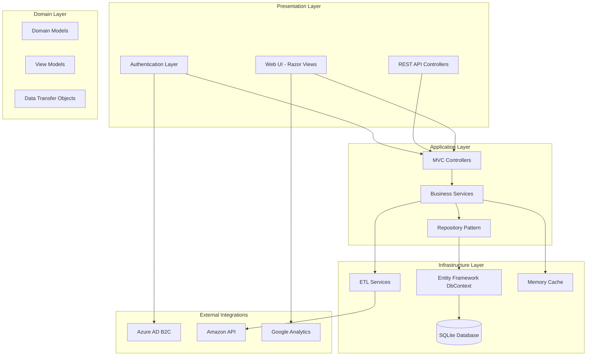
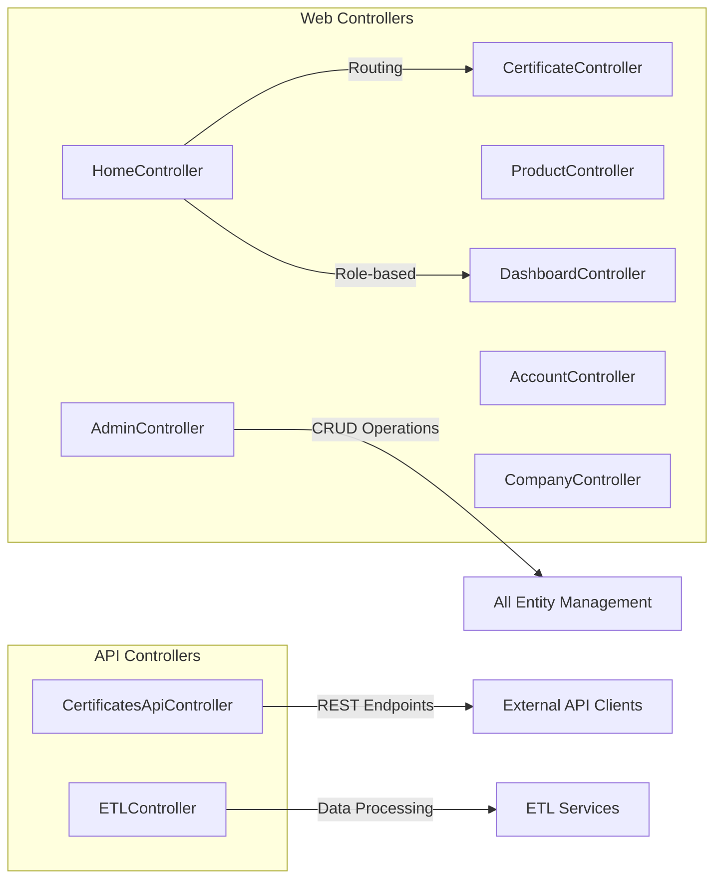
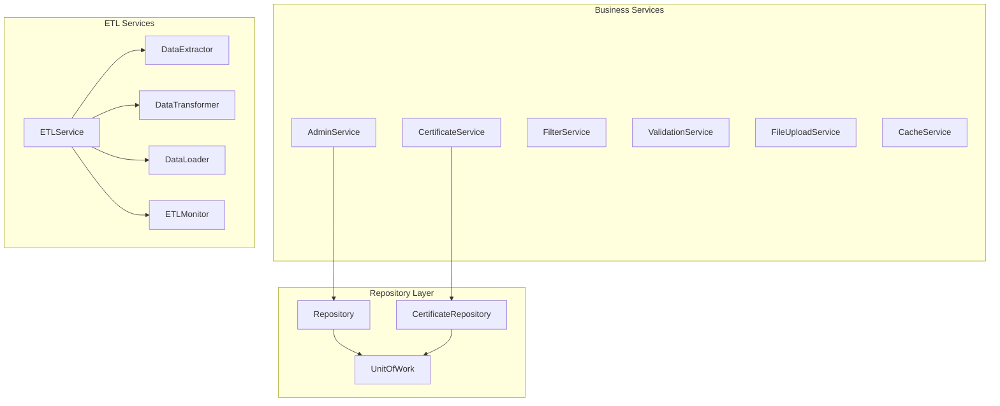
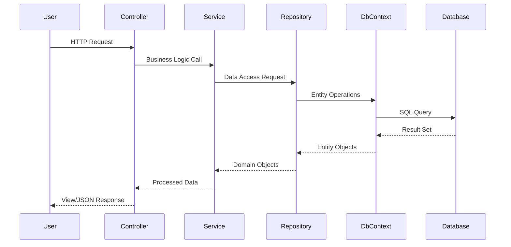
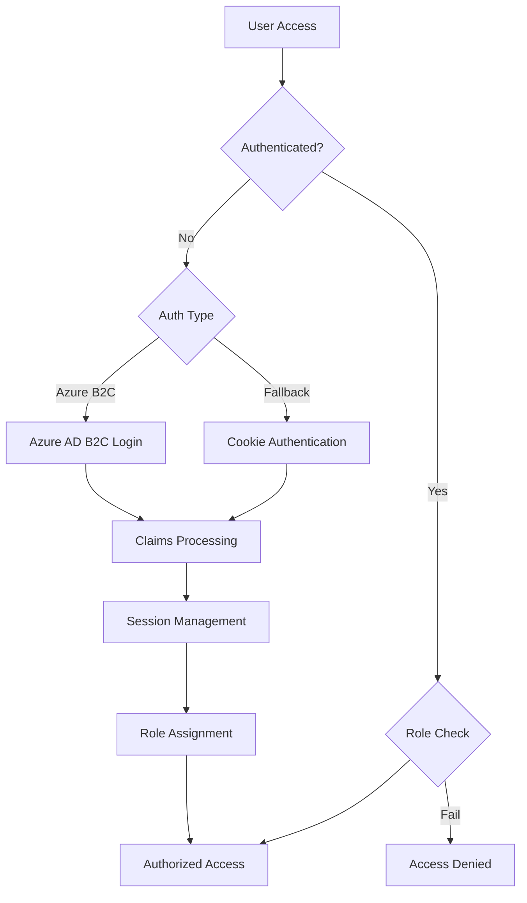
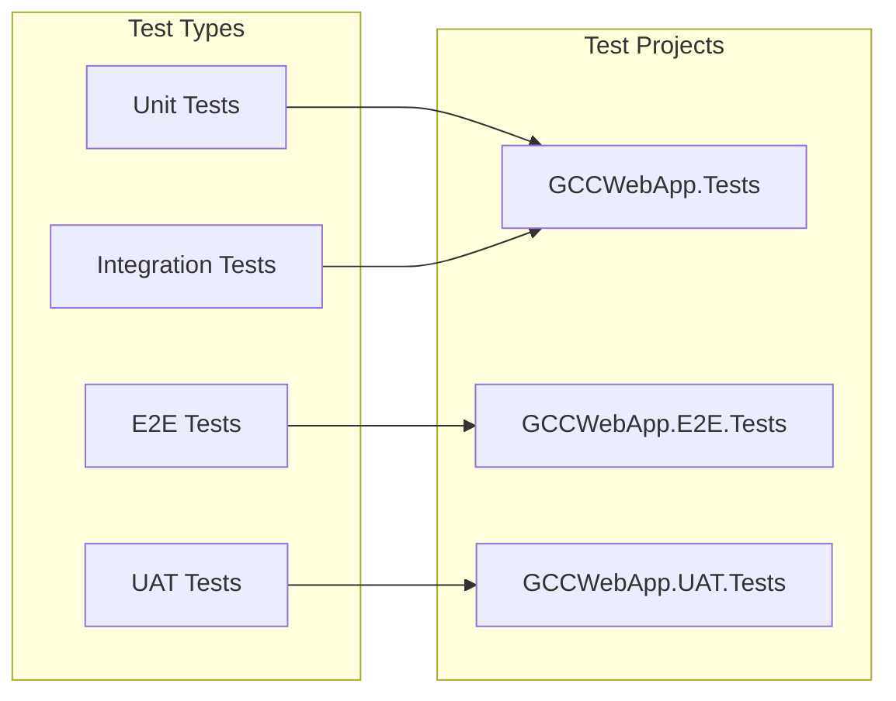
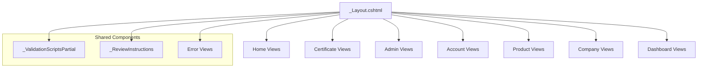

# GCC Database Solution - Architecture Analysis Report

## Executive Summary

The GCC (GreenCircle Certified) Database Solution is a comprehensive ASP.NET Core web application designed for certificate management and tracking. The system follows a layered architecture pattern with clear separation of concerns, implementing modern authentication, comprehensive testing, and ETL capabilities.

## Technology Stack

### Core Framework
- **ASP.NET Core 8.0** - Main web framework
- **Entity Framework Core 9.0** - ORM and database access
- **SQLite** - Database engine (with SQL Server support)
- **Microsoft Identity Web** - Authentication and authorization

### Frontend Technologies
- **Razor Pages/Views** - Server-side rendering
- **Bootstrap** - CSS framework
- **jQuery** - JavaScript library
- **Custom CSS/JS** - Application-specific styling and behavior

### Testing Framework
- **xUnit** - Unit and integration testing
- **Playwright** - End-to-end testing
- **Test coverage tools** - Code coverage analysis

### Security & Authentication
- **Azure AD B2C** - Identity provider
- **Cookie Authentication** - Fallback authentication
- **Role-based Authorization** - Access control
- **Security Headers** - XSS, CSRF protection

## Architecture Overview



## System Components

### 1. Core Entities

#### Primary Business Objects
- **Certificate** - Central entity for certification tracking
- **Company** - Organizations that own certificates
- **Product** - Items being certified
- **User** - System users with role-based access
- **CertificationType** - Different types of certifications

#### Supporting Entities
- **ProductCategory/Type/Subcategory** - Product classification hierarchy
- **CustomField/CustomFieldValue** - Dynamic field system
- **Tag** - Labeling and categorization
- **Role/Permission** - Security and authorization

### 2. Controllers Architecture



### 3. Service Layer Architecture



### 4. Data Flow Architecture



## Security Architecture

### Authentication Flow


### Authorization Policies
- **AdminOnly** - Requires Admin role
- **AnalystOrAdmin** - Requires Analyst or Admin role
- **ExternalAccess** - Allows External, Analyst, or Admin
- **AuthenticatedUsers** - Any authenticated user

## Database Architecture

### Entity Relationship Model
The system uses a comprehensive relational model with the following key relationships:

1. **Certificate Management**
   - Certificates belong to Companies and Products
   - Support for custom fields per certificate type
   - Audit tracking for creation/modification

2. **Product Hierarchy**
   - Category → Type → Subcategory structure
   - Product identifiers (UPC, GTIN, EAN, ASIN)
   - Tag-based classification

3. **User Management**
   - Role-based security model
   - Company-user associations
   - Activity logging

4. **ETL & Integration**
   - Configuration-driven ETL processes
   - Data quality monitoring
   - Alert management

## Testing Strategy

### Test Coverage


### Testing Coverage Areas
- **Controller Testing** - API endpoints and MVC actions
- **Service Layer Testing** - Business logic validation
- **Integration Testing** - Database operations
- **UI Testing** - Playwright-based browser automation
- **Authentication Testing** - Security scenarios
- **Role-based Testing** - Authorization workflows

## Frontend Architecture

### View Structure


### Static Assets Organization
- **CSS** - Modular stylesheets per feature area
- **JavaScript** - Feature-specific JS modules
- **Images** - Logo, headers, and UI assets
- **Libraries** - Bootstrap, jQuery, validation libraries

## Performance Considerations

### Caching Strategy
- **Memory Caching** - Frequently accessed data
- **Session Management** - User state and preferences
- **Static File Caching** - 7-day cache for production assets

### Database Optimization
- **Indexed Fields** - Unique constraints and foreign keys
- **Repository Pattern** - Abstracted data access
- **Entity Tracking** - Optimized for read/write scenarios

## Deployment Architecture

### Configuration Management
- **Environment-specific** - Development, staging, production configs
- **Secret Management** - Encrypted sensitive data
- **Connection Strings** - Database connectivity options

### Security Headers
- X-Frame-Options: DENY
- X-Content-Type-Options: nosniff
- X-XSS-Protection: enabled
- Strict-Transport-Security (production)
- Referrer-Policy: strict-origin-when-cross-origin

## Integration Points

### External Systems
1. **Azure AD B2C** - User authentication and management
2. **Amazon API** - Product data synchronization
3. **Google Analytics** - Usage tracking and analytics

### ETL Capabilities
- **Data Extraction** - Multiple source support
- **Data Transformation** - Configurable business rules
- **Data Loading** - Batch and real-time processing
- **Quality Monitoring** - Data validation and alerting

## Recommended Improvements

### Short-term
1. Add API documentation (Swagger/OpenAPI)
2. Implement request/response logging
3. Add comprehensive error handling middleware
4. Performance monitoring and alerting

### Long-term
1. Microservices architecture consideration
2. Event-driven architecture implementation
3. Advanced caching strategies (Redis)
4. Container orchestration (Docker/Kubernetes)

## File Structure Overview

```
GCCWebApp/
├── Controllers/           # MVC and API controllers
├── Models/               # Domain models and ViewModels
├── Views/                # Razor views and layouts
├── Services/             # Business logic services
├── Repositories/         # Data access layer
├── Data/                 # Entity Framework context
├── Configuration/        # App configuration classes
├── wwwroot/             # Static web assets
├── Migrations/          # EF Core migrations
├── Documentation/       # Project documentation
└── [Test Projects]/     # Comprehensive test suites
```

This architecture provides a solid foundation for a scalable, maintainable certificate management system with modern security practices and comprehensive testing coverage.