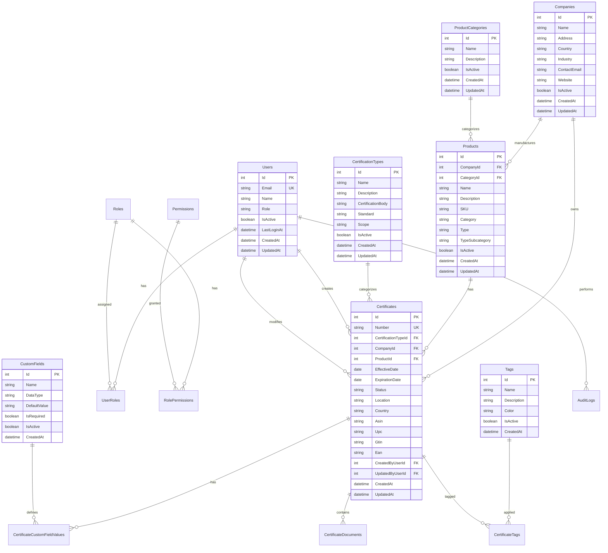

# GCC Database Design Documentation

## Table of Contents
1. [Overview](#overview)
2. [Database Architecture](#database-architecture)
3. [Entity Relationship Diagram](#entity-relationship-diagram)
4. [Table Schemas](#table-schemas)
5. [Relationships](#relationships)
6. [Indexes](#indexes)
7. [Constraints](#constraints)
8. [Stored Procedures](#stored-procedures)
9. [Views](#views)
10. [Security](#security)
11. [Performance Optimization](#performance-optimization)
12. [Backup and Recovery](#backup-and-recovery)
13. [Migration Strategy](#migration-strategy)

## Overview

The GCC Database is designed to manage certificates, companies, products, and related data for Green Circle Certified. The database uses SQLite for development and Microsoft SQL Server for production, following normalized design principles to ensure data integrity and optimal performance.

### Key Design Principles
- **Normalization**: Third Normal Form (3NF) to minimize redundancy
- **Referential Integrity**: Foreign key constraints ensure data consistency
- **Entity Framework Core**: Code-first approach with automatic migrations
- **Performance**: Strategic indexing and query optimization
- **Flexible Development**: SQLite for local development, SQL Server for production
- **Comprehensive Relationships**: 13+ entities supporting complex certificate management

### Current Implementation Status
- **Database Engine**: SQLite (development) / SQL Server (production)
- **ORM**: Entity Framework Core 8.0 with Code First approach
- **Migration System**: Automatic database creation and seeding
- **Entities**: 13 core entities with full relationship mapping
- **Sample Data**: Comprehensive seed data with 5 companies, 5 products, 5 certificates
- **Advanced Features**: Custom fields, tags, audit trails, flexible search

## Database Architecture

### Database Configuration
```sql
-- Database Settings
CREATE DATABASE GCCDatabase
COLLATE SQL_Latin1_General_CP1_CI_AS
WITH
  COMPATIBILITY_LEVEL = 150,
  QUERY_STORE = ON,
  AUTOMATIC_TUNING (FORCE_LAST_GOOD_PLAN = ON);

-- File Groups
ALTER DATABASE GCCDatabase
ADD FILEGROUP CertificateData;

ALTER DATABASE GCCDatabase
ADD FILEGROUP ArchiveData;
```

### Schema Organization
| Schema | Purpose |
|--------|---------|
| `dbo` | Core application tables |
| `audit` | Audit and logging tables |
| `security` | Authentication and authorization |
| `reporting` | Reporting views and aggregates |
| `staging` | ETL and data import staging |

## Entity Relationship Diagram



## Table Schemas

### Core Tables

#### Companies Table
```sql
CREATE TABLE dbo.Companies (
    CompanyId INT IDENTITY(1,1) PRIMARY KEY,
    Name NVARCHAR(200) NOT NULL,
    LegalName NVARCHAR(200),
    TaxId NVARCHAR(50),
    Address NVARCHAR(500),
    City NVARCHAR(100),
    StateProvince NVARCHAR(100),
    PostalCode NVARCHAR(20),
    Country NVARCHAR(100) NOT NULL,
    Phone NVARCHAR(50),
    Email NVARCHAR(200),
    Website NVARCHAR(500),
    IsActive BIT DEFAULT 1,
    CreatedBy INT,
    CreatedDate DATETIME2 DEFAULT GETUTCDATE(),
    ModifiedBy INT,
    ModifiedDate DATETIME2 DEFAULT GETUTCDATE(),
    CONSTRAINT UK_Companies_Name UNIQUE (Name),
    CONSTRAINT FK_Companies_CreatedBy FOREIGN KEY (CreatedBy) REFERENCES dbo.Users(UserId),
    CONSTRAINT FK_Companies_ModifiedBy FOREIGN KEY (ModifiedBy) REFERENCES dbo.Users(UserId)
);
```

#### Products Table
```sql
CREATE TABLE dbo.Products (
    ProductId INT IDENTITY(1,1) PRIMARY KEY,
    CompanyId INT NOT NULL,
    CategoryId INT NOT NULL,
    Name NVARCHAR(200) NOT NULL,
    Description NVARCHAR(MAX),
    SKU NVARCHAR(100),
    UPC NVARCHAR(50),
    ManufacturerPartNumber NVARCHAR(100),
    IsActive BIT DEFAULT 1,
    CreatedBy INT,
    CreatedDate DATETIME2 DEFAULT GETUTCDATE(),
    ModifiedBy INT,
    ModifiedDate DATETIME2 DEFAULT GETUTCDATE(),
    CONSTRAINT FK_Products_Company FOREIGN KEY (CompanyId) REFERENCES dbo.Companies(CompanyId),
    CONSTRAINT FK_Products_Category FOREIGN KEY (CategoryId) REFERENCES dbo.ProductCategories(CategoryId),
    CONSTRAINT FK_Products_CreatedBy FOREIGN KEY (CreatedBy) REFERENCES dbo.Users(UserId),
    CONSTRAINT FK_Products_ModifiedBy FOREIGN KEY (ModifiedBy) REFERENCES dbo.Users(UserId),
    INDEX IX_Products_CompanyId (CompanyId),
    INDEX IX_Products_CategoryId (CategoryId),
    INDEX IX_Products_SKU (SKU)
);
```

#### Certificates Table
```sql
CREATE TABLE dbo.Certificates (
    CertificateId INT IDENTITY(1,1) PRIMARY KEY,
    CertificateNumber NVARCHAR(50) NOT NULL,
    TypeId INT NOT NULL,
    CompanyId INT NOT NULL,
    ProductId INT NULL,
    EffectiveDate DATE NOT NULL,
    ExpirationDate DATE NOT NULL,
    Status NVARCHAR(20) NOT NULL,
    IssueLocation NVARCHAR(200),
    IssuingAuthority NVARCHAR(200),
    VerificationUrl NVARCHAR(500),
    IsPublic BIT DEFAULT 1,
    CreatedBy INT,
    CreatedDate DATETIME2 DEFAULT GETUTCDATE(),
    ModifiedBy INT,
    ModifiedDate DATETIME2 DEFAULT GETUTCDATE(),
    CONSTRAINT UK_Certificates_Number UNIQUE (CertificateNumber),
    CONSTRAINT FK_Certificates_Type FOREIGN KEY (TypeId) REFERENCES dbo.CertificateTypes(TypeId),
    CONSTRAINT FK_Certificates_Company FOREIGN KEY (CompanyId) REFERENCES dbo.Companies(CompanyId),
    CONSTRAINT FK_Certificates_Product FOREIGN KEY (ProductId) REFERENCES dbo.Products(ProductId),
    CONSTRAINT FK_Certificates_CreatedBy FOREIGN KEY (CreatedBy) REFERENCES dbo.Users(UserId),
    CONSTRAINT FK_Certificates_ModifiedBy FOREIGN KEY (ModifiedBy) REFERENCES dbo.Users(UserId),
    CONSTRAINT CK_Certificates_Status CHECK (Status IN ('Active', 'Expired', 'Revoked', 'Pending', 'Draft')),
    INDEX IX_Certificates_CompanyId (CompanyId),
    INDEX IX_Certificates_ProductId (ProductId),
    INDEX IX_Certificates_Status (Status),
    INDEX IX_Certificates_ExpirationDate (ExpirationDate)
)
WITH (SYSTEM_VERSIONING = ON (HISTORY_TABLE = audit.CertificatesHistory));
```

#### Users Table
```sql
CREATE TABLE dbo.Users (
    UserId INT IDENTITY(1,1) PRIMARY KEY,
    Email NVARCHAR(200) NOT NULL,
    PasswordHash NVARCHAR(500),
    FirstName NVARCHAR(100),
    LastName NVARCHAR(100),
    DisplayName NVARCHAR(200),
    Phone NVARCHAR(50),
    CompanyId INT NULL,
    IsActive BIT DEFAULT 1,
    IsEmailVerified BIT DEFAULT 0,
    EmailVerificationToken NVARCHAR(100),
    PasswordResetToken NVARCHAR(100),
    PasswordResetExpiry DATETIME2,
    LastLoginDate DATETIME2,
    FailedLoginAttempts INT DEFAULT 0,
    LockoutEndDate DATETIME2,
    CreatedDate DATETIME2 DEFAULT GETUTCDATE(),
    ModifiedDate DATETIME2 DEFAULT GETUTCDATE(),
    CONSTRAINT UK_Users_Email UNIQUE (Email),
    CONSTRAINT FK_Users_Company FOREIGN KEY (CompanyId) REFERENCES dbo.Companies(CompanyId),
    INDEX IX_Users_Email (Email),
    INDEX IX_Users_CompanyId (CompanyId)
);
```

### Lookup Tables

#### CertificateTypes Table
```sql
CREATE TABLE dbo.CertificateTypes (
    TypeId INT IDENTITY(1,1) PRIMARY KEY,
    Name NVARCHAR(100) NOT NULL,
    Description NVARCHAR(500),
    ValidityPeriodDays INT DEFAULT 365,
    RequiresProduct BIT DEFAULT 0,
    IsActive BIT DEFAULT 1,
    SortOrder INT DEFAULT 0,
    CreatedDate DATETIME2 DEFAULT GETUTCDATE(),
    CONSTRAINT UK_CertificateTypes_Name UNIQUE (Name)
);
```

#### ProductCategories Table
```sql
CREATE TABLE dbo.ProductCategories (
    CategoryId INT IDENTITY(1,1) PRIMARY KEY,
    ParentCategoryId INT NULL,
    Name NVARCHAR(100) NOT NULL,
    Description NVARCHAR(500),
    IsActive BIT DEFAULT 1,
    SortOrder INT DEFAULT 0,
    CreatedDate DATETIME2 DEFAULT GETUTCDATE(),
    CONSTRAINT FK_ProductCategories_Parent FOREIGN KEY (ParentCategoryId) 
        REFERENCES dbo.ProductCategories(CategoryId)
);
```

### Security Tables

#### Roles Table
```sql
CREATE TABLE security.Roles (
    RoleId INT IDENTITY(1,1) PRIMARY KEY,
    Name NVARCHAR(50) NOT NULL,
    Description NVARCHAR(200),
    IsSystemRole BIT DEFAULT 0,
    IsActive BIT DEFAULT 1,
    CreatedDate DATETIME2 DEFAULT GETUTCDATE(),
    CONSTRAINT UK_Roles_Name UNIQUE (Name)
);
```

#### UserRoles Table
```sql
CREATE TABLE security.UserRoles (
    UserRoleId INT IDENTITY(1,1) PRIMARY KEY,
    UserId INT NOT NULL,
    RoleId INT NOT NULL,
    AssignedDate DATETIME2 DEFAULT GETUTCDATE(),
    AssignedBy INT,
    CONSTRAINT FK_UserRoles_User FOREIGN KEY (UserId) REFERENCES dbo.Users(UserId),
    CONSTRAINT FK_UserRoles_Role FOREIGN KEY (RoleId) REFERENCES security.Roles(RoleId),
    CONSTRAINT FK_UserRoles_AssignedBy FOREIGN KEY (AssignedBy) REFERENCES dbo.Users(UserId),
    CONSTRAINT UK_UserRoles_UserRole UNIQUE (UserId, RoleId)
);
```

### Audit Tables

#### AuditLogs Table
```sql
CREATE TABLE audit.AuditLogs (
    LogId BIGINT IDENTITY(1,1) PRIMARY KEY,
    UserId INT,
    Action NVARCHAR(50) NOT NULL,
    TableName NVARCHAR(100),
    RecordId INT,
    OldValues NVARCHAR(MAX),
    NewValues NVARCHAR(MAX),
    IpAddress NVARCHAR(45),
    UserAgent NVARCHAR(500),
    Timestamp DATETIME2 DEFAULT GETUTCDATE(),
    CONSTRAINT FK_AuditLogs_User FOREIGN KEY (UserId) REFERENCES dbo.Users(UserId),
    INDEX IX_AuditLogs_UserId (UserId),
    INDEX IX_AuditLogs_Timestamp (Timestamp),
    INDEX IX_AuditLogs_TableRecord (TableName, RecordId)
);
```

## Relationships

### Primary Relationships
1. **Company → Products**: One-to-Many
2. **Company → Certificates**: One-to-Many
3. **Product → Certificates**: One-to-Many (optional)
4. **User → Roles**: Many-to-Many (through UserRoles)
5. **Certificate → Attributes**: One-to-Many
6. **Certificate → Documents**: One-to-Many

### Cascade Rules
```sql
-- Soft delete cascade for Companies
CREATE TRIGGER tr_Companies_SoftDelete
ON dbo.Companies
INSTEAD OF DELETE
AS
BEGIN
    UPDATE dbo.Companies 
    SET IsActive = 0, ModifiedDate = GETUTCDATE()
    WHERE CompanyId IN (SELECT CompanyId FROM deleted);
    
    UPDATE dbo.Products 
    SET IsActive = 0, ModifiedDate = GETUTCDATE()
    WHERE CompanyId IN (SELECT CompanyId FROM deleted);
END;
```

## Indexes

### Performance Indexes
```sql
-- Covering index for certificate searches
CREATE NONCLUSTERED INDEX IX_Certificates_Search
ON dbo.Certificates (Status, ExpirationDate)
INCLUDE (CertificateNumber, CompanyId, ProductId, TypeId);

-- Full-text search indexes
CREATE FULLTEXT CATALOG ft_catalog;

CREATE FULLTEXT INDEX ON dbo.Products(Name, Description)
KEY INDEX PK_Products ON ft_catalog;

CREATE FULLTEXT INDEX ON dbo.Companies(Name, LegalName)
KEY INDEX PK_Companies ON ft_catalog;

-- Filtered indexes for active records
CREATE NONCLUSTERED INDEX IX_Companies_Active
ON dbo.Companies (Name)
WHERE IsActive = 1;

CREATE NONCLUSTERED INDEX IX_Products_Active
ON dbo.Products (Name, CompanyId)
WHERE IsActive = 1;
```

## Constraints

### Check Constraints
```sql
-- Date validation
ALTER TABLE dbo.Certificates
ADD CONSTRAINT CK_Certificates_Dates 
CHECK (ExpirationDate > EffectiveDate);

-- Email format validation
ALTER TABLE dbo.Users
ADD CONSTRAINT CK_Users_Email 
CHECK (Email LIKE '%_@_%._%');

-- Status values
ALTER TABLE dbo.Certificates
ADD CONSTRAINT CK_Certificates_ValidStatus
CHECK (Status IN ('Active', 'Expired', 'Revoked', 'Pending', 'Draft'));
```

### Default Constraints
```sql
ALTER TABLE dbo.Certificates
ADD CONSTRAINT DF_Certificates_Status 
DEFAULT 'Pending' FOR Status;

ALTER TABLE dbo.Users
ADD CONSTRAINT DF_Users_CreatedDate 
DEFAULT GETUTCDATE() FOR CreatedDate;
```

## Stored Procedures

### Certificate Management
```sql
CREATE PROCEDURE dbo.sp_CreateCertificate
    @CertificateNumber NVARCHAR(50),
    @TypeId INT,
    @CompanyId INT,
    @ProductId INT = NULL,
    @EffectiveDate DATE,
    @ExpirationDate DATE,
    @CreatedBy INT,
    @CertificateId INT OUTPUT
AS
BEGIN
    SET NOCOUNT ON;
    
    BEGIN TRANSACTION;
    
    BEGIN TRY
        INSERT INTO dbo.Certificates (
            CertificateNumber, TypeId, CompanyId, ProductId,
            EffectiveDate, ExpirationDate, Status, CreatedBy
        )
        VALUES (
            @CertificateNumber, @TypeId, @CompanyId, @ProductId,
            @EffectiveDate, @ExpirationDate, 'Active', @CreatedBy
        );
        
        SET @CertificateId = SCOPE_IDENTITY();
        
        -- Log the action
        INSERT INTO audit.AuditLogs (UserId, Action, TableName, RecordId)
        VALUES (@CreatedBy, 'CREATE', 'Certificates', @CertificateId);
        
        COMMIT TRANSACTION;
    END TRY
    BEGIN CATCH
        ROLLBACK TRANSACTION;
        THROW;
    END CATCH
END;
```

### Advanced Search Implementation

The application implements sophisticated search functionality through the `CertificateRepository.GetAdvancedFilteredCertificatesAsync` method:

**Implemented Search Features:**
- **Multi-field Text Search**: Certificate number, company name, product name, certification type, location, country
- **Date Range Filtering**: Effective date and expiration date ranges
- **Status Filtering**: Active, expired, pending certificates
- **Geographic Filtering**: Location and country with partial matching
- **Tag-based Filtering**: Filter by associated tags
- **Flexible Sorting**: Multiple sort fields with ascending/descending options
- **Comprehensive Pagination**: Page-based results with total count

**Search Filter Model:**
```csharp
public class CertificateSearchFilter
{
    public string? SearchTerm { get; set; }
    public int? CompanyId { get; set; }
    public int? ProductId { get; set; }
    public int? CertificationTypeId { get; set; }
    public string? Status { get; set; }
    public string? Location { get; set; }
    public string? Country { get; set; }
    public DateTime? EffectiveDateFrom { get; set; }
    public DateTime? EffectiveDateTo { get; set; }
    public DateTime? ExpirationDateFrom { get; set; }
    public DateTime? ExpirationDateTo { get; set; }
    public List<int>? TagIds { get; set; }
    public string? SortBy { get; set; } = "CreatedAt";
    public bool SortDescending { get; set; } = true;
    public int Page { get; set; } = 1;
    public int PageSize { get; set; } = 10;
}
```

**Additional Search Methods:**
```csharp
// Specialized search methods in CertificateRepository
Task<IEnumerable<Certificate>> GetCertificatesByStatusAsync(string status);
Task<IEnumerable<Certificate>> GetCertificatesExpiringInDaysAsync(int days);
Task<IEnumerable<Certificate>> GetCertificatesByLocationAsync(string location);
Task<IEnumerable<Certificate>> GetCertificatesByCountryAsync(string country);
Task<IEnumerable<Certificate>> GetCertificatesByDateRangeAsync(DateTime startDate, DateTime endDate);
Task<Dictionary<string, int>> GetCertificateStatisticsAsync();
```

**Performance Optimizations:**
- Entity Framework Core query optimization with `.AsNoTracking()`
- Strategic use of `.Include()` for related data
- Efficient pagination with `.Skip()` and `.Take()`
- Case-insensitive partial matching for text searches
- Indexed foreign key relationships for fast joins

## Views

### Reporting Views
```sql
CREATE VIEW reporting.vw_ActiveCertificates
AS
SELECT 
    c.CertificateId,
    c.CertificateNumber,
    c.EffectiveDate,
    c.ExpirationDate,
    DATEDIFF(DAY, GETDATE(), c.ExpirationDate) AS DaysUntilExpiration,
    co.Name AS CompanyName,
    p.Name AS ProductName,
    ct.Name AS CertificateType
FROM dbo.Certificates c
INNER JOIN dbo.Companies co ON c.CompanyId = co.CompanyId
LEFT JOIN dbo.Products p ON c.ProductId = p.ProductId
INNER JOIN dbo.CertificateTypes ct ON c.TypeId = ct.TypeId
WHERE c.Status = 'Active'
  AND c.ExpirationDate > GETDATE();
```

### Dashboard Views
```sql
CREATE VIEW reporting.vw_DashboardStatistics
AS
SELECT
    (SELECT COUNT(*) FROM dbo.Certificates WHERE Status = 'Active') AS ActiveCertificates,
    (SELECT COUNT(*) FROM dbo.Certificates 
     WHERE Status = 'Active' AND ExpirationDate < DATEADD(DAY, 30, GETDATE())) AS ExpiringCertificates,
    (SELECT COUNT(*) FROM dbo.Companies WHERE IsActive = 1) AS ActiveCompanies,
    (SELECT COUNT(*) FROM dbo.Products WHERE IsActive = 1) AS ActiveProducts,
    (SELECT COUNT(*) FROM dbo.Users WHERE IsActive = 1) AS ActiveUsers;
```

## Security

### Row-Level Security
```sql
-- Create security policy for multi-tenant access
CREATE SCHEMA rls;
GO

CREATE FUNCTION rls.fn_SecurityPredicate(@CompanyId INT)
RETURNS TABLE
WITH SCHEMABINDING
AS
RETURN SELECT 1 AS result
WHERE 
    @CompanyId = CAST(SESSION_CONTEXT(N'CompanyId') AS INT)
    OR IS_ROLEMEMBER('db_owner') = 1
    OR IS_ROLEMEMBER('Admin') = 1;
GO

CREATE SECURITY POLICY CompanyFilter
ADD FILTER PREDICATE rls.fn_SecurityPredicate(CompanyId)
ON dbo.Certificates,
ADD FILTER PREDICATE rls.fn_SecurityPredicate(CompanyId)
ON dbo.Products
WITH (STATE = ON);
```

### Data Encryption
```sql
-- Create master key and certificate for encryption
CREATE MASTER KEY ENCRYPTION BY PASSWORD = 'Strong_Password_123!';

CREATE CERTIFICATE CertEncryption
WITH SUBJECT = 'Certificate Data Encryption';

CREATE SYMMETRIC KEY SymKey_CertificateData
WITH ALGORITHM = AES_256
ENCRYPTION BY CERTIFICATE CertEncryption;

-- Encrypted columns
ALTER TABLE dbo.Users
ADD PasswordHash_Encrypted VARBINARY(MAX);

-- Encrypt sensitive data
OPEN SYMMETRIC KEY SymKey_CertificateData
DECRYPTION BY CERTIFICATE CertEncryption;

UPDATE dbo.Users
SET PasswordHash_Encrypted = EncryptByKey(Key_GUID('SymKey_CertificateData'), PasswordHash);

CLOSE SYMMETRIC KEY SymKey_CertificateData;
```

## Performance Optimization

### Query Optimization
```sql
-- Statistics update job
CREATE PROCEDURE dbo.sp_UpdateStatistics
AS
BEGIN
    UPDATE STATISTICS dbo.Certificates WITH FULLSCAN;
    UPDATE STATISTICS dbo.Companies WITH FULLSCAN;
    UPDATE STATISTICS dbo.Products WITH FULLSCAN;
    UPDATE STATISTICS dbo.Users WITH FULLSCAN;
END;

-- Index maintenance
CREATE PROCEDURE dbo.sp_RebuildIndexes
AS
BEGIN
    ALTER INDEX ALL ON dbo.Certificates REBUILD;
    ALTER INDEX ALL ON dbo.Companies REBUILD;
    ALTER INDEX ALL ON dbo.Products REBUILD;
    
    -- Update statistics after rebuild
    EXEC sp_UpdateStatistics;
END;
```

### Partitioning Strategy
```sql
-- Partition function for archiving old certificates
CREATE PARTITION FUNCTION pf_CertificateDate (DATE)
AS RANGE RIGHT FOR VALUES (
    '2020-01-01', '2021-01-01', '2022-01-01', 
    '2023-01-01', '2024-01-01', '2025-01-01'
);

CREATE PARTITION SCHEME ps_CertificateDate
AS PARTITION pf_CertificateDate
TO ([PRIMARY], [PRIMARY], [PRIMARY], 
    [PRIMARY], [PRIMARY], [ArchiveData]);
```

## Backup and Recovery

### Backup Strategy
```sql
-- Full backup weekly
BACKUP DATABASE GCCDatabase
TO DISK = 'C:\Backups\GCCDatabase_Full_' + 
    CONVERT(VARCHAR(8), GETDATE(), 112) + '.bak'
WITH COMPRESSION, CHECKSUM;

-- Differential backup daily
BACKUP DATABASE GCCDatabase
TO DISK = 'C:\Backups\GCCDatabase_Diff_' + 
    CONVERT(VARCHAR(8), GETDATE(), 112) + '.bak'
WITH DIFFERENTIAL, COMPRESSION, CHECKSUM;

-- Transaction log backup hourly
BACKUP LOG GCCDatabase
TO DISK = 'C:\Backups\GCCDatabase_Log_' + 
    CONVERT(VARCHAR(12), GETDATE(), 112) + 
    REPLACE(CONVERT(VARCHAR(5), GETDATE(), 108), ':', '') + '.trn'
WITH COMPRESSION, CHECKSUM;
```

### Recovery Procedures
```sql
-- Point-in-time recovery
RESTORE DATABASE GCCDatabase_Recovery
FROM DISK = 'C:\Backups\GCCDatabase_Full_20240801.bak'
WITH NORECOVERY, REPLACE;

RESTORE DATABASE GCCDatabase_Recovery
FROM DISK = 'C:\Backups\GCCDatabase_Diff_20240807.bak'
WITH NORECOVERY;

RESTORE LOG GCCDatabase_Recovery
FROM DISK = 'C:\Backups\GCCDatabase_Log_202408081000.trn'
WITH RECOVERY, STOPAT = '2024-08-08 10:30:00';
```

## Migration Strategy

### Version Control
```sql
CREATE TABLE dbo.SchemaVersions (
    VersionId INT IDENTITY(1,1) PRIMARY KEY,
    Version NVARCHAR(20) NOT NULL,
    Description NVARCHAR(500),
    Script NVARCHAR(MAX),
    AppliedDate DATETIME2 DEFAULT GETUTCDATE(),
    AppliedBy NVARCHAR(100) DEFAULT SUSER_SNAME()
);
```

### Migration Scripts
```sql
-- Example migration script
BEGIN TRANSACTION;

BEGIN TRY
    -- Check if migration already applied
    IF NOT EXISTS (SELECT 1 FROM dbo.SchemaVersions WHERE Version = '1.0.1')
    BEGIN
        -- Apply migration changes
        ALTER TABLE dbo.Certificates
        ADD VerificationCode NVARCHAR(50);
        
        -- Log migration
        INSERT INTO dbo.SchemaVersions (Version, Description)
        VALUES ('1.0.1', 'Added VerificationCode to Certificates');
        
        COMMIT TRANSACTION;
        PRINT 'Migration 1.0.1 applied successfully';
    END
    ELSE
    BEGIN
        PRINT 'Migration 1.0.1 already applied';
        ROLLBACK TRANSACTION;
    END
END TRY
BEGIN CATCH
    ROLLBACK TRANSACTION;
    THROW;
END CATCH;
```

## Data Dictionary

### Key Terms
| Term | Definition |
|------|------------|
| Certificate | Official document verifying compliance or certification |
| Company | Organization that owns products or certificates |
| Product | Item or service that can be certified |
| User | System user with authentication credentials |
| Role | Set of permissions assigned to users |
| Audit Log | Record of system changes for compliance |

## Maintenance Procedures

### Daily Tasks
1. Check backup completion
2. Review error logs
3. Monitor disk space
4. Check index fragmentation

### Weekly Tasks
1. Full database backup
2. Update statistics
3. Review slow query logs
4. Check for unused indexes

### Monthly Tasks
1. Index rebuild/reorganize
2. Archive old audit logs
3. Review user permissions
4. Performance baseline update

## Contact Information

For database support:
- DBA Team: dba@gccdatabase.com
- On-call: +1-555-0100
- Documentation: /Documentation/Database_Design.md