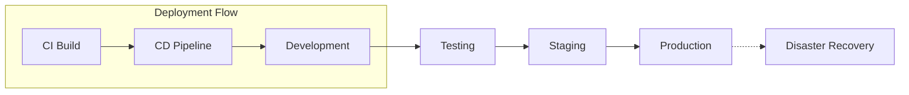
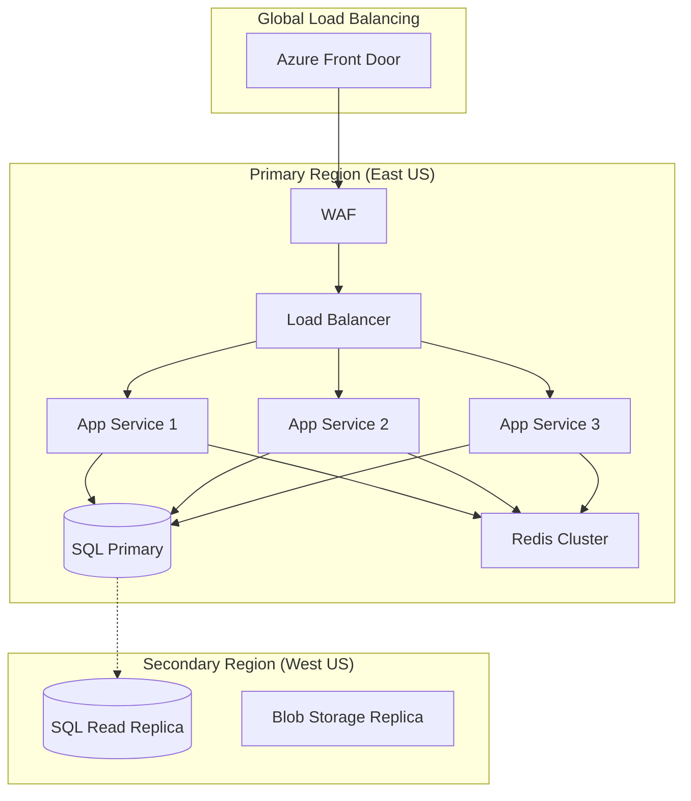
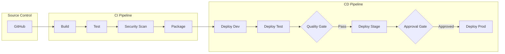

# 🚀 Multi-Environment Deployment Guide

**Version:** 1.0.0  
**Last Updated:** August 21, 2025  
**Application:** GCC Database Web Application

---

## 📋 Table of Contents

1. [Environment Overview](#environment-overview)
2. [Development Environment](#development-environment)
3. [Testing Environment](#testing-environment)
4. [Staging Environment](#staging-environment)
5. [Production Environment](#production-environment)
6. [Disaster Recovery Environment](#disaster-recovery-environment)
7. [Environment Comparison Matrix](#environment-comparison-matrix)
8. [Deployment Automation](#deployment-automation)
9. [Environment Promotion Strategy](#environment-promotion-strategy)

---

## 🌍 Environment Overview

### Environment Architecture



### Environment Purpose Matrix

| Environment | Purpose | Users | Data Type | Uptime SLA |
|------------|---------|-------|-----------|------------|
| **Development** | Active development & debugging | Developers | Mock/Test | None |
| **Testing** | Automated testing & QA | QA Team, CI/CD | Test Data | None |
| **Staging** | Pre-production validation | QA, Product Owners | Prod-like | 95% |
| **Production** | Live system | End Users | Production | 99.9% |
| **DR** | Disaster recovery | Emergency Only | Prod Replica | 99.5% |

---

## 💻 Development Environment

### Infrastructure Specifications

```yaml
Environment: Development
Location: Local / Azure Dev
Resources:
  - App Service: B1 Basic (1 instance)
  - Database: SQLite / SQL Express
  - Storage: Local filesystem
  - Cache: In-memory
  - SSL: Self-signed certificate
```

### Setup Instructions

#### 1. Local Development Setup

```bash
# Clone repository
git clone https://github.com/gcc/database-app.git
cd database-app

# Install dependencies
dotnet restore

# Setup local database
dotnet ef database update

# Run application
dotnet run --environment Development
```

#### 2. Docker Development Setup

```dockerfile
# docker-compose.dev.yml
version: '3.8'
services:
  app:
    build: .
    environment:
      - ASPNETCORE_ENVIRONMENT=Development
      - ConnectionStrings__DefaultConnection=Data Source=app.db
    ports:
      - "5000:80"
      - "5001:443"
    volumes:
      - ./src:/app
      - ./data:/app/data
```

### Configuration

```json
// appsettings.Development.json
{
  "Logging": {
    "LogLevel": {
      "Default": "Debug",
      "Microsoft": "Information"
    }
  },
  "ConnectionStrings": {
    "DefaultConnection": "Data Source=gcc_dev.db"
  },
  "Authentication": {
    "UseAzureAD": false,
    "UseCookieAuth": true
  },
  "Features": {
    "EnableSwagger": true,
    "EnableDebugMode": true,
    "SeedDatabase": true
  }
}
```

### Development Tools

- **Hot Reload**: Enabled for rapid development
- **Swagger UI**: Available at `/swagger`
- **Debug Endpoints**: `/debug/info`, `/debug/health`
- **Mock Services**: Email, SMS, Payment gateways

---

## 🧪 Testing Environment

### Infrastructure Specifications

```yaml
Environment: Testing
Location: Azure Test Subscription
Resources:
  - App Service: S1 Standard (1 instance)
  - Database: Azure SQL Basic (5 DTU)
  - Storage: Azure Storage (LRS)
  - Cache: Redis Basic (250MB)
  - SSL: Azure managed certificate
```

### Automated Deployment

```yaml
# azure-pipelines-test.yml
trigger:
  branches:
    include:
      - develop
      - feature/*

stages:
  - stage: Test
    jobs:
      - job: Deploy
        steps:
          - task: AzureWebApp@1
            inputs:
              azureSubscription: 'Azure-Test'
              appName: 'gcc-test-app'
              package: '$(Pipeline.Workspace)/drop/*.zip'
              
          - task: SqlAzureDacpacDeployment@1
            inputs:
              azureSubscription: 'Azure-Test'
              serverName: 'gcc-test-sql.database.windows.net'
              databaseName: 'GCCTestDB'
              sqlUsername: 'testadmin'
              sqlPassword: '$(TestDbPassword)'
```

### Test Data Management

```sql
-- Reset test database
EXEC sp_MSforeachtable 'ALTER TABLE ? NOCHECK CONSTRAINT all'
EXEC sp_MSforeachtable 'DELETE FROM ?'
EXEC sp_MSforeachtable 'ALTER TABLE ? CHECK CONSTRAINT all'

-- Load test data
EXEC LoadTestData @DataSet = 'Standard'
EXEC GenerateSyntheticData @Records = 10000
```

### Testing Configurations

```json
// appsettings.Testing.json
{
  "ConnectionStrings": {
    "DefaultConnection": "Server=gcc-test-sql.database.windows.net;Database=GCCTestDB;User Id=testadmin;Password={secret}"
  },
  "TestSettings": {
    "EnableMockServices": true,
    "MaxParallelTests": 4,
    "TestDataSetSize": "Medium",
    "AutoCleanup": true
  },
  "Logging": {
    "LogLevel": {
      "Default": "Warning",
      "System.Net.Http": "Information"
    }
  }
}
```

---

## 🎭 Staging Environment

### Infrastructure Specifications

```yaml
Environment: Staging
Location: Azure Production Region (Secondary)
Resources:
  - App Service: P1v3 Premium (2 instances)
  - Database: Azure SQL S2 Standard (50 DTU)
  - Storage: Azure Storage (GRS)
  - Cache: Redis C1 Standard (1GB)
  - CDN: Azure CDN Standard
  - SSL: Managed certificate
```

### Deployment Process

#### Pre-Deployment Checklist

- [ ] All tests passing in Test environment
- [ ] Performance benchmarks met
- [ ] Security scan completed
- [ ] Database migration scripts tested
- [ ] Rollback plan documented
- [ ] Stakeholder approval obtained

#### Deployment Script

```powershell
# deploy-staging.ps1
param(
    [string]$Version,
    [string]$Environment = "Staging"
)

# Backup current deployment
Write-Host "Creating backup..."
az webapp config backup create `
    --resource-group gcc-staging-rg `
    --webapp-name gcc-staging-app `
    --backup-name "pre-$Version"

# Deploy new version
Write-Host "Deploying version $Version..."
az webapp deployment source config-zip `
    --resource-group gcc-staging-rg `
    --name gcc-staging-app `
    --src "./releases/$Version.zip"

# Run smoke tests
Write-Host "Running smoke tests..."
dotnet test SmokeTests.dll --environment Staging

# Warm up application
Invoke-WebRequest -Uri "https://staging.gccdatabase.com/health" -UseBasicParsing
```

### Staging Configuration

```json
// appsettings.Staging.json
{
  "ConnectionStrings": {
    "DefaultConnection": "Server=gcc-staging-sql.database.windows.net;Database=GCCStaging;User Id=staging-app;Password={vault:staging-db-password}"
  },
  "Azure": {
    "KeyVault": {
      "Uri": "https://gcc-staging-kv.vault.azure.net/"
    },
    "ApplicationInsights": {
      "InstrumentationKey": "{staging-key}",
      "EnableAdaptiveSampling": true
    }
  },
  "Features": {
    "EnableBetaFeatures": true,
    "MaintenanceMode": false,
    "RateLimiting": {
      "Enabled": true,
      "RequestsPerMinute": 100
    }
  }
}
```

### Staging Validation Tests

```csharp
// StagingValidation.cs
[TestClass]
public class StagingValidationTests
{
    [TestMethod]
    public async Task ValidateDeployment()
    {
        // Check application health
        var health = await client.GetAsync("/health");
        Assert.AreEqual(HttpStatusCode.OK, health.StatusCode);
        
        // Verify database connectivity
        var dbCheck = await client.GetAsync("/api/health/database");
        Assert.IsTrue(dbCheck.IsSuccessStatusCode);
        
        // Test critical user journeys
        await TestUserLogin();
        await TestCertificateSearch();
        await TestDocumentUpload();
    }
}
```

---

## 🏭 Production Environment

### Infrastructure Specifications

```yaml
Environment: Production
Location: Azure Primary Region (East US)
Resources:
  - App Service: P3v3 Premium (3+ instances with autoscale)
  - Database: Azure SQL P4 Premium (125 DTU) with Read Replicas
  - Storage: Azure Storage (RA-GRS)
  - Cache: Redis P1 Premium (6GB) with clustering
  - CDN: Azure Front Door Premium
  - WAF: Azure WAF v2
  - SSL: EV SSL Certificate
```

### High Availability Architecture



### Production Deployment Process

#### Blue-Green Deployment Strategy

```powershell
# blue-green-deploy.ps1
param(
    [string]$Version,
    [switch]$AutoSwap = $false
)

$ResourceGroup = "gcc-prod-rg"
$AppName = "gcc-prod-app"
$SlotName = "staging"

# Step 1: Deploy to staging slot
Write-Host "Deploying to staging slot..." -ForegroundColor Green
az webapp deployment source config-zip `
    --resource-group $ResourceGroup `
    --name $AppName `
    --slot $SlotName `
    --src "./releases/prod-$Version.zip"

# Step 2: Warm up staging slot
Write-Host "Warming up staging slot..." -ForegroundColor Yellow
$warmupUrls = @(
    "https://gcc-prod-app-staging.azurewebsites.net/",
    "https://gcc-prod-app-staging.azurewebsites.net/api/health",
    "https://gcc-prod-app-staging.azurewebsites.net/certificates"
)

foreach ($url in $warmupUrls) {
    Invoke-WebRequest -Uri $url -UseBasicParsing | Out-Null
}

# Step 3: Run production readiness tests
Write-Host "Running production readiness tests..." -ForegroundColor Cyan
$testResult = dotnet test ProductionReadiness.dll `
    --environment Production `
    --configuration Release

if ($LASTEXITCODE -ne 0) {
    Write-Error "Production readiness tests failed!"
    exit 1
}

# Step 4: Swap slots
if ($AutoSwap) {
    Write-Host "Swapping slots..." -ForegroundColor Green
    az webapp deployment slot swap `
        --resource-group $ResourceGroup `
        --name $AppName `
        --slot $SlotName `
        --action swap
        
    Write-Host "Deployment completed successfully!" -ForegroundColor Green
} else {
    Write-Host "Manual approval required for slot swap" -ForegroundColor Yellow
}
```

### Production Configuration

```json
// appsettings.Production.json
{
  "ConnectionStrings": {
    "DefaultConnection": "Server=gcc-prod-sql.database.windows.net;Database=GCCProduction;User Id=prod-app;Password={vault:prod-db-password};MultipleActiveResultSets=true;Connection Timeout=30;Max Pool Size=100",
    "ReadOnlyConnection": "Server=gcc-prod-sql-replica.database.windows.net;Database=GCCProduction;User Id=prod-reader;Password={vault:prod-reader-password};ApplicationIntent=ReadOnly"
  },
  "Azure": {
    "KeyVault": {
      "Uri": "https://gcc-prod-kv.vault.azure.net/",
      "ClientId": "{managed-identity}",
      "UseMangedIdentity": true
    },
    "ApplicationInsights": {
      "InstrumentationKey": "{prod-key}",
      "EnableAdaptiveSampling": true,
      "SamplingPercentage": 10
    },
    "Redis": {
      "Configuration": "gcc-prod-redis.redis.cache.windows.net:6380,password={vault:redis-password},ssl=True,abortConnect=False,connectTimeout=10000",
      "InstanceName": "GCCProd"
    }
  },
  "Security": {
    "UseHSTS": true,
    "UseHttpsRedirection": true,
    "ContentSecurityPolicy": "default-src 'self'; script-src 'self' 'unsafe-inline' https://cdn.jsdelivr.net; style-src 'self' 'unsafe-inline'",
    "RateLimiting": {
      "Enabled": true,
      "RequestsPerMinute": 60,
      "RequestsPerHour": 1000
    }
  },
  "Performance": {
    "ResponseCaching": true,
    "ResponseCompression": true,
    "MinifyHtml": true,
    "UseCDN": true,
    "CDNBaseUrl": "https://cdn.gccdatabase.com"
  }
}
```

### Production Monitoring

```yaml
# monitoring-config.yml
alerts:
  - name: High CPU Usage
    metric: CpuPercentage
    threshold: 80
    window: 5m
    severity: Warning
    
  - name: High Memory Usage
    metric: MemoryPercentage
    threshold: 85
    window: 5m
    severity: Warning
    
  - name: Slow Response Time
    metric: ResponseTime
    threshold: 2000ms
    window: 5m
    severity: Critical
    
  - name: Error Rate
    metric: Http5xxErrors
    threshold: 10
    window: 5m
    severity: Critical

dashboards:
  - name: Production Overview
    widgets:
      - Requests per second
      - Average response time
      - Error rate
      - Active users
      - Database performance
      - Cache hit ratio
```

---

## 🔥 Disaster Recovery Environment

### Infrastructure Specifications

```yaml
Environment: Disaster Recovery
Location: Azure Secondary Region (West US)
Resources:
  - App Service: P2v3 Premium (2 instances - cold standby)
  - Database: Azure SQL Geo-Replica
  - Storage: RA-GRS (Auto-failover)
  - Cache: Redis Geo-Replica
  - Traffic Manager: For failover routing
```

### DR Activation Process

```powershell
# activate-dr.ps1
param(
    [switch]$Confirm = $false
)

if (!$Confirm) {
    Write-Warning "This will activate the DR environment and failover production traffic!"
    $response = Read-Host "Are you sure? (yes/no)"
    if ($response -ne "yes") {
        exit
    }
}

# Step 1: Scale up DR resources
Write-Host "Scaling up DR environment..." -ForegroundColor Yellow
az appservice plan update `
    --name gcc-dr-plan `
    --resource-group gcc-dr-rg `
    --sku P3v3 `
    --number-of-workers 3

# Step 2: Failover database
Write-Host "Initiating database failover..." -ForegroundColor Yellow
az sql db failover-group set-primary `
    --name gcc-failover-group `
    --resource-group gcc-dr-rg `
    --server gcc-dr-sql

# Step 3: Update Traffic Manager
Write-Host "Updating Traffic Manager..." -ForegroundColor Yellow
az network traffic-manager endpoint update `
    --name gcc-prod-endpoint `
    --profile-name gcc-traffic-manager `
    --resource-group gcc-global-rg `
    --type azureEndpoints `
    --priority 2

az network traffic-manager endpoint update `
    --name gcc-dr-endpoint `
    --profile-name gcc-traffic-manager `
    --resource-group gcc-global-rg `
    --type azureEndpoints `
    --priority 1

Write-Host "DR activation completed!" -ForegroundColor Green
```

---

## 📊 Environment Comparison Matrix

| Feature | Dev | Test | Staging | Production | DR |
|---------|-----|------|---------|------------|-----|
| **Instances** | 1 | 1 | 2 | 3-10 | 2-3 |
| **Database Size** | 10MB | 1GB | 10GB | 100GB+ | 100GB+ |
| **Data Retention** | 1 day | 7 days | 30 days | 7 years | 7 years |
| **Backup Frequency** | None | Daily | Daily | Hourly | Continuous |
| **SSL Certificate** | Self-signed | Azure | Azure | EV SSL | EV SSL |
| **Monitoring** | Basic | Basic | Full | Full | Full |
| **Auto-scaling** | No | No | No | Yes | Yes |
| **Geo-redundancy** | No | No | No | Yes | Yes |
| **SLA** | None | None | 95% | 99.9% | 99.5% |
| **Cost/Month** | $0 | $150 | $500 | $2,500 | $1,500 |

---

## 🤖 Deployment Automation

### CI/CD Pipeline Architecture



### Automated Deployment Configuration

```yaml
# azure-pipelines.yml
trigger:
  branches:
    include:
      - main
      - release/*

variables:
  buildConfiguration: 'Release'
  dotnetVersion: '8.0.x'

stages:
  - stage: Build
    jobs:
      - job: BuildJob
        steps:
          - task: UseDotNet@2
            inputs:
              version: $(dotnetVersion)
              
          - task: DotNetCoreCLI@2
            displayName: 'Restore'
            inputs:
              command: restore
              
          - task: DotNetCoreCLI@2
            displayName: 'Build'
            inputs:
              command: build
              configuration: $(buildConfiguration)
              
          - task: DotNetCoreCLI@2
            displayName: 'Test'
            inputs:
              command: test
              configuration: $(buildConfiguration)
              
          - task: DotNetCoreCLI@2
            displayName: 'Publish'
            inputs:
              command: publish
              configuration: $(buildConfiguration)
              outputDir: $(Build.ArtifactStagingDirectory)
              
          - task: PublishBuildArtifacts@1
            inputs:
              artifactName: 'drop'

  - stage: DeployDev
    dependsOn: Build
    condition: succeeded()
    jobs:
      - deployment: DeployToDev
        environment: 'Development'
        strategy:
          runOnce:
            deploy:
              steps:
                - task: AzureWebApp@1
                  inputs:
                    appName: 'gcc-dev-app'
                    package: '$(Pipeline.Workspace)/drop/*.zip'

  - stage: DeployTest
    dependsOn: DeployDev
    condition: succeeded()
    jobs:
      - deployment: DeployToTest
        environment: 'Testing'
        strategy:
          runOnce:
            deploy:
              steps:
                - task: AzureWebApp@1
                  inputs:
                    appName: 'gcc-test-app'
                    package: '$(Pipeline.Workspace)/drop/*.zip'

  - stage: DeployStaging
    dependsOn: DeployTest
    condition: and(succeeded(), eq(variables['Build.SourceBranch'], 'refs/heads/main'))
    jobs:
      - deployment: DeployToStaging
        environment: 'Staging'
        strategy:
          runOnce:
            deploy:
              steps:
                - task: AzureWebApp@1
                  inputs:
                    appName: 'gcc-staging-app'
                    package: '$(Pipeline.Workspace)/drop/*.zip'

  - stage: DeployProduction
    dependsOn: DeployStaging
    condition: and(succeeded(), eq(variables['Build.SourceBranch'], 'refs/heads/main'))
    jobs:
      - deployment: DeployToProduction
        environment: 'Production'
        strategy:
          runOnce:
            deploy:
              steps:
                - task: AzureWebApp@1
                  inputs:
                    appName: 'gcc-prod-app'
                    slot: 'staging'
                    package: '$(Pipeline.Workspace)/drop/*.zip'
                    
                - task: AzureAppServiceManage@0
                  inputs:
                    action: 'Swap Slots'
                    appName: 'gcc-prod-app'
                    sourceSlot: 'staging'
```

---

## 📈 Environment Promotion Strategy

### Promotion Criteria

#### Dev → Test
- [ ] Code compiles successfully
- [ ] Unit tests pass (>80% coverage)
- [ ] No critical code analysis issues

#### Test → Staging
- [ ] All automated tests pass
- [ ] Performance benchmarks met
- [ ] Security scan completed
- [ ] Integration tests successful

#### Staging → Production
- [ ] UAT sign-off received
- [ ] Performance testing passed
- [ ] Security review completed
- [ ] Change advisory board approval
- [ ] Deployment window scheduled
- [ ] Rollback plan documented
- [ ] Communication plan executed

### Promotion Gates

```yaml
# quality-gates.yml
gates:
  test-to-staging:
    automated:
      - unit-test-coverage: ">= 80%"
      - integration-tests: "100% pass"
      - security-scan: "no high/critical"
      - performance: "< 2s avg response"
    manual:
      - qa-signoff: required
      
  staging-to-production:
    automated:
      - smoke-tests: "100% pass"
      - load-test: "handles 1000 rps"
      - security-audit: "passed"
    manual:
      - product-owner: required
      - change-board: required
      - deployment-window: scheduled
```

---

## 📝 Best Practices

### Environment Isolation
- Separate Azure subscriptions for production/non-production
- Network segmentation between environments
- No shared resources between environments
- Environment-specific service accounts

### Configuration Management
- Use Azure Key Vault for secrets
- Environment-specific configuration files
- Never hardcode environment-specific values
- Use managed identities where possible

### Data Management
- Production data never in non-production environments
- Anonymized data for testing/staging
- Regular data refresh in staging
- Automated data cleanup in test environments

### Security
- Different certificates per environment
- Rotate credentials regularly
- Audit access to production
- Implement least privilege access

---

*This guide is maintained by the DevOps team and updated with each major release.*