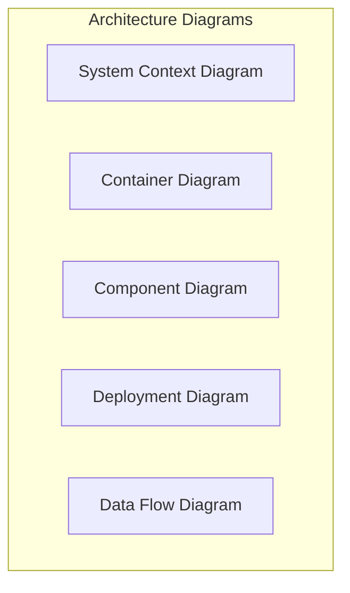

# 📚 GCC Database Application - Master Documentation Plan

**Version:** 1.0.0  
**Date:** August 21, 2025  
**Author:** Development Team  
**Status:** Planning Phase

---

## 📋 Executive Summary

This comprehensive documentation plan outlines the creation of deployment guides, architecture documentation, technical flows, and tool comparison matrices for the GCC Database Application. The plan is organized by priority, complexity, and estimated cost, providing a structured approach to complete technical documentation.

---

## 🎯 Documentation Objectives

1. **Deployment Excellence**: Create comprehensive deployment guides for multiple environments
2. **Architecture Clarity**: Document system architecture with clear diagrams and explanations
3. **Technical Flows**: Map all system processes and data flows
4. **Tool Evaluation**: Compare and recommend tools for various system components
5. **Knowledge Transfer**: Enable smooth onboarding and system maintenance

---

## 📊 Documentation Deliverables Matrix

| Category | Priority | Complexity | Estimated Hours | Cost Range |
|----------|----------|------------|-----------------|------------|
| **Deployment Guides** | Critical | High | 40-60 | $4,000-$6,000 |
| **Architecture Documentation** | Critical | High | 30-40 | $3,000-$4,000 |
| **Technical Flow Diagrams** | High | Medium | 20-30 | $2,000-$3,000 |
| **Technical Guides** | High | Medium | 30-40 | $3,000-$4,000 |
| **Tool Comparison** | Medium | Low | 15-20 | $1,500-$2,000 |
| **Operations Manual** | High | Medium | 25-35 | $2,500-$3,500 |
| **Total Estimated** | - | - | **160-225** | **$16,000-$22,500** |

---

## 📁 Section 1: Deployment Guides

### 1.1 Production Deployment Guide
**Priority:** Critical | **Complexity:** High | **Est. Hours:** 15-20

#### Contents:
- Azure App Service deployment procedures
- Infrastructure as Code (ARM/Terraform templates)
- SSL/TLS certificate configuration
- Custom domain setup
- Application settings and secrets management
- Database migration strategies
- Zero-downtime deployment techniques
- Rollback procedures

#### Deliverables:
```
Documentation/Deployment/
├── Production_Deployment_Guide.md
├── Azure_Infrastructure_Setup.md
├── SSL_Certificate_Management.md
├── Database_Migration_Procedures.md
└── Scripts/
    ├── deploy-production.ps1
    ├── rollback-production.ps1
    └── infrastructure-as-code/
```

### 1.2 Staging Environment Guide
**Priority:** High | **Complexity:** Medium | **Est. Hours:** 8-10

#### Contents:
- Staging environment specifications
- Data synchronization from production
- Testing procedures before production
- Performance benchmarking setup

### 1.3 Development Environment Setup
**Priority:** High | **Complexity:** Low | **Est. Hours:** 5-8

#### Contents:
- Local development prerequisites
- Docker containerization setup
- Database seeding procedures
- Debugging configuration

### 1.4 CI/CD Pipeline Documentation
**Priority:** Critical | **Complexity:** High | **Est. Hours:** 12-15

#### Contents:
- Azure DevOps pipeline configuration
- GitHub Actions workflows
- Automated testing integration
- Security scanning in pipeline
- Artifact management
- Release gates and approvals

---

## 📁 Section 2: Architecture Documentation

### 2.1 System Architecture Overview
**Priority:** Critical | **Complexity:** High | **Est. Hours:** 10-12

#### Contents:
- High-level architecture diagrams
- Component interaction maps
- Technology stack decisions
- Scalability patterns
- Security architecture

#### Diagram Types:


### 2.2 Microservices Architecture (Future State)
**Priority:** Medium | **Complexity:** High | **Est. Hours:** 8-10

#### Contents:
- Service decomposition strategy
- Inter-service communication patterns
- Event-driven architecture design
- Service mesh considerations

### 2.3 Database Architecture
**Priority:** Critical | **Complexity:** Medium | **Est. Hours:** 6-8

#### Contents:
- Entity relationship diagrams
- Data partitioning strategies
- Index optimization guide
- Backup and recovery procedures
- Performance tuning guidelines

### 2.4 Security Architecture
**Priority:** Critical | **Complexity:** High | **Est. Hours:** 6-10

#### Contents:
- Authentication flow diagrams
- Authorization matrix
- Data encryption at rest/transit
- Security boundary definitions
- Threat modeling documentation

---

## 📁 Section 3: Technical Flow Diagrams

### 3.1 Business Process Flows
**Priority:** High | **Complexity:** Medium | **Est. Hours:** 8-10

#### Key Flows to Document:
1. **Certificate Creation Flow**
   - User initiation
   - Validation steps
   - Approval workflow
   - Document generation
   - Notification system

2. **User Authentication Flow**
   - Azure AD B2C integration
   - Cookie fallback mechanism
   - Role assignment
   - Session management

3. **Search and Filter Flow**
   - Query processing
   - Cache interaction
   - Result aggregation
   - Pagination logic

### 3.2 Data Processing Flows
**Priority:** High | **Complexity:** Medium | **Est. Hours:** 6-8

#### Contents:
- ETL pipeline documentation
- Real-time data streaming
- Batch processing workflows
- Data validation pipelines

### 3.3 Integration Flows
**Priority:** Medium | **Complexity:** Medium | **Est. Hours:** 6-8

#### Contents:
- External API integration patterns
- Webhook processing
- File upload/download flows
- Email notification system

---

## 📁 Section 4: Technical Guides

### 4.1 API Development Guide
**Priority:** High | **Complexity:** Medium | **Est. Hours:** 8-10

#### Contents:
- RESTful API design principles
- Versioning strategies
- Authentication/Authorization
- Rate limiting implementation
- Error handling patterns
- OpenAPI/Swagger documentation

### 4.2 Performance Optimization Guide
**Priority:** High | **Complexity:** High | **Est. Hours:** 8-10

#### Contents:
- Query optimization techniques
- Caching strategies
- Lazy loading implementation
- Async/await patterns
- Memory management
- Connection pooling

### 4.3 Security Implementation Guide
**Priority:** Critical | **Complexity:** High | **Est. Hours:** 8-10

#### Contents:
- OWASP Top 10 mitigation
- Input validation techniques
- XSS prevention
- SQL injection prevention
- CSRF protection
- Security headers configuration

### 4.4 Testing Strategy Guide
**Priority:** High | **Complexity:** Medium | **Est. Hours:** 6-10

#### Contents:
- Unit testing best practices
- Integration testing patterns
- E2E testing with Playwright
- Performance testing with k6
- Security testing automation
- Test data management

---

## 📁 Section 5: Tool Comparison & Recommendations

### 5.1 Development Tools Comparison
**Priority:** Medium | **Complexity:** Low | **Est. Hours:** 5-6

| Tool Category | Options | Recommendation | Cost | Complexity |
|---------------|---------|----------------|------|------------|
| **IDE** | VS 2022, VS Code, Rider | VS 2022 Professional | $45/month | Low |
| **Version Control** | Git, Azure DevOps, GitHub | GitHub Enterprise | $21/user/month | Low |
| **CI/CD** | Azure DevOps, GitHub Actions, Jenkins | Azure DevOps | $30/user/month | Medium |
| **Container Registry** | ACR, Docker Hub, GitHub | Azure Container Registry | $5-50/month | Low |

### 5.2 Infrastructure Tools
**Priority:** Medium | **Complexity:** Low | **Est. Hours:** 5-6

| Tool Category | Options | Recommendation | Cost | Complexity |
|---------------|---------|----------------|------|------------|
| **IaC** | Terraform, ARM, Bicep | Terraform | Free (OSS) | Medium |
| **Monitoring** | App Insights, DataDog, New Relic | Application Insights | $2.88/GB | Medium |
| **APM** | App Insights, Dynatrace, AppDynamics | Application Insights | Included | Medium |
| **Log Management** | Azure Monitor, ELK, Splunk | Azure Monitor | $2.30/GB | Low |

### 5.3 Security Tools
**Priority:** High | **Complexity:** Low | **Est. Hours:** 5-8

| Tool Category | Options | Recommendation | Cost | Complexity |
|---------------|---------|----------------|------|------------|
| **SAST** | SonarQube, Checkmarx, Fortify | SonarQube | $150/month | Medium |
| **DAST** | OWASP ZAP, Burp Suite, Acunetix | OWASP ZAP | Free | Medium |
| **Dependency Scan** | Snyk, WhiteSource, Dependabot | Snyk | $99/month | Low |
| **Secrets Management** | Azure Key Vault, HashiCorp Vault | Azure Key Vault | $0.03/10k ops | Low |

---

## 📁 Section 6: Operations Manual

### 6.1 Day-to-Day Operations
**Priority:** High | **Complexity:** Medium | **Est. Hours:** 8-10

#### Contents:
- Daily monitoring checklist
- Performance metrics to track
- Alert response procedures
- Backup verification
- Security audit procedures

### 6.2 Incident Response Guide
**Priority:** Critical | **Complexity:** Medium | **Est. Hours:** 6-8

#### Contents:
- Incident classification matrix
- Escalation procedures
- Communication templates
- Post-mortem process
- Root cause analysis templates

### 6.3 Disaster Recovery Plan
**Priority:** Critical | **Complexity:** High | **Est. Hours:** 8-10

#### Contents:
- RTO/RPO definitions
- Backup strategies
- Recovery procedures
- Failover processes
- Testing schedules

### 6.4 Maintenance Procedures
**Priority:** Medium | **Complexity:** Low | **Est. Hours:** 3-5

#### Contents:
- Patching procedures
- Certificate renewal
- Database maintenance
- Log rotation
- Archive procedures

---

## 📅 Implementation Timeline

### Phase 1: Critical Documentation (Weeks 1-4)
- Production Deployment Guide
- System Architecture Overview
- Security Implementation Guide
- Incident Response Guide

### Phase 2: High Priority (Weeks 5-8)
- CI/CD Pipeline Documentation
- Technical Flow Diagrams
- API Development Guide
- Day-to-Day Operations Manual

### Phase 3: Medium Priority (Weeks 9-12)
- Tool Comparison Matrices
- Performance Optimization Guide
- Staging Environment Guide
- Maintenance Procedures

### Phase 4: Enhancement Documentation (Weeks 13-16)
- Microservices Architecture
- Advanced Integration Patterns
- Comprehensive Testing Guide
- Future State Architecture

---

## 💰 Cost Analysis

### Documentation Development Costs

| Resource Type | Hours | Rate | Total Cost |
|---------------|-------|------|------------|
| Senior Technical Writer | 100 | $100/hr | $10,000 |
| Solution Architect | 60 | $150/hr | $9,000 |
| DevOps Engineer | 40 | $120/hr | $4,800 |
| Security Specialist | 25 | $130/hr | $3,250 |
| **Total Professional Services** | **225** | - | **$27,050** |

### Tool Licensing Costs (Annual)

| Tool Category | Selected Tools | Annual Cost |
|---------------|---------------|-------------|
| Development Tools | VS 2022, GitHub Enterprise | $3,300 |
| CI/CD & DevOps | Azure DevOps, Terraform Cloud | $4,200 |
| Monitoring & APM | Application Insights, Azure Monitor | $2,400 |
| Security Tools | SonarQube, Snyk | $2,988 |
| **Total Tool Costs** | - | **$12,888** |

### Infrastructure Costs (Monthly)

| Component | Specification | Monthly Cost |
|-----------|--------------|--------------|
| Azure App Service | P1v3 (2 instances) | $284 |
| Azure SQL Database | S2 Standard | $75 |
| Application Gateway | Standard v2 | $246 |
| Redis Cache | C1 Standard | $61 |
| Storage & Backup | 500GB + Snapshots | $45 |
| **Total Infrastructure** | - | **$711** |

---

## 📊 Complexity & Priority Matrix

```
High Complexity / High Priority (DO FIRST)
├── Production Deployment Guide
├── System Architecture Documentation
├── Security Implementation Guide
└── CI/CD Pipeline Setup

Medium Complexity / High Priority (DO SECOND)
├── Technical Flow Diagrams
├── API Development Guide
├── Operations Manual
└── Performance Optimization

Low Complexity / High Priority (QUICK WINS)
├── Development Environment Setup
├── Tool Comparison Matrices
└── Maintenance Procedures

Medium Complexity / Medium Priority (PHASE 3)
├── Microservices Architecture
├── Advanced Integration Patterns
└── Comprehensive Testing Guide
```

---

## 🎯 Success Metrics

### Documentation Quality Metrics
- **Completeness**: 100% of planned sections completed
- **Accuracy**: <5% error rate in technical details
- **Clarity**: 90% user comprehension rate
- **Currency**: Updated within 30 days of system changes

### Operational Metrics
- **Deployment Time**: Reduced by 50% with automation
- **Incident Resolution**: 30% faster with proper documentation
- **Onboarding Time**: New developers productive in <1 week
- **System Uptime**: Achieve 99.9% availability

---

## 🔄 Maintenance & Updates

### Review Schedule
- **Weekly**: Operations procedures and incident documentation
- **Monthly**: Deployment guides and configuration
- **Quarterly**: Architecture and design documentation
- **Annually**: Complete documentation audit

### Version Control
- All documentation in Git repository
- Markdown format for easy versioning
- Pull request reviews for changes
- Automated documentation builds

---

## 📝 Next Steps

1. **Immediate Actions** (This Week)
   - [ ] Review and approve documentation plan
   - [ ] Assign documentation owners
   - [ ] Set up documentation repository structure
   - [ ] Begin Phase 1 critical documentation

2. **Short Term** (Next 2 Weeks)
   - [ ] Complete production deployment guide
   - [ ] Create initial architecture diagrams
   - [ ] Document current security implementation
   - [ ] Establish documentation review process

3. **Medium Term** (Next Month)
   - [ ] Complete Phase 1 and 2 documentation
   - [ ] Conduct documentation review sessions
   - [ ] Begin tool evaluation and selection
   - [ ] Train team on documentation standards

---

## 📚 References & Resources

### Documentation Standards
- [Microsoft Documentation Style Guide](https://docs.microsoft.com/style-guide)
- [Google Developer Documentation Style Guide](https://developers.google.com/style)
- [Write the Docs Community](https://www.writethedocs.org)

### Diagramming Tools
- [Mermaid](https://mermaid-js.github.io) - Markdown-based diagrams
- [Draw.io](https://draw.io) - Free diagramming tool
- [Lucidchart](https://lucidchart.com) - Professional diagrams
- [PlantUML](https://plantuml.com) - Text-based UML

### Architecture Frameworks
- [C4 Model](https://c4model.com) - Software architecture diagrams
- [TOGAF](https://www.opengroup.org/togaf) - Enterprise architecture
- [Azure Architecture Framework](https://docs.microsoft.com/azure/architecture)

---

*This documentation plan is a living document and will be updated as the project evolves.*

**Document Owner:** Development Team  
**Last Review:** August 21, 2025  
**Next Review:** September 21, 2025