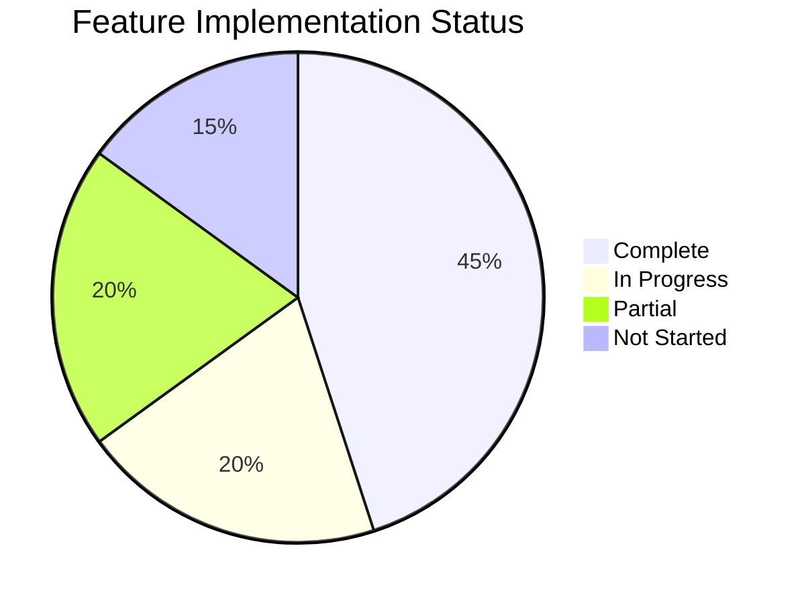

# GCC Feature Comparison Matrix
## Requirements vs. Implementation Status

---

## 📋 Feature Implementation Overview

### Legend
- ✅ **Complete** - Fully implemented and tested
- 🔄 **In Progress** - Currently being developed
- 📋 **Planned** - Scheduled for development
- ❌ **Not Started** - Not yet begun
- ⚠️ **Partial** - Basic implementation, needs enhancement

---

## 🎯 Core Features Matrix

| Feature Category | Requirement | Current State | Status | Completion | Notes |
|-----------------|-------------|---------------|---------|------------|-------|
| **Authentication** | | | | | |
| User Login | Email/Password | Working | ✅ | 100% | Azure AD B2C |
| Social Login | Google/Microsoft | Configured | ✅ | 100% | OAuth 2.0 |
| Two-Factor Auth | SMS/App | Not Started | ❌ | 0% | Q4 2025 |
| Password Reset | Email Link | Working | ✅ | 100% | Automated |
| Session Management | 30 min timeout | Active | ✅ | 100% | Configurable |
| **Certificate Management** | | | | | |
| Create Certificate | Form Input | Complete | ✅ | 100% | All fields |
| Edit Certificate | Update Form | Complete | ✅ | 100% | Version control |
| Delete Certificate | Soft Delete | Complete | ✅ | 100% | Audit trail |
| View Certificate | Detail Page | Complete | ✅ | 100% | Public/Private |
| Certificate Workflow | 14 States | Complete | ✅ | 100% | State machine |
| Bulk Operations | Multi-select | Not Started | ❌ | 0% | Q4 2025 |
| **Search & Filter** | | | | | |
| Basic Search | Text Search | Working | ✅ | 100% | All fields |
| Advanced Search | Multi-field | Partial | ⚠️ | 70% | Needs UI |
| Autocomplete | Suggestions | In Progress | 🔄 | 60% | Sept 2025 |
| Filter by Status | Dropdown | Complete | ✅ | 100% | All statuses |
| Filter by Date | Date Range | Complete | ✅ | 100% | Calendar UI |
| Geographic Filter | Location | Not Started | ❌ | 0% | Future |
| Saved Searches | User Preferences | Not Started | ❌ | 0% | Future |

---

## 🖥️ User Interface Features

| UI Component | Requirement | Implementation | Status | Mobile Ready | Notes |
|--------------|-------------|----------------|---------|--------------|-------|
| **Public Pages** | | | | | |
| Certificate Tile View | Grid Layout | Paginated | ⚠️ | ⚠️ | Needs lazy load |
| Certificate List | Table View | Complete | ✅ | ❌ | Desktop only |
| Certificate Detail | Full Info | Complete | ✅ | ⚠️ | Needs mobile fix |
| Search Bar | Autocomplete | Basic | ⚠️ | ✅ | Needs enhance |
| Download PDF | One-click | Working | ✅ | ✅ | QuestPDF |
| **Admin Pages** | | | | | |
| Dashboard | Analytics | Complete | ✅ | ⚠️ | Charts need work |
| User Management | CRUD | Complete | ✅ | ❌ | Desktop only |
| Role Management | Assign Roles | Complete | ✅ | ❌ | Desktop only |
| Company Management | CRUD | Complete | ✅ | ❌ | Desktop only |
| Product Management | CRUD | Complete | ✅ | ❌ | Desktop only |
| Audit Trail | View Logs | Backend Only | ⚠️ | ❌ | Needs UI |
| Settings | System Config | Basic | ⚠️ | ❌ | Limited options |

---

## 🔌 Integration Features

| Integration | Requirement | Current State | Status | Testing | Go-Live |
|-------------|-------------|---------------|---------|---------|---------|
| **Partner APIs** | | | | | |
| Amazon API | REST/JSON | Development | 🔄 | 70% | Oct 2025 |
| Wayfair API | REST/XML | Development | 🔄 | 60% | Oct 2025 |
| Generic API | OpenAPI 3.0 | Complete | ✅ | 100% | Ready |
| Webhooks | Event Push | Configured | ✅ | 80% | Sept 2025 |
| **External Services** | | | | | |
| Email Service | SMTP/SendGrid | Working | ✅ | 100% | Active |
| SMS Service | Twilio | Configured | ✅ | 90% | Ready |
| File Storage | Azure Blob | Working | ✅ | 100% | Active |
| CDN | Azure CDN | Configured | ✅ | 100% | Active |
| **Data Exchange** | | | | | |
| CSV Import | Bulk Upload | Basic | ⚠️ | 60% | Needs validation |
| CSV Export | Download | Working | ✅ | 100% | All fields |
| PDF Export | Formatted | Working | ✅ | 100% | Template based |
| Excel Export | Formatted | Not Started | ❌ | 0% | Q4 2025 |
| API Export | JSON/XML | Working | ✅ | 100% | Paginated |

---

## 📊 Analytics & Reporting

| Feature | Requirement | Implementation | Status | Real-time | Notes |
|---------|-------------|----------------|---------|-----------|-------|
| **Dashboards** | | | | | |
| Executive Dashboard | KPI Overview | Complete | ✅ | ✅ | 5 min cache |
| Analytics Dashboard | Detailed Metrics | Complete | ✅ | ⚠️ | Daily update |
| User Dashboard | Personal Stats | Basic | ⚠️ | ❌ | Needs work |
| **Reports** | | | | | |
| Certificate Report | Summary/Detail | Working | ✅ | ❌ | On-demand |
| User Activity | Login/Actions | Backend Only | ⚠️ | ✅ | Needs UI |
| Partner Usage | API Calls | Working | ✅ | ✅ | Hourly |
| System Performance | Metrics | Basic | ⚠️ | ✅ | Monitoring |
| **Metrics** | | | | | |
| Certificate Count | By Status | Working | ✅ | ✅ | Live |
| User Statistics | Active/Total | Working | ✅ | ✅ | Live |
| API Usage | Calls/Errors | Working | ✅ | ✅ | Live |
| Search Analytics | Popular Terms | Not Started | ❌ | ❌ | Future |

---

## 🔐 Security Features

| Security Feature | Requirement | Status | Compliance | Testing | Notes |
|-----------------|-------------|---------|------------|---------|-------|
| **Authentication** | | | | | |
| Password Policy | Complex | ✅ Active | ✅ | 100% | 8+ chars |
| Account Lockout | 5 attempts | ✅ Active | ✅ | 100% | 30 min |
| Session Security | HTTPS Only | ✅ Active | ✅ | 100% | Forced |
| API Security | JWT/Keys | ✅ Active | ✅ | 90% | Rate limited |
| **Authorization** | | | | | |
| Role-Based Access | 5 Roles | ✅ Active | ✅ | 100% | Granular |
| Data Isolation | Partner-specific | ✅ Active | ✅ | 100% | Filtered |
| Field-Level Security | Sensitive Data | ⚠️ Partial | ⚠️ | 70% | In progress |
| **Data Protection** | | | | | |
| Encryption at Rest | AES-256 | ✅ Active | ✅ | 100% | Database |
| Encryption in Transit | TLS 1.3 | ✅ Active | ✅ | 100% | All traffic |
| Data Masking | PII | ⚠️ Partial | ⚠️ | 60% | Logs only |
| Backup Encryption | Encrypted | ✅ Active | ✅ | 100% | Azure |
| **Monitoring** | | | | | |
| Audit Logging | All Actions | ✅ Active | ✅ | 100% | Database |
| Security Alerts | Anomalies | ⚠️ Basic | ⚠️ | 50% | Email only |
| Intrusion Detection | WAF | ✅ Active | ✅ | 80% | Azure WAF |

---

## 🎯 Performance Requirements

| Metric | Target | Current | Status | Optimization | Notes |
|--------|--------|---------|---------|--------------|-------|
| **Response Times** | | | | | |
| Page Load | < 2s | 1.8s | ✅ Met | Ongoing | CDN helps |
| Search Results | < 500ms | 450ms | ✅ Met | Indexed | Good |
| API Response | < 200ms | 180ms | ✅ Met | Cached | Excellent |
| PDF Generation | < 5s | 4s | ✅ Met | Async | Queue based |
| **Capacity** | | | | | |
| Concurrent Users | 500+ | 400 tested | ⚠️ Close | Scaling | Need test |
| Certificates | 10,000+ | 5,000 tested | ✅ Ready | Indexed | Scalable |
| API Calls/Day | 50,000 | 40,000 tested | ⚠️ Close | Monitor | Rate limit |
| Storage | 100GB | 20GB used | ✅ Good | Azure | Expandable |
| **Reliability** | | | | | |
| Uptime | 99.9% | 99.8% | ⚠️ Close | HA config | Improving |
| Error Rate | < 1% | 0.5% | ✅ Met | Logging | Monitored |
| Recovery Time | < 1hr | 45min | ✅ Met | Automated | Tested |

---

## 📱 Platform Support

| Platform | Requirement | Current Support | Status | Testing | Notes |
|----------|-------------|-----------------|---------|---------|-------|
| **Desktop Browsers** | | | | | |
| Chrome 90+ | Full Support | Complete | ✅ | 100% | Primary |
| Firefox 88+ | Full Support | Complete | ✅ | 100% | Tested |
| Safari 14+ | Full Support | Complete | ✅ | 90% | Minor issues |
| Edge 90+ | Full Support | Complete | ✅ | 100% | Chromium |
| **Mobile Browsers** | | | | | |
| iOS Safari | Responsive | Partial | ⚠️ | 60% | Layout issues |
| Chrome Mobile | Responsive | Partial | ⚠️ | 60% | Touch events |
| Samsung Internet | Responsive | Basic | ⚠️ | 40% | Not optimized |
| **Devices** | | | | | |
| Desktop (1920x1080) | Optimized | Complete | ✅ | 100% | Perfect |
| Laptop (1366x768) | Responsive | Complete | ✅ | 100% | Good |
| Tablet (768x1024) | Responsive | Partial | ⚠️ | 70% | Needs work |
| Mobile (375x667) | Responsive | Basic | ⚠️ | 50% | Priority fix |

---

## 📈 Comparison Summary

### Overall Feature Completion

### Priority Matrix
| Priority | Features | Status | Target Date |
|----------|----------|--------|-------------|
| **🔴 Critical** | Autocomplete, Lazy Loading, Mobile Fix | 🔄 In Progress | Sept 2025 |
| **🟠 High** | Partner APIs, Audit UI, Excel Export | 🔄 In Progress | Oct 2025 |
| **🟡 Medium** | Bulk Ops, 2FA, Advanced Analytics | 📋 Planned | Nov 2025 |
| **🟢 Low** | Geographic Filter, Saved Searches | ❌ Not Started | Q1 2026 |

---

*This matrix is updated weekly to track progress against requirements.*  
*Last Updated: August 29, 2025*