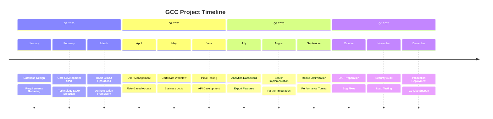
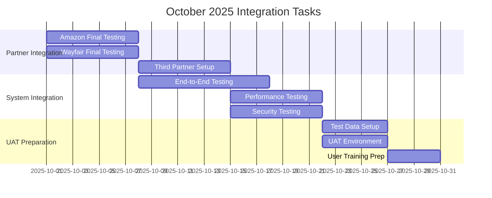
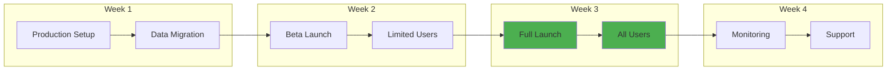
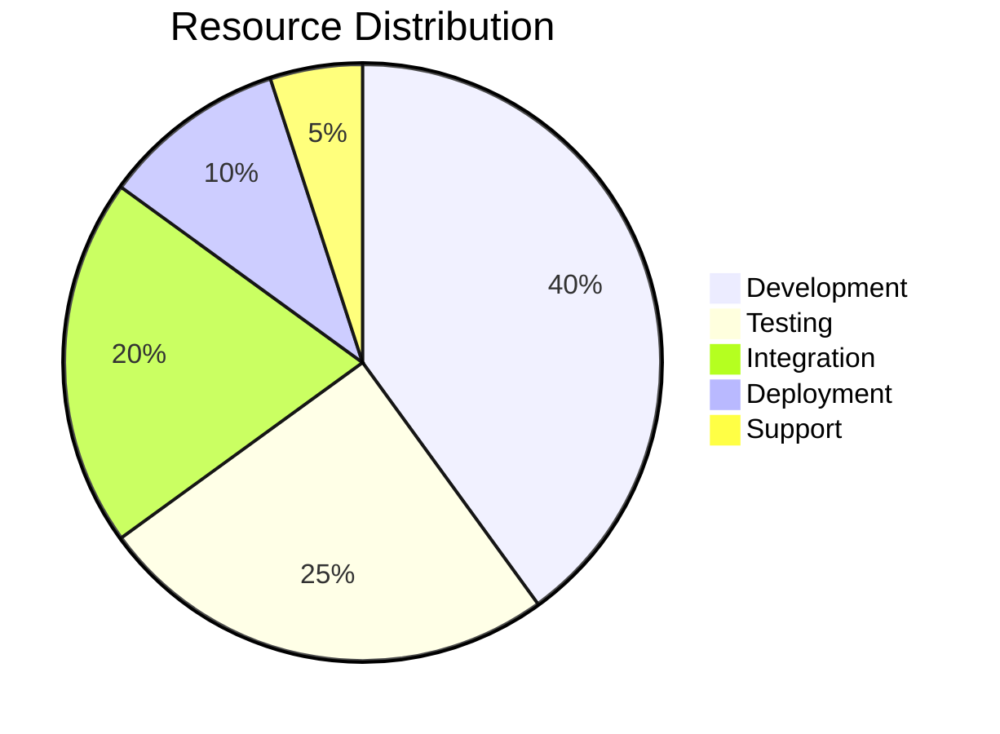
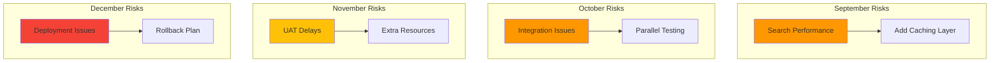
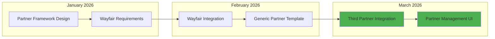

# GCC Implementation Roadmap
## From Development to Production - Q3 2025 to Q1 2026

---

## 📅 Master Timeline

---

## 🎯 Phase 1: Foundation (✅ Complete)
*January - June 2025*

### Completed Deliverables
- ✅ **Database Architecture** - Normalized schema with 15+ tables
- ✅ **Authentication System** - Azure AD B2C integration
- ✅ **Core CRUD Operations** - Certificate management
- ✅ **User Role System** - 5 role types implemented
- ✅ **Basic UI Framework** - Responsive layout structure
- ✅ **API Foundation** - RESTful endpoints

### Key Achievements
- 100% database schema implemented
- Authentication working for all user types
- Basic certificate lifecycle functional
- Admin interface operational

---

## 🚀 Phase 2: Enhancement (🔄 Current Phase)
*July - September 2025*

### August 2025 (Current Month)
| Week | Focus Area | Status | Details |
|------|------------|--------|---------|
| Week 1 | Analytics Dashboard | ✅ Complete | Charts, metrics, KPIs |
| Week 2 | Basic Search | ✅ Complete | Text search, filters |
| Week 3 | Export Features | ✅ Complete | CSV, PDF generation |
| **Week 4** | **Advanced Search** | **🔄 Active** | **Autocomplete, suggestions** |
| Week 5 | Partner APIs | 🔄 Active | Amazon, Wayfair integration |

### September 2025 (Next Month)
| Week | Deliverable | Owner | Priority |
|------|-------------|-------|----------|
| Week 1 | Complete Autocomplete | Frontend Team | 🔴 Critical |
| Week 2 | Lazy Loading Implementation | Backend Team | 🔴 Critical |
| Week 3 | Mobile Responsive Fixes | UI Team | 🟠 High |
| Week 4 | Performance Optimization | DevOps | 🟠 High |

### Phase 2 Success Criteria
- [ ] Search returns results in < 500ms
- [ ] Mobile experience fully responsive
- [ ] Partner APIs tested and validated
- [ ] 90% feature completion

---

## 🏗️ Phase 3: Integration & Testing
*October - November 2025*

### October 2025 - Integration Sprint

### November 2025 - Quality Assurance
| Activity | Duration | Participants | Output |
|----------|----------|--------------|--------|
| **UAT Round 1** | Week 1 | 10 Key Users | Bug List, Feedback |
| **Bug Fixes** | Week 2 | Dev Team | Patch Release |
| **UAT Round 2** | Week 3 | 20 Users | Sign-off Document |
| **Performance Tuning** | Week 4 | DevOps | Optimization Report |

---

## 🚀 Phase 4: Deployment
*December 2025*

### Deployment Schedule

### Go-Live Checklist
- [ ] Docker production environment configured
- [ ] Docker images built and tested
- [ ] SSL certificates configured in containers
- [ ] Volume mounts for data persistence verified
- [ ] Docker container monitoring active
- [ ] Database container backups configured
- [ ] Container orchestration tested (scaling)
- [ ] Docker rollback procedures documented
- [ ] Support team trained on Docker operations
- [ ] Communication sent to users
- [ ] Partner notifications completed

---

## 📊 Resource Allocation

### Team Allocation by Phase

### Staffing Plan
| Role | Aug | Sep | Oct | Nov | Dec |
|------|-----|-----|-----|-----|-----|
| Lead Developer | 100% | 100% | 80% | 60% | 40% |
| Frontend Dev | 100% | 80% | 60% | 40% | 20% |
| Backend Dev | 80% | 100% | 80% | 60% | 40% |
| QA Engineer | 60% | 80% | 100% | 100% | 60% |
| DevOps | 40% | 60% | 80% | 100% | 100% |
| Support | 20% | 20% | 40% | 60% | 100% |

---

## 🎯 Critical Milestones

### Milestone Timeline
| Date | Milestone | Dependency | Risk Level |
|------|-----------|------------|------------|
| **Sept 15** | Search Complete | UI Team | 🟠 Medium |
| **Sept 30** | Amazon API Live | Amazon Cooperation | 🔴 High |
| **Oct 15** | Integration Testing | All Features | 🟠 Medium |
| **Oct 31** | UAT Environment | Infrastructure | 🟡 Low |
| **Nov 15** | UAT Sign-off | User Feedback | 🟠 Medium |
| **Nov 30** | Production Ready | All Tests Pass | 🟠 Medium |
| **Dec 15** | Go-Live | Executive Approval | 🟡 Low |

---

## ⚠️ Risk Management

### Risk Mitigation Timeline

---

## 📈 Success Metrics

### Phase Success Indicators
| Phase | KPI | Target | Measurement |
|-------|-----|--------|-------------|
| **Enhancement** | Feature Completion | 95% | Story Points |
| **Integration** | API Success Rate | 99% | Response Logs |
| **Testing** | Bug Resolution | < 48hrs | Issue Tracker |
| **Deployment** | Uptime | 99.9% | Monitoring |

### Post-Launch Targets (30 Days)
- 🎯 **200+ Active Users**
- 🎯 **1000+ Certificates**
- 🎯 **10,000+ API Calls/Day**
- 🎯 **< 2% Error Rate**
- 🎯 **< 2s Page Load**

---

## 🔄 Continuous Improvement

### Phase 2: Additional Partners (Q1 2026)

**Phase 2 Scope**: 
- **Wayfair Integration**: Custom API endpoints and data mapping
- **Generic Partner Framework**: Reusable architecture for future partners
- **Partner Management**: Admin interface for configuring new partners
- **Estimated Timeline**: 6-8 weeks
- **Estimated Cost**: $35,000

---

## 📞 Communication Plan

### Stakeholder Updates
| Audience | Frequency | Format | Owner |
|----------|-----------|--------|-------|
| Executive Team | Weekly | Dashboard | PM |
| Development Team | Daily | Stand-up | Lead Dev |
| Users | Bi-weekly | Email | Marketing |
| Partners | Monthly | Report | Business |

---

*This roadmap is updated weekly. Last update: August 29, 2025*  
*For questions: project-manager@greencirclecertified.com*