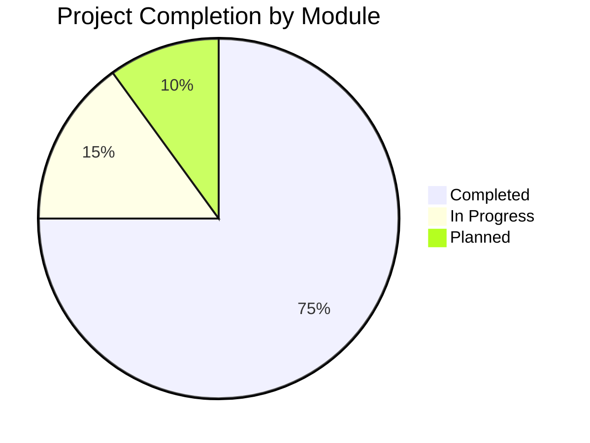
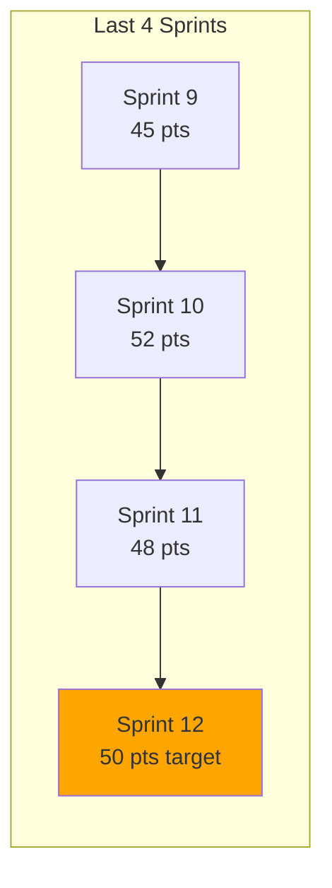
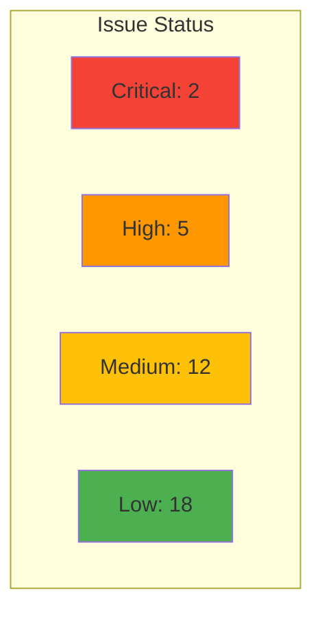
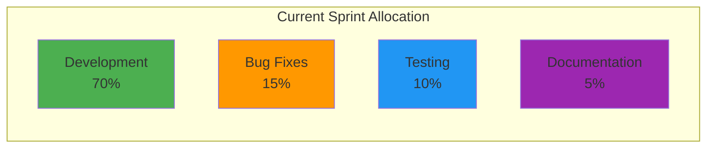
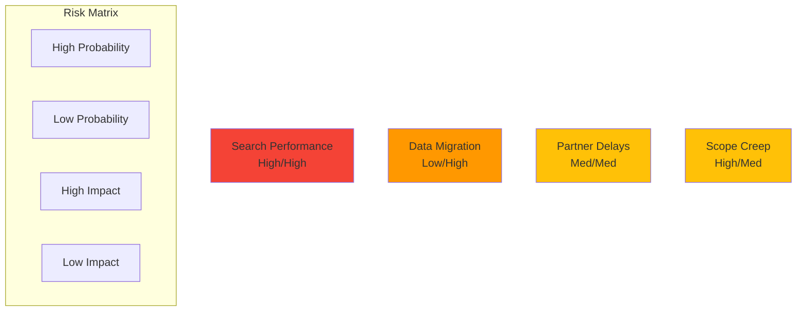
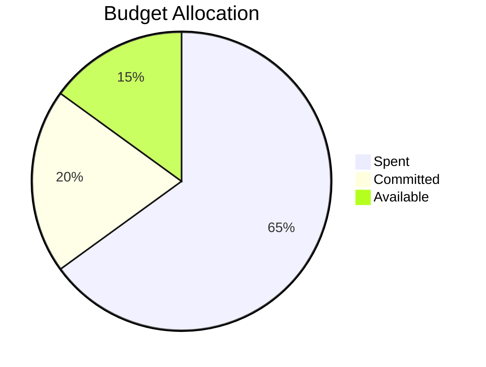

# GCC Project Status Dashboard
*Real-Time Project Health Metrics*

---

## 📊 Overall Project Health Score: **B+ (85%)**

---

## 🎯 Sprint Progress (Current Sprint: #12)

### Sprint Goals
| Goal | Status | Progress |
|------|--------|----------|
| Complete Autocomplete Search | 🔄 In Progress | ████████░░ 80% |
| Implement Lazy Loading | 🔄 In Progress | ██████░░░░ 60% |
| Fix Critical Bugs | ✅ Complete | ██████████ 100% |
| Amazon API Testing | 🔄 In Progress | ███████░░░ 70% |
| Mobile Optimization | 📋 Planned | ██░░░░░░░░ 20% |

### Sprint Velocity

---

## 🐛 Issue Tracking

### Open Issues by Priority

### Critical Issues
1. **🔴 Search Performance** - Slow response on large datasets
   - *Impact*: User Experience
   - *ETA*: Sept 5, 2025
   
2. **🔴 Mobile Layout** - Certificate view breaks on small screens
   - *Impact*: Mobile Users
   - *ETA*: Sept 8, 2025

---

## ✅ Feature Delivery Status

### Completed Features (Last 30 Days)
- ✅ PDF Certificate Generation
- ✅ Role-Based Access Control
- ✅ Basic Analytics Dashboard
- ✅ CSV Export Functionality
- ✅ Audit Trail Implementation

### In Development
| Feature | Developer | Progress | ETA |
|---------|-----------|----------|-----|
| Autocomplete Search | Dev 1 | ████████░░ 80% | Sept 10 |
| Lazy Loading | Dev 2 | ██████░░░░ 60% | Sept 15 |
| Partner Branding | Dev 3 | ███████░░░ 70% | Sept 12 |
| Advanced Filters | Dev 1 | ████░░░░░░ 40% | Sept 20 |

### Upcoming Features (Next Sprint)
- 📋 Geographic Search Filters
- 📋 Bulk Certificate Updates
- 📋 Enhanced Mobile Experience
- 📋 API Rate Limiting
- 📋 Two-Factor Authentication

---

## 👥 Team Performance

### Team Capacity

### Individual Contributions (This Week)
| Team Member | Commits | Pull Requests | Issues Resolved |
|-------------|---------|---------------|-----------------|
| Lead Dev | 23 | 8 | 12 |
| Frontend Dev | 18 | 6 | 8 |
| Backend Dev | 21 | 7 | 10 |
| QA Engineer | 5 | 2 | 15 |

---

## 📈 Key Performance Indicators

### System Metrics
| Metric | Current | Target | Status |
|--------|---------|--------|--------|
| **Page Load Time** | 1.8s | < 2s | ✅ Good |
| **API Response** | 180ms | < 200ms | ✅ Good |
| **Uptime** | 99.8% | 99.9% | ⚠️ Close |
| **Error Rate** | 0.5% | < 1% | ✅ Good |
| **Test Coverage** | 78% | > 80% | ⚠️ Close |

### Business Metrics
| Metric | Current | Target | Trend |
|--------|---------|--------|-------|
| **Active Users** | 145 | 200 | 📈 ↑15% |
| **Certificates Created/Day** | 25 | 30 | 📈 ↑10% |
| **API Calls/Day** | 8,500 | 10,000 | 📈 ↑20% |
| **Partner Integrations** | 2 | 3 | 🔄 Stable |

---

## 🚨 Risk Assessment

### Current Risks

### Risk Mitigation Status
| Risk | Mitigation Action | Status |
|------|------------------|--------|
| Search Performance | Implement caching layer | 🔄 In Progress |
| Data Migration | Phased rollout plan | ✅ Planned |
| Partner Delays | Parallel development | ✅ Active |
| Scope Creep | Weekly scope reviews | ✅ Active |

---

## 📅 Milestone Timeline

### Q3 2025 (Current Quarter)
- ✅ **July**: Core Features Complete
- ✅ **August**: API Development & Testing
- 🔄 **September**: Search & Partner Integration

### Q4 2025 (Next Quarter)
- 📋 **October**: User Acceptance Testing
- 📋 **November**: Performance & Security
- 📋 **December**: Production Deployment

---

## 💰 Budget Status

### Development Budget

### Resource Utilization
| Resource | Allocated | Used | Remaining |
|----------|-----------|------|-----------|
| Development Hours | 2000 | 1300 | 700 |
| Testing Hours | 400 | 250 | 150 |
| Infrastructure | $10K | $6.5K | $3.5K |
| Licenses | $5K | $4K | $1K |

---

## 🎯 Next Week Priorities

### Top 5 Action Items
1. **Complete Autocomplete Search** - Frontend implementation
2. **Fix Mobile Layout Issues** - Critical bug resolution
3. **Partner API Testing** - Amazon integration validation
4. **Performance Testing** - Load testing with 1000+ records
5. **Documentation Update** - API documentation completion

### Blocked Items
- ⚠️ **Wayfair API Credentials** - Awaiting partner response
- ⚠️ **Production SSL Certificate** - Procurement in progress
- ⚠️ **Two-Factor Auth Library** - License approval pending

---

## 📞 Escalation Items

### Needs Executive Attention
1. **Partner Agreement** - Wayfair contract finalization
2. **Budget Approval** - Additional testing resources ($5K)
3. **Go-Live Date** - Confirm December 1st target

---

*Dashboard Updated: August 29, 2025 | Next Update: September 5, 2025*