# GCC System Overview - Visual Guide

## 🏗️ System Architecture

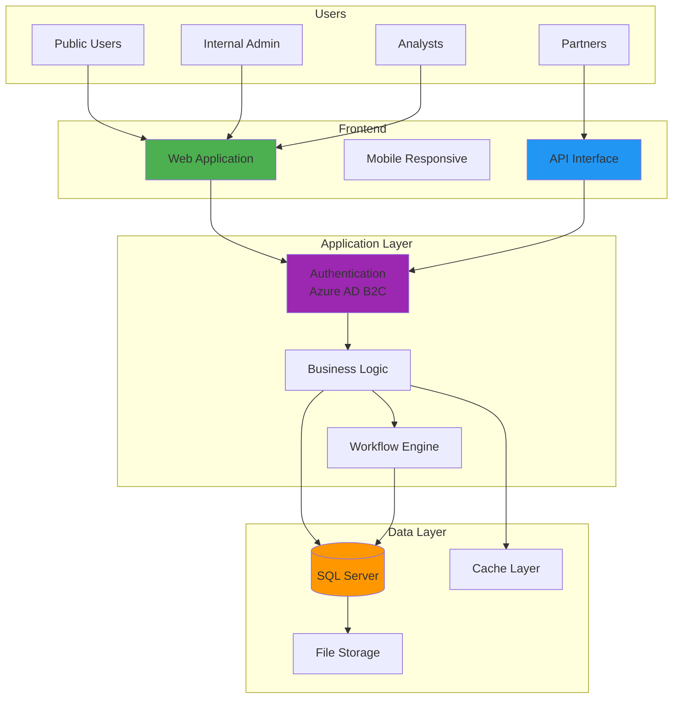

---

## 📊 Data Flow Diagram

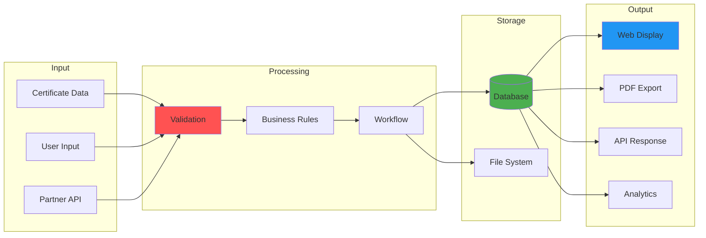

---

## 🔄 Certificate Lifecycle

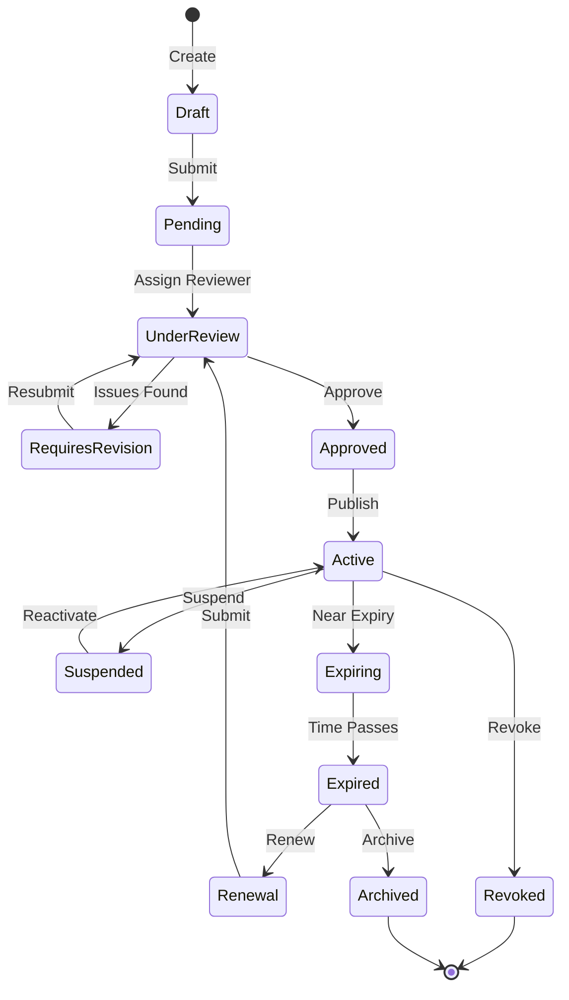

---

## 👥 User Journey Map

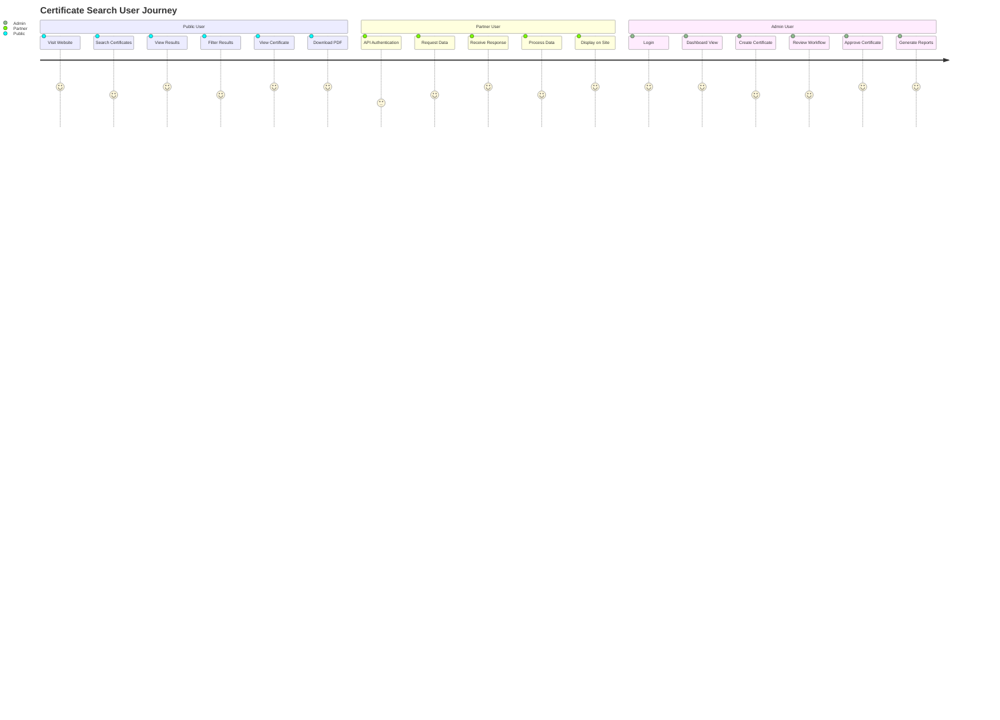

---

## 🗺️ Site Navigation Structure

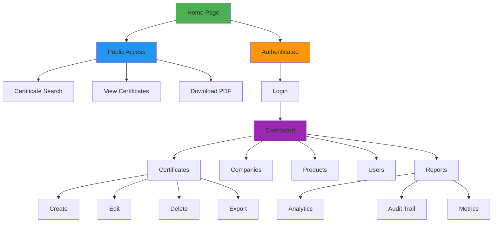

---

## 🔐 Security Architecture

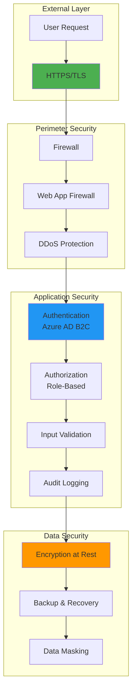

---

## 📈 Performance Metrics Dashboard

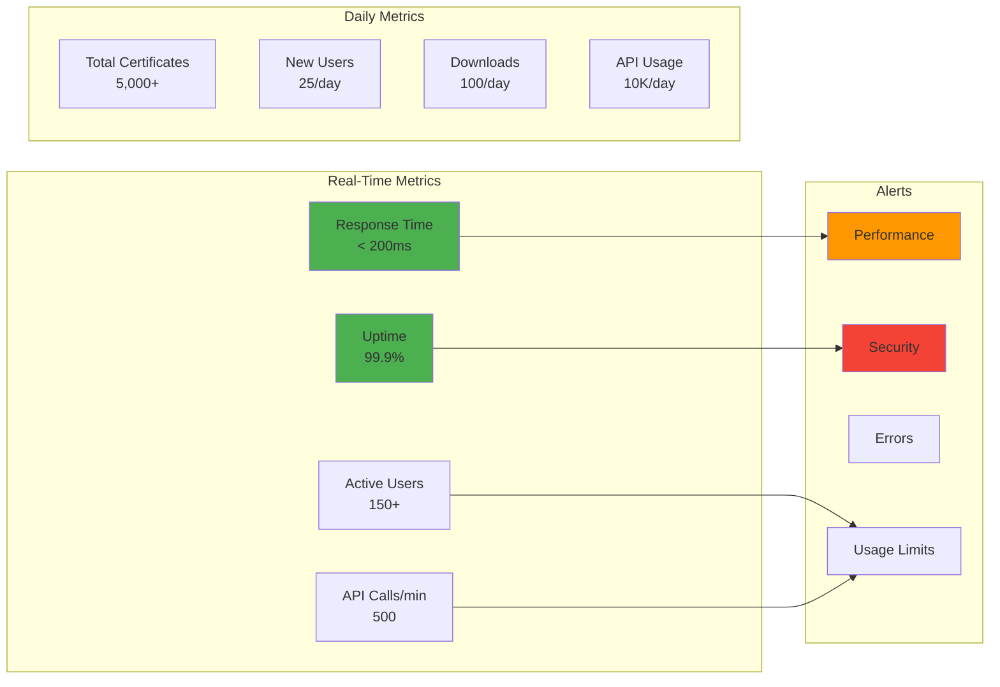

---

## 🔄 Integration Points

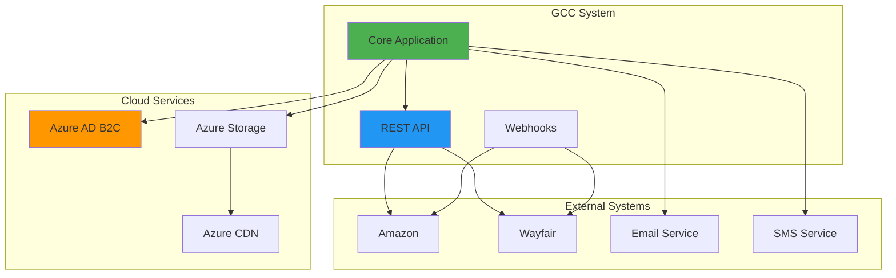

---

## 📱 Responsive Design Flow

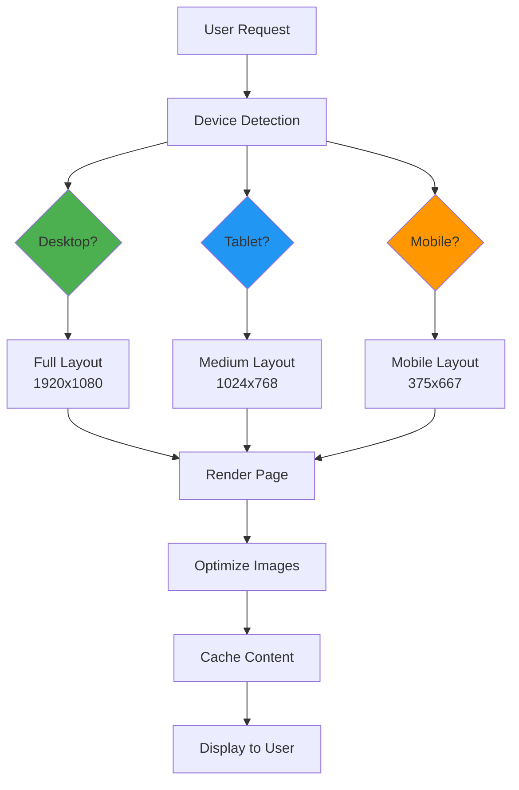

---

## 🎯 Feature Roadmap

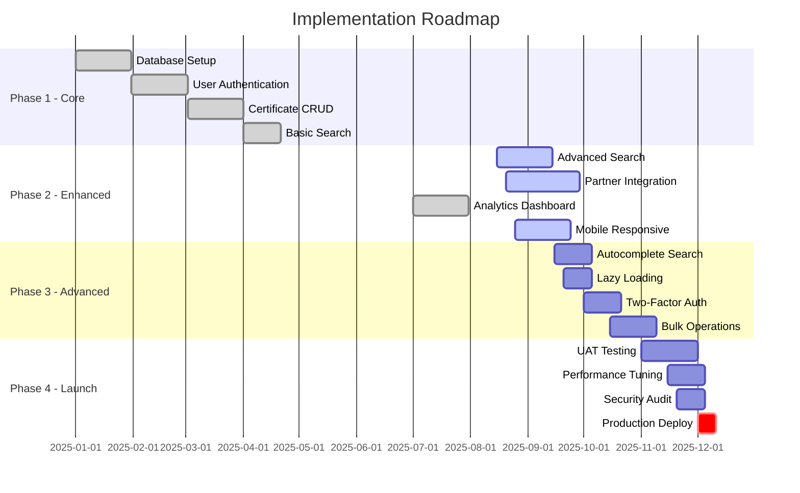

---

## 🐳 Docker Deployment Architecture

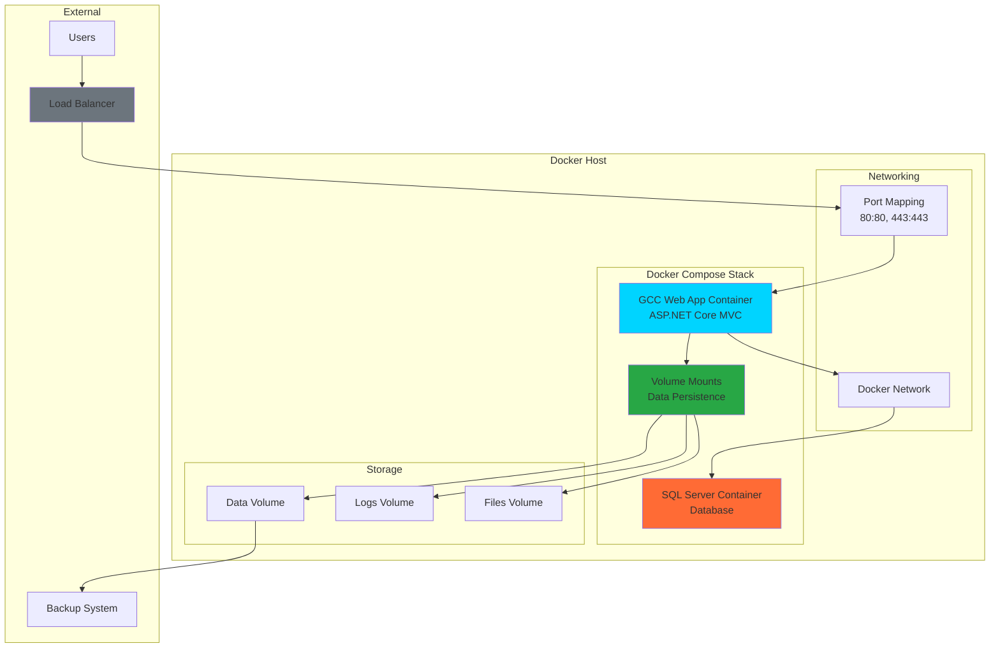

### Docker Benefits
- **Consistency**: Same environment across dev, staging, production
- **Scalability**: Easy horizontal scaling with container orchestration
- **Isolation**: Application and database run in separate containers
- **Portability**: Deploy anywhere Docker runs
- **Version Control**: Infrastructure as code with docker-compose.yml

---

## 🔧 Technology Stack

### Core Technologies
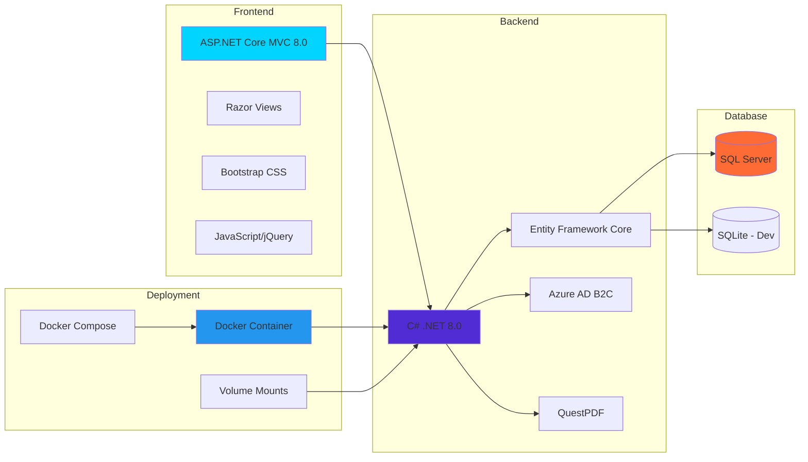

### Development Tools
- **Testing**: xUnit, Playwright, SpecFlow
- **Containerization**: Docker, Docker Compose
- **CI/CD**: GitHub Actions with Docker builds
- **IDE**: Visual Studio / VS Code with Docker support
- **Version Control**: Git
- **Package Management**: NuGet

---

*These diagrams provide a visual overview of the GCC system architecture, data flows, and implementation roadmap. All diagrams are interactive and can be exported for presentations.*