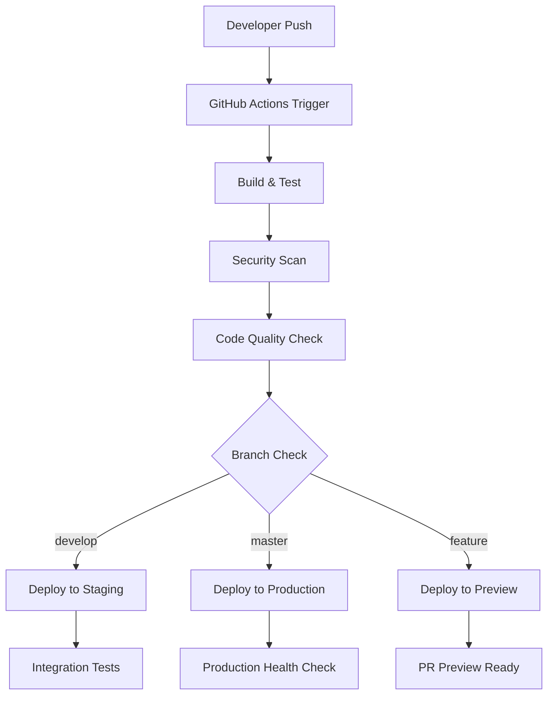

# Build & CI/CD Pipeline Documentation - GCC Database Solution

## Overview
This document provides comprehensive documentation for the build processes and CI/CD pipeline of the GCC Database Solution. Our pipeline ensures code quality, security, and reliable deployments across development, staging, and production environments.

## Build System Overview

### Local Development Build
```bash
# Standard build commands
dotnet restore                              # Restore NuGet packages
dotnet clean                               # Clean previous build artifacts
dotnet build                               # Compile application
dotnet build --configuration Release      # Release build
dotnet run                                 # Run development server
dotnet run --urls "http://localhost:5101" # Specify URL
```

### Build Configuration Files
- **Project File**: `GCCWebApp.csproj`
- **Solution File**: `GCCWebApp.sln`
- **Docker**: `Dockerfile`, `docker-compose.yml`
- **Scripts**: Various `.cmd` and `.sh` files in root directory

## CI/CD Pipeline Architecture

### Pipeline Overview


### Environments
1. **Development**: Local developer machines
2. **Preview**: Feature branch deployments
3. **Staging**: Integration testing environment
4. **Production**: Live application

## GitHub Actions Workflows

### Main CI/CD Workflow
File: `.github/workflows/ci-cd.yml`

```yaml
name: CI/CD Pipeline

on:
  push:
    branches: [ master, develop ]
  pull_request:
    branches: [ master, develop ]

env:
  DOTNET_VERSION: '8.0.x'
  NODE_VERSION: '18.x'

jobs:
  build-and-test:
    name: Build and Test
    runs-on: ubuntu-latest

    steps:
    - name: Checkout code
      uses: actions/checkout@v4
      with:
        fetch-depth: 0  # Required for SonarCloud

    - name: Setup .NET
      uses: actions/setup-dotnet@v4
      with:
        dotnet-version: ${{ env.DOTNET_VERSION }}

    - name: Setup Node.js
      uses: actions/setup-node@v4
      with:
        node-version: ${{ env.NODE_VERSION }}
        cache: 'npm'

    - name: Cache NuGet packages
      uses: actions/cache@v3
      with:
        path: ~/.nuget/packages
        key: ${{ runner.os }}-nuget-${{ hashFiles('**/*.csproj') }}
        restore-keys: |
          ${{ runner.os }}-nuget-

    - name: Restore dependencies
      run: dotnet restore

    - name: Build application
      run: dotnet build --no-restore --configuration Release

    - name: Run unit tests
      run: dotnet test GCCWebApp.Tests --no-build --configuration Release --logger trx --collect:"XPlat Code Coverage"

    - name: Run integration tests
      run: dotnet test GCCWebApp.UAT.Tests --no-build --configuration Release --logger trx

    - name: Run API tests
      run: dotnet test GCCWebApp.Api.Tests --no-build --configuration Release --logger trx

    - name: Run security tests
      run: dotnet test GCCWebApp.Security.Tests --no-build --configuration Release --logger trx

    - name: Install frontend dependencies
      run: npm ci
      working-directory: ./wwwroot

    - name: Build frontend assets
      run: npm run build
      working-directory: ./wwwroot

    - name: Run frontend tests
      run: npm test
      working-directory: ./wwwroot

    - name: Upload test results
      uses: actions/upload-artifact@v3
      if: always()
      with:
        name: test-results
        path: |
          **/*.trx
          **/coverage.*.xml

  security-scan:
    name: Security Scan
    runs-on: ubuntu-latest
    needs: build-and-test

    steps:
    - name: Checkout code
      uses: actions/checkout@v4

    - name: Run CodeQL Analysis
      uses: github/codeql-action/init@v2
      with:
        languages: 'csharp, javascript'

    - name: Autobuild
      uses: github/codeql-action/autobuild@v2

    - name: Perform CodeQL Analysis
      uses: github/codeql-action/analyze@v2

    - name: Run Snyk Security Scan
      uses: snyk/actions/dotnet@master
      env:
        SNYK_TOKEN: ${{ secrets.SNYK_TOKEN }}
      with:
        args: --severity-threshold=medium

    - name: Run OWASP Dependency Check
      uses: dependency-check/Dependency-Check_Action@main
      with:
        project: 'GCC Database Solution'
        path: '.'
        format: 'JSON'

  code-quality:
    name: Code Quality Analysis
    runs-on: ubuntu-latest
    needs: build-and-test

    steps:
    - name: Checkout code
      uses: actions/checkout@v4
      with:
        fetch-depth: 0

    - name: Setup .NET
      uses: actions/setup-dotnet@v4
      with:
        dotnet-version: ${{ env.DOTNET_VERSION }}

    - name: Setup SonarCloud Scanner
      run: dotnet tool install --global dotnet-sonarscanner

    - name: Begin SonarCloud analysis
      env:
        GITHUB_TOKEN: ${{ secrets.GITHUB_TOKEN }}
        SONAR_TOKEN: ${{ secrets.SONAR_TOKEN }}
      run: |
        dotnet sonarscanner begin \
          /k:"gccwebapp" \
          /o:"pointsolve" \
          /d:sonar.login="${{ secrets.SONAR_TOKEN }}" \
          /d:sonar.host.url="https://sonarcloud.io" \
          /d:sonar.cs.opencover.reportsPaths="**/coverage.opencover.xml"

    - name: Build for analysis
      run: dotnet build --configuration Release

    - name: End SonarCloud analysis
      env:
        GITHUB_TOKEN: ${{ secrets.GITHUB_TOKEN }}
        SONAR_TOKEN: ${{ secrets.SONAR_TOKEN }}
      run: dotnet sonarscanner end /d:sonar.login="${{ secrets.SONAR_TOKEN }}"

  build-docker:
    name: Build Docker Image
    runs-on: ubuntu-latest
    needs: [build-and-test, security-scan, code-quality]
    if: github.event_name == 'push'

    steps:
    - name: Checkout code
      uses: actions/checkout@v4

    - name: Set up Docker Buildx
      uses: docker/setup-buildx-action@v3

    - name: Login to Container Registry
      uses: docker/login-action@v3
      with:
        registry: ghcr.io
        username: ${{ github.actor }}
        password: ${{ secrets.GITHUB_TOKEN }}

    - name: Extract metadata
      id: meta
      uses: docker/metadata-action@v5
      with:
        images: ghcr.io/${{ github.repository }}
        tags: |
          type=ref,event=branch
          type=ref,event=pr
          type=sha,prefix={{branch}}-
          type=raw,value=latest,enable={{is_default_branch}}

    - name: Build and push Docker image
      uses: docker/build-push-action@v5
      with:
        context: .
        platforms: linux/amd64,linux/arm64
        push: true
        tags: ${{ steps.meta.outputs.tags }}
        labels: ${{ steps.meta.outputs.labels }}
        cache-from: type=gha
        cache-to: type=gha,mode=max

  deploy-staging:
    name: Deploy to Staging
    runs-on: ubuntu-latest
    needs: build-docker
    if: github.ref == 'refs/heads/develop'
    environment: staging

    steps:
    - name: Deploy to staging
      uses: azure/webapps-deploy@v2
      with:
        app-name: ${{ secrets.AZURE_WEBAPP_NAME_STAGING }}
        publish-profile: ${{ secrets.AZURE_WEBAPP_PUBLISH_PROFILE_STAGING }}
        images: 'ghcr.io/${{ github.repository }}:develop'

    - name: Run smoke tests
      run: |
        curl -f ${{ secrets.STAGING_URL }}/health || exit 1

  deploy-production:
    name: Deploy to Production
    runs-on: ubuntu-latest
    needs: build-docker
    if: github.ref == 'refs/heads/master'
    environment: production

    steps:
    - name: Deploy to production
      uses: azure/webapps-deploy@v2
      with:
        app-name: ${{ secrets.AZURE_WEBAPP_NAME_PRODUCTION }}
        publish-profile: ${{ secrets.AZURE_WEBAPP_PUBLISH_PROFILE_PRODUCTION }}
        images: 'ghcr.io/${{ github.repository }}:latest'

    - name: Run production health checks
      run: |
        curl -f ${{ secrets.PRODUCTION_URL }}/health || exit 1
        # Additional health checks
        curl -f ${{ secrets.PRODUCTION_URL }}/api/health/database || exit 1
        curl -f ${{ secrets.PRODUCTION_URL }}/api/health/external-services || exit 1

  notify:
    name: Deployment Notification
    runs-on: ubuntu-latest
    needs: [deploy-staging, deploy-production]
    if: always()

    steps:
    - name: Notify Teams
      uses: 8398a7/action-slack@v3
      with:
        status: ${{ job.status }}
        webhook_url: ${{ secrets.SLACK_WEBHOOK }}
        fields: repo,message,commit,author,action,eventName,ref,workflow
```

### Pull Request Workflow
File: `.github/workflows/pr-checks.yml`

```yaml
name: Pull Request Checks

on:
  pull_request:
    types: [opened, synchronize, reopened]

jobs:
  pr-checks:
    name: PR Validation
    runs-on: ubuntu-latest

    steps:
    - name: Checkout code
      uses: actions/checkout@v4

    - name: Setup .NET
      uses: actions/setup-dotnet@v4
      with:
        dotnet-version: '8.0.x'

    - name: Check commit message format
      uses: wagoid/commitlint-github-action@v5

    - name: Restore and build
      run: |
        dotnet restore
        dotnet build --configuration Release

    - name: Run tests with coverage
      run: |
        dotnet test --configuration Release \
          --collect:"XPlat Code Coverage" \
          --results-directory ./coverage \
          --logger trx

    - name: Generate coverage report
      uses: danielpalme/ReportGenerator-GitHub-Action@5.1.20
      with:
        reports: 'coverage/**/coverage.cobertura.xml'
        targetdir: 'coverage-report'
        reporttypes: 'Html;Cobertura'

    - name: Comment PR with coverage
      uses: marocchino/sticky-pull-request-comment@v2
      with:
        recreate: true
        path: coverage-report/index.html

    - name: Check code formatting
      run: dotnet format --verify-no-changes

    - name: Lint frontend code
      run: |
        cd wwwroot
        npm ci
        npm run lint

    - name: Security scan
      uses: securecodewarrior/github-action-add-sarif@v1
      with:
        sarif-file: security-scan.sarif
```

## Docker Build System

### Multi-Stage Dockerfile
Current production Dockerfile with optimizations:

```dockerfile
# Build stage
FROM mcr.microsoft.com/dotnet/sdk:8.0 AS build
ARG BUILD_CONFIGURATION=Release
WORKDIR /src

# Copy csproj and restore dependencies (better caching)
COPY ["GCCWebApp.csproj", "."]
RUN dotnet restore "./GCCWebApp.csproj"

# Copy source and build
COPY . .
WORKDIR "/src/."
RUN dotnet build "GCCWebApp.csproj" -c $BUILD_CONFIGURATION -o /app/build

# Publish stage
FROM build AS publish
RUN dotnet publish "GCCWebApp.csproj" -c $BUILD_CONFIGURATION -o /app/publish /p:UseAppHost=false

# Runtime stage
FROM mcr.microsoft.com/dotnet/aspnet:8.0 AS final
WORKDIR /app

# Security: Create non-root user
RUN adduser --disabled-password --gecos '' appuser && chown -R appuser /app
USER appuser

# Environment configuration
ENV ASPNETCORE_ENVIRONMENT=Production
ENV ASPNETCORE_URLS=http://+:8080

# Health check
HEALTHCHECK --interval=30s --timeout=10s --start-period=5s --retries=3 \
  CMD curl -f http://localhost:8080/health || exit 1

# Copy published app
COPY --from=publish /app/publish .

ENTRYPOINT ["dotnet", "GCCWebApp.dll"]
```

### Docker Compose for Local Development
```yaml
# docker-compose.dev.yml
version: '3.8'

services:
  gccwebapp:
    build:
      context: .
      dockerfile: Dockerfile.dev
      target: development
    container_name: gcc-webapp-dev
    ports:
      - "5101:5101"
      - "7130:7130"  # HTTPS
    environment:
      - ASPNETCORE_ENVIRONMENT=Development
      - ASPNETCORE_URLS=https://+:7130;http://+:5101
      - ConnectionStrings__DefaultConnection=Server=sqlserver;Database=GCCDatabase;User Id=sa;Password=YourPassword123!;TrustServerCertificate=true;
    volumes:
      - .:/src
      - /src/bin
      - /src/obj
    depends_on:
      - sqlserver
      - redis
    networks:
      - gcc-dev

  sqlserver:
    image: mcr.microsoft.com/mssql/server:2022-latest
    container_name: gcc-sqlserver-dev
    environment:
      - ACCEPT_EULA=Y
      - MSSQL_SA_PASSWORD=YourPassword123!
    ports:
      - "1433:1433"
    volumes:
      - sqlserver-data:/var/opt/mssql
    networks:
      - gcc-dev

  redis:
    image: redis:7-alpine
    container_name: gcc-redis-dev
    ports:
      - "6379:6379"
    networks:
      - gcc-dev

volumes:
  sqlserver-data:

networks:
  gcc-dev:
    driver: bridge
```

### Available Docker Scripts

The project includes comprehensive Docker deployment scripts:

#### Interactive Build Script
```bash
# Windows: docker-build.cmd
# Linux/Mac: docker-build.sh

# Features:
# - Interactive menu for build options
# - Development, Test, Production builds
# - Multi-architecture builds (ARM64, AMD64)
# - Security scanning integration
# - Build history and logging
# - Registry deployment options
```

#### Production Deployment Scripts
```bash
# Quick production deployment with SQLite
./docker-run-production.sh

# Plesk server deployment with PostgreSQL
./docker-deploy-plesk-FIXED.cmd

# Container registry deployment
./docker-deploy-plesk-registry-UPDATED.cmd

# Docker Compose deployment
docker-compose up -d
```

#### Container Management Scripts
```bash
# Clean up old containers and images
./docker-cleanup.cmd

# Health check monitoring
./docker-health-check.cmd

# Rollback to previous version
./docker-rollback.cmd
```

## Build Artifacts and Outputs

### Local Build Outputs
```
bin/
├── Debug/
│   └── net8.0/
│       ├── GCCWebApp.dll
│       ├── GCCWebApp.exe
│       └── wwwroot/
└── Release/
    └── net8.0/
        ├── GCCWebApp.dll
        ├── GCCWebApp.exe
        └── wwwroot/

obj/
├── Debug/
└── Release/
```

### CI/CD Artifacts
- **Build logs**: Available in GitHub Actions
- **Test results**: JUnit XML format
- **Coverage reports**: Cobertura XML and HTML
- **Security scan results**: SARIF format
- **Docker images**: Multi-architecture containers
- **Deployment artifacts**: Published application files

### Artifact Retention
- **Build artifacts**: 30 days
- **Test results**: 90 days
- **Security scans**: 1 year
- **Docker images**: Tagged releases permanent, others 90 days

## Environment Configuration

### Development Environment
```bash
# Local development setup
ASPNETCORE_ENVIRONMENT=Development
ASPNETCORE_URLS=https://localhost:7130;http://localhost:5101
ConnectionStrings__DefaultConnection=Server=(localdb)\\mssqllocaldb;Database=GCCDatabase;Trusted_Connection=true;

# Optional features (disabled in dev)
Features__EnableAzureB2C=false
Features__EnableApplicationInsights=false
```

### Staging Environment
```bash
# Staging configuration
ASPNETCORE_ENVIRONMENT=Staging
ConnectionStrings__DefaultConnection=Server=staging-db;Database=GCCDatabase;User Id=app_user;Password=***;
GCC_JWT_SECRET=staging-jwt-secret-64-characters-long
Features__EnableAzureB2C=true
Features__EnableApplicationInsights=true
```

### Production Environment
```bash
# Production configuration (Azure App Service)
ASPNETCORE_ENVIRONMENT=Production
ConnectionStrings__DefaultConnection=Server=prod-db;Database=GCCDatabase;User Id=app_user;Password=***;Encrypt=true;
GCC_JWT_SECRET=production-jwt-secret-64-characters-long
GCC_AZURE_AD_B2C_CLIENT_SECRET=***
GCC_APPLICATION_INSIGHTS_CONNECTION_STRING=***
Features__EnableRateLimiting=true
Features__EnableSecurityHeaders=true
```

## Testing in CI/CD

### Test Execution Strategy
```bash
# Test execution order
1. Unit Tests (GCCWebApp.Tests)
   - Fast execution (< 2 minutes)
   - No external dependencies
   - Code coverage collection

2. Integration Tests (GCCWebApp.UAT.Tests)
   - Database interactions
   - API endpoint testing
   - Playwright UI testing

3. API Tests (GCCWebApp.Api.Tests)
   - External API contract validation
   - Performance testing
   - Load testing

4. Security Tests (GCCWebApp.Security.Tests)
   - Authentication flows
   - Authorization checks
   - Input validation
   - Security headers
```

### Test Configuration
```xml
<!-- Directory.Build.props -->
<Project>
  <PropertyGroup>
    <EnableNETAnalyzers>true</EnableNETAnalyzers>
    <AnalysisLevel>latest</AnalysisLevel>
    <TreatWarningsAsErrors>true</TreatWarningsAsErrors>
    <WarningsNotAsErrors>CS8618</WarningsNotAsErrors> <!-- Nullable warnings -->
  </PropertyGroup>

  <ItemGroup>
    <PackageReference Include="Microsoft.NET.Test.Sdk" Version="17.7.2" />
    <PackageReference Include="xunit" Version="2.4.2" />
    <PackageReference Include="xunit.runner.visualstudio" Version="2.4.5" />
    <PackageReference Include="coverlet.collector" Version="6.0.0" />
    <PackageReference Include="Microsoft.AspNetCore.Mvc.Testing" Version="8.0.0" />
  </ItemGroup>
</Project>
```

### Test Reporting
```bash
# Coverage reporting configuration
dotnet test --collect:"XPlat Code Coverage" \
  --results-directory ./TestResults \
  --logger trx \
  -- DataCollectionRunSettings.DataCollectors.DataCollector.Configuration.Format=opencover

# Generate HTML coverage report
reportgenerator \
  -reports:"TestResults/**/coverage.opencover.xml" \
  -targetdir:"coverage-report" \
  -reporttypes:"Html;Cobertura"
```

## Performance Monitoring

### Build Performance Metrics
- **Build time targets**:
  - Local build: < 2 minutes
  - CI build: < 5 minutes
  - Docker build: < 10 minutes

### CI/CD Performance Optimization
```yaml
# Optimization strategies
caching:
  - NuGet packages
  - Docker layers
  - npm dependencies
  - Build artifacts

parallelization:
  - Test execution
  - Security scans
  - Code quality checks
  - Multi-platform builds
```

## Troubleshooting

### Common Build Issues

#### Build Failures
```bash
# Clear build cache
dotnet clean
rm -rf bin/ obj/
dotnet restore --force

# Check for package conflicts
dotnet list package --outdated
dotnet list package --vulnerable
```

#### Docker Build Issues
```bash
# Clear Docker cache
docker system prune -f
docker builder prune -f

# Build with verbose output
docker build --progress=plain --no-cache .

# Check Docker daemon logs
docker system events
```

#### CI/CD Failures
```bash
# Check workflow logs in GitHub Actions
# Common issues:
# - Secrets not configured
# - Environment variables missing
# - Dependency version conflicts
# - Test environment setup failures
```

### Performance Issues
```bash
# Profile build performance
dotnet build -bl  # Binary log for analysis

# Analyze with MSBuild Structured Log Viewer
# https://msbuildlog.com/

# Docker build performance
docker build --progress=plain . 2>&1 | ts '[%Y-%m-%d %H:%M:%S]'
```

## Security in CI/CD

### Secret Management
```yaml
# GitHub Secrets (Production)
secrets:
  AZURE_WEBAPP_PUBLISH_PROFILE_PRODUCTION: "..."
  AZURE_WEBAPP_PUBLISH_PROFILE_STAGING: "..."
  SONAR_TOKEN: "..."
  SNYK_TOKEN: "..."
  SLACK_WEBHOOK: "..."
  GCC_JWT_SECRET: "..."
  DATABASE_CONNECTION_STRING: "..."
```

### Security Scanning
1. **SAST** (Static Application Security Testing):
   - CodeQL for C# and JavaScript
   - SonarCloud for code quality and security
   - Snyk for dependency vulnerabilities

2. **Container Scanning**:
   - Docker image vulnerability scanning
   - Base image security checks
   - Runtime security policies

3. **DAST** (Dynamic Application Security Testing):
   - OWASP ZAP integration
   - Penetration testing automation
   - API security testing

### Compliance Checks
```bash
# License compliance
dotnet list package --include-transitive | grep -i license

# Security policy enforcement
docker scan gcc-webapp:latest
snyk test --severity-threshold=medium

# Data protection compliance (GDPR, etc.)
# Automated PII detection in logs and code
```

## Deployment Strategies

### Blue-Green Deployment
```bash
# Azure App Service slots
# - Production slot (Blue)
# - Staging slot (Green)
# - Swap slots after validation
```

### Rolling Deployment
```bash
# Kubernetes deployment strategy
strategy:
  type: RollingUpdate
  rollingUpdate:
    maxUnavailable: 1
    maxSurge: 1
```

### Canary Deployment
```bash
# Traffic splitting for new versions
# - 5% traffic to new version
# - Monitor metrics
# - Gradually increase traffic
```

## Monitoring and Observability

### Application Performance Monitoring
```csharp
// Application Insights integration
services.AddApplicationInsightsTelemetry();

// Custom metrics and logging
_logger.LogInformation("Certificate {CertificateId} processed in {Duration}ms",
    certificateId, stopwatch.ElapsedMilliseconds);
```

### Infrastructure Monitoring
```yaml
# Health checks
healthChecks:
  - name: database
    endpoint: /health/database
    interval: 30s

  - name: external-api
    endpoint: /health/external-services
    interval: 60s

  - name: storage
    endpoint: /health/storage
    interval: 30s
```

### Alerts and Notifications
```yaml
# Alert conditions
alerts:
  - name: High Error Rate
    condition: error_rate > 5%
    duration: 5m

  - name: Slow Response Time
    condition: avg_response_time > 2s
    duration: 5m

  - name: High CPU Usage
    condition: cpu_usage > 80%
    duration: 10m
```

## Backup and Recovery

### Backup Strategy
```bash
# Database backups (automated)
# - Full backup: Daily at 2 AM UTC
# - Differential backup: Every 6 hours
# - Transaction log backup: Every 15 minutes
# - Retention: 30 days

# Application backups
# - Configuration files
# - Uploaded files and documents
# - Application logs
```

### Disaster Recovery
```bash
# Recovery procedures
# 1. Infrastructure provisioning (Terraform)
# 2. Database restore from backup
# 3. Application deployment (latest stable)
# 4. DNS cutover
# 5. Monitoring and validation

# RTO (Recovery Time Objective): 4 hours
# RPO (Recovery Point Objective): 1 hour
```

## Continuous Improvement

### Pipeline Metrics
- **Deployment frequency**: Target 2-3 times per week
- **Lead time**: Code commit to production < 2 hours
- **Mean time to recovery**: < 4 hours
- **Change failure rate**: < 5%

### Process Improvements
1. **Monthly pipeline reviews**: Identify bottlenecks
2. **Security posture assessment**: Quarterly security reviews
3. **Performance optimization**: Continuous monitoring and tuning
4. **Tool evaluation**: Assess new CI/CD tools and practices

### Future Enhancements
- **GitOps implementation**: ArgoCD for Kubernetes deployments
- **Advanced testing**: Property-based testing, mutation testing
- **ML-powered quality gates**: Intelligent code review assistance
- **Multi-cloud strategy**: Azure + AWS deployment options

---

This documentation provides a comprehensive guide to the build and CI/CD processes for the GCC Database Solution, ensuring consistent, secure, and reliable software delivery.

---
*Last Updated: September 17, 2025*