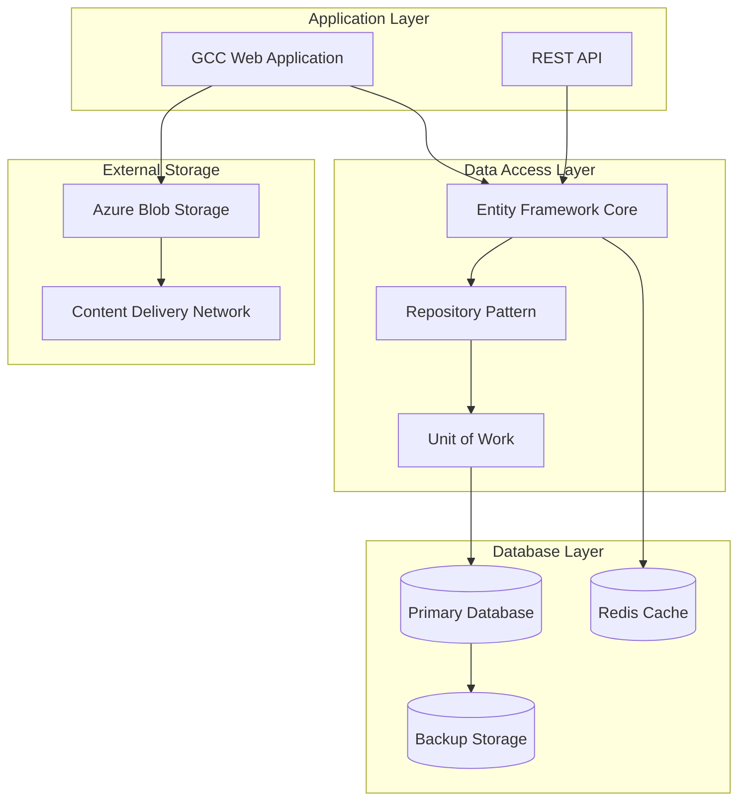
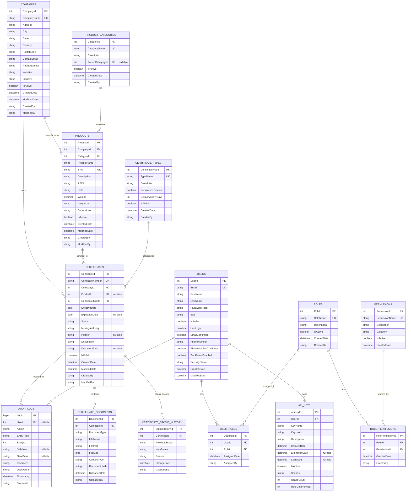

# Database Design Document
## GCC Database Solution - Comprehensive Data Architecture

### Document Information
- **Document Version**: 1.0
- **Last Updated**: September 17, 2025
- **Document Owner**: Database Administrator / Technical Lead
- **Review Cycle**: Quarterly
- **Classification**: Internal Technical Document

---

## Table of Contents

1. [Executive Summary](#1-executive-summary)
2. [Database Overview](#2-database-overview)
3. [Logical Data Model](#3-logical-data-model)
4. [Physical Data Model](#4-physical-data-model)
5. [Table Specifications](#5-table-specifications)
6. [Relationships & Constraints](#6-relationships--constraints)
7. [Indexes & Performance](#7-indexes--performance)
8. [Data Security & Privacy](#8-data-security--privacy)
9. [Migration Strategy](#9-migration-strategy)
10. [Backup & Recovery](#10-backup--recovery)
11. [Data Governance](#11-data-governance)
12. [Maintenance Procedures](#12-maintenance-procedures)

---

## 1. Executive Summary

### 1.1 Purpose
This document provides comprehensive database design specifications for the GCC Database Solution, including logical and physical data models, table structures, relationships, and operational procedures.

### 1.2 Database Overview
- **Primary Database**: SQL Server (Azure SQL Database for production)
- **Development Database**: SQL Server LocalDB
- **ORM Framework**: Entity Framework Core 9.0
- **Migration Management**: EF Core Migrations
- **Data Access Pattern**: Repository Pattern with Unit of Work

### 1.3 Key Design Principles
- **Data Integrity**: Strong referential integrity with appropriate constraints
- **Performance**: Optimized indexing strategy for common query patterns
- **Scalability**: Designed to handle growing data volumes
- **Security**: Data protection through encryption and access controls
- **Audit Trail**: Comprehensive logging of all data changes

---

## 2. Database Overview

### 2.1 Database Architecture



### 2.2 Database Environments

| Environment | Database Type | Size | Backup | Purpose |
|-------------|---------------|------|--------|---------|
| **Development** | SQL Server LocalDB | 10 GB | Daily | Local development |
| **Testing** | Azure SQL Database (Basic) | 50 GB | Daily | Automated testing |
| **Staging** | Azure SQL Database (Standard) | 100 GB | Hourly | Pre-production testing |
| **Production** | Azure SQL Database (Premium) | 500 GB | Continuous | Live application |

### 2.3 Connection Architecture

```csharp
// Connection string configuration
public class DatabaseConfiguration
{
    public string ConnectionString { get; set; }
    public int CommandTimeout { get; set; } = 30;
    public bool EnableRetryOnFailure { get; set; } = true;
    public int MaxRetryCount { get; set; } = 3;
    public TimeSpan MaxRetryDelay { get; set; } = TimeSpan.FromSeconds(5);
    public bool EnableSensitiveDataLogging { get; set; } = false;
}
```

---

## 3. Logical Data Model

### 3.1 High-Level Entity Relationship Diagram



### 3.2 Domain Model Relationships

#### 3.2.1 Core Business Entities
- **Companies** are the primary organizational entities
- **Products** belong to companies and can have multiple certificates
- **Certificates** are the central entities, linking companies and products
- **Certificate Types** provide standardized categorization

#### 3.2.2 Security & Access Control
- **Users** have multiple **Roles** through **User_Roles** junction table
- **Roles** have multiple **Permissions** through **Role_Permissions**
- **API Keys** belong to users and have specific scopes and rate limits

#### 3.2.3 Audit & Tracking
- **Audit Logs** track all significant data changes
- **Certificate Status History** provides detailed certificate lifecycle tracking
- **Certificate Documents** manage file attachments and metadata

---

## 4. Physical Data Model

### 4.1 Database Schema Structure

```sql
-- Database creation script for production
CREATE DATABASE GCC_Database
ON (
    NAME = 'GCC_Database',
    FILENAME = 'GCC_Database.mdf',
    SIZE = 1024MB,
    MAXSIZE = 10240MB,
    FILEGROWTH = 256MB
)
LOG ON (
    NAME = 'GCC_Database_Log',
    FILENAME = 'GCC_Database_Log.ldf',
    SIZE = 256MB,
    MAXSIZE = 2048MB,
    FILEGROWTH = 64MB
);

-- Set database options for performance and security
ALTER DATABASE GCC_Database SET RECOVERY FULL;
ALTER DATABASE GCC_Database SET AUTO_CREATE_STATISTICS ON;
ALTER DATABASE GCC_Database SET AUTO_UPDATE_STATISTICS ON;
ALTER DATABASE GCC_Database SET PAGE_VERIFY CHECKSUM;
```

### 4.2 File Groups and Partitioning Strategy

```sql
-- Create additional file groups for large tables
ALTER DATABASE GCC_Database ADD FILEGROUP FG_AuditLogs;
ALTER DATABASE GCC_Database ADD FILEGROUP FG_Documents;

-- Add data files to file groups
ALTER DATABASE GCC_Database
ADD FILE (
    NAME = 'GCC_AuditLogs',
    FILENAME = 'GCC_AuditLogs.ndf',
    SIZE = 512MB,
    FILEGROWTH = 128MB
) TO FILEGROUP FG_AuditLogs;

ALTER DATABASE GCC_Database
ADD FILE (
    NAME = 'GCC_Documents',
    FILENAME = 'GCC_Documents.ndf',
    SIZE = 256MB,
    FILEGROWTH = 64MB
) TO FILEGROUP FG_Documents;
```

---

## 5. Table Specifications

### 5.1 Core Business Tables

#### 5.1.1 Companies Table
```sql
CREATE TABLE Companies (
    CompanyId int IDENTITY(1,1) NOT NULL,
    CompanyName nvarchar(200) NOT NULL,
    Address nvarchar(500) NULL,
    City nvarchar(100) NULL,
    State nvarchar(50) NULL,
    Country nvarchar(100) NULL,
    PostalCode nvarchar(20) NULL,
    ContactEmail nvarchar(320) NULL, -- RFC compliant email length
    PhoneNumber nvarchar(20) NULL,
    Website nvarchar(500) NULL,
    Industry nvarchar(100) NULL,
    IsActive bit NOT NULL DEFAULT 1,
    CreatedDate datetime2(7) NOT NULL DEFAULT GETUTCDATE(),
    ModifiedDate datetime2(7) NULL,
    CreatedBy nvarchar(100) NOT NULL,
    ModifiedBy nvarchar(100) NULL,

    CONSTRAINT PK_Companies PRIMARY KEY CLUSTERED (CompanyId),
    CONSTRAINT UK_Companies_CompanyName UNIQUE (CompanyName),
    CONSTRAINT CK_Companies_Email CHECK (ContactEmail LIKE '%_@_%.__%' OR ContactEmail IS NULL),
    CONSTRAINT CK_Companies_CreatedDate CHECK (CreatedDate <= GETUTCDATE()),
    CONSTRAINT CK_Companies_ModifiedDate CHECK (ModifiedDate IS NULL OR ModifiedDate >= CreatedDate)
);
```

#### 5.1.2 Products Table
```sql
CREATE TABLE Products (
    ProductId int IDENTITY(1,1) NOT NULL,
    CompanyId int NOT NULL,
    CategoryId int NULL,
    ProductName nvarchar(300) NOT NULL,
    SKU nvarchar(100) NOT NULL,
    Description nvarchar(2000) NULL,
    ASIN nvarchar(20) NULL, -- Amazon Standard Identification Number
    UPC nvarchar(20) NULL,  -- Universal Product Code
    Weight decimal(10,3) NULL,
    WeightUnit nvarchar(10) NULL, -- kg, lbs, oz, etc.
    Dimensions nvarchar(100) NULL, -- L x W x H format
    IsActive bit NOT NULL DEFAULT 1,
    CreatedDate datetime2(7) NOT NULL DEFAULT GETUTCDATE(),
    ModifiedDate datetime2(7) NULL,
    CreatedBy nvarchar(100) NOT NULL,
    ModifiedBy nvarchar(100) NULL,

    CONSTRAINT PK_Products PRIMARY KEY CLUSTERED (ProductId),
    CONSTRAINT UK_Products_SKU UNIQUE (SKU),
    CONSTRAINT FK_Products_Companies FOREIGN KEY (CompanyId)
        REFERENCES Companies(CompanyId),
    CONSTRAINT FK_Products_Categories FOREIGN KEY (CategoryId)
        REFERENCES ProductCategories(CategoryId),
    CONSTRAINT CK_Products_Weight CHECK (Weight IS NULL OR Weight > 0),
    CONSTRAINT CK_Products_WeightUnit CHECK (
        WeightUnit IS NULL OR
        WeightUnit IN ('kg', 'g', 'lbs', 'oz', 'tonnes')
    )
);
```

#### 5.1.3 Certificates Table (Enhanced)
```sql
CREATE TABLE Certificates (
    CertificateId int IDENTITY(1,1) NOT NULL,
    CertificateNumber nvarchar(100) NOT NULL,
    CompanyId int NOT NULL,
    ProductId int NULL, -- Nullable for company-level certificates
    CertificateTypeId int NOT NULL,
    EffectiveDate date NOT NULL,
    ExpirationDate date NULL,
    Status nvarchar(50) NOT NULL DEFAULT 'Draft',
    IssuingAuthority nvarchar(200) NOT NULL,
    Partner nvarchar(50) NULL, -- Amazon, Wayfair, None
    Description nvarchar(2000) NULL,
    DocumentPath nvarchar(1000) NULL,
    IsPublic bit NOT NULL DEFAULT 1,
    CreatedDate datetime2(7) NOT NULL DEFAULT GETUTCDATE(),
    ModifiedDate datetime2(7) NULL,
    CreatedBy nvarchar(100) NOT NULL,
    ModifiedBy nvarchar(100) NULL,

    -- Computed columns for search optimization
    SearchText AS (
        CertificateNumber + ' ' +
        ISNULL(IssuingAuthority, '') + ' ' +
        ISNULL(Description, '')
    ) PERSISTED,

    DaysUntilExpiration AS (
        CASE
            WHEN ExpirationDate IS NULL THEN NULL
            ELSE DATEDIFF(DAY, GETDATE(), ExpirationDate)
        END
    ),

    CONSTRAINT PK_Certificates PRIMARY KEY CLUSTERED (CertificateId),
    CONSTRAINT UK_Certificates_CertificateNumber UNIQUE (CertificateNumber),
    CONSTRAINT FK_Certificates_Companies FOREIGN KEY (CompanyId)
        REFERENCES Companies(CompanyId),
    CONSTRAINT FK_Certificates_Products FOREIGN KEY (ProductId)
        REFERENCES Products(ProductId),
    CONSTRAINT FK_Certificates_CertificateTypes FOREIGN KEY (CertificateTypeId)
        REFERENCES CertificateTypes(CertificateTypeId),
    CONSTRAINT CK_Certificates_Status CHECK (
        Status IN ('Draft', 'Submitted', 'UnderReview', 'Approved', 'Active',
                  'Expiring', 'Expired', 'Suspended', 'Revoked', 'Renewed',
                  'Updated', 'Archived', 'Rejected', 'Cancelled')
    ),
    CONSTRAINT CK_Certificates_Partner CHECK (
        Partner IS NULL OR
        Partner IN ('Amazon', 'Wayfair')
    ),
    CONSTRAINT CK_Certificates_DateRange CHECK (
        ExpirationDate IS NULL OR ExpirationDate > EffectiveDate
    ),
    CONSTRAINT CK_Certificates_EffectiveDate CHECK (
        EffectiveDate >= '2020-01-01' AND EffectiveDate <= DATEADD(YEAR, 5, GETDATE())
    )
);
```

### 5.2 Security & Access Control Tables

#### 5.2.1 Users Table (Enhanced)
```sql
CREATE TABLE Users (
    UserId int IDENTITY(1,1) NOT NULL,
    Email nvarchar(320) NOT NULL, -- RFC 5321 compliant
    FirstName nvarchar(100) NOT NULL,
    LastName nvarchar(100) NOT NULL,
    PasswordHash nvarchar(255) NULL, -- For cookie authentication fallback
    Salt nvarchar(128) NULL,
    IsActive bit NOT NULL DEFAULT 1,
    LastLogin datetime2(7) NULL,
    EmailConfirmed bit NOT NULL DEFAULT 0,
    PhoneNumber nvarchar(20) NULL,
    PhoneNumberConfirmed bit NOT NULL DEFAULT 0,
    TwoFactorEnabled bit NOT NULL DEFAULT 0,
    SecurityStamp nvarchar(128) NULL, -- For security token invalidation
    FailedLoginAttempts int NOT NULL DEFAULT 0,
    LockoutEnd datetime2(7) NULL,
    CreatedDate datetime2(7) NOT NULL DEFAULT GETUTCDATE(),
    ModifiedDate datetime2(7) NULL,

    CONSTRAINT PK_Users PRIMARY KEY CLUSTERED (UserId),
    CONSTRAINT UK_Users_Email UNIQUE (Email),
    CONSTRAINT CK_Users_Email CHECK (Email LIKE '%_@_%.__%'),
    CONSTRAINT CK_Users_FailedAttempts CHECK (FailedLoginAttempts >= 0),
    CONSTRAINT CK_Users_LockoutEnd CHECK (
        LockoutEnd IS NULL OR LockoutEnd > GETUTCDATE()
    )
);
```

#### 5.2.2 API Keys Table (Enhanced)
```sql
CREATE TABLE ApiKeys (
    ApiKeyId int IDENTITY(1,1) NOT NULL,
    UserId int NOT NULL,
    KeyName nvarchar(100) NOT NULL,
    KeyHash nvarchar(255) NOT NULL, -- SHA-256 hash of the actual key
    Description nvarchar(500) NULL,
    CreatedDate datetime2(7) NOT NULL DEFAULT GETUTCDATE(),
    ExpirationDate datetime2(7) NULL,
    LastUsed datetime2(7) NULL,
    IsActive bit NOT NULL DEFAULT 1,
    Scopes nvarchar(1000) NULL, -- JSON array of allowed scopes
    UsageCount bigint NOT NULL DEFAULT 0,
    RateLimitPerHour int NOT NULL DEFAULT 100,
    AllowedIpRanges nvarchar(2000) NULL, -- JSON array of IP ranges
    AllowedDomains nvarchar(2000) NULL, -- JSON array of allowed domains

    CONSTRAINT PK_ApiKeys PRIMARY KEY CLUSTERED (ApiKeyId),
    CONSTRAINT UK_ApiKeys_KeyHash UNIQUE (KeyHash),
    CONSTRAINT FK_ApiKeys_Users FOREIGN KEY (UserId)
        REFERENCES Users(UserId) ON DELETE CASCADE,
    CONSTRAINT CK_ApiKeys_RateLimit CHECK (RateLimitPerHour > 0),
    CONSTRAINT CK_ApiKeys_UsageCount CHECK (UsageCount >= 0),
    CONSTRAINT CK_ApiKeys_ExpirationDate CHECK (
        ExpirationDate IS NULL OR ExpirationDate > CreatedDate
    )
);
```

### 5.3 Audit & Tracking Tables

#### 5.3.1 Audit Logs Table
```sql
CREATE TABLE AuditLogs (
    LogId bigint IDENTITY(1,1) NOT NULL,
    UserId int NULL, -- Nullable for system actions
    Action nvarchar(100) NOT NULL,
    EntityType nvarchar(100) NOT NULL,
    EntityId int NOT NULL,
    OldValue nvarchar(MAX) NULL, -- JSON representation
    NewValue nvarchar(MAX) NULL, -- JSON representation
    IpAddress nvarchar(45) NULL, -- IPv6 compatible
    UserAgent nvarchar(500) NULL,
    Timestamp datetime2(7) NOT NULL DEFAULT GETUTCDATE(),
    SessionId nvarchar(128) NULL,
    RequestId nvarchar(128) NULL, -- For correlation with application logs

    CONSTRAINT PK_AuditLogs PRIMARY KEY CLUSTERED (LogId),
    CONSTRAINT FK_AuditLogs_Users FOREIGN KEY (UserId)
        REFERENCES Users(UserId),
    CONSTRAINT CK_AuditLogs_Action CHECK (
        Action IN ('Create', 'Update', 'Delete', 'View', 'Login', 'Logout',
                  'Export', 'Import', 'StatusChange', 'PasswordChange')
    ),
    CONSTRAINT CK_AuditLogs_EntityType CHECK (
        EntityType IN ('Certificate', 'Company', 'Product', 'User', 'ApiKey',
                      'Role', 'Permission', 'System')
    )
) ON FG_AuditLogs; -- Use dedicated file group for audit logs
```

#### 5.3.2 Certificate Status History Table
```sql
CREATE TABLE CertificateStatusHistory (
    StatusHistoryId int IDENTITY(1,1) NOT NULL,
    CertificateId int NOT NULL,
    PreviousStatus nvarchar(50) NULL, -- NULL for initial status
    NewStatus nvarchar(50) NOT NULL,
    Reason nvarchar(1000) NULL,
    ChangeDate datetime2(7) NOT NULL DEFAULT GETUTCDATE(),
    ChangedBy nvarchar(100) NOT NULL,

    CONSTRAINT PK_CertificateStatusHistory PRIMARY KEY CLUSTERED (StatusHistoryId),
    CONSTRAINT FK_CertificateStatusHistory_Certificates FOREIGN KEY (CertificateId)
        REFERENCES Certificates(CertificateId) ON DELETE CASCADE,
    CONSTRAINT CK_CertificateStatusHistory_Statuses CHECK (
        (PreviousStatus IS NULL OR
         PreviousStatus IN ('Draft', 'Submitted', 'UnderReview', 'Approved', 'Active',
                           'Expiring', 'Expired', 'Suspended', 'Revoked', 'Renewed',
                           'Updated', 'Archived', 'Rejected', 'Cancelled')) AND
        NewStatus IN ('Draft', 'Submitted', 'UnderReview', 'Approved', 'Active',
                     'Expiring', 'Expired', 'Suspended', 'Revoked', 'Renewed',
                     'Updated', 'Archived', 'Rejected', 'Cancelled')
    )
);
```

---

## 6. Relationships & Constraints

### 6.1 Foreign Key Relationships

```sql
-- Add foreign key constraints with proper cascade behavior
ALTER TABLE Products
ADD CONSTRAINT FK_Products_Companies
FOREIGN KEY (CompanyId) REFERENCES Companies(CompanyId)
ON UPDATE CASCADE ON DELETE RESTRICT; -- Prevent deletion of companies with products

ALTER TABLE Certificates
ADD CONSTRAINT FK_Certificates_Companies
FOREIGN KEY (CompanyId) REFERENCES Companies(CompanyId)
ON UPDATE CASCADE ON DELETE RESTRICT;

ALTER TABLE Certificates
ADD CONSTRAINT FK_Certificates_Products
FOREIGN KEY (ProductId) REFERENCES Products(ProductId)
ON UPDATE CASCADE ON DELETE SET NULL; -- Allow product deletion, keep certificate

ALTER TABLE UserRoles
ADD CONSTRAINT FK_UserRoles_Users
FOREIGN KEY (UserId) REFERENCES Users(UserId)
ON DELETE CASCADE; -- Remove user roles when user is deleted

ALTER TABLE ApiKeys
ADD CONSTRAINT FK_ApiKeys_Users
FOREIGN KEY (UserId) REFERENCES Users(UserId)
ON DELETE CASCADE; -- Remove API keys when user is deleted
```

### 6.2 Check Constraints for Data Integrity

```sql
-- Email validation constraint
ALTER TABLE Companies
ADD CONSTRAINT CK_Companies_EmailFormat
CHECK (ContactEmail IS NULL OR ContactEmail LIKE '%_@_%.__%');

ALTER TABLE Users
ADD CONSTRAINT CK_Users_EmailFormat
CHECK (Email LIKE '%_@_%.__%');

-- Date range constraints
ALTER TABLE Certificates
ADD CONSTRAINT CK_Certificates_ReasonableDates
CHECK (EffectiveDate >= '2020-01-01' AND
       (ExpirationDate IS NULL OR ExpirationDate <= DATEADD(YEAR, 20, EffectiveDate)));

-- Business rule constraints
ALTER TABLE Products
ADD CONSTRAINT CK_Products_SKUFormat
CHECK (SKU NOT LIKE '%[^A-Z0-9-]%'); -- Only alphanumeric and hyphens

ALTER TABLE Certificates
ADD CONSTRAINT CK_Certificates_CertificateNumberFormat
CHECK (CertificateNumber NOT LIKE '%[^A-Z0-9-]%');
```

### 6.3 Unique Constraints and Indexes

```sql
-- Unique constraints for business rules
ALTER TABLE UserRoles
ADD CONSTRAINT UK_UserRoles_UserRole
UNIQUE (UserId, RoleId); -- One role assignment per user per role

ALTER TABLE RolePermissions
ADD CONSTRAINT UK_RolePermissions_RolePermission
UNIQUE (RoleId, PermissionId); -- One permission assignment per role per permission

-- Partial unique constraints for active records
CREATE UNIQUE NONCLUSTERED INDEX UK_Companies_ActiveName
ON Companies(CompanyName)
WHERE IsActive = 1; -- Only active companies need unique names

CREATE UNIQUE NONCLUSTERED INDEX UK_Products_ActiveSKU
ON Products(SKU)
WHERE IsActive = 1; -- Only active products need unique SKUs
```

---

## 7. Indexes & Performance

### 7.1 Primary Index Strategy

#### 7.1.1 Clustered Indexes
```sql
-- Clustered indexes are already defined as primary keys
-- These provide physical ordering of data

-- For large tables, consider partitioning strategies
-- AuditLogs table could be partitioned by date
CREATE PARTITION FUNCTION PF_AuditLogsByMonth (datetime2)
AS RANGE RIGHT FOR VALUES (
    '2025-01-01', '2025-02-01', '2025-03-01', '2025-04-01',
    '2025-05-01', '2025-06-01', '2025-07-01', '2025-08-01',
    '2025-09-01', '2025-10-01', '2025-11-01', '2025-12-01'
);

CREATE PARTITION SCHEME PS_AuditLogsByMonth
AS PARTITION PF_AuditLogsByMonth
TO (FG_AuditLogs, FG_AuditLogs, FG_AuditLogs, FG_AuditLogs,
    FG_AuditLogs, FG_AuditLogs, FG_AuditLogs, FG_AuditLogs,
    FG_AuditLogs, FG_AuditLogs, FG_AuditLogs, FG_AuditLogs);
```

#### 7.1.2 Non-Clustered Indexes for Query Performance
```sql
-- Certificate search indexes
CREATE NONCLUSTERED INDEX IX_Certificates_Status_Partner_ExpirationDate
ON Certificates(Status, Partner, ExpirationDate)
INCLUDE (CertificateId, CertificateNumber, CompanyId, ProductId, EffectiveDate, CreatedDate);

CREATE NONCLUSTERED INDEX IX_Certificates_Company_Status
ON Certificates(CompanyId, Status)
INCLUDE (CertificateNumber, EffectiveDate, ExpirationDate, Partner);

CREATE NONCLUSTERED INDEX IX_Certificates_Product_Status
ON Certificates(ProductId, Status)
INCLUDE (CertificateNumber, EffectiveDate, ExpirationDate, Partner)
WHERE ProductId IS NOT NULL;

-- Search optimization indexes
CREATE NONCLUSTERED INDEX IX_Certificates_SearchText
ON Certificates(SearchText)
INCLUDE (CertificateId, Status, Partner, IsPublic);

-- Partner-specific indexes for API performance
CREATE NONCLUSTERED INDEX IX_Certificates_Amazon
ON Certificates(Partner, Status, IsPublic, ExpirationDate)
INCLUDE (CertificateId, CertificateNumber, CompanyId, ProductId, EffectiveDate)
WHERE Partner = 'Amazon' OR Partner IS NULL;

CREATE NONCLUSTERED INDEX IX_Certificates_Wayfair
ON Certificates(Partner, Status, IsPublic, ExpirationDate)
INCLUDE (CertificateId, CertificateNumber, CompanyId, ProductId, EffectiveDate)
WHERE Partner = 'Wayfair' OR Partner IS NULL;

-- Company and product lookup indexes
CREATE NONCLUSTERED INDEX IX_Companies_Name_Active
ON Companies(CompanyName, IsActive)
INCLUDE (CompanyId, ContactEmail, Country, Industry);

CREATE NONCLUSTERED INDEX IX_Products_SKU_Active
ON Products(SKU, IsActive)
INCLUDE (ProductId, CompanyId, ProductName, ASIN, UPC);

CREATE NONCLUSTERED INDEX IX_Products_Company_Active
ON Products(CompanyId, IsActive)
INCLUDE (ProductId, ProductName, SKU, CategoryId);

-- User and authentication indexes
CREATE NONCLUSTERED INDEX IX_Users_Email_Active
ON Users(Email, IsActive)
INCLUDE (UserId, FirstName, LastName, EmailConfirmed);

CREATE NONCLUSTERED INDEX IX_ApiKeys_Hash_Active
ON ApiKeys(KeyHash, IsActive)
INCLUDE (ApiKeyId, UserId, RateLimitPerHour, ExpirationDate);

CREATE NONCLUSTERED INDEX IX_ApiKeys_User_Active
ON ApiKeys(UserId, IsActive)
INCLUDE (ApiKeyId, KeyName, CreatedDate, ExpirationDate);

-- Audit log indexes for reporting
CREATE NONCLUSTERED INDEX IX_AuditLogs_User_Timestamp
ON AuditLogs(UserId, Timestamp DESC)
INCLUDE (Action, EntityType, EntityId);

CREATE NONCLUSTERED INDEX IX_AuditLogs_Entity_Timestamp
ON AuditLogs(EntityType, EntityId, Timestamp DESC)
INCLUDE (UserId, Action, OldValue, NewValue);

CREATE NONCLUSTERED INDEX IX_AuditLogs_Action_Timestamp
ON AuditLogs(Action, Timestamp DESC)
INCLUDE (UserId, EntityType, EntityId);
```

### 7.2 Index Maintenance Strategy

```sql
-- Index maintenance procedures
CREATE PROCEDURE sp_RebuildIndexes
AS
BEGIN
    DECLARE @TableName nvarchar(128);
    DECLARE @IndexName nvarchar(128);
    DECLARE @SQL nvarchar(1000);

    DECLARE index_cursor CURSOR FOR
    SELECT
        OBJECT_NAME(i.object_id) AS TableName,
        i.name AS IndexName
    FROM sys.indexes i
    INNER JOIN sys.dm_db_index_physical_stats(DB_ID(), NULL, NULL, NULL, 'LIMITED') ps
        ON i.object_id = ps.object_id AND i.index_id = ps.index_id
    WHERE ps.avg_fragmentation_in_percent > 30
        AND ps.page_count > 1000;

    OPEN index_cursor;
    FETCH NEXT FROM index_cursor INTO @TableName, @IndexName;

    WHILE @@FETCH_STATUS = 0
    BEGIN
        SET @SQL = 'ALTER INDEX ' + @IndexName + ' ON ' + @TableName + ' REBUILD';
        PRINT 'Rebuilding index: ' + @IndexName + ' on table: ' + @TableName;
        EXEC sp_executesql @SQL;

        FETCH NEXT FROM index_cursor INTO @TableName, @IndexName;
    END

    CLOSE index_cursor;
    DEALLOCATE index_cursor;
END;
```

### 7.3 Query Optimization Guidelines

```sql
-- Example of optimized query patterns
-- Certificate search with filtering and pagination
CREATE PROCEDURE sp_SearchCertificates
    @SearchTerm nvarchar(100) = NULL,
    @Partner nvarchar(50) = NULL,
    @Status nvarchar(50) = NULL,
    @CompanyId int = NULL,
    @Page int = 1,
    @PageSize int = 20
AS
BEGIN
    SET NOCOUNT ON;

    DECLARE @Offset int = (@Page - 1) * @PageSize;

    WITH FilteredCertificates AS (
        SELECT
            c.CertificateId,
            c.CertificateNumber,
            c.CompanyId,
            c.ProductId,
            c.EffectiveDate,
            c.ExpirationDate,
            c.Status,
            c.Partner,
            c.IsPublic,
            c.CreatedDate,
            co.CompanyName,
            p.ProductName,
            ROW_NUMBER() OVER (ORDER BY c.CreatedDate DESC) AS RowNum
        FROM Certificates c WITH (NOLOCK)
        INNER JOIN Companies co WITH (NOLOCK) ON c.CompanyId = co.CompanyId
        LEFT JOIN Products p WITH (NOLOCK) ON c.ProductId = p.ProductId
        WHERE
            (@SearchTerm IS NULL OR c.SearchText LIKE '%' + @SearchTerm + '%')
            AND (@Partner IS NULL OR c.Partner = @Partner OR (@Partner = 'Public' AND c.Partner IS NULL))
            AND (@Status IS NULL OR c.Status = @Status)
            AND (@CompanyId IS NULL OR c.CompanyId = @CompanyId)
            AND c.IsPublic = 1
    )
    SELECT
        CertificateId,
        CertificateNumber,
        CompanyName,
        ProductName,
        EffectiveDate,
        ExpirationDate,
        Status,
        Partner,
        CreatedDate,
        (SELECT COUNT(*) FROM FilteredCertificates) AS TotalCount
    FROM FilteredCertificates
    WHERE RowNum BETWEEN @Offset + 1 AND @Offset + @PageSize
    ORDER BY RowNum;
END;
```

---

## 8. Data Security & Privacy

### 8.1 Data Classification

| Data Type | Classification | Protection Level | Retention |
|-----------|---------------|------------------|-----------|
| **Certificate Data** | Business Confidential | Encrypted at rest | 7 years |
| **Company Information** | Business Confidential | Encrypted at rest | 7 years |
| **User Credentials** | Highly Confidential | Hashed + Salted | Account lifetime |
| **Personal Information** | Personal Data (GDPR) | Encrypted at rest | Per privacy policy |
| **Audit Logs** | Internal | Encrypted at rest | 3 years |
| **API Keys** | Highly Confidential | Hashed | Key lifetime |

### 8.2 Encryption Strategy

```sql
-- Enable Transparent Data Encryption (TDE) for production
-- This is typically done at the Azure SQL Database level
ALTER DATABASE GCC_Database SET ENCRYPTION ON;

-- Column-level encryption for sensitive data
-- Create master key and certificate
CREATE MASTER KEY ENCRYPTION BY PASSWORD = 'StrongMasterKeyPassword123!';

CREATE CERTIFICATE GCC_Certificate
WITH SUBJECT = 'GCC Database Certificate';

CREATE SYMMETRIC KEY GCC_SymmetricKey
WITH ALGORITHM = AES_256
ENCRYPTION BY CERTIFICATE GCC_Certificate;

-- Example of encrypted column (for demonstration - not used in current schema)
/*
ALTER TABLE Users ADD EncryptedPersonalData varbinary(256);

-- Function to encrypt/decrypt sensitive data
CREATE FUNCTION dbo.EncryptSensitiveData(@Data nvarchar(1000))
RETURNS varbinary(256)
AS
BEGIN
    DECLARE @EncryptedData varbinary(256);

    OPEN SYMMETRIC KEY GCC_SymmetricKey
    DECRYPTION BY CERTIFICATE GCC_Certificate;

    SET @EncryptedData = EncryptByKey(Key_GUID('GCC_SymmetricKey'), @Data);

    CLOSE SYMMETRIC KEY GCC_SymmetricKey;

    RETURN @EncryptedData;
END;
*/
```

### 8.3 Data Access Controls

```sql
-- Create database roles for different access levels
CREATE ROLE db_certificate_reader;
CREATE ROLE db_certificate_writer;
CREATE ROLE db_admin_full;
CREATE ROLE db_auditor;

-- Grant permissions to roles
-- Certificate readers (public API access)
GRANT SELECT ON Certificates TO db_certificate_reader;
GRANT SELECT ON Companies TO db_certificate_reader;
GRANT SELECT ON Products TO db_certificate_reader;
GRANT SELECT ON CertificateTypes TO db_certificate_reader;

-- Certificate writers (internal users)
GRANT SELECT, INSERT, UPDATE ON Certificates TO db_certificate_writer;
GRANT SELECT, INSERT, UPDATE ON Companies TO db_certificate_writer;
GRANT SELECT, INSERT, UPDATE ON Products TO db_certificate_writer;
GRANT INSERT ON AuditLogs TO db_certificate_writer;

-- Admin full access
GRANT ALL ON SCHEMA::dbo TO db_admin_full;

-- Auditor read-only access to audit tables
GRANT SELECT ON AuditLogs TO db_auditor;
GRANT SELECT ON CertificateStatusHistory TO db_auditor;

-- Row-level security for partner data
CREATE FUNCTION dbo.fn_PartnerSecurityPredicate(@Partner nvarchar(50))
RETURNS TABLE
WITH SCHEMABINDING
AS
RETURN (
    SELECT 1 AS Result
    WHERE
        @Partner IS NULL OR -- Public certificates
        @Partner = CAST(SESSION_CONTEXT(N'Partner') AS nvarchar(50)) OR -- Partner match
        IS_MEMBER('db_admin_full') = 1 -- Admin override
);

CREATE SECURITY POLICY PartnerFilter
ADD FILTER PREDICATE dbo.fn_PartnerSecurityPredicate(Partner) ON Certificates
WITH (STATE = ON);
```

### 8.4 GDPR Compliance Features

```sql
-- Create procedure for data subject rights (GDPR Article 17 - Right to erasure)
CREATE PROCEDURE sp_DeleteUserData
    @UserId int,
    @RequestedBy nvarchar(100)
AS
BEGIN
    SET NOCOUNT ON;
    BEGIN TRANSACTION;

    TRY
        -- Log the deletion request
        INSERT INTO AuditLogs (UserId, Action, EntityType, EntityId, NewValue, Timestamp)
        VALUES (@UserId, 'Delete', 'User', @UserId, 'GDPR Data Deletion Requested by: ' + @RequestedBy, GETUTCDATE());

        -- Anonymize user data instead of hard delete to maintain referential integrity
        UPDATE Users
        SET
            Email = 'deleted-user-' + CAST(@UserId AS nvarchar(10)) + '@anonymized.local',
            FirstName = 'Deleted',
            LastName = 'User',
            PasswordHash = NULL,
            Salt = NULL,
            PhoneNumber = NULL,
            IsActive = 0,
            ModifiedDate = GETUTCDATE()
        WHERE UserId = @UserId;

        -- Delete or anonymize related data
        DELETE FROM ApiKeys WHERE UserId = @UserId;

        -- Update audit logs to remove personal information
        UPDATE AuditLogs
        SET
            IpAddress = 'XXX.XXX.XXX.XXX',
            UserAgent = 'Anonymized'
        WHERE UserId = @UserId;

        COMMIT TRANSACTION;

        PRINT 'User data successfully anonymized for UserId: ' + CAST(@UserId AS nvarchar(10));
    END TRY
    BEGIN CATCH
        ROLLBACK TRANSACTION;
        THROW;
    END CATCH
END;

-- Create procedure for data export (GDPR Article 20 - Right to data portability)
CREATE PROCEDURE sp_ExportUserData
    @UserId int
AS
BEGIN
    SET NOCOUNT ON;

    -- Export user profile data
    SELECT
        'User Profile' AS DataType,
        Email,
        FirstName,
        LastName,
        PhoneNumber,
        CreatedDate,
        LastLogin
    FROM Users
    WHERE UserId = @UserId;

    -- Export user activities
    SELECT
        'User Activities' AS DataType,
        Action,
        EntityType,
        EntityId,
        Timestamp
    FROM AuditLogs
    WHERE UserId = @UserId
    ORDER BY Timestamp DESC;

    -- Export API keys (metadata only, not actual keys)
    SELECT
        'API Keys' AS DataType,
        KeyName,
        Description,
        CreatedDate,
        ExpirationDate,
        LastUsed,
        UsageCount
    FROM ApiKeys
    WHERE UserId = @UserId;
END;
```

---

## 9. Migration Strategy

### 9.1 Entity Framework Migrations

```csharp
// Example migration class structure
public partial class InitialCreate : Migration
{
    protected override void Up(MigrationBuilder migrationBuilder)
    {
        // Create tables
        migrationBuilder.CreateTable(
            name: "Companies",
            columns: table => new
            {
                CompanyId = table.Column<int>(type: "int", nullable: false)
                    .Annotation("SqlServer:Identity", "1, 1"),
                CompanyName = table.Column<string>(type: "nvarchar(200)", maxLength: 200, nullable: false),
                // ... other columns
                CreatedDate = table.Column<DateTime>(type: "datetime2", nullable: false, defaultValueSql: "GETUTCDATE()"),
                IsActive = table.Column<bool>(type: "bit", nullable: false, defaultValue: true)
            },
            constraints: table =>
            {
                table.PrimaryKey("PK_Companies", x => x.CompanyId);
                table.UniqueConstraint("UK_Companies_CompanyName", x => x.CompanyName);
                table.CheckConstraint("CK_Companies_Email", "ContactEmail LIKE '%_@_%.__%' OR ContactEmail IS NULL");
            });

        // Create indexes
        migrationBuilder.CreateIndex(
            name: "IX_Companies_Name_Active",
            table: "Companies",
            columns: new[] { "CompanyName", "IsActive" },
            unique: true,
            filter: "IsActive = 1");
    }

    protected override void Down(MigrationBuilder migrationBuilder)
    {
        migrationBuilder.DropTable(name: "Companies");
    }
}
```

### 9.2 Data Migration Scripts

```sql
-- Migration script template for production deployments
-- Script Version: 1.0.0
-- Applied Date: YYYY-MM-DD
-- Description: Initial database schema creation

-- Pre-migration validation
IF NOT EXISTS (SELECT 1 FROM sys.databases WHERE name = 'GCC_Database')
BEGIN
    PRINT 'Database GCC_Database does not exist. Creating new database.';
    -- Database creation script here
END
ELSE
BEGIN
    PRINT 'Database GCC_Database exists. Applying schema updates.';
END

-- Migration transaction
BEGIN TRANSACTION MigrationTransaction;

BEGIN TRY
    -- Schema changes
    IF NOT EXISTS (SELECT 1 FROM sys.tables WHERE name = 'Companies')
    BEGIN
        PRINT 'Creating Companies table...';
        -- Table creation script
    END

    -- Data migrations (if needed)
    IF EXISTS (SELECT 1 FROM sys.tables WHERE name = 'Companies')
    BEGIN
        PRINT 'Migrating existing company data...';
        -- Data transformation scripts
    END

    -- Create/update indexes
    PRINT 'Creating performance indexes...';
    -- Index creation scripts

    -- Update migration tracking
    INSERT INTO __EFMigrationsHistory (MigrationId, ProductVersion)
    VALUES ('20250917000000_InitialCreate', '9.0.0');

    COMMIT TRANSACTION MigrationTransaction;
    PRINT 'Migration completed successfully.';

END TRY
BEGIN CATCH
    ROLLBACK TRANSACTION MigrationTransaction;
    PRINT 'Migration failed. Error: ' + ERROR_MESSAGE();
    THROW;
END CATCH
```

### 9.3 Environment-Specific Configurations

```json
{
  "DatabaseMigrations": {
    "Development": {
      "AutoMigrate": true,
      "SeedData": true,
      "AllowDataLoss": true
    },
    "Testing": {
      "AutoMigrate": true,
      "SeedData": true,
      "AllowDataLoss": true
    },
    "Staging": {
      "AutoMigrate": false,
      "SeedData": false,
      "AllowDataLoss": false,
      "RequireManualApproval": true
    },
    "Production": {
      "AutoMigrate": false,
      "SeedData": false,
      "AllowDataLoss": false,
      "RequireManualApproval": true,
      "RequireBackup": true
    }
  }
}
```

---

## 10. Backup & Recovery

### 10.1 Backup Strategy

```sql
-- Full backup strategy for production
-- Daily full backups
BACKUP DATABASE GCC_Database
TO DISK = 'C:\Backups\GCC_Database_Full_' + CONVERT(varchar, GETDATE(), 112) + '.bak'
WITH
    COMPRESSION,
    CHECKSUM,
    VERIFY_ONLY = OFF,
    INIT;

-- Hourly transaction log backups
BACKUP LOG GCC_Database
TO DISK = 'C:\Backups\GCC_Database_Log_' + CONVERT(varchar, GETDATE(), 112) + '_' + REPLACE(CONVERT(varchar, GETDATE(), 108), ':', '') + '.trn'
WITH
    COMPRESSION,
    CHECKSUM;

-- Weekly differential backups
BACKUP DATABASE GCC_Database
TO DISK = 'C:\Backups\GCC_Database_Diff_' + CONVERT(varchar, GETDATE(), 112) + '.bak'
WITH
    DIFFERENTIAL,
    COMPRESSION,
    CHECKSUM;
```

### 10.2 Recovery Procedures

```sql
-- Point-in-time recovery procedure
-- Step 1: Restore full backup
RESTORE DATABASE GCC_Database_Recovery
FROM DISK = 'C:\Backups\GCC_Database_Full_20250917.bak'
WITH
    MOVE 'GCC_Database' TO 'C:\Data\GCC_Database_Recovery.mdf',
    MOVE 'GCC_Database_Log' TO 'C:\Data\GCC_Database_Recovery_Log.ldf',
    NORECOVERY,
    REPLACE;

-- Step 2: Restore differential backup
RESTORE DATABASE GCC_Database_Recovery
FROM DISK = 'C:\Backups\GCC_Database_Diff_20250917.bak'
WITH NORECOVERY;

-- Step 3: Restore transaction log backups up to point in time
RESTORE LOG GCC_Database_Recovery
FROM DISK = 'C:\Backups\GCC_Database_Log_20250917_140000.trn'
WITH STOPAT = '2025-09-17 14:30:00.000';

-- Step 4: Bring database online
RESTORE DATABASE GCC_Database_Recovery WITH RECOVERY;
```

### 10.3 Disaster Recovery Plan

```sql
-- Disaster recovery runbook
-- RTO: 1 hour, RPO: 15 minutes

-- 1. Assess damage and declare disaster
-- 2. Notify stakeholders and activate DR team
-- 3. Prepare secondary environment
-- 4. Restore database from geo-replicated backups
-- 5. Update connection strings
-- 6. Verify application functionality
-- 7. Switch DNS to DR environment
-- 8. Monitor and validate

-- Automated failover script for Azure SQL Database
-- (This would be configured in Azure portal)
/*
$resourceGroupName = "gcc-production-rg"
$serverName = "gcc-sql-server"
$databaseName = "gcc-database"
$failoverGroupName = "gcc-failover-group"

# Initiate failover
Invoke-AzSqlDatabaseFailoverGroup -ResourceGroupName $resourceGroupName -ServerName $serverName -FailoverGroupName $failoverGroupName
*/
```

---

## 11. Data Governance

### 11.1 Data Quality Rules

```sql
-- Data quality validation procedures
CREATE PROCEDURE sp_ValidateDataQuality
AS
BEGIN
    SET NOCOUNT ON;

    DECLARE @IssueCount int = 0;

    -- Check for orphaned records
    IF EXISTS (SELECT 1 FROM Certificates c LEFT JOIN Companies co ON c.CompanyId = co.CompanyId WHERE co.CompanyId IS NULL)
    BEGIN
        PRINT 'ERROR: Orphaned certificates found (no corresponding company)';
        SET @IssueCount = @IssueCount + 1;
    END

    -- Check for invalid email formats
    IF EXISTS (SELECT 1 FROM Companies WHERE ContactEmail IS NOT NULL AND ContactEmail NOT LIKE '%_@_%.__%')
    BEGIN
        PRINT 'ERROR: Invalid email formats found in Companies table';
        SET @IssueCount = @IssueCount + 1;
    END

    -- Check for expired certificates still marked as active
    IF EXISTS (SELECT 1 FROM Certificates WHERE Status = 'Active' AND ExpirationDate < GETDATE())
    BEGIN
        PRINT 'WARNING: Active certificates found that have expired';

        -- Auto-correct expired certificates
        UPDATE Certificates
        SET Status = 'Expired', ModifiedDate = GETUTCDATE(), ModifiedBy = 'System'
        WHERE Status = 'Active' AND ExpirationDate < GETDATE();

        PRINT 'Automatically updated expired certificates to Expired status';
    END

    -- Check for duplicate certificate numbers
    IF EXISTS (
        SELECT CertificateNumber
        FROM Certificates
        GROUP BY CertificateNumber
        HAVING COUNT(*) > 1
    )
    BEGIN
        PRINT 'ERROR: Duplicate certificate numbers found';
        SET @IssueCount = @IssueCount + 1;
    END

    -- Summary
    IF @IssueCount = 0
        PRINT 'Data quality check completed successfully - no issues found';
    ELSE
        PRINT 'Data quality check completed with ' + CAST(@IssueCount AS nvarchar(10)) + ' issues requiring attention';
END;
```

### 11.2 Data Retention Policies

```sql
-- Data retention and archival procedures
CREATE PROCEDURE sp_ArchiveOldData
    @ArchiveOlderThanDays int = 2555 -- 7 years default
AS
BEGIN
    SET NOCOUNT ON;

    DECLARE @CutoffDate datetime2 = DATEADD(DAY, -@ArchiveOlderThanDays, GETUTCDATE());

    BEGIN TRANSACTION;

    TRY
        -- Archive old audit logs
        INSERT INTO AuditLogsArchive (LogId, UserId, Action, EntityType, EntityId, OldValue, NewValue, Timestamp, ArchivedDate)
        SELECT LogId, UserId, Action, EntityType, EntityId, OldValue, NewValue, Timestamp, GETUTCDATE()
        FROM AuditLogs
        WHERE Timestamp < @CutoffDate;

        DELETE FROM AuditLogs WHERE Timestamp < @CutoffDate;

        -- Archive expired certificates older than retention period
        INSERT INTO CertificatesArchive
        SELECT *, GETUTCDATE() AS ArchivedDate
        FROM Certificates
        WHERE Status IN ('Expired', 'Revoked', 'Archived')
            AND ModifiedDate < @CutoffDate;

        DELETE FROM Certificates
        WHERE Status IN ('Expired', 'Revoked', 'Archived')
            AND ModifiedDate < @CutoffDate;

        COMMIT TRANSACTION;

        PRINT 'Data archival completed successfully';
    END TRY
    BEGIN CATCH
        ROLLBACK TRANSACTION;
        PRINT 'Data archival failed: ' + ERROR_MESSAGE();
        THROW;
    END CATCH
END;
```

---

## 12. Maintenance Procedures

### 12.1 Regular Maintenance Tasks

```sql
-- Weekly maintenance procedure
CREATE PROCEDURE sp_WeeklyMaintenance
AS
BEGIN
    SET NOCOUNT ON;

    PRINT 'Starting weekly maintenance at ' + CONVERT(varchar, GETDATE(), 120);

    -- Update statistics
    PRINT 'Updating statistics...';
    EXEC sp_updatestats;

    -- Rebuild fragmented indexes
    PRINT 'Rebuilding fragmented indexes...';
    EXEC sp_RebuildIndexes;

    -- Clean up old data
    PRINT 'Cleaning up old temporary data...';
    DELETE FROM AuditLogs WHERE Action = 'View' AND Timestamp < DATEADD(DAY, -30, GETUTCDATE());

    -- Validate data quality
    PRINT 'Running data quality checks...';
    EXEC sp_ValidateDataQuality;

    -- Check database integrity
    PRINT 'Checking database integrity...';
    DBCC CHECKDB WITH NO_INFOMSGS;

    PRINT 'Weekly maintenance completed at ' + CONVERT(varchar, GETDATE(), 120);
END;

-- Monthly maintenance procedure
CREATE PROCEDURE sp_MonthlyMaintenance
AS
BEGIN
    SET NOCOUNT ON;

    PRINT 'Starting monthly maintenance at ' + CONVERT(varchar, GETDATE(), 120);

    -- Archive old data
    PRINT 'Archiving old data...';
    EXEC sp_ArchiveOldData;

    -- Shrink database if necessary (use with caution)
    PRINT 'Checking database size...';
    DECLARE @DataSpaceUsed float;
    SELECT @DataSpaceUsed = (SELECT SUM(size * 8.0 / 1024) FROM sys.database_files WHERE type = 0);

    IF @DataSpaceUsed > 10240 -- More than 10GB
    BEGIN
        PRINT 'Database size is large, considering shrink operation...';
        -- DBCC SHRINKDATABASE(GCC_Database, 10); -- Use carefully in production
    END

    -- Generate monthly report
    PRINT 'Generating monthly statistics report...';
    SELECT
        'Database Health Report' AS ReportType,
        COUNT(*) AS TotalCertificates,
        COUNT(CASE WHEN Status = 'Active' THEN 1 END) AS ActiveCertificates,
        COUNT(CASE WHEN ExpirationDate BETWEEN GETDATE() AND DATEADD(DAY, 30, GETDATE()) THEN 1 END) AS ExpiringIn30Days,
        COUNT(DISTINCT CompanyId) AS TotalCompanies,
        COUNT(DISTINCT ProductId) AS TotalProducts
    FROM Certificates;

    PRINT 'Monthly maintenance completed at ' + CONVERT(varchar, GETDATE(), 120);
END;
```

### 12.2 Performance Monitoring Queries

```sql
-- Performance monitoring queries
CREATE VIEW vw_DatabasePerformanceMetrics
AS
SELECT
    -- Index usage statistics
    i.name AS IndexName,
    OBJECT_NAME(i.object_id) AS TableName,
    s.user_seeks,
    s.user_scans,
    s.user_lookups,
    s.user_updates,
    s.last_user_seek,
    s.last_user_scan,
    s.last_user_lookup,
    s.last_user_update
FROM sys.indexes i
LEFT JOIN sys.dm_db_index_usage_stats s
    ON i.object_id = s.object_id AND i.index_id = s.index_id
WHERE OBJECTPROPERTY(i.object_id, 'IsUserTable') = 1;

-- Query to identify slow queries
CREATE VIEW vw_SlowQueries
AS
SELECT
    qs.sql_handle,
    qs.statement_start_offset,
    qs.statement_end_offset,
    qs.execution_count,
    qs.total_worker_time / qs.execution_count AS avg_cpu_time,
    qs.total_elapsed_time / qs.execution_count AS avg_elapsed_time,
    qs.total_logical_reads / qs.execution_count AS avg_logical_reads,
    qs.creation_time,
    qs.last_execution_time,
    SUBSTRING(st.text, (qs.statement_start_offset/2)+1,
        ((CASE qs.statement_end_offset
            WHEN -1 THEN DATALENGTH(st.text)
            ELSE qs.statement_end_offset
        END - qs.statement_start_offset)/2) + 1) AS statement_text
FROM sys.dm_exec_query_stats qs
CROSS APPLY sys.dm_exec_sql_text(qs.sql_handle) st
WHERE qs.total_elapsed_time / qs.execution_count > 1000000 -- More than 1 second average
ORDER BY avg_elapsed_time DESC;
```

---

## Document Control

### Version History
| Version | Date | Author | Changes |
|---------|------|--------|---------|
| 1.0 | 2025-09-17 | Database Administrator | Initial comprehensive database design document |

### Review & Approval
- **Next Review Date**: December 17, 2025
- **Document Owner**: Database Administrator / Technical Lead
- **Approved By**: [To be completed]
- **Distribution**: Technical Team, Database Administrators, DevOps Team

### Related Documents
- [Technical Design Document](technical-design-document.md)
- [Architecture Document](architecture.md)
- [Security Architecture Document](security-architecture-document.md)
- [API Reference](api-reference.md)

---

*This document provides comprehensive database design specifications for the GCC Database Solution, ensuring data integrity, performance, security, and maintainability.*