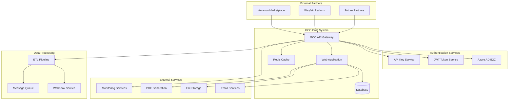
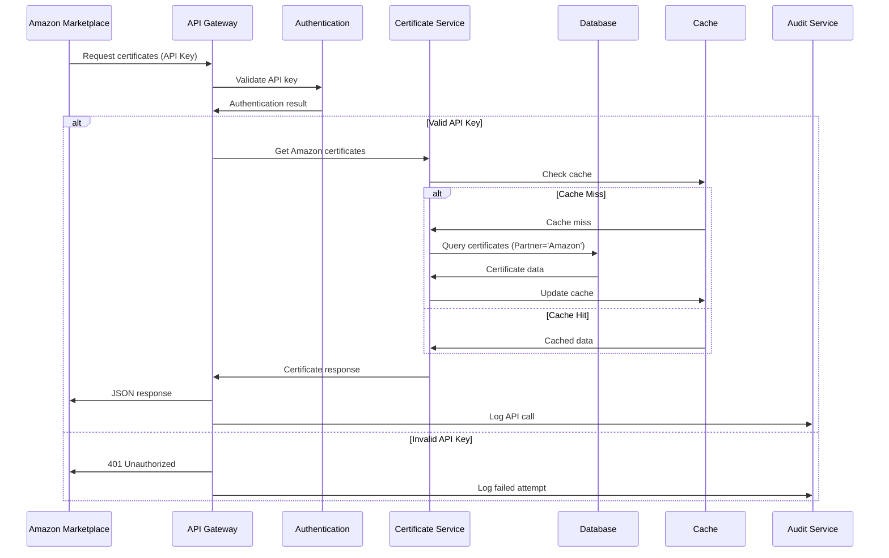
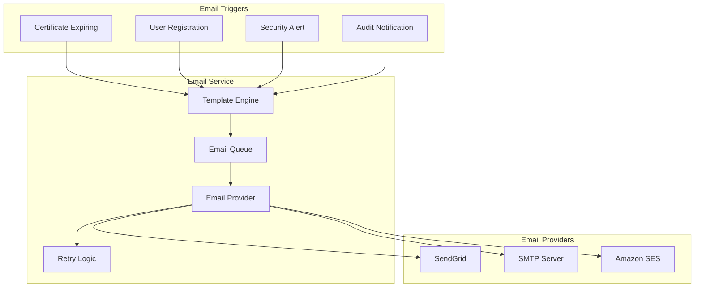
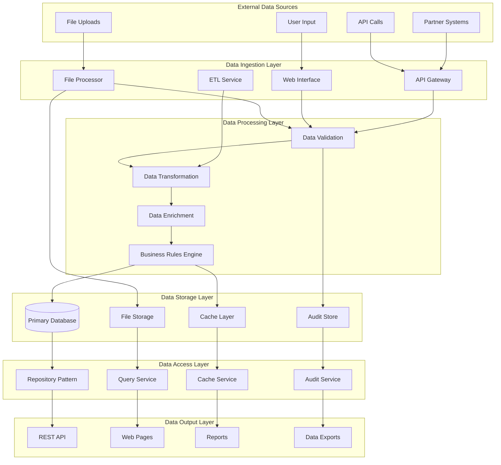
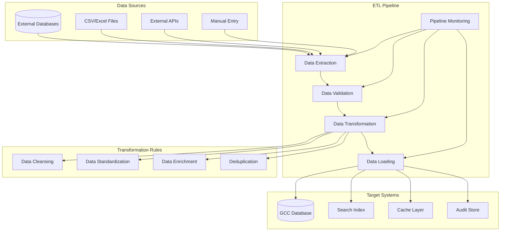

# Integration Architecture Document
## GCC Database Solution - Third-Party Integrations & Data Flows

### Document Information
- **Document Version**: 1.0
- **Last Updated**: September 17, 2025
- **Document Owner**: Integration Architect / Technical Lead
- **Review Cycle**: Quarterly
- **Classification**: Internal Technical Document

---

## Table of Contents

1. [Executive Summary](#1-executive-summary)
2. [Integration Overview](#2-integration-overview)
3. [Partner Integration Architecture](#3-partner-integration-architecture)
4. [Authentication Services Integration](#4-authentication-services-integration)
5. [Email & Communication Services](#5-email--communication-services)
6. [Document Storage Integration](#6-document-storage-integration)
7. [API Gateway & Management](#7-api-gateway--management)
8. [Data Flow Architecture](#8-data-flow-architecture)
9. [ETL & Data Pipeline Integration](#9-etl--data-pipeline-integration)
10. [Monitoring & Observability](#10-monitoring--observability)
11. [Error Handling & Resilience](#11-error-handling--resilience)
12. [Integration Security](#12-integration-security)

---

## 1. Executive Summary

### 1.1 Purpose
This Integration Architecture Document defines the comprehensive integration strategy, patterns, and implementation details for the GCC Database Solution's interactions with external systems, partners, and third-party services.

### 1.2 Integration Objectives
- **Seamless Partner Integration**: Enable Amazon, Wayfair, and other partners to access certificate data
- **Scalable API Architecture**: Support high-volume API traffic with proper rate limiting
- **Reliable Data Exchange**: Ensure data consistency and reliability across integrations
- **Security & Compliance**: Maintain security standards across all integration points
- **Monitoring & Observability**: Comprehensive visibility into integration health and performance

### 1.3 Integration Principles
- **API-First Design**: All integrations follow RESTful API standards
- **Loose Coupling**: Minimize dependencies between systems
- **Event-Driven Architecture**: Asynchronous processing where appropriate
- **Resilience**: Circuit breakers and retry mechanisms
- **Security by Design**: Authentication, authorization, and encryption at all levels

---

## 2. Integration Overview

### 2.1 Integration Landscape



### 2.2 Integration Categories

| Integration Type | Purpose | Implementation | Status |
|------------------|---------|---------------|--------|
| **Partner APIs** | External marketplace access | RESTful APIs with authentication | ✅ Production Ready |
| **Authentication** | User identity verification | Azure AD B2C + JWT + API Keys | ✅ Production Ready |
| **Email Services** | Notifications and communications | SMTP/SendGrid integration | ✅ Production Ready |
| **File Storage** | Document and certificate storage | Azure Blob Storage / Local files | ✅ Production Ready |
| **PDF Generation** | Certificate document creation | QuestPDF library | ✅ Production Ready |
| **Monitoring** | System observability | Application Insights / Logging | ✅ Production Ready |
| **Webhooks** | Event notifications | HTTP callbacks | 🔧 Infrastructure Ready |
| **ETL Pipelines** | Data transformation | Custom ETL service | ✅ Production Ready |

---

## 3. Partner Integration Architecture

### 3.1 Amazon Marketplace Integration

#### 3.1.1 Integration Architecture


#### 3.1.2 Amazon-Specific Implementation
```csharp
[ApiController]
[Route("api/[controller]")]
public class CertificateTileExternalApiController : BaseApiController
{
    private readonly ICertificateService _certificateService;
    private readonly IPartnerFilterService _partnerFilter;
    private readonly IRateLimitingService _rateLimiting;

    [HttpGet("tiles")]
    [Authorize(AuthenticationSchemes = "ApiKey")]
    public async Task<IActionResult> GetAmazonCertificates(
        [FromQuery] ExternalCertificateSearchParameters parameters)
    {
        // Rate limiting check
        var rateLimitResult = await _rateLimiting.CheckRateLimitAsync(
            HttpContext.User.Identity.Name, "tiles");

        if (!rateLimitResult.IsAllowed)
        {
            Response.Headers.Add("X-RateLimit-Limit", rateLimitResult.Limit.ToString());
            Response.Headers.Add("X-RateLimit-Remaining", "0");
            Response.Headers.Add("X-RateLimit-Reset", rateLimitResult.ResetTime.ToString());
            return StatusCode(429, "Rate limit exceeded");
        }

        // Apply partner filtering
        var partner = GetPartnerFromApiKey();
        var filteredParameters = _partnerFilter.ApplyPartnerFilter(parameters, partner);

        // Get certificates
        var certificates = await _certificateService.GetExternalCertificatesAsync(filteredParameters);

        // Add rate limit headers
        Response.Headers.Add("X-RateLimit-Limit", rateLimitResult.Limit.ToString());
        Response.Headers.Add("X-RateLimit-Remaining", rateLimitResult.Remaining.ToString());
        Response.Headers.Add("X-RateLimit-Reset", rateLimitResult.ResetTime.ToString());

        return StandardResponse(certificates);
    }

    [HttpGet("suggestions")]
    [AllowAnonymous]
    public async Task<IActionResult> GetSearchSuggestions(
        [FromQuery] string query, [FromQuery] string partner = null)
    {
        var suggestions = await _certificateService.GetSearchSuggestionsAsync(query, partner);
        return StandardResponse(suggestions);
    }

    [HttpGet("filters")]
    [AllowAnonymous]
    public async Task<IActionResult> GetAvailableFilters([FromQuery] string partner = null)
    {
        var filters = await _certificateService.GetAvailableFiltersAsync(partner);
        return StandardResponse(filters);
    }
}
```

#### 3.1.3 Partner Configuration
```csharp
public class PartnerConfiguration
{
    public class AmazonConfig
    {
        public string ApiKeyPrefix { get; set; } = "amz_";
        public int RateLimitPerHour { get; set; } = 1000;
        public string[] AllowedIpRanges { get; set; } = {
            "72.21.196.0/24",    // Amazon IP ranges
            "176.32.96.0/24",
            "54.240.128.0/18"
        };
        public string[] AllowedDomains { get; set; } = {
            "*.amazon.com",
            "*.amazonaws.com"
        };
        public bool RequireHttps { get; set; } = true;
        public string[] AllowedEndpoints { get; set; } = {
            "/api/CertificateTileExternal/tiles",
            "/api/CertificateTileExternal/suggestions",
            "/api/CertificateTileExternal/filters",
            "/api/CertificateTileExternal/certificate/*"
        };
    }

    public class WayfairConfig
    {
        public string ApiKeyPrefix { get; set; } = "wf_";
        public int RateLimitPerHour { get; set; } = 500;
        // Similar configuration structure
    }
}
```

### 3.2 API Gateway Implementation

#### 3.2.1 API Gateway Architecture
```csharp
public class ApiGatewayMiddleware
{
    private readonly RequestDelegate _next;
    private readonly IApiKeyService _apiKeyService;
    private readonly IRateLimitingService _rateLimiting;
    private readonly ILogger<ApiGatewayMiddleware> _logger;

    public async Task InvokeAsync(HttpContext context)
    {
        // Extract API key and partner information
        var apiKey = ExtractApiKey(context.Request);
        var partner = await DeterminePartnerAsync(apiKey);

        if (!string.IsNullOrEmpty(apiKey))
        {
            // Validate API key
            var validationResult = await _apiKeyService.ValidateAsync(apiKey);
            if (!validationResult.IsValid)
            {
                await WriteErrorResponse(context, 401, "Invalid API key");
                return;
            }

            // Check rate limiting
            var rateLimitResult = await _rateLimiting.CheckRateLimitAsync(
                validationResult.ApiKey.Id.ToString(),
                context.Request.Path);

            if (!rateLimitResult.IsAllowed)
            {
                await WriteErrorResponse(context, 429, "Rate limit exceeded");
                return;
            }

            // Set context for downstream processing
            context.Items["Partner"] = partner;
            context.Items["ApiKeyId"] = validationResult.ApiKey.Id;
        }

        // Add request tracking
        var requestId = Guid.NewGuid().ToString();
        context.Items["RequestId"] = requestId;
        context.Response.Headers.Add("X-Request-ID", requestId);

        await _next(context);

        // Log API usage
        await LogApiUsageAsync(context, partner, apiKey);
    }

    private async Task LogApiUsageAsync(HttpContext context, string partner, string apiKey)
    {
        var usage = new ApiUsageLog
        {
            RequestId = context.Items["RequestId"]?.ToString(),
            Partner = partner,
            ApiKey = apiKey?.Substring(0, Math.Min(8, apiKey.Length)) + "...", // Partial key for security
            Endpoint = context.Request.Path,
            Method = context.Request.Method,
            StatusCode = context.Response.StatusCode,
            ResponseTime = DateTime.UtcNow,
            IpAddress = context.Connection.RemoteIpAddress?.ToString(),
            UserAgent = context.Request.Headers["User-Agent"]
        };

        await _apiUsageService.LogUsageAsync(usage);
    }
}
```

---

## 4. Authentication Services Integration

### 4.1 Azure AD B2C Integration

#### 4.1.1 Azure AD B2C Configuration
```csharp
public class AzureAdB2CIntegrationService
{
    private readonly IConfiguration _configuration;
    private readonly HttpClient _httpClient;
    private readonly ILogger<AzureAdB2CIntegrationService> _logger;

    public async Task<B2CTokenValidationResult> ValidateB2CTokenAsync(string token)
    {
        try
        {
            var tokenHandler = new JwtSecurityTokenHandler();
            var validationParameters = new TokenValidationParameters
            {
                ValidateIssuer = true,
                ValidIssuer = _configuration["AzureAdB2C:Issuer"],
                ValidateAudience = true,
                ValidAudience = _configuration["AzureAdB2C:ClientId"],
                ValidateLifetime = true,
                ClockSkew = TimeSpan.FromMinutes(5),
                IssuerSigningKeyResolver = async (token, securityToken, kid, validationParameters) =>
                {
                    // Retrieve signing keys from Azure AD B2C
                    var keys = await GetSigningKeysAsync();
                    return keys.Where(k => k.KeyId == kid);
                }
            };

            var principal = tokenHandler.ValidateToken(token, validationParameters, out var validatedToken);

            return new B2CTokenValidationResult
            {
                IsValid = true,
                Principal = principal,
                Claims = principal.Claims.ToList()
            };
        }
        catch (SecurityTokenException ex)
        {
            _logger.LogWarning(ex, "Azure AD B2C token validation failed");
            return new B2CTokenValidationResult { IsValid = false, Error = ex.Message };
        }
    }

    private async Task<IEnumerable<SecurityKey>> GetSigningKeysAsync()
    {
        var keysEndpoint = $"{_configuration["AzureAdB2C:Instance"]}/{_configuration["AzureAdB2C:Domain"]}/discovery/v2.0/keys?p={_configuration["AzureAdB2C:SignUpSignInPolicyId"]}";

        var response = await _httpClient.GetStringAsync(keysEndpoint);
        var jwks = JsonSerializer.Deserialize<JsonWebKeySet>(response);

        return jwks.Keys.Select(k => new SymmetricSecurityKey(Convert.FromBase64String(k.K)));
    }
}
```

#### 4.1.2 Multi-Authentication Handler
```csharp
public class MultiAuthenticationHandler : IAuthenticationHandler
{
    private readonly IServiceProvider _serviceProvider;
    private readonly ILogger<MultiAuthenticationHandler> _logger;

    public async Task<AuthenticateResult> AuthenticateAsync()
    {
        var context = _serviceProvider.GetRequiredService<IHttpContextAccessor>().HttpContext;

        // Try API Key authentication first
        if (context.Request.Headers.ContainsKey("X-API-Key"))
        {
            var apiKeyHandler = _serviceProvider.GetRequiredService<ApiKeyAuthenticationHandler>();
            var apiKeyResult = await apiKeyHandler.AuthenticateAsync();
            if (apiKeyResult.Succeeded)
                return apiKeyResult;
        }

        // Try Bearer token authentication
        if (context.Request.Headers.ContainsKey("Authorization"))
        {
            var authHeader = context.Request.Headers["Authorization"].ToString();
            if (authHeader.StartsWith("Bearer "))
            {
                var jwtHandler = _serviceProvider.GetRequiredService<JwtAuthenticationHandler>();
                var jwtResult = await jwtHandler.AuthenticateAsync();
                if (jwtResult.Succeeded)
                    return jwtResult;
            }
        }

        // Try cookie authentication
        var cookieHandler = _serviceProvider.GetRequiredService<CookieAuthenticationHandler>();
        return await cookieHandler.AuthenticateAsync();
    }
}
```

---

## 5. Email & Communication Services

### 5.1 Email Service Integration

#### 5.1.1 Email Service Architecture


#### 5.1.2 Email Service Implementation
```csharp
public class EmailIntegrationService : IEmailService
{
    private readonly IEmailTemplateService _templateService;
    private readonly IEmailProviderFactory _providerFactory;
    private readonly IMessageQueue _messageQueue;
    private readonly ILogger<EmailIntegrationService> _logger;

    public async Task SendCertificateExpirationNotificationAsync(
        Certificate certificate, string recipientEmail)
    {
        var emailMessage = new EmailMessage
        {
            To = recipientEmail,
            Subject = $"Certificate Expiration Notice - {certificate.CertificateNumber}",
            Template = "CertificateExpiration",
            Data = new
            {
                certificate.CertificateNumber,
                certificate.ExpirationDate,
                CompanyName = certificate.Company?.CompanyName,
                ProductName = certificate.Product?.ProductName,
                DaysUntilExpiration = (certificate.ExpirationDate - DateTime.Today)?.Days
            }
        };

        await QueueEmailAsync(emailMessage, EmailPriority.High);
    }

    public async Task SendSecurityAlertAsync(SecurityAlert alert, string[] recipients)
    {
        var emailMessage = new EmailMessage
        {
            To = recipients,
            Subject = $"Security Alert: {alert.Title}",
            Template = "SecurityAlert",
            Data = new
            {
                alert.Title,
                alert.Description,
                alert.Severity,
                alert.Timestamp,
                alert.ActionRequired
            }
        };

        await QueueEmailAsync(emailMessage, EmailPriority.Critical);
    }

    private async Task QueueEmailAsync(EmailMessage message, EmailPriority priority)
    {
        var queueMessage = new QueuedEmailMessage
        {
            Id = Guid.NewGuid(),
            EmailMessage = message,
            Priority = priority,
            QueuedAt = DateTime.UtcNow,
            MaxRetries = 3,
            RetryCount = 0
        };

        await _messageQueue.EnqueueAsync(queueMessage);
        _logger.LogInformation("Email queued: {EmailId} to {Recipients}",
            queueMessage.Id, string.Join(", ", message.To));
    }

    public async Task ProcessEmailQueueAsync()
    {
        while (true)
        {
            var queuedMessage = await _messageQueue.DequeueAsync<QueuedEmailMessage>();
            if (queuedMessage == null)
            {
                await Task.Delay(TimeSpan.FromSeconds(5));
                continue;
            }

            try
            {
                var provider = _providerFactory.GetProvider();
                var renderedEmail = await _templateService.RenderAsync(
                    queuedMessage.EmailMessage.Template,
                    queuedMessage.EmailMessage.Data);

                queuedMessage.EmailMessage.Body = renderedEmail;

                await provider.SendAsync(queuedMessage.EmailMessage);

                _logger.LogInformation("Email sent successfully: {EmailId}", queuedMessage.Id);
            }
            catch (Exception ex)
            {
                _logger.LogError(ex, "Failed to send email: {EmailId}", queuedMessage.Id);

                queuedMessage.RetryCount++;
                if (queuedMessage.RetryCount < queuedMessage.MaxRetries)
                {
                    queuedMessage.NextRetryAt = DateTime.UtcNow.AddMinutes(Math.Pow(2, queuedMessage.RetryCount));
                    await _messageQueue.EnqueueAsync(queuedMessage);
                }
                else
                {
                    _logger.LogError("Email failed permanently after {RetryCount} attempts: {EmailId}",
                        queuedMessage.RetryCount, queuedMessage.Id);
                }
            }
        }
    }
}
```

### 5.2 Email Template Management

#### 5.2.1 Template Service Implementation
```csharp
public class EmailTemplateService : IEmailTemplateService
{
    private readonly Dictionary<string, EmailTemplate> _templates;
    private readonly IFileStorageService _fileStorage;

    public EmailTemplateService(IFileStorageService fileStorage)
    {
        _fileStorage = fileStorage;
        _templates = new Dictionary<string, EmailTemplate>
        {
            ["CertificateExpiration"] = new EmailTemplate
            {
                Name = "CertificateExpiration",
                Subject = "Certificate Expiration Notice - {{CertificateNumber}}",
                BodyTemplate = LoadTemplate("certificate-expiration.html"),
                RequiredData = new[] { "CertificateNumber", "ExpirationDate", "CompanyName" }
            },
            ["SecurityAlert"] = new EmailTemplate
            {
                Name = "SecurityAlert",
                Subject = "Security Alert: {{Title}}",
                BodyTemplate = LoadTemplate("security-alert.html"),
                RequiredData = new[] { "Title", "Description", "Severity", "Timestamp" }
            },
            ["UserRegistration"] = new EmailTemplate
            {
                Name = "UserRegistration",
                Subject = "Welcome to GCC Database Solution",
                BodyTemplate = LoadTemplate("user-registration.html"),
                RequiredData = new[] { "FirstName", "LastName", "Email" }
            }
        };
    }

    public async Task<string> RenderAsync(string templateName, object data)
    {
        if (!_templates.TryGetValue(templateName, out var template))
            throw new InvalidOperationException($"Template '{templateName}' not found");

        var json = JsonSerializer.Serialize(data);
        var dataDict = JsonSerializer.Deserialize<Dictionary<string, object>>(json);

        // Validate required data
        foreach (var requiredField in template.RequiredData)
        {
            if (!dataDict.ContainsKey(requiredField))
                throw new ArgumentException($"Required field '{requiredField}' missing from template data");
        }

        // Render template using Handlebars or similar
        var handlebars = Handlebars.Compile(template.BodyTemplate);
        return handlebars(dataDict);
    }

    private string LoadTemplate(string fileName)
    {
        var templatePath = Path.Combine("EmailTemplates", fileName);
        return File.ReadAllText(templatePath);
    }
}
```

---

## 6. Document Storage Integration

### 6.1 File Storage Architecture

#### 6.1.1 Storage Provider Factory
```csharp
public interface IFileStorageProvider
{
    Task<string> UploadAsync(string containerName, string fileName, Stream fileStream);
    Task<Stream> DownloadAsync(string filePath);
    Task<bool> DeleteAsync(string filePath);
    Task<FileMetadata> GetMetadataAsync(string filePath);
    Task<string> GenerateDownloadUrlAsync(string filePath, TimeSpan expiration);
}

public class FileStorageProviderFactory : IFileStorageProviderFactory
{
    private readonly IConfiguration _configuration;
    private readonly IServiceProvider _serviceProvider;

    public IFileStorageProvider GetProvider()
    {
        var providerType = _configuration["FileStorage:Provider"];

        return providerType?.ToLower() switch
        {
            "azureblob" => _serviceProvider.GetRequiredService<AzureBlobStorageProvider>(),
            "amazons3" => _serviceProvider.GetRequiredService<AmazonS3StorageProvider>(),
            "local" => _serviceProvider.GetRequiredService<LocalFileStorageProvider>(),
            _ => _serviceProvider.GetRequiredService<LocalFileStorageProvider>()
        };
    }
}
```

#### 6.1.2 Azure Blob Storage Integration
```csharp
public class AzureBlobStorageProvider : IFileStorageProvider
{
    private readonly BlobServiceClient _blobServiceClient;
    private readonly IConfiguration _configuration;
    private readonly ILogger<AzureBlobStorageProvider> _logger;

    public async Task<string> UploadAsync(string containerName, string fileName, Stream fileStream)
    {
        try
        {
            var containerClient = _blobServiceClient.GetBlobContainerClient(containerName);
            await containerClient.CreateIfNotExistsAsync(PublicAccessType.None);

            var blobClient = containerClient.GetBlobClient(fileName);

            // Set metadata
            var metadata = new Dictionary<string, string>
            {
                ["UploadedAt"] = DateTime.UtcNow.ToString("O"),
                ["ContentType"] = GetContentType(fileName),
                ["FileSize"] = fileStream.Length.ToString()
            };

            var uploadOptions = new BlobUploadOptions
            {
                Metadata = metadata,
                HttpHeaders = new BlobHttpHeaders
                {
                    ContentType = GetContentType(fileName)
                }
            };

            await blobClient.UploadAsync(fileStream, uploadOptions);

            var filePath = $"{containerName}/{fileName}";
            _logger.LogInformation("File uploaded successfully to Azure Blob Storage: {FilePath}", filePath);

            return filePath;
        }
        catch (Exception ex)
        {
            _logger.LogError(ex, "Failed to upload file to Azure Blob Storage: {FileName}", fileName);
            throw new FileStorageException($"Upload failed: {ex.Message}", ex);
        }
    }

    public async Task<Stream> DownloadAsync(string filePath)
    {
        try
        {
            var (containerName, fileName) = ParseFilePath(filePath);
            var containerClient = _blobServiceClient.GetBlobContainerClient(containerName);
            var blobClient = containerClient.GetBlobClient(fileName);

            var response = await blobClient.DownloadStreamingAsync();
            return response.Value.Content;
        }
        catch (RequestFailedException ex) when (ex.Status == 404)
        {
            throw new FileNotFoundException($"File not found: {filePath}");
        }
        catch (Exception ex)
        {
            _logger.LogError(ex, "Failed to download file from Azure Blob Storage: {FilePath}", filePath);
            throw new FileStorageException($"Download failed: {ex.Message}", ex);
        }
    }

    public async Task<string> GenerateDownloadUrlAsync(string filePath, TimeSpan expiration)
    {
        var (containerName, fileName) = ParseFilePath(filePath);
        var containerClient = _blobServiceClient.GetBlobContainerClient(containerName);
        var blobClient = containerClient.GetBlobClient(fileName);

        if (blobClient.CanGenerateSasUri)
        {
            var sasBuilder = new BlobSasBuilder
            {
                BlobContainerName = containerName,
                BlobName = fileName,
                Resource = "b",
                ExpiresOn = DateTimeOffset.UtcNow.Add(expiration)
            };
            sasBuilder.SetPermissions(BlobSasPermissions.Read);

            return blobClient.GenerateSasUri(sasBuilder).ToString();
        }

        throw new InvalidOperationException("Cannot generate SAS URI for blob client");
    }
}
```

### 6.2 Document Management Service

#### 6.2.1 Certificate Document Handler
```csharp
public class CertificateDocumentService : ICertificateDocumentService
{
    private readonly IFileStorageProvider _fileStorage;
    private readonly IPdfGenerationService _pdfGenerator;
    private readonly IVirusScanner _virusScanner;

    public async Task<DocumentUploadResult> UploadCertificateDocumentAsync(
        int certificateId, IFormFile file, string uploadedBy)
    {
        // Validate file
        var validationResult = ValidateFile(file);
        if (!validationResult.IsValid)
            return DocumentUploadResult.Failure(validationResult.Errors);

        // Scan for viruses
        if (await _virusScanner.ScanAsync(file.OpenReadStream()))
            return DocumentUploadResult.Failure("File failed virus scan");

        try
        {
            // Generate secure filename
            var fileName = GenerateSecureFileName(file.FileName, certificateId);
            var containerName = $"certificates/{DateTime.UtcNow:yyyy/MM}";

            // Upload file
            var filePath = await _fileStorage.UploadAsync(
                containerName, fileName, file.OpenReadStream());

            // Create document record
            var document = new CertificateDocument
            {
                CertificateId = certificateId,
                DocumentType = GetDocumentType(file.ContentType),
                FileName = file.FileName,
                FilePath = filePath,
                FileSize = file.Length,
                ContentType = file.ContentType,
                DocumentHash = await CalculateFileHashAsync(file.OpenReadStream()),
                UploadedDate = DateTime.UtcNow,
                UploadedBy = uploadedBy
            };

            await _documentRepository.CreateAsync(document);

            // Generate thumbnail for PDFs
            if (file.ContentType == "application/pdf")
            {
                await GenerateThumbnailAsync(file.OpenReadStream(), filePath);
            }

            return DocumentUploadResult.Success(document);
        }
        catch (Exception ex)
        {
            _logger.LogError(ex, "Failed to upload document for certificate {CertificateId}", certificateId);
            return DocumentUploadResult.Failure($"Upload failed: {ex.Message}");
        }
    }

    private FileValidationResult ValidateFile(IFormFile file)
    {
        var errors = new List<string>();

        // Check file size (max 10MB)
        if (file.Length > 10 * 1024 * 1024)
            errors.Add("File size exceeds 10MB limit");

        // Check file type
        var allowedTypes = new[] { "application/pdf", "image/jpeg", "image/png", "image/gif" };
        if (!allowedTypes.Contains(file.ContentType))
            errors.Add($"File type {file.ContentType} is not allowed");

        // Check file extension
        var allowedExtensions = new[] { ".pdf", ".jpg", ".jpeg", ".png", ".gif" };
        var extension = Path.GetExtension(file.FileName).ToLower();
        if (!allowedExtensions.Contains(extension))
            errors.Add($"File extension {extension} is not allowed");

        return new FileValidationResult
        {
            IsValid = !errors.Any(),
            Errors = errors
        };
    }
}
```

---

## 7. API Gateway & Management

### 7.1 API Management Implementation

#### 7.1.1 API Versioning Strategy
```csharp
public class ApiVersioningConfiguration
{
    public static void ConfigureApiVersioning(IServiceCollection services)
    {
        services.AddApiVersioning(options =>
        {
            options.DefaultApiVersion = new ApiVersion(1, 0);
            options.AssumeDefaultVersionWhenUnspecified = true;
            options.ApiVersionReader = ApiVersionReader.Combine(
                new UrlSegmentApiVersionReader(),
                new HeaderApiVersionReader("X-Version"),
                new QueryStringApiVersionReader("version")
            );
        });

        services.AddVersionedApiExplorer(setup =>
        {
            setup.GroupNameFormat = "'v'VVV";
            setup.SubstituteApiVersionInUrl = true;
        });
    }
}

[ApiController]
[ApiVersion("1.0")]
[ApiVersion("2.0")]
[Route("api/v{version:apiVersion}/[controller]")]
public class CertificatesV2Controller : BaseApiController
{
    [HttpGet]
    [MapToApiVersion("2.0")]
    public async Task<IActionResult> GetCertificatesV2(
        [FromQuery] CertificateSearchParametersV2 parameters)
    {
        // Enhanced search capabilities in v2
        var results = await _certificateService.SearchV2Async(parameters);
        return StandardResponse(results);
    }

    [HttpGet]
    [MapToApiVersion("1.0")]
    public async Task<IActionResult> GetCertificatesV1(
        [FromQuery] CertificateSearchParameters parameters)
    {
        // Legacy v1 compatibility
        var results = await _certificateService.SearchAsync(parameters);
        return StandardResponse(results);
    }
}
```

#### 7.1.2 API Documentation Generation
```csharp
public class SwaggerConfiguration
{
    public static void ConfigureSwagger(IServiceCollection services, IConfiguration configuration)
    {
        services.AddSwaggerGen(c =>
        {
            c.SwaggerDoc("v1", new OpenApiInfo
            {
                Title = "GCC Database API",
                Version = "v1",
                Description = "Green Circle Certified Database API for certificate management",
                Contact = new OpenApiContact
                {
                    Name = "GCC Support",
                    Email = "support@greencirclecertified.com",
                    Url = new Uri("https://greencirclecertified.com/support")
                },
                License = new OpenApiLicense
                {
                    Name = "Proprietary",
                }
            });

            c.SwaggerDoc("v2", new OpenApiInfo
            {
                Title = "GCC Database API v2",
                Version = "v2",
                Description = "Enhanced GCC Database API with advanced features"
            });

            // Add security definitions
            c.AddSecurityDefinition("Bearer", new OpenApiSecurityScheme
            {
                Type = SecuritySchemeType.Http,
                Scheme = "bearer",
                BearerFormat = "JWT",
                Description = "JWT Authorization header using the Bearer scheme."
            });

            c.AddSecurityDefinition("ApiKey", new OpenApiSecurityScheme
            {
                Type = SecuritySchemeType.ApiKey,
                In = ParameterLocation.Header,
                Name = "X-API-Key",
                Description = "API Key for partner access"
            });

            // Add security requirements
            c.AddSecurityRequirement(new OpenApiSecurityRequirement
            {
                {
                    new OpenApiSecurityScheme
                    {
                        Reference = new OpenApiReference { Type = ReferenceType.SecurityScheme, Id = "Bearer" }
                    },
                    Array.Empty<string>()
                },
                {
                    new OpenApiSecurityScheme
                    {
                        Reference = new OpenApiReference { Type = ReferenceType.SecurityScheme, Id = "ApiKey" }
                    },
                    Array.Empty<string>()
                }
            });

            // Include XML comments
            var xmlFile = $"{Assembly.GetExecutingAssembly().GetName().Name}.xml";
            var xmlPath = Path.Combine(AppContext.BaseDirectory, xmlFile);
            c.IncludeXmlComments(xmlPath);
        });
    }
}
```

---

## 8. Data Flow Architecture

### 8.1 Comprehensive Data Flow



### 8.2 Data Synchronization

#### 8.2.1 Real-time Data Sync
```csharp
public class DataSynchronizationService
{
    private readonly IMessageQueue _messageQueue;
    private readonly ICacheService _cacheService;
    private readonly IHubContext<DataSyncHub> _hubContext;

    public async Task HandleDataChangeAsync(DataChangeEvent changeEvent)
    {
        // Update cache
        await InvalidateCacheAsync(changeEvent);

        // Notify connected clients
        await NotifyClientsAsync(changeEvent);

        // Queue for partner notification if applicable
        await QueuePartnerNotificationAsync(changeEvent);

        // Update search indexes
        await UpdateSearchIndexesAsync(changeEvent);
    }

    private async Task InvalidateCacheAsync(DataChangeEvent changeEvent)
    {
        var cacheKeys = GenerateCacheKeys(changeEvent);
        foreach (var key in cacheKeys)
        {
            await _cacheService.RemoveAsync(key);
        }
    }

    private async Task NotifyClientsAsync(DataChangeEvent changeEvent)
    {
        if (changeEvent.EntityType == "Certificate")
        {
            await _hubContext.Clients.Group("CertificateWatchers")
                .SendAsync("CertificateChanged", changeEvent);
        }
    }

    private async Task QueuePartnerNotificationAsync(DataChangeEvent changeEvent)
    {
        if (changeEvent.EntityType == "Certificate" && changeEvent.Action != "View")
        {
            var certificate = await _certificateService.GetByIdAsync(changeEvent.EntityId);
            if (!string.IsNullOrEmpty(certificate?.Partner))
            {
                var notification = new PartnerNotification
                {
                    Partner = certificate.Partner,
                    EventType = changeEvent.Action,
                    EntityType = changeEvent.EntityType,
                    EntityId = changeEvent.EntityId,
                    Timestamp = DateTime.UtcNow,
                    Data = certificate
                };

                await _messageQueue.EnqueueAsync(notification);
            }
        }
    }
}
```

---

## 9. ETL & Data Pipeline Integration

### 9.1 ETL Pipeline Architecture



### 9.2 ETL Service Implementation

#### 9.2.1 ETL Pipeline Service
```csharp
public class EtlPipelineService : IEtlPipelineService
{
    private readonly IDataExtractor _extractor;
    private readonly IDataTransformer _transformer;
    private readonly IDataLoader _loader;
    private readonly IEtlMonitoringService _monitoring;

    public async Task<EtlResult> RunPipelineAsync(EtlPipelineConfig config)
    {
        var pipelineId = Guid.NewGuid();
        var result = new EtlResult { PipelineId = pipelineId, StartTime = DateTime.UtcNow };

        try
        {
            await _monitoring.LogPipelineStartAsync(pipelineId, config);

            // Extract phase
            var extractedData = await _extractor.ExtractAsync(config.SourceConfig);
            result.ExtractedRecords = extractedData.Count;
            await _monitoring.LogPhaseCompleteAsync(pipelineId, "Extract", extractedData.Count);

            // Transform phase
            var transformedData = await _transformer.TransformAsync(extractedData, config.TransformConfig);
            result.TransformedRecords = transformedData.ValidRecords.Count;
            result.FailedRecords = transformedData.FailedRecords.Count;
            await _monitoring.LogPhaseCompleteAsync(pipelineId, "Transform", transformedData.ValidRecords.Count);

            // Load phase
            var loadResult = await _loader.LoadAsync(transformedData.ValidRecords, config.TargetConfig);
            result.LoadedRecords = loadResult.SuccessfulLoads;
            result.LoadFailures = loadResult.FailedLoads;
            await _monitoring.LogPhaseCompleteAsync(pipelineId, "Load", loadResult.SuccessfulLoads);

            result.EndTime = DateTime.UtcNow;
            result.Status = EtlStatus.Completed;
            result.ErrorMessages = loadResult.ErrorMessages;

            await _monitoring.LogPipelineCompleteAsync(pipelineId, result);
            return result;
        }
        catch (Exception ex)
        {
            result.EndTime = DateTime.UtcNow;
            result.Status = EtlStatus.Failed;
            result.ErrorMessages = new[] { ex.Message };

            await _monitoring.LogPipelineFailedAsync(pipelineId, ex);
            throw;
        }
    }

    public async Task<EtlScheduleResult> SchedulePipelineAsync(string cronExpression, EtlPipelineConfig config)
    {
        var scheduleId = Guid.NewGuid();

        // Register with background job scheduler
        BackgroundJob.Schedule<EtlPipelineService>(
            service => service.RunPipelineAsync(config),
            cronExpression);

        return new EtlScheduleResult
        {
            ScheduleId = scheduleId,
            CronExpression = cronExpression,
            NextRun = GetNextRunTime(cronExpression),
            Status = ScheduleStatus.Active
        };
    }
}
```

---

## 10. Monitoring & Observability

### 10.1 Integration Monitoring

#### 10.1.1 Health Check Implementation
```csharp
public class IntegrationHealthService : IHealthCheck
{
    private readonly IApiKeyService _apiKeyService;
    private readonly IEmailService _emailService;
    private readonly IFileStorageProvider _fileStorage;
    private readonly HttpClient _httpClient;

    public async Task<HealthCheckResult> CheckHealthAsync(
        HealthCheckContext context, CancellationToken cancellationToken = default)
    {
        var healthData = new Dictionary<string, object>();
        var overallHealthy = true;

        // Check API Key service
        try
        {
            await _apiKeyService.ValidateAsync("health-check-key");
            healthData["ApiKeyService"] = "Healthy";
        }
        catch (Exception ex)
        {
            healthData["ApiKeyService"] = $"Unhealthy: {ex.Message}";
            overallHealthy = false;
        }

        // Check Email service
        try
        {
            await _emailService.ValidateConfigurationAsync();
            healthData["EmailService"] = "Healthy";
        }
        catch (Exception ex)
        {
            healthData["EmailService"] = $"Unhealthy: {ex.Message}";
            overallHealthy = false;
        }

        // Check File storage
        try
        {
            await _fileStorage.GetMetadataAsync("health-check.txt");
            healthData["FileStorage"] = "Healthy";
        }
        catch (Exception ex)
        {
            healthData["FileStorage"] = $"Unhealthy: {ex.Message}";
            overallHealthy = false;
        }

        // Check external dependencies
        var externalChecks = await CheckExternalDependenciesAsync();
        healthData.Add("ExternalDependencies", externalChecks);

        return overallHealthy
            ? HealthCheckResult.Healthy("All integrations are healthy", healthData)
            : HealthCheckResult.Unhealthy("One or more integrations are unhealthy", data: healthData);
    }

    private async Task<Dictionary<string, string>> CheckExternalDependenciesAsync()
    {
        var results = new Dictionary<string, string>();

        // Check Azure AD B2C
        try
        {
            var response = await _httpClient.GetAsync("https://login.microsoftonline.com/common/v2.0/.well-known/openid_configuration");
            results["AzureAD"] = response.IsSuccessStatusCode ? "Healthy" : "Unhealthy";
        }
        catch (Exception ex)
        {
            results["AzureAD"] = $"Unhealthy: {ex.Message}";
        }

        return results;
    }
}
```

### 10.2 Integration Metrics

#### 10.2.1 Metrics Collection Service
```csharp
public class IntegrationMetricsService
{
    private readonly IMetricsCollector _metricsCollector;
    private readonly ILogger<IntegrationMetricsService> _logger;

    public void RecordApiCall(string partner, string endpoint, int statusCode, long responseTimeMs)
    {
        _metricsCollector.Counter("api_calls_total")
            .WithTag("partner", partner)
            .WithTag("endpoint", endpoint)
            .WithTag("status_code", statusCode.ToString())
            .Increment();

        _metricsCollector.Histogram("api_response_time_ms")
            .WithTag("partner", partner)
            .WithTag("endpoint", endpoint)
            .Record(responseTimeMs);
    }

    public void RecordEmailSent(string templateName, bool success)
    {
        _metricsCollector.Counter("emails_sent_total")
            .WithTag("template", templateName)
            .WithTag("success", success.ToString())
            .Increment();
    }

    public void RecordFileUpload(string fileType, long fileSizeBytes, bool success)
    {
        _metricsCollector.Counter("file_uploads_total")
            .WithTag("file_type", fileType)
            .WithTag("success", success.ToString())
            .Increment();

        if (success)
        {
            _metricsCollector.Histogram("file_upload_size_bytes")
                .WithTag("file_type", fileType)
                .Record(fileSizeBytes);
        }
    }

    public void RecordEtlPipelineRun(string pipelineName, int recordsProcessed, bool success, long durationMs)
    {
        _metricsCollector.Counter("etl_pipeline_runs_total")
            .WithTag("pipeline", pipelineName)
            .WithTag("success", success.ToString())
            .Increment();

        _metricsCollector.Histogram("etl_pipeline_duration_ms")
            .WithTag("pipeline", pipelineName)
            .Record(durationMs);

        if (success)
        {
            _metricsCollector.Histogram("etl_records_processed")
                .WithTag("pipeline", pipelineName)
                .Record(recordsProcessed);
        }
    }
}
```

---

## 11. Error Handling & Resilience

### 11.1 Circuit Breaker Implementation

#### 11.1.1 Circuit Breaker Service
```csharp
public class IntegrationCircuitBreakerService
{
    private readonly Dictionary<string, CircuitBreakerPolicy> _circuitBreakers;
    private readonly ILogger<IntegrationCircuitBreakerService> _logger;

    public IntegrationCircuitBreakerService()
    {
        _circuitBreakers = new Dictionary<string, CircuitBreakerPolicy>
        {
            ["EmailService"] = Policy
                .Handle<EmailServiceException>()
                .CircuitBreakerAsync(
                    handledEventsAllowedBeforeBreaking: 5,
                    durationOfBreak: TimeSpan.FromMinutes(1),
                    onBreak: (exception, duration) => OnCircuitBreakerOpen("EmailService", exception, duration),
                    onReset: () => OnCircuitBreakerClosed("EmailService")),

            ["FileStorage"] = Policy
                .Handle<FileStorageException>()
                .CircuitBreakerAsync(
                    handledEventsAllowedBeforeBreaking: 3,
                    durationOfBreak: TimeSpan.FromMinutes(2),
                    onBreak: (exception, duration) => OnCircuitBreakerOpen("FileStorage", exception, duration),
                    onReset: () => OnCircuitBreakerClosed("FileStorage")),

            ["ExternalApi"] = Policy
                .Handle<HttpRequestException>()
                .Or<TaskCanceledException>()
                .CircuitBreakerAsync(
                    handledEventsAllowedBeforeBreaking: 10,
                    durationOfBreak: TimeSpan.FromMinutes(5),
                    onBreak: (exception, duration) => OnCircuitBreakerOpen("ExternalApi", exception, duration),
                    onReset: () => OnCircuitBreakerClosed("ExternalApi"))
        };
    }

    public async Task<T> ExecuteAsync<T>(string serviceName, Func<Task<T>> operation)
    {
        if (!_circuitBreakers.TryGetValue(serviceName, out var circuitBreaker))
        {
            _logger.LogWarning("No circuit breaker configured for service: {ServiceName}", serviceName);
            return await operation();
        }

        try
        {
            return await circuitBreaker.ExecuteAsync(operation);
        }
        catch (CircuitBreakerOpenException)
        {
            _logger.LogWarning("Circuit breaker is open for service: {ServiceName}", serviceName);
            throw new ServiceUnavailableException($"Service {serviceName} is currently unavailable");
        }
    }

    private void OnCircuitBreakerOpen(string serviceName, Exception exception, TimeSpan duration)
    {
        _logger.LogError(exception, "Circuit breaker opened for {ServiceName}, duration: {Duration}",
            serviceName, duration);

        // Notify monitoring system
        // Send alert to operations team
    }

    private void OnCircuitBreakerClosed(string serviceName)
    {
        _logger.LogInformation("Circuit breaker closed for {ServiceName}", serviceName);
    }
}
```

### 11.2 Retry Policies

#### 11.2.1 Comprehensive Retry Strategy
```csharp
public class IntegrationRetryPolicyService
{
    private readonly Dictionary<string, RetryPolicy> _retryPolicies;

    public IntegrationRetryPolicyService()
    {
        _retryPolicies = new Dictionary<string, RetryPolicy>
        {
            ["EmailService"] = Policy
                .Handle<EmailServiceException>()
                .WaitAndRetryAsync(
                    retryCount: 3,
                    sleepDurationProvider: retryAttempt => TimeSpan.FromSeconds(Math.Pow(2, retryAttempt)),
                    onRetry: (outcome, timespan, retryCount, context) =>
                        LogRetryAttempt("EmailService", retryCount, timespan, outcome.Exception)),

            ["FileStorage"] = Policy
                .Handle<FileStorageException>()
                .WaitAndRetryAsync(
                    retryCount: 2,
                    sleepDurationProvider: retryAttempt => TimeSpan.FromSeconds(retryAttempt * 2),
                    onRetry: (outcome, timespan, retryCount, context) =>
                        LogRetryAttempt("FileStorage", retryCount, timespan, outcome.Exception)),

            ["DatabaseConnection"] = Policy
                .Handle<SqlException>()
                .WaitAndRetryAsync(
                    retryCount: 5,
                    sleepDurationProvider: retryAttempt => TimeSpan.FromMilliseconds(100 * retryAttempt),
                    onRetry: (outcome, timespan, retryCount, context) =>
                        LogRetryAttempt("DatabaseConnection", retryCount, timespan, outcome.Exception))
        };
    }

    public async Task<T> ExecuteWithRetryAsync<T>(string serviceName, Func<Task<T>> operation)
    {
        if (_retryPolicies.TryGetValue(serviceName, out var retryPolicy))
        {
            return await retryPolicy.ExecuteAsync(operation);
        }

        return await operation();
    }

    private void LogRetryAttempt(string serviceName, int retryCount, TimeSpan delay, Exception exception)
    {
        _logger.LogWarning(exception,
            "Retry attempt {RetryCount} for {ServiceName} after {Delay}ms",
            retryCount, serviceName, delay.TotalMilliseconds);
    }
}
```

---

## 12. Integration Security

### 12.1 API Security Implementation

#### 12.1.1 OAuth 2.0 Client Credentials Flow
```csharp
public class OAuth2ClientService
{
    private readonly HttpClient _httpClient;
    private readonly IMemoryCache _tokenCache;
    private readonly IConfiguration _configuration;

    public async Task<string> GetAccessTokenAsync(string clientId, string clientSecret, string scope)
    {
        var cacheKey = $"oauth_token_{clientId}_{scope}";

        if (_tokenCache.TryGetValue(cacheKey, out string cachedToken))
        {
            return cachedToken;
        }

        var tokenRequest = new[]
        {
            new KeyValuePair<string, string>("grant_type", "client_credentials"),
            new KeyValuePair<string, string>("client_id", clientId),
            new KeyValuePair<string, string>("client_secret", clientSecret),
            new KeyValuePair<string, string>("scope", scope)
        };

        var response = await _httpClient.PostAsync("/oauth2/token", new FormUrlEncodedContent(tokenRequest));
        response.EnsureSuccessStatusCode();

        var tokenResponse = await response.Content.ReadFromJsonAsync<TokenResponse>();

        // Cache token with appropriate expiration
        var cacheExpiration = DateTime.UtcNow.AddSeconds(tokenResponse.ExpiresIn - 60); // 60s buffer
        _tokenCache.Set(cacheKey, tokenResponse.AccessToken, cacheExpiration);

        return tokenResponse.AccessToken;
    }
}
```

### 12.2 Webhook Security

#### 12.2.1 Webhook Signature Validation
```csharp
public class WebhookSecurityService
{
    private readonly IConfiguration _configuration;
    private readonly ILogger<WebhookSecurityService> _logger;

    public bool ValidateWebhookSignature(string payload, string signature, string secret)
    {
        try
        {
            var expectedSignature = GenerateSignature(payload, secret);
            return string.Equals(signature, expectedSignature, StringComparison.OrdinalIgnoreCase);
        }
        catch (Exception ex)
        {
            _logger.LogError(ex, "Failed to validate webhook signature");
            return false;
        }
    }

    public string GenerateSignature(string payload, string secret)
    {
        using var hmac = new HMACSHA256(Encoding.UTF8.GetBytes(secret));
        var hash = hmac.ComputeHash(Encoding.UTF8.GetBytes(payload));
        return $"sha256={Convert.ToHexString(hash).ToLower()}";
    }

    public async Task<WebhookDeliveryResult> DeliverWebhookAsync(string url, object payload, string secret)
    {
        try
        {
            var jsonPayload = JsonSerializer.Serialize(payload);
            var signature = GenerateSignature(jsonPayload, secret);

            var request = new HttpRequestMessage(HttpMethod.Post, url)
            {
                Content = new StringContent(jsonPayload, Encoding.UTF8, "application/json")
            };

            request.Headers.Add("X-Webhook-Signature", signature);
            request.Headers.Add("X-Webhook-Timestamp", DateTimeOffset.UtcNow.ToUnixTimeSeconds().ToString());
            request.Headers.Add("User-Agent", "GCC-Webhook/1.0");

            using var httpClient = new HttpClient { Timeout = TimeSpan.FromSeconds(30) };
            var response = await httpClient.SendAsync(request);

            return new WebhookDeliveryResult
            {
                Success = response.IsSuccessStatusCode,
                StatusCode = (int)response.StatusCode,
                ResponseBody = await response.Content.ReadAsStringAsync(),
                DeliveredAt = DateTime.UtcNow
            };
        }
        catch (Exception ex)
        {
            _logger.LogError(ex, "Failed to deliver webhook to {Url}", url);
            return new WebhookDeliveryResult
            {
                Success = false,
                Error = ex.Message,
                DeliveredAt = DateTime.UtcNow
            };
        }
    }
}
```

---

## Document Control

### Version History
| Version | Date | Author | Changes |
|---------|------|--------|---------|
| 1.0 | 2025-09-17 | Integration Architect | Initial comprehensive integration architecture document |

### Review & Approval
- **Next Review Date**: December 17, 2025
- **Document Owner**: Integration Architect / Technical Lead
- **Approved By**: [To be completed]
- **Distribution**: Technical Team, DevOps Team, Partner Integration Team

### Related Documents
- [Technical Design Document](technical-design-document.md)
- [Security Architecture Document](security-architecture-document.md)
- [Database Design Document](database-design-document.md)
- [API Reference](api-reference.md)

---

*This Integration Architecture Document provides comprehensive specifications for all third-party integrations and data flows in the GCC Database Solution, ensuring scalable, secure, and reliable system interoperability.*