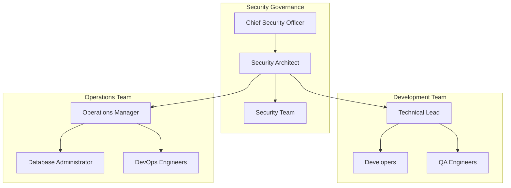
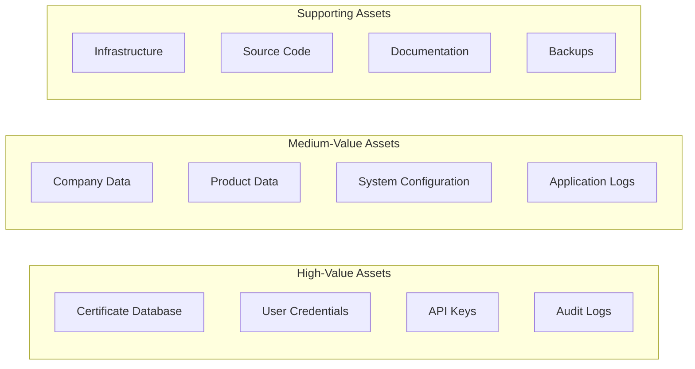
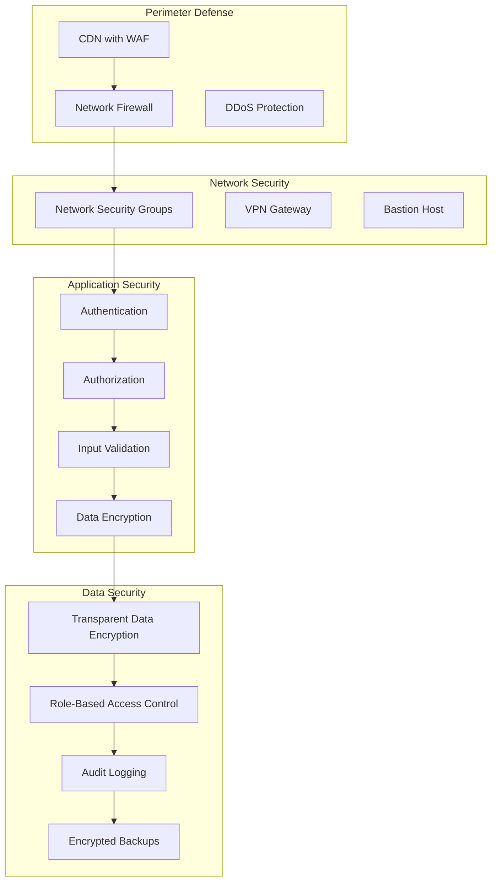
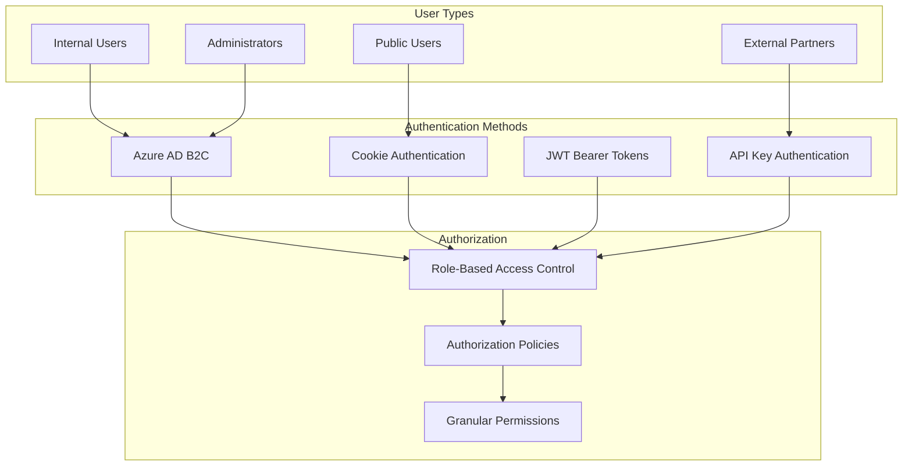
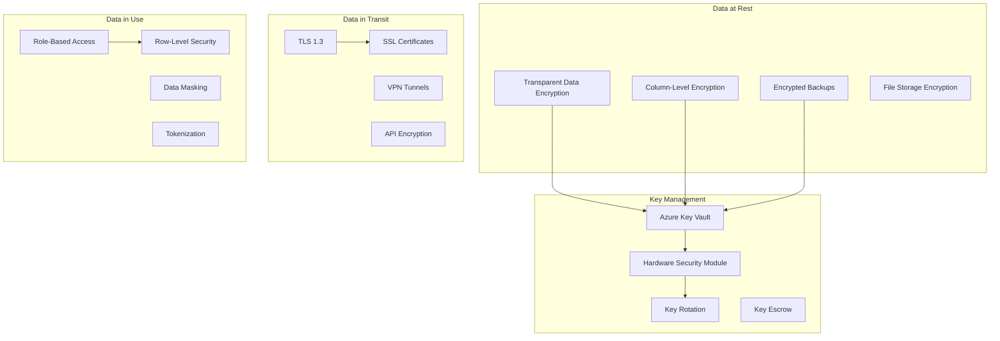
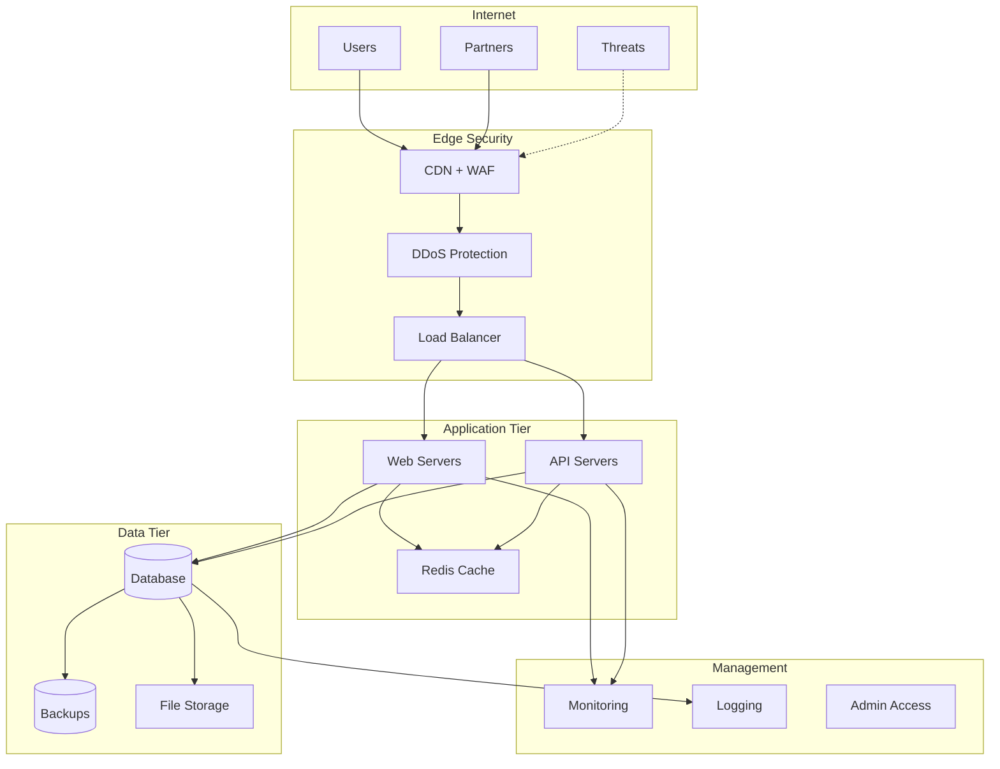
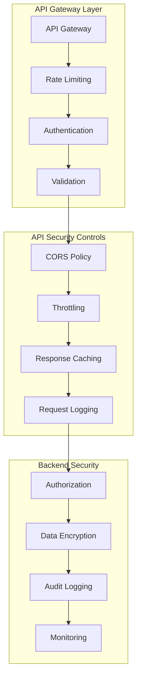
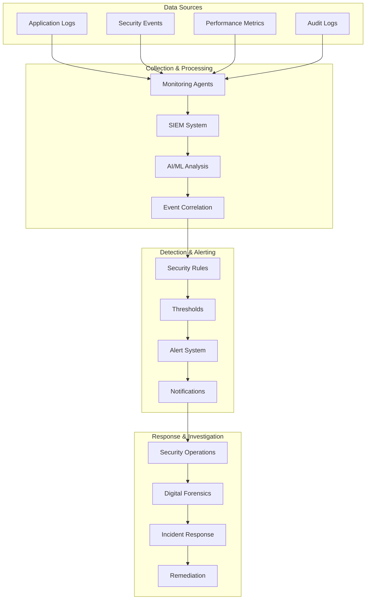

# Security Architecture Document
## GCC Database Solution - Comprehensive Security Design

### Document Information
- **Document Version**: 1.0
- **Last Updated**: September 17, 2025
- **Document Owner**: Security Lead / Technical Lead
- **Review Cycle**: Quarterly
- **Classification**: Internal Security Document

---

## Table of Contents

1. [Executive Summary](#1-executive-summary)
2. [Security Governance](#2-security-governance)
3. [Threat Model](#3-threat-model)
4. [Security Architecture](#4-security-architecture)
5. [Authentication & Authorization](#5-authentication--authorization)
6. [Data Security](#6-data-security)
7. [Application Security](#7-application-security)
8. [Infrastructure Security](#8-infrastructure-security)
9. [API Security](#9-api-security)
10. [Monitoring & Incident Response](#10-monitoring--incident-response)
11. [Compliance & Governance](#11-compliance--governance)
12. [Security Testing](#12-security-testing)

---

## 1. Executive Summary

### 1.1 Purpose
This Security Architecture Document defines the comprehensive security strategy, controls, and implementation details for the GCC Database Solution, ensuring protection of sensitive certification data and compliance with industry standards.

### 1.2 Security Objectives
- **Confidentiality**: Protect sensitive certificate and business data from unauthorized access
- **Integrity**: Ensure data accuracy and prevent unauthorized modifications
- **Availability**: Maintain system availability for business operations
- **Authentication**: Verify user identities through multiple mechanisms
- **Authorization**: Enforce role-based access controls
- **Auditability**: Maintain comprehensive audit trails for compliance

### 1.3 Security Framework Alignment
- **NIST Cybersecurity Framework**: Identify, Protect, Detect, Respond, Recover
- **ISO 27001**: Information Security Management Systems
- **OWASP**: Web Application Security Top 10
- **GDPR**: Data Protection and Privacy Requirements

---

## 2. Security Governance

### 2.1 Security Organization



### 2.2 Security Roles & Responsibilities

| Role | Security Responsibilities |
|------|---------------------------|
| **Security Architect** | Overall security design, threat modeling, security reviews |
| **Technical Lead** | Secure coding practices, security implementation oversight |
| **Developers** | Secure coding, vulnerability remediation, security testing |
| **Database Administrator** | Database security, encryption, access controls |
| **DevOps Engineers** | Infrastructure security, deployment security, monitoring |
| **QA Engineers** | Security testing, vulnerability assessment |

### 2.3 Security Policies

#### 2.3.1 Secure Development Lifecycle (SDL)
1. **Requirements Phase**: Security requirements definition
2. **Design Phase**: Threat modeling and security architecture review
3. **Implementation Phase**: Secure coding practices and code reviews
4. **Testing Phase**: Security testing and vulnerability assessment
5. **Deployment Phase**: Security configuration and hardening
6. **Maintenance Phase**: Security monitoring and incident response

#### 2.3.2 Data Classification Policy
- **Public**: Certificate information available to public users
- **Internal**: Business operational data for internal users
- **Confidential**: Partner-specific data and business intelligence
- **Restricted**: Personal information, credentials, and system secrets

---

## 3. Threat Model

### 3.1 Asset Identification



### 3.2 Threat Analysis (STRIDE Model)

#### 3.2.1 Spoofing Threats
| Threat | Impact | Likelihood | Mitigation |
|--------|--------|------------|------------|
| **Identity Spoofing** | High | Medium | Multi-factor authentication, Azure AD B2C |
| **API Key Theft** | High | Medium | Secure key storage, rotation policies |
| **Session Hijacking** | Medium | Low | Secure session management, HTTPS only |

#### 3.2.2 Tampering Threats
| Threat | Impact | Likelihood | Mitigation |
|--------|--------|------------|------------|
| **Data Manipulation** | High | Low | Input validation, parameterized queries |
| **Configuration Changes** | High | Low | Configuration management, change control |
| **Certificate Forgery** | High | Low | Digital signatures, audit trails |

#### 3.2.3 Repudiation Threats
| Threat | Impact | Likelihood | Mitigation |
|--------|--------|------------|------------|
| **Action Denial** | Medium | Medium | Comprehensive audit logging |
| **Transaction Disputes** | Medium | Low | Digital signatures, timestamp validation |

#### 3.2.4 Information Disclosure Threats
| Threat | Impact | Likelihood | Mitigation |
|--------|--------|------------|------------|
| **Data Breaches** | High | Medium | Encryption, access controls, monitoring |
| **SQL Injection** | High | Low | Parameterized queries, input validation |
| **Cross-Site Scripting** | Medium | Low | Output encoding, CSP headers |

#### 3.2.5 Denial of Service Threats
| Threat | Impact | Likelihood | Mitigation |
|--------|--------|------------|------------|
| **DDoS Attacks** | High | Medium | Rate limiting, CDN protection |
| **Resource Exhaustion** | Medium | Low | Resource monitoring, auto-scaling |
| **Database Overload** | High | Medium | Connection pooling, query optimization |

#### 3.2.6 Elevation of Privilege Threats
| Threat | Impact | Likelihood | Mitigation |
|--------|--------|------------|------------|
| **Privilege Escalation** | High | Low | Role-based access control, principle of least privilege |
| **Admin Account Compromise** | High | Low | Administrative access controls, monitoring |

---

## 4. Security Architecture

### 4.1 Defense in Depth Strategy



### 4.2 Security Zones

#### 4.2.1 Internet Zone (Untrusted)
- Public users accessing certificate information
- External partners using API endpoints
- Anonymous traffic requiring filtering and validation

#### 4.2.2 DMZ Zone (Semi-Trusted)
- Web application servers
- API gateways
- Load balancers and reverse proxies

#### 4.2.3 Application Zone (Trusted)
- Application servers
- Business logic components
- Session management

#### 4.2.4 Data Zone (Highly Trusted)
- Database servers
- File storage systems
- Backup infrastructure

#### 4.2.5 Management Zone (Restricted)
- Administrative interfaces
- Monitoring systems
- Configuration management

---

## 5. Authentication & Authorization

### 5.1 Multi-Authentication Architecture



### 5.2 Authentication Implementation

#### 5.2.1 Azure AD B2C Configuration
```csharp
public class AzureAdB2CConfiguration
{
    public string Instance { get; set; }
    public string Domain { get; set; }
    public string TenantId { get; set; }
    public string ClientId { get; set; }
    public string ClientSecret { get; set; }
    public string SignUpSignInPolicyId { get; set; }
    public string CallbackPath { get; set; }
    public string SignedOutCallbackPath { get; set; }

    // Security settings
    public bool RequireHttps { get; set; } = true;
    public TimeSpan TokenLifetime { get; set; } = TimeSpan.FromHours(8);
    public bool RequireMfa { get; set; } = true;
    public int MaxFailedAttempts { get; set; } = 5;
    public TimeSpan LockoutDuration { get; set; } = TimeSpan.FromMinutes(30);
}
```

#### 5.2.2 JWT Token Security
```csharp
public class JwtSecurityConfiguration
{
    public string SecretKey { get; set; } // Minimum 64 characters
    public string Issuer { get; set; }
    public string Audience { get; set; }
    public TimeSpan TokenLifetime { get; set; } = TimeSpan.FromHours(24);
    public TimeSpan RefreshTokenLifetime { get; set; } = TimeSpan.FromDays(7);
    public string Algorithm { get; set; } = SecurityAlgorithms.HmacSha256;
    public bool RequireHttpsMetadata { get; set; } = true;
    public bool SaveToken { get; set; } = false;
    public bool RequireExpirationTime { get; set; } = true;
    public bool ValidateLifetime { get; set; } = true;
    public TimeSpan ClockSkew { get; set; } = TimeSpan.FromMinutes(5);
}
```

#### 5.2.3 API Key Security Implementation
```csharp
public class ApiKeySecurityService
{
    public async Task<ApiKeyValidationResult> ValidateApiKeyAsync(string apiKey)
    {
        // Hash the provided API key
        var hashedKey = HashApiKey(apiKey);

        // Retrieve API key details from database
        var keyInfo = await _repository.GetApiKeyByHashAsync(hashedKey);

        if (keyInfo == null)
            return ApiKeyValidationResult.Invalid("API key not found");

        // Validate key status and expiration
        if (!keyInfo.IsActive)
            return ApiKeyValidationResult.Invalid("API key is disabled");

        if (keyInfo.ExpirationDate.HasValue && keyInfo.ExpirationDate < DateTime.UtcNow)
            return ApiKeyValidationResult.Invalid("API key has expired");

        // Check rate limiting
        if (!await CheckRateLimitAsync(keyInfo))
            return ApiKeyValidationResult.Invalid("Rate limit exceeded");

        // Validate IP restrictions
        if (!ValidateIpRestrictions(keyInfo, GetClientIpAddress()))
            return ApiKeyValidationResult.Invalid("IP address not allowed");

        // Update usage statistics
        await UpdateUsageStatisticsAsync(keyInfo);

        return ApiKeyValidationResult.Valid(keyInfo);
    }

    private string HashApiKey(string apiKey)
    {
        using var sha256 = SHA256.Create();
        var hashedBytes = sha256.ComputeHash(Encoding.UTF8.GetBytes(apiKey + _configuration.Salt));
        return Convert.ToBase64String(hashedBytes);
    }
}
```

### 5.3 Authorization Framework

#### 5.3.1 Role-Based Access Control (RBAC)
```csharp
public static class Roles
{
    public const string Admin = "Admin";
    public const string Analyst = "Analyst";
    public const string External = "External";
    public const string Viewer = "Viewer";
}

public static class Permissions
{
    // Certificate permissions
    public const string CertificateCreate = "Certificate:Create";
    public const string CertificateRead = "Certificate:Read";
    public const string CertificateUpdate = "Certificate:Update";
    public const string CertificateDelete = "Certificate:Delete";
    public const string CertificateExport = "Certificate:Export";

    // Company permissions
    public const string CompanyCreate = "Company:Create";
    public const string CompanyRead = "Company:Read";
    public const string CompanyUpdate = "Company:Update";
    public const string CompanyDelete = "Company:Delete";

    // Administrative permissions
    public const string UserManagement = "User:Manage";
    public const string RoleManagement = "Role:Manage";
    public const string SystemConfiguration = "System:Configure";
    public const string AuditLogAccess = "AuditLog:Access";
}

public class RolePermissionMatrix
{
    private static readonly Dictionary<string, string[]> _rolePermissions = new()
    {
        [Roles.Admin] = new[]
        {
            Permissions.CertificateCreate, Permissions.CertificateRead, Permissions.CertificateUpdate, Permissions.CertificateDelete,
            Permissions.CompanyCreate, Permissions.CompanyRead, Permissions.CompanyUpdate, Permissions.CompanyDelete,
            Permissions.UserManagement, Permissions.RoleManagement, Permissions.SystemConfiguration, Permissions.AuditLogAccess
        },
        [Roles.Analyst] = new[]
        {
            Permissions.CertificateCreate, Permissions.CertificateRead, Permissions.CertificateUpdate,
            Permissions.CompanyRead, Permissions.CompanyUpdate, Permissions.CertificateExport
        },
        [Roles.External] = new[]
        {
            Permissions.CertificateRead, Permissions.CompanyRead
        },
        [Roles.Viewer] = new[]
        {
            Permissions.CertificateRead, Permissions.CompanyRead
        }
    };

    public static string[] GetPermissions(string role) =>
        _rolePermissions.TryGetValue(role, out var permissions) ? permissions : Array.Empty<string>();
}
```

#### 5.3.2 Authorization Policies
```csharp
public static class AuthorizationPolicies
{
    public static void ConfigurePolicies(AuthorizationOptions options)
    {
        // Role-based policies
        options.AddPolicy("AdminOnly", policy =>
            policy.RequireRole(Roles.Admin));

        options.AddPolicy("AnalystOrAdmin", policy =>
            policy.RequireRole(Roles.Analyst, Roles.Admin));

        options.AddPolicy("ExternalAccess", policy =>
            policy.RequireRole(Roles.External, Roles.Analyst, Roles.Admin));

        // Permission-based policies
        options.AddPolicy("CanCreateCertificates", policy =>
            policy.RequireAssertion(context =>
                context.User.HasClaim("permission", Permissions.CertificateCreate)));

        options.AddPolicy("CanAccessAuditLogs", policy =>
            policy.RequireAssertion(context =>
                context.User.HasClaim("permission", Permissions.AuditLogAccess)));

        // Resource-based policies
        options.AddPolicy("CanAccessPartnerData", policy =>
            policy.AddRequirements(new PartnerDataAccessRequirement()));

        // API-specific policies
        options.AddPolicy("ApiAccess", policy =>
        {
            policy.RequireAuthenticatedUser();
            policy.AddAuthenticationSchemes("Bearer", "ApiKey");
        });
    }
}
```

---

## 6. Data Security

### 6.1 Data Protection Strategy



### 6.2 Encryption Implementation

#### 6.2.1 Database Encryption Configuration
```sql
-- Enable Transparent Data Encryption
ALTER DATABASE GCC_Database SET ENCRYPTION ON;

-- Create symmetric keys for column-level encryption
CREATE MASTER KEY ENCRYPTION BY PASSWORD = 'ComplexMasterKeyPassword123!';

CREATE CERTIFICATE GCC_Certificate
WITH SUBJECT = 'GCC Sensitive Data Certificate',
EXPIRY_DATE = '2026-12-31';

CREATE SYMMETRIC KEY GCC_SymmetricKey
WITH ALGORITHM = AES_256
ENCRYPTION BY CERTIFICATE GCC_Certificate;

-- Example: Encrypt sensitive user data
CREATE FUNCTION dbo.EncryptSensitiveData(@Data nvarchar(1000))
RETURNS varbinary(8000)
AS
BEGIN
    DECLARE @EncryptedData varbinary(8000);

    OPEN SYMMETRIC KEY GCC_SymmetricKey
    DECRYPTION BY CERTIFICATE GCC_Certificate;

    SET @EncryptedData = EncryptByKey(Key_GUID('GCC_SymmetricKey'), @Data);

    CLOSE SYMMETRIC KEY GCC_SymmetricKey;

    RETURN @EncryptedData;
END;
```

#### 6.2.2 Application-Level Encryption
```csharp
public class DataProtectionService
{
    private readonly IDataProtector _protector;
    private readonly IConfiguration _configuration;

    public DataProtectionService(IDataProtectionProvider provider, IConfiguration configuration)
    {
        _protector = provider.CreateProtector("GCC.SensitiveData.v1");
        _configuration = configuration;
    }

    public string ProtectPersonalData(string data)
    {
        if (string.IsNullOrEmpty(data))
            return data;

        return _protector.Protect(data);
    }

    public string UnprotectPersonalData(string protectedData)
    {
        if (string.IsNullOrEmpty(protectedData))
            return protectedData;

        try
        {
            return _protector.Unprotect(protectedData);
        }
        catch (CryptographicException ex)
        {
            _logger.LogError(ex, "Failed to decrypt personal data");
            throw new SecurityException("Data decryption failed", ex);
        }
    }
}

// Data protection configuration
public void ConfigureDataProtection(IServiceCollection services)
{
    services.AddDataProtection()
        .PersistKeysToAzureBlobStorage(_configuration.GetConnectionString("KeyStorage"))
        .ProtectKeysWithAzureKeyVault(
            _configuration["KeyVault:VaultUri"],
            _configuration["KeyVault:KeyName"])
        .SetApplicationName("GCC-Database-Solution")
        .SetDefaultKeyLifetime(TimeSpan.FromDays(90));
}
```

### 6.3 Data Loss Prevention (DLP)

#### 6.3.1 Sensitive Data Classification
```csharp
public class DataClassificationService
{
    private readonly Dictionary<DataClassification, string[]> _sensitivePatterns = new()
    {
        [DataClassification.PersonalData] = new[]
        {
            @"\b\d{3}-\d{2}-\d{4}\b", // SSN pattern
            @"\b[A-Za-z0-9._%+-]+@[A-Za-z0-9.-]+\.[A-Z|a-z]{2,}\b", // Email pattern
            @"\b\d{10,15}\b" // Phone number pattern
        },
        [DataClassification.Financial] = new[]
        {
            @"\b\d{4}[- ]?\d{4}[- ]?\d{4}[- ]?\d{4}\b", // Credit card pattern
            @"\b\d{9}\b" // Bank account pattern
        },
        [DataClassification.Confidential] = new[]
        {
            @"\b[A-Z]{2,5}-\d{3,6}\b", // Certificate number pattern
            @"\bAPI[_-]?KEY[_-]?\w+", // API key pattern
        }
    };

    public DataClassificationResult ClassifyData(string data)
    {
        var result = new DataClassificationResult { Data = data };

        foreach (var (classification, patterns) in _sensitivePatterns)
        {
            foreach (var pattern in patterns)
            {
                if (Regex.IsMatch(data, pattern, RegexOptions.IgnoreCase))
                {
                    result.Classifications.Add(classification);
                    result.MatchedPatterns.Add(pattern);
                }
            }
        }

        return result;
    }
}
```

#### 6.3.2 Data Masking for Non-Production
```csharp
public class DataMaskingService
{
    public string MaskPersonalData(string data, DataClassification classification)
    {
        return classification switch
        {
            DataClassification.PersonalData => MaskPersonalInformation(data),
            DataClassification.Financial => MaskFinancialData(data),
            DataClassification.Confidential => MaskConfidentialData(data),
            _ => data
        };
    }

    private string MaskPersonalInformation(string data)
    {
        // Mask email addresses
        data = Regex.Replace(data, @"([a-zA-Z0-9._%+-]+)@([a-zA-Z0-9.-]+\.[a-zA-Z]{2,})",
            m => $"{m.Groups[1].Value[0]}***@{m.Groups[2].Value}");

        // Mask phone numbers
        data = Regex.Replace(data, @"\b(\d{3})(\d{3})(\d{4})\b", "***-***-$3");

        return data;
    }

    private string MaskFinancialData(string data)
    {
        // Mask credit card numbers
        return Regex.Replace(data, @"\b(\d{4})[- ]?(\d{4})[- ]?(\d{4})[- ]?(\d{4})\b",
            "****-****-****-$4");
    }

    private string MaskConfidentialData(string data)
    {
        // Mask certificate numbers
        return Regex.Replace(data, @"\b([A-Z]{2,5})-(\d{3,6})\b", "$1-***");
    }
}
```

---

## 7. Application Security

### 7.1 Input Validation & Sanitization

#### 7.1.1 Comprehensive Input Validation
```csharp
public class InputValidationService
{
    private readonly Dictionary<string, string> _validationPatterns = new()
    {
        ["CertificateNumber"] = @"^[A-Z0-9\-]{5,50}$",
        ["CompanyName"] = @"^[A-Za-z0-9\s\.\-&',]{2,200}$",
        ["Email"] = @"^[a-zA-Z0-9._%+-]+@[a-zA-Z0-9.-]+\.[a-zA-Z]{2,}$",
        ["PhoneNumber"] = @"^\+?[\d\s\-\(\)]{10,20}$",
        ["SKU"] = @"^[A-Z0-9\-]{3,100}$",
        ["ASIN"] = @"^[A-Z0-9]{10}$",
        ["UPC"] = @"^\d{12}$"
    };

    public ValidationResult ValidateInput(string inputType, string value)
    {
        if (string.IsNullOrEmpty(value))
            return ValidationResult.Success();

        // Check for common injection patterns
        if (ContainsSqlInjectionPatterns(value))
            return ValidationResult.Failure("Input contains potential SQL injection patterns");

        if (ContainsXssPatterns(value))
            return ValidationResult.Failure("Input contains potential XSS patterns");

        // Type-specific validation
        if (_validationPatterns.TryGetValue(inputType, out var pattern))
        {
            if (!Regex.IsMatch(value, pattern))
                return ValidationResult.Failure($"Input does not match required format for {inputType}");
        }

        // Length validation
        if (value.Length > GetMaxLength(inputType))
            return ValidationResult.Failure($"Input exceeds maximum length for {inputType}");

        return ValidationResult.Success();
    }

    private bool ContainsSqlInjectionPatterns(string input)
    {
        var sqlPatterns = new[]
        {
            @"(\bUNION\b|\bSELECT\b|\bINSERT\b|\bUPDATE\b|\bDELETE\b|\bDROP\b|\bEXEC\b)",
            @"(--|\/\*|\*\/)",
            @"(\bOR\b\s+\d+\s*=\s*\d+|\bAND\b\s+\d+\s*=\s*\d+)",
            @"(\bxp_\w+|\bsp_\w+)"
        };

        return sqlPatterns.Any(pattern =>
            Regex.IsMatch(input, pattern, RegexOptions.IgnoreCase));
    }

    private bool ContainsXssPatterns(string input)
    {
        var xssPatterns = new[]
        {
            @"<script[^>]*>.*?</script>",
            @"javascript:",
            @"on\w+\s*=",
            @"<iframe[^>]*>",
            @"<object[^>]*>",
            @"<embed[^>]*>"
        };

        return xssPatterns.Any(pattern =>
            Regex.IsMatch(input, pattern, RegexOptions.IgnoreCase));
    }
}
```

#### 7.1.2 Output Encoding & CSP
```csharp
public class SecurityHeadersMiddleware
{
    public async Task InvokeAsync(HttpContext context, RequestDelegate next)
    {
        // Content Security Policy
        context.Response.Headers.Add("Content-Security-Policy",
            "default-src 'self'; " +
            "script-src 'self' 'unsafe-inline' https://cdn.jsdelivr.net; " +
            "style-src 'self' 'unsafe-inline' https://cdn.jsdelivr.net; " +
            "img-src 'self' data: https:; " +
            "font-src 'self' https://fonts.gstatic.com; " +
            "connect-src 'self'; " +
            "frame-ancestors 'none'; " +
            "base-uri 'self'; " +
            "form-action 'self'");

        // Additional security headers
        context.Response.Headers.Add("X-Content-Type-Options", "nosniff");
        context.Response.Headers.Add("X-Frame-Options", "DENY");
        context.Response.Headers.Add("X-XSS-Protection", "1; mode=block");
        context.Response.Headers.Add("Referrer-Policy", "strict-origin-when-cross-origin");
        context.Response.Headers.Add("Permissions-Policy", "geolocation=(), microphone=(), camera=()");

        // Strict Transport Security
        if (context.Request.IsHttps)
        {
            context.Response.Headers.Add("Strict-Transport-Security",
                "max-age=31536000; includeSubDomains; preload");
        }

        // Remove server information
        context.Response.Headers.Remove("Server");
        context.Response.Headers.Remove("X-Powered-By");

        await next(context);
    }
}
```

### 7.2 Session Security

#### 7.2.1 Secure Session Configuration
```csharp
public void ConfigureSecureSessions(IServiceCollection services)
{
    services.AddSession(options =>
    {
        options.Cookie.Name = "__GCC_Session";
        options.Cookie.HttpOnly = true;
        options.Cookie.SecurePolicy = CookieSecurePolicy.Always;
        options.Cookie.SameSite = SameSiteMode.Strict;
        options.IdleTimeout = TimeSpan.FromMinutes(30);
        options.Cookie.MaxAge = TimeSpan.FromHours(8);
    });

    services.ConfigureApplicationCookie(options =>
    {
        options.Cookie.Name = "__GCC_Auth";
        options.Cookie.HttpOnly = true;
        options.Cookie.SecurePolicy = CookieSecurePolicy.Always;
        options.Cookie.SameSite = SameSiteMode.Strict;
        options.ExpireTimeSpan = TimeSpan.FromHours(8);
        options.SlidingExpiration = true;
        options.LoginPath = "/Account/Login";
        options.LogoutPath = "/Account/Logout";
        options.AccessDeniedPath = "/Account/AccessDenied";
    });
}
```

#### 7.2.2 CSRF Protection
```csharp
public void ConfigureCsrfProtection(IServiceCollection services)
{
    services.AddAntiforgery(options =>
    {
        options.Cookie.Name = "__RequestVerificationToken";
        options.Cookie.HttpOnly = true;
        options.Cookie.SecurePolicy = CookieSecurePolicy.Always;
        options.Cookie.SameSite = SameSiteMode.Strict;
        options.HeaderName = "X-CSRF-TOKEN";
        options.SuppressXFrameOptionsHeader = false;
    });
}

// Custom CSRF validation for API endpoints
public class ValidateCsrfTokenAttribute : Attribute, IFilterFactory
{
    public IFilterMetadata CreateInstance(IServiceProvider serviceProvider)
    {
        return new ValidateCsrfTokenFilter(
            serviceProvider.GetRequiredService<IAntiforgery>());
    }

    public bool IsReusable => true;
}
```

---

## 8. Infrastructure Security

### 8.1 Network Security Architecture



### 8.2 Container Security

#### 8.2.1 Secure Dockerfile Configuration
```dockerfile
# Multi-stage build for security
FROM mcr.microsoft.com/dotnet/sdk:8.0 AS build
WORKDIR /src

# Copy only necessary files for restore
COPY ["GCCWebApp.csproj", "."]
RUN dotnet restore "./GCCWebApp.csproj"

# Copy source and build
COPY . .
RUN dotnet build "./GCCWebApp.csproj" -c Release -o /app/build

# Publish stage
FROM build AS publish
RUN dotnet publish "./GCCWebApp.csproj" -c Release -o /app/publish /p:UseAppHost=false

# Runtime stage with security hardening
FROM mcr.microsoft.com/dotnet/aspnet:8.0 AS final
WORKDIR /app

# Create non-root user
RUN groupadd -r appgroup && useradd -r -g appgroup appuser

# Set secure permissions
RUN chown -R appuser:appgroup /app
RUN chmod -R 755 /app

# Remove unnecessary packages to reduce attack surface
RUN apt-get update && apt-get upgrade -y && \
    apt-get remove -y wget curl && \
    apt-get autoremove -y && \
    apt-get clean && \
    rm -rf /var/lib/apt/lists/*

# Security environment variables
ENV ASPNETCORE_ENVIRONMENT=Production
ENV ASPNETCORE_URLS=http://+:8080
ENV DOTNET_CLI_TELEMETRY_OPTOUT=1
ENV DOTNET_NOLOGO=1

# Run as non-root user
USER appuser

# Health check
HEALTHCHECK --interval=30s --timeout=10s --start-period=5s --retries=3 \
  CMD curl -f http://localhost:8080/health || exit 1

COPY --from=publish --chown=appuser:appgroup /app/publish .

EXPOSE 8080
ENTRYPOINT ["dotnet", "GCCWebApp.dll"]
```

#### 8.2.2 Container Security Scanning
```yaml
# Docker security scanning configuration
version: '3.8'
services:
  gcc-webapp:
    build:
      context: .
      dockerfile: Dockerfile
    security_opt:
      - no-new-privileges:true
    read_only: true
    tmpfs:
      - /tmp
      - /app/logs
    cap_drop:
      - ALL
    cap_add:
      - NET_BIND_SERVICE
    ulimits:
      nofile:
        soft: 1024
        hard: 2048
      nproc:
        soft: 64
        hard: 128
```

### 8.3 Secrets Management

#### 8.3.1 Azure Key Vault Integration
```csharp
public class SecureConfigurationService
{
    private readonly SecretClient _secretClient;
    private readonly ILogger<SecureConfigurationService> _logger;

    public SecureConfigurationService(SecretClient secretClient, ILogger<SecureConfigurationService> logger)
    {
        _secretClient = secretClient;
        _logger = logger;
    }

    public async Task<string> GetSecretAsync(string secretName)
    {
        try
        {
            var secret = await _secretClient.GetSecretAsync(secretName);
            return secret.Value.Value;
        }
        catch (Exception ex)
        {
            _logger.LogError(ex, "Failed to retrieve secret: {SecretName}", secretName);
            throw new SecurityException($"Unable to retrieve secret: {secretName}", ex);
        }
    }

    public async Task SetSecretAsync(string secretName, string secretValue)
    {
        try
        {
            await _secretClient.SetSecretAsync(secretName, secretValue);
            _logger.LogInformation("Secret updated: {SecretName}", secretName);
        }
        catch (Exception ex)
        {
            _logger.LogError(ex, "Failed to set secret: {SecretName}", secretName);
            throw new SecurityException($"Unable to set secret: {secretName}", ex);
        }
    }
}

// Configuration in Program.cs
public void ConfigureKeyVault(IServiceCollection services, IConfiguration configuration)
{
    var keyVaultUrl = configuration["KeyVault:VaultUri"];
    if (!string.IsNullOrEmpty(keyVaultUrl))
    {
        services.AddSingleton<SecretClient>(provider =>
        {
            var credential = new DefaultAzureCredential();
            return new SecretClient(new Uri(keyVaultUrl), credential);
        });

        services.AddSingleton<SecureConfigurationService>();
    }
}
```

---

## 9. API Security

### 9.1 API Security Framework



### 9.2 API Rate Limiting & Throttling

#### 9.2.1 Advanced Rate Limiting Implementation
```csharp
public class AdvancedRateLimitingService
{
    private readonly IMemoryCache _cache;
    private readonly IConfiguration _configuration;
    private readonly ILogger<AdvancedRateLimitingService> _logger;

    public async Task<RateLimitResult> CheckRateLimitAsync(string clientId, string endpoint)
    {
        var config = GetRateLimitConfig(clientId, endpoint);
        var cacheKey = $"rate_limit_{clientId}_{endpoint}";

        var currentCount = await GetCurrentCountAsync(cacheKey);
        var windowStart = GetWindowStart(config.WindowSize);

        // Sliding window algorithm
        var requestsInWindow = await GetRequestsInWindowAsync(clientId, endpoint, windowStart);

        if (requestsInWindow >= config.RequestLimit)
        {
            var retryAfter = windowStart.Add(config.WindowSize).Subtract(DateTime.UtcNow);
            return new RateLimitResult
            {
                IsAllowed = false,
                RetryAfter = retryAfter,
                Limit = config.RequestLimit,
                Remaining = 0,
                ResetTime = windowStart.Add(config.WindowSize)
            };
        }

        // Record the request
        await RecordRequestAsync(clientId, endpoint);

        return new RateLimitResult
        {
            IsAllowed = true,
            Limit = config.RequestLimit,
            Remaining = config.RequestLimit - requestsInWindow - 1,
            ResetTime = windowStart.Add(config.WindowSize)
        };
    }

    private RateLimitConfig GetRateLimitConfig(string clientId, string endpoint)
    {
        // Partner-specific rate limits
        var partnerLimits = new Dictionary<string, RateLimitConfig>
        {
            ["amazon"] = new() { RequestLimit = 1000, WindowSize = TimeSpan.FromHours(1) },
            ["wayfair"] = new() { RequestLimit = 500, WindowSize = TimeSpan.FromHours(1) },
            ["default"] = new() { RequestLimit = 100, WindowSize = TimeSpan.FromHours(1) }
        };

        var partner = GetPartnerFromClientId(clientId);
        return partnerLimits.GetValueOrDefault(partner, partnerLimits["default"]);
    }
}
```

### 9.3 API Security Validation

#### 9.3.1 Request Validation Middleware
```csharp
public class ApiSecurityValidationMiddleware
{
    private readonly RequestDelegate _next;
    private readonly ILogger<ApiSecurityValidationMiddleware> _logger;

    public async Task InvokeAsync(HttpContext context)
    {
        // Validate request headers
        if (!ValidateSecurityHeaders(context.Request))
        {
            context.Response.StatusCode = 400;
            await context.Response.WriteAsync("Invalid security headers");
            return;
        }

        // Validate content type for POST/PUT requests
        if (IsModifyingRequest(context.Request) && !ValidateContentType(context.Request))
        {
            context.Response.StatusCode = 415;
            await context.Response.WriteAsync("Unsupported content type");
            return;
        }

        // Validate request size
        if (!ValidateRequestSize(context.Request))
        {
            context.Response.StatusCode = 413;
            await context.Response.WriteAsync("Request too large");
            return;
        }

        // Add security response headers
        AddSecurityResponseHeaders(context.Response);

        await _next(context);
    }

    private bool ValidateSecurityHeaders(HttpRequest request)
    {
        // Check for required security headers
        if (request.Headers.ContainsKey("X-Forwarded-For"))
        {
            var forwardedFor = request.Headers["X-Forwarded-For"].ToString();
            if (!IsValidIpAddress(forwardedFor))
                return false;
        }

        // Validate API key format if present
        if (request.Headers.ContainsKey("X-API-Key"))
        {
            var apiKey = request.Headers["X-API-Key"].ToString();
            if (string.IsNullOrEmpty(apiKey) || apiKey.Length < 32)
                return false;
        }

        return true;
    }

    private void AddSecurityResponseHeaders(HttpResponse response)
    {
        response.Headers.Add("X-Content-Type-Options", "nosniff");
        response.Headers.Add("X-Frame-Options", "DENY");
        response.Headers.Add("Cache-Control", "no-store, no-cache, must-revalidate");
        response.Headers.Add("Pragma", "no-cache");
    }
}
```

---

## 10. Monitoring & Incident Response

### 10.1 Security Monitoring Architecture



### 10.2 Security Event Detection

#### 10.2.1 Anomaly Detection Service
```csharp
public class SecurityAnomalyDetectionService
{
    private readonly IAuditLogRepository _auditRepository;
    private readonly IAlertService _alertService;
    private readonly ILogger<SecurityAnomalyDetectionService> _logger;

    public async Task DetectAnomaliesAsync()
    {
        await DetectUnusualLoginPatternsAsync();
        await DetectSuspiciousApiUsageAsync();
        await DetectDataAccessAnomaliesAsync();
        await DetectPrivilegeEscalationAttemptsAsync();
    }

    private async Task DetectUnusualLoginPatternsAsync()
    {
        var timeWindow = DateTime.UtcNow.AddHours(-24);
        var loginEvents = await _auditRepository.GetLoginEventsAsync(timeWindow);

        foreach (var userGroup in loginEvents.GroupBy(e => e.UserId))
        {
            var user = userGroup.Key;
            var events = userGroup.ToList();

            // Detect multiple failed login attempts
            var failedAttempts = events.Count(e => e.Action == "LoginFailed");
            if (failedAttempts > 5)
            {
                await _alertService.CreateAlertAsync(new SecurityAlert
                {
                    Type = AlertType.SuspiciousActivity,
                    Severity = AlertSeverity.High,
                    Title = "Multiple Failed Login Attempts",
                    Description = $"User {user} had {failedAttempts} failed login attempts in 24 hours",
                    UserId = user,
                    Timestamp = DateTime.UtcNow
                });
            }

            // Detect logins from unusual locations
            var ipAddresses = events.Select(e => e.IpAddress).Distinct().ToList();
            if (ipAddresses.Count > 3)
            {
                await _alertService.CreateAlertAsync(new SecurityAlert
                {
                    Type = AlertType.UnusualLocation,
                    Severity = AlertSeverity.Medium,
                    Title = "Login from Multiple Locations",
                    Description = $"User {user} logged in from {ipAddresses.Count} different IP addresses",
                    UserId = user,
                    Timestamp = DateTime.UtcNow
                });
            }
        }
    }

    private async Task DetectSuspiciousApiUsageAsync()
    {
        var timeWindow = DateTime.UtcNow.AddHours(-1);
        var apiEvents = await _auditRepository.GetApiEventsAsync(timeWindow);

        foreach (var apiKeyGroup in apiEvents.GroupBy(e => e.ApiKeyId))
        {
            var apiKey = apiKeyGroup.Key;
            var events = apiKeyGroup.ToList();

            // Detect rapid API calls (potential automation/attack)
            if (events.Count > 1000) // More than 1000 calls per hour
            {
                await _alertService.CreateAlertAsync(new SecurityAlert
                {
                    Type = AlertType.RateLimitExceeded,
                    Severity = AlertSeverity.High,
                    Title = "Excessive API Usage",
                    Description = $"API key {apiKey} made {events.Count} calls in 1 hour",
                    Timestamp = DateTime.UtcNow
                });
            }

            // Detect unusual data access patterns
            var accessedEntities = events.Select(e => e.EntityId).Distinct().Count();
            if (accessedEntities > 500) // Accessing more than 500 different entities
            {
                await _alertService.CreateAlertAsync(new SecurityAlert
                {
                    Type = AlertType.DataHarvesting,
                    Severity = AlertSeverity.High,
                    Title = "Potential Data Harvesting",
                    Description = $"API key {apiKey} accessed {accessedEntities} different entities",
                    Timestamp = DateTime.UtcNow
                });
            }
        }
    }
}
```

### 10.3 Incident Response Procedures

#### 10.3.1 Automated Incident Response
```csharp
public class IncidentResponseService
{
    private readonly IUserManagementService _userService;
    private readonly IApiKeyService _apiKeyService;
    private readonly INotificationService _notificationService;
    private readonly ILogger<IncidentResponseService> _logger;

    public async Task HandleSecurityIncidentAsync(SecurityAlert alert)
    {
        var incident = await CreateIncidentAsync(alert);

        try
        {
            switch (alert.Type)
            {
                case AlertType.SuspiciousActivity:
                    await HandleSuspiciousActivityAsync(alert, incident);
                    break;

                case AlertType.DataBreach:
                    await HandleDataBreachAsync(alert, incident);
                    break;

                case AlertType.RateLimitExceeded:
                    await HandleRateLimitViolationAsync(alert, incident);
                    break;

                case AlertType.PrivilegeEscalation:
                    await HandlePrivilegeEscalationAsync(alert, incident);
                    break;

                default:
                    await HandleGenericIncidentAsync(alert, incident);
                    break;
            }

            await UpdateIncidentStatusAsync(incident.Id, IncidentStatus.Resolved);
        }
        catch (Exception ex)
        {
            _logger.LogError(ex, "Failed to handle security incident: {IncidentId}", incident.Id);
            await UpdateIncidentStatusAsync(incident.Id, IncidentStatus.Failed);
            await EscalateIncidentAsync(incident);
        }
    }

    private async Task HandleSuspiciousActivityAsync(SecurityAlert alert, SecurityIncident incident)
    {
        if (alert.UserId.HasValue)
        {
            // Temporarily lock the user account
            await _userService.LockUserAccountAsync(alert.UserId.Value, TimeSpan.FromHours(1),
                "Automatic lock due to suspicious activity");

            // Invalidate all user sessions
            await _userService.InvalidateUserSessionsAsync(alert.UserId.Value);

            // Notify security team
            await _notificationService.NotifySecurityTeamAsync(
                $"User account {alert.UserId} has been temporarily locked due to suspicious activity");
        }
    }

    private async Task HandleDataBreachAsync(SecurityAlert alert, SecurityIncident incident)
    {
        // Immediate containment
        await _notificationService.NotifySecurityTeamAsync(
            "URGENT: Potential data breach detected", alert.Description);

        // Lock down affected systems
        if (alert.ApiKeyId.HasValue)
        {
            await _apiKeyService.DisableApiKeyAsync(alert.ApiKeyId.Value,
                "Disabled due to potential data breach");
        }

        // Initiate breach response protocol
        await InitiateBreachResponseAsync(incident);
    }

    private async Task HandleRateLimitViolationAsync(SecurityAlert alert, SecurityIncident incident)
    {
        if (alert.ApiKeyId.HasValue)
        {
            // Temporarily throttle the API key
            await _apiKeyService.ThrottleApiKeyAsync(alert.ApiKeyId.Value, TimeSpan.FromHours(1));

            // Log the incident
            _logger.LogWarning("API key {ApiKeyId} exceeded rate limits and has been throttled",
                alert.ApiKeyId.Value);
        }
    }
}
```

---

## 11. Compliance & Governance

### 11.1 Regulatory Compliance Framework

#### 11.1.1 GDPR Compliance Implementation
```csharp
public class GdprComplianceService
{
    private readonly IUserRepository _userRepository;
    private readonly IAuditLogRepository _auditRepository;
    private readonly IDataProtectionService _dataProtection;

    // Article 17 - Right to Erasure (Right to be Forgotten)
    public async Task<DataErasureResult> ProcessDataErasureRequestAsync(int userId, string requestedBy)
    {
        var user = await _userRepository.GetByIdAsync(userId);
        if (user == null)
            return DataErasureResult.UserNotFound();

        try
        {
            // Log the erasure request
            await _auditRepository.LogActionAsync(userId, "DataErasureRequested",
                "User", userId, null, $"Requested by: {requestedBy}");

            // Anonymize user data
            await AnonymizeUserDataAsync(user);

            // Update related records
            await AnonymizeRelatedDataAsync(userId);

            // Generate erasure confirmation
            var confirmationId = Guid.NewGuid().ToString();
            await _auditRepository.LogActionAsync(userId, "DataErasureCompleted",
                "User", userId, null, $"Confirmation ID: {confirmationId}");

            return DataErasureResult.Success(confirmationId);
        }
        catch (Exception ex)
        {
            await _auditRepository.LogActionAsync(userId, "DataErasureError",
                "User", userId, null, ex.Message);
            return DataErasureResult.Error(ex.Message);
        }
    }

    // Article 20 - Right to Data Portability
    public async Task<DataPortabilityResult> ExportUserDataAsync(int userId)
    {
        var userData = new UserDataExport
        {
            RequestDate = DateTime.UtcNow,
            UserId = userId
        };

        // Export user profile
        var user = await _userRepository.GetByIdAsync(userId);
        userData.Profile = new UserProfileExport
        {
            Email = user.Email,
            FirstName = user.FirstName,
            LastName = user.LastName,
            PhoneNumber = user.PhoneNumber,
            CreatedDate = user.CreatedDate,
            LastLogin = user.LastLogin
        };

        // Export user activities
        var activities = await _auditRepository.GetUserActivitiesAsync(userId);
        userData.Activities = activities.Select(a => new ActivityExport
        {
            Action = a.Action,
            EntityType = a.EntityType,
            Timestamp = a.Timestamp,
            IpAddress = a.IpAddress
        }).ToList();

        // Export API keys (metadata only)
        var apiKeys = await _apiKeyService.GetUserApiKeysAsync(userId);
        userData.ApiKeys = apiKeys.Select(k => new ApiKeyExport
        {
            Name = k.KeyName,
            Description = k.Description,
            CreatedDate = k.CreatedDate,
            LastUsed = k.LastUsed,
            UsageCount = k.UsageCount
        }).ToList();

        return DataPortabilityResult.Success(userData);
    }

    private async Task AnonymizeUserDataAsync(User user)
    {
        user.Email = $"anonymized-{user.UserId}@gdpr-compliant.local";
        user.FirstName = "Anonymized";
        user.LastName = "User";
        user.PhoneNumber = null;
        user.PasswordHash = null;
        user.IsActive = false;

        await _userRepository.UpdateAsync(user);
    }
}
```

#### 11.1.2 SOC 2 Compliance Controls
```csharp
public class Soc2ComplianceService
{
    // Security Principle: Controls to protect against unauthorized access
    public async Task<ComplianceReport> GenerateSecurityControlsReportAsync()
    {
        var report = new ComplianceReport
        {
            ReportType = "SOC 2 Type II - Security",
            GeneratedDate = DateTime.UtcNow
        };

        // CC6.1 - Logical and physical access controls
        var accessControls = await EvaluateAccessControlsAsync();
        report.Controls.Add(new ControlEvaluation
        {
            ControlId = "CC6.1",
            Description = "Logical and physical access controls",
            Status = accessControls.IsCompliant ? "Effective" : "Deficient",
            Evidence = accessControls.Evidence
        });

        // CC6.2 - Authentication and authorization
        var authControls = await EvaluateAuthenticationControlsAsync();
        report.Controls.Add(new ControlEvaluation
        {
            ControlId = "CC6.2",
            Description = "Authentication and authorization controls",
            Status = authControls.IsCompliant ? "Effective" : "Deficient",
            Evidence = authControls.Evidence
        });

        // CC6.3 - Network security
        var networkControls = await EvaluateNetworkSecurityAsync();
        report.Controls.Add(new ControlEvaluation
        {
            ControlId = "CC6.3",
            Description = "Network security controls",
            Status = networkControls.IsCompliant ? "Effective" : "Deficient",
            Evidence = networkControls.Evidence
        });

        return report;
    }

    private async Task<ControlEvaluation> EvaluateAccessControlsAsync()
    {
        var evaluation = new ControlEvaluation();
        var evidence = new List<string>();

        // Check if RBAC is properly implemented
        var roles = await _roleService.GetAllRolesAsync();
        var hasProperRoles = roles.Any(r => r.Name == "Admin") &&
                           roles.Any(r => r.Name == "Analyst") &&
                           roles.Any(r => r.Name == "External");

        if (hasProperRoles)
        {
            evidence.Add("Role-based access control properly implemented with Admin, Analyst, and External roles");
            evaluation.IsCompliant = true;
        }
        else
        {
            evidence.Add("Role-based access control not properly configured");
            evaluation.IsCompliant = false;
        }

        // Check if users have appropriate role assignments
        var users = await _userService.GetAllUsersAsync();
        var usersWithoutRoles = users.Where(u => !u.Roles.Any()).Count();

        if (usersWithoutRoles == 0)
        {
            evidence.Add("All users have appropriate role assignments");
        }
        else
        {
            evidence.Add($"{usersWithoutRoles} users found without role assignments");
            evaluation.IsCompliant = false;
        }

        evaluation.Evidence = evidence;
        return evaluation;
    }
}
```

### 11.2 Security Governance Processes

#### 11.2.1 Security Risk Assessment
```csharp
public class SecurityRiskAssessmentService
{
    public async Task<RiskAssessmentReport> ConductSecurityRiskAssessmentAsync()
    {
        var report = new RiskAssessmentReport
        {
            AssessmentDate = DateTime.UtcNow,
            AssessmentPeriod = "Quarterly"
        };

        // Assess threat landscape
        var threats = await IdentifyThreatsAsync();
        report.IdentifiedThreats = threats;

        // Evaluate vulnerabilities
        var vulnerabilities = await AssessVulnerabilitiesAsync();
        report.Vulnerabilities = vulnerabilities;

        // Calculate risk scores
        foreach (var threat in threats)
        {
            foreach (var vulnerability in vulnerabilities.Where(v => v.ThreatCategories.Contains(threat.Category)))
            {
                var riskScore = CalculateRiskScore(threat.Likelihood, vulnerability.Impact);
                report.RiskMatrix.Add(new RiskItem
                {
                    Threat = threat.Name,
                    Vulnerability = vulnerability.Name,
                    Likelihood = threat.Likelihood,
                    Impact = vulnerability.Impact,
                    RiskScore = riskScore,
                    RiskLevel = GetRiskLevel(riskScore),
                    MitigationStatus = vulnerability.MitigationStatus
                });
            }
        }

        // Generate recommendations
        report.Recommendations = GenerateSecurityRecommendations(report.RiskMatrix);

        return report;
    }

    private RiskLevel GetRiskLevel(int riskScore)
    {
        return riskScore switch
        {
            >= 15 => RiskLevel.Critical,
            >= 10 => RiskLevel.High,
            >= 5 => RiskLevel.Medium,
            _ => RiskLevel.Low
        };
    }
}
```

---

## 12. Security Testing

### 12.1 Security Testing Strategy

#### 12.1.1 Automated Security Testing
```csharp
[TestClass]
public class SecurityTests
{
    private TestServer _server;
    private HttpClient _client;

    [TestInitialize]
    public void Setup()
    {
        var builder = new WebHostBuilder()
            .UseStartup<TestStartup>()
            .UseEnvironment("Testing");

        _server = new TestServer(builder);
        _client = _server.CreateClient();
    }

    [TestMethod]
    public async Task Authentication_WithInvalidCredentials_ShouldReturnUnauthorized()
    {
        // Arrange
        var loginRequest = new
        {
            Email = "invalid@example.com",
            Password = "wrongpassword"
        };

        // Act
        var response = await _client.PostAsJsonAsync("/Account/Login", loginRequest);

        // Assert
        Assert.AreEqual(HttpStatusCode.Unauthorized, response.StatusCode);
    }

    [TestMethod]
    public async Task SqlInjection_WithMaliciousInput_ShouldBeBlocked()
    {
        // Arrange
        var maliciousInput = "'; DROP TABLE Users; --";
        var searchRequest = $"/api/v1/certificates?search={maliciousInput}";

        // Act
        var response = await _client.GetAsync(searchRequest);

        // Assert
        Assert.AreEqual(HttpStatusCode.BadRequest, response.StatusCode);
        var content = await response.Content.ReadAsStringAsync();
        Assert.IsTrue(content.Contains("Input contains potential SQL injection patterns"));
    }

    [TestMethod]
    public async Task XssAttack_WithScriptTag_ShouldBeBlocked()
    {
        // Arrange
        var xssPayload = "<script>alert('xss')</script>";
        var request = new CreateCertificateRequest
        {
            CertificateNumber = "TEST-001",
            Description = xssPayload
        };

        // Act
        var response = await _client.PostAsJsonAsync("/api/v1/certificates", request);

        // Assert
        Assert.AreEqual(HttpStatusCode.BadRequest, response.StatusCode);
    }

    [TestMethod]
    public async Task RateLimit_ExceedingLimit_ShouldReturnTooManyRequests()
    {
        // Arrange
        var apiKey = "test-api-key";
        _client.DefaultRequestHeaders.Add("X-API-Key", apiKey);

        // Act - Make requests exceeding rate limit
        var tasks = Enumerable.Range(0, 150)
            .Select(_ => _client.GetAsync("/api/v1/certificates"))
            .ToArray();

        var responses = await Task.WhenAll(tasks);

        // Assert
        var rateLimitedResponses = responses.Count(r => r.StatusCode == HttpStatusCode.TooManyRequests);
        Assert.IsTrue(rateLimitedResponses > 0);
    }

    [TestMethod]
    public async Task Authorization_AccessingAdminEndpoint_WithoutAdminRole_ShouldReturnForbidden()
    {
        // Arrange
        var token = await GetAnalystTokenAsync();
        _client.DefaultRequestHeaders.Authorization = new AuthenticationHeaderValue("Bearer", token);

        // Act
        var response = await _client.GetAsync("/Admin/Users");

        // Assert
        Assert.AreEqual(HttpStatusCode.Forbidden, response.StatusCode);
    }

    [TestMethod]
    public async Task DataProtection_SensitiveData_ShouldBeEncrypted()
    {
        // Arrange
        var sensitiveData = "test@example.com";
        var dataProtectionService = _server.Services.GetRequiredService<IDataProtectionService>();

        // Act
        var encryptedData = dataProtectionService.ProtectPersonalData(sensitiveData);
        var decryptedData = dataProtectionService.UnprotectPersonalData(encryptedData);

        // Assert
        Assert.AreNotEqual(sensitiveData, encryptedData);
        Assert.AreEqual(sensitiveData, decryptedData);
        Assert.IsTrue(encryptedData.Length > sensitiveData.Length);
    }
}
```

### 12.2 Penetration Testing Guidelines

#### 12.2.1 Security Testing Checklist
```markdown
# Security Testing Checklist

## Authentication & Authorization Testing
- [ ] Test password policies and complexity requirements
- [ ] Verify multi-factor authentication implementation
- [ ] Test session management and timeout
- [ ] Verify role-based access controls
- [ ] Test privilege escalation scenarios
- [ ] Verify API key security and rotation

## Input Validation Testing
- [ ] Test SQL injection vulnerabilities
- [ ] Test cross-site scripting (XSS) vulnerabilities
- [ ] Test command injection vulnerabilities
- [ ] Test file upload security
- [ ] Test parameter pollution attacks
- [ ] Verify input length restrictions

## Data Protection Testing
- [ ] Verify data encryption at rest
- [ ] Test data transmission security (TLS)
- [ ] Verify sensitive data masking
- [ ] Test data backup encryption
- [ ] Verify personal data protection (GDPR)
- [ ] Test data retention policies

## Infrastructure Security Testing
- [ ] Test network security controls
- [ ] Verify firewall configurations
- [ ] Test container security
- [ ] Verify secrets management
- [ ] Test monitoring and alerting
- [ ] Verify backup and recovery procedures

## API Security Testing
- [ ] Test API authentication mechanisms
- [ ] Verify rate limiting implementation
- [ ] Test CORS configuration
- [ ] Verify API versioning security
- [ ] Test error handling and information disclosure
- [ ] Verify request/response validation
```

---

## Document Control

### Version History
| Version | Date | Author | Changes |
|---------|------|--------|---------|
| 1.0 | 2025-09-17 | Security Lead | Initial comprehensive security architecture document |

### Review & Approval
- **Next Review Date**: December 17, 2025
- **Document Owner**: Security Lead / Technical Lead
- **Approved By**: [To be completed]
- **Distribution**: Security Team, Technical Team, Compliance Officer

### Related Documents
- [Technical Design Document](technical-design-document.md)
- [Database Design Document](database-design-document.md)
- [Architecture Document](architecture.md)
- [Change Management Process](../project-management/change-management-process.md)

---

*This Security Architecture Document provides comprehensive security specifications for the GCC Database Solution, ensuring protection of sensitive data and compliance with industry standards.*