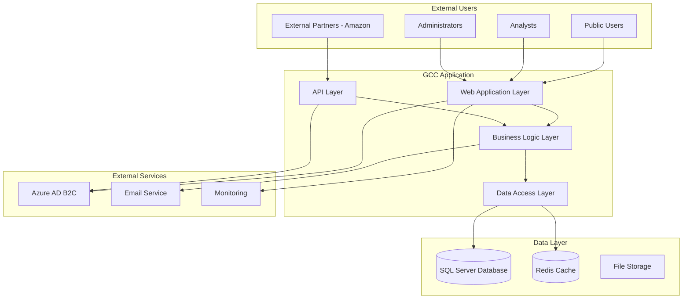
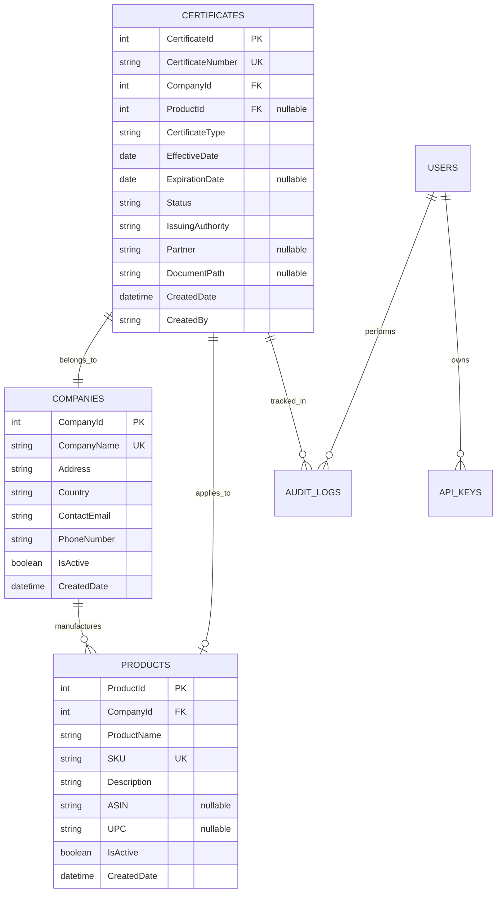

# Technical Design Document (TDD)
## GCC Database Solution - Detailed Implementation Design

### Document Information
- **Document Version**: 1.0
- **Last Updated**: September 17, 2025
- **Document Owner**: Technical Lead
- **Review Cycle**: Quarterly
- **Classification**: Internal Technical Document

---

## Table of Contents

1. [Executive Summary](#1-executive-summary)
2. [System Overview](#2-system-overview)
3. [Architecture Design](#3-architecture-design)
4. [Component Design](#4-component-design)
5. [Data Design](#5-data-design)
6. [API Design](#6-api-design)
7. [Security Design](#7-security-design)
8. [Integration Design](#8-integration-design)
9. [Performance Design](#9-performance-design)
10. [Error Handling Design](#10-error-handling-design)
11. [Logging & Monitoring Design](#11-logging--monitoring-design)
12. [Deployment Design](#12-deployment-design)
13. [Testing Strategy](#13-testing-strategy)
14. [Implementation Guidelines](#14-implementation-guidelines)

---

## 1. Executive Summary

### 1.1 Purpose
This Technical Design Document provides detailed implementation specifications for the GCC Database Solution, complementing the high-level architecture document with specific technical implementation details.

### 1.2 Scope
This document covers:
- Detailed component design and interactions
- Database schema and data flow specifications
- API endpoint specifications and contracts
- Security implementation details
- Performance optimization strategies
- Deployment and operational considerations

### 1.3 Technology Stack
- **Framework**: ASP.NET Core 8.0 MVC
- **Database**: SQL Server (LocalDB for dev, Azure SQL for production)
- **ORM**: Entity Framework Core 9.0
- **Authentication**: Azure AD B2C + Cookie fallback
- **Caching**: Redis (production), In-Memory (development)
- **Frontend**: Razor Views + Bootstrap 5.3 + jQuery
- **API**: RESTful Web API with Swagger/OpenAPI
- **Container**: Docker with multi-stage builds

---

## 2. System Overview

### 2.1 Current Implementation Status
The GCC Database Solution is a production-ready ASP.NET Core application with the following key features:

- **Certificate Management**: Full CRUD operations with workflow management
- **Multi-Role Authentication**: Admin, Analyst, External, and Public access
- **Partner Integration**: Amazon-specific API endpoints and filtering
- **API Architecture**: RESTful APIs with JWT and API Key authentication
- **Document Management**: PDF generation using QuestPDF
- **Search Functionality**: Basic search with plans for autocomplete
- **Audit Trail**: Comprehensive logging of all user actions

### 2.2 System Context


---

## 3. Architecture Design

### 3.1 Layered Architecture Implementation

#### 3.1.1 Presentation Layer
**Location**: `/Controllers/`, `/Views/`, `/wwwroot/`

**Components**:
- **MVC Controllers**: Handle web requests and return views
- **API Controllers**: Handle RESTful API requests
- **Razor Views**: Server-side rendered HTML templates
- **Static Content**: CSS, JavaScript, images

**Key Implementation Details**:
```csharp
// Example MVC Controller Structure
[Authorize(Policy = "AdminOrAnalyst")]
public class CertificateController : Controller
{
    private readonly ICertificateService _certificateService;
    private readonly ILogger<CertificateController> _logger;

    // Constructor injection for dependencies
    // Action methods for CRUD operations
    // Error handling and validation
}

// Example API Controller Structure
[ApiController]
[Route("api/v1/[controller]")]
public class CertificatesController : BaseApiController
{
    // RESTful endpoints with proper HTTP verbs
    // Standardized response format
    // API versioning support
}
```

#### 3.1.2 Business Logic Layer
**Location**: `/Services/`

**Components**:
- **CertificateService**: Certificate business logic and workflow
- **AuthenticationService**: User authentication and authorization
- **CompanyService**: Company management operations
- **ProductService**: Product catalog management
- **NotificationService**: Email and alert handling
- **AuditService**: Activity logging and tracking

**Design Patterns Used**:
- **Dependency Injection**: Constructor injection for all services
- **Repository Pattern**: Abstracted data access
- **Unit of Work**: Transaction management
- **Strategy Pattern**: Multiple authentication strategies

#### 3.1.3 Data Access Layer
**Location**: `/Repositories/`, `/Data/`

**Components**:
- **Repository Classes**: Generic and specific repositories
- **DbContext**: Entity Framework context
- **Migrations**: Database schema versioning
- **Entities**: Data model classes

**Implementation Example**:
```csharp
public interface ICertificateRepository
{
    Task<Certificate> GetByIdAsync(int id);
    Task<IEnumerable<Certificate>> GetByPartnerAsync(string partner);
    Task<Certificate> CreateAsync(Certificate certificate);
    Task UpdateAsync(Certificate certificate);
    Task DeleteAsync(int id);
}

public class CertificateRepository : Repository<Certificate>, ICertificateRepository
{
    // Specific implementation for certificate operations
    // Includes caching strategy
    // Audit trail implementation
}
```

### 3.2 Cross-Cutting Concerns

#### 3.2.1 Dependency Injection Configuration
**Location**: `Program.cs`

```csharp
// Service Registration
builder.Services.AddScoped<ICertificateService, CertificateService>();
builder.Services.AddScoped<ICertificateRepository, CertificateRepository>();
builder.Services.AddScoped<IUnitOfWork, UnitOfWork>();

// Authentication Services
builder.Services.AddAuthentication()
    .AddCookie(CookieAuthenticationDefaults.AuthenticationScheme)
    .AddJwtBearer("Bearer", options => { /* JWT config */ })
    .AddMicrosoftIdentityWebApp(builder.Configuration.GetSection("AzureAdB2C"));

// Authorization Policies
builder.Services.AddAuthorizationBuilder()
    .AddPolicy("AdminOnly", policy => policy.RequireRole("Admin"))
    .AddPolicy("AnalystOrAdmin", policy => policy.RequireRole("Analyst", "Admin"));
```

#### 3.2.2 Middleware Pipeline
```csharp
// Request Pipeline Configuration
app.UseHttpsRedirection();
app.UseStaticFiles();
app.UseRouting();
app.UseAuthentication();
app.UseAuthorization();
app.UseSession();

// Custom Middleware
app.UseMiddleware<ErrorHandlingMiddleware>();
app.UseMiddleware<AuditLoggingMiddleware>();
app.UseMiddleware<SecurityHeadersMiddleware>();
```

---

## 4. Component Design

### 4.1 Certificate Management Component

#### 4.1.1 Certificate Entity Design
```csharp
public class Certificate
{
    public int CertificateId { get; set; }
    public string CertificateNumber { get; set; } // Unique identifier
    public int CompanyId { get; set; }
    public int? ProductId { get; set; } // Nullable for company-level certs
    public string CertificateType { get; set; }
    public DateTime EffectiveDate { get; set; }
    public DateTime? ExpirationDate { get; set; }
    public string Status { get; set; } // 14-state workflow
    public string IssuingAuthority { get; set; }
    public string Partner { get; set; } // Amazon, Wayfair, None
    public string DocumentPath { get; set; }
    public DateTime CreatedDate { get; set; }
    public DateTime? ModifiedDate { get; set; }
    public string CreatedBy { get; set; }
    public string ModifiedBy { get; set; }

    // Navigation properties
    public Company Company { get; set; }
    public Product Product { get; set; }
    public ICollection<AuditLog> AuditLogs { get; set; }
}
```

#### 4.1.2 Certificate Workflow Service
```csharp
public class CertificateWorkflowService
{
    // 14-state certificate lifecycle
    public enum CertificateStatus
    {
        Draft, Submitted, UnderReview, Approved,
        Active, Expiring, Expired, Suspended,
        Revoked, Renewed, Updated, Archived,
        Rejected, Cancelled
    }

    public async Task<bool> TransitionStatusAsync(int certificateId,
        CertificateStatus newStatus, string userId, string reason)
    {
        // Validate transition rules
        // Update certificate status
        // Log status change
        // Send notifications if required
        // Return success/failure
    }
}
```

### 4.2 Authentication Component

#### 4.2.1 Multi-Authentication Strategy
```csharp
public class AuthenticationManager
{
    public async Task<AuthenticationResult> AuthenticateAsync(
        HttpContext context, AuthenticationScheme scheme)
    {
        return scheme.Name switch
        {
            "Bearer" => await AuthenticateJwtAsync(context),
            "ApiKey" => await AuthenticateApiKeyAsync(context),
            "Cookies" => await AuthenticateCookieAsync(context),
            "AzureADB2C" => await AuthenticateAzureB2CAsync(context),
            _ => AuthenticationResult.Fail("Unknown scheme")
        };
    }
}
```

#### 4.2.2 Role-Based Authorization
```csharp
public static class AuthorizationPolicies
{
    public const string AdminOnly = "AdminOnly";
    public const string AnalystOrAdmin = "AnalystOrAdmin";
    public const string ExternalAccess = "ExternalAccess";
    public const string AuthenticatedUsers = "AuthenticatedUsers";

    public static void ConfigurePolicies(AuthorizationOptions options)
    {
        options.AddPolicy(AdminOnly, policy =>
            policy.RequireRole("Admin"));

        options.AddPolicy(AnalystOrAdmin, policy =>
            policy.RequireRole("Analyst", "Admin"));

        options.AddPolicy(ExternalAccess, policy =>
            policy.RequireRole("External", "Analyst", "Admin"));
    }
}
```

### 4.3 API Design Components

#### 4.3.1 Base API Controller
```csharp
[ApiController]
public abstract class BaseApiController : ControllerBase
{
    protected readonly ILogger _logger;

    protected BaseApiController(ILogger logger)
    {
        _logger = logger;
    }

    protected IActionResult StandardResponse<T>(T data, string message = null)
    {
        return Ok(new StandardApiResponse<T>
        {
            Success = true,
            Data = data,
            Message = message,
            RequestId = HttpContext.TraceIdentifier,
            Timestamp = DateTime.UtcNow
        });
    }

    protected IActionResult ErrorResponse(string message, int statusCode = 400)
    {
        return StatusCode(statusCode, new StandardApiResponse<object>
        {
            Success = false,
            Errors = new[] { message },
            RequestId = HttpContext.TraceIdentifier,
            Timestamp = DateTime.UtcNow
        });
    }
}
```

#### 4.3.2 API Response Standardization
```csharp
public class StandardApiResponse<T>
{
    public bool Success { get; set; }
    public T Data { get; set; }
    public string Message { get; set; }
    public string[] Errors { get; set; }
    public string RequestId { get; set; }
    public DateTime Timestamp { get; set; }
    public string Version { get; set; } = "1.0";
    public PaginationMetadata Pagination { get; set; } // For paginated responses
}
```

---

## 5. Data Design

### 5.1 Database Schema Design

#### 5.1.1 Core Tables
```sql
-- Certificates Table (Primary entity)
CREATE TABLE Certificates (
    CertificateId int IDENTITY(1,1) PRIMARY KEY,
    CertificateNumber nvarchar(50) UNIQUE NOT NULL,
    CompanyId int NOT NULL,
    ProductId int NULL,
    CertificateType nvarchar(100) NOT NULL,
    EffectiveDate date NOT NULL,
    ExpirationDate date NULL,
    Status nvarchar(50) NOT NULL DEFAULT 'Draft',
    IssuingAuthority nvarchar(200) NOT NULL,
    Partner nvarchar(50) NULL, -- Amazon, Wayfair, None
    DocumentPath nvarchar(500) NULL,
    CreatedDate datetime2 NOT NULL DEFAULT GETUTCDATE(),
    ModifiedDate datetime2 NULL,
    CreatedBy nvarchar(100) NOT NULL,
    ModifiedBy nvarchar(100) NULL,

    CONSTRAINT FK_Certificates_Companies FOREIGN KEY (CompanyId)
        REFERENCES Companies(CompanyId),
    CONSTRAINT FK_Certificates_Products FOREIGN KEY (ProductId)
        REFERENCES Products(ProductId)
);

-- Indexes for performance
CREATE INDEX IX_Certificates_Status ON Certificates(Status);
CREATE INDEX IX_Certificates_Partner ON Certificates(Partner);
CREATE INDEX IX_Certificates_ExpirationDate ON Certificates(ExpirationDate);
CREATE INDEX IX_Certificates_Company ON Certificates(CompanyId);
```

#### 5.1.2 Entity Relationships


### 5.2 Data Access Patterns

#### 5.2.1 Repository Implementation
```csharp
public class CertificateRepository : ICertificateRepository
{
    private readonly ApplicationDbContext _context;
    private readonly IMemoryCache _cache;
    private readonly ILogger<CertificateRepository> _logger;

    public async Task<IEnumerable<Certificate>> GetByPartnerAsync(string partner)
    {
        var cacheKey = $"certificates_partner_{partner}";

        if (!_cache.TryGetValue(cacheKey, out IEnumerable<Certificate> certificates))
        {
            certificates = await _context.Certificates
                .Include(c => c.Company)
                .Include(c => c.Product)
                .Where(c => c.Partner == partner || partner == null)
                .Where(c => c.Status == "Active")
                .OrderByDescending(c => c.CreatedDate)
                .ToListAsync();

            _cache.Set(cacheKey, certificates, TimeSpan.FromMinutes(15));
        }

        return certificates;
    }
}
```

#### 5.2.2 Unit of Work Pattern
```csharp
public class UnitOfWork : IUnitOfWork
{
    private readonly ApplicationDbContext _context;
    private ICertificateRepository _certificates;
    private ICompanyRepository _companies;

    public ICertificateRepository Certificates =>
        _certificates ??= new CertificateRepository(_context);

    public async Task<int> SaveChangesAsync()
    {
        try
        {
            return await _context.SaveChangesAsync();
        }
        catch (DbUpdateException ex)
        {
            _logger.LogError(ex, "Database update failed");
            throw new DataAccessException("Failed to save changes", ex);
        }
    }
}
```

---

## 6. API Design

### 6.1 RESTful API Endpoints

#### 6.1.1 Certificate API Endpoints
```csharp
[ApiController]
[Route("api/v1/[controller]")]
[Authorize]
public class CertificatesController : BaseApiController
{
    [HttpGet]
    [AllowAnonymous] // Public endpoint
    public async Task<IActionResult> GetCertificates(
        [FromQuery] CertificateSearchParameters parameters)
    {
        var certificates = await _certificateService.SearchAsync(parameters);
        return StandardResponse(certificates);
    }

    [HttpGet("{id:int}")]
    [AllowAnonymous]
    public async Task<IActionResult> GetCertificate(int id)
    {
        var certificate = await _certificateService.GetByIdAsync(id);
        if (certificate == null)
            return NotFound($"Certificate with ID {id} not found");

        return StandardResponse(certificate);
    }

    [HttpPost]
    [Authorize(Policy = "AnalystOrAdmin")]
    public async Task<IActionResult> CreateCertificate(
        [FromBody] CreateCertificateRequest request)
    {
        if (!ModelState.IsValid)
            return BadRequest(ModelState);

        var certificate = await _certificateService.CreateAsync(request);
        return CreatedAtAction(nameof(GetCertificate),
            new { id = certificate.CertificateId }, certificate);
    }
}
```

#### 6.1.2 External Partner API
```csharp
[ApiController]
[Route("api/[controller]")]
public class CertificateTileExternalApiController : BaseApiController
{
    [HttpGet("tiles")]
    [AllowAnonymous]
    public async Task<IActionResult> GetTiles(
        [FromQuery] ExternalTileSearchParameters parameters)
    {
        // Partner-specific filtering
        var partner = HttpContext.Request.Headers["X-Partner-ID"].FirstOrDefault();

        var tiles = await _certificateService.GetExternalTilesAsync(
            parameters, partner);

        return StandardResponse(new
        {
            TotalCount = tiles.TotalCount,
            Page = parameters.Page,
            PageSize = parameters.PageSize,
            Certificates = tiles.Items
        });
    }

    [HttpGet("suggestions")]
    [AllowAnonymous]
    public async Task<IActionResult> GetSuggestions(
        [FromQuery] string query)
    {
        var suggestions = await _searchService.GetSuggestionsAsync(query);
        return StandardResponse(suggestions);
    }
}
```

### 6.2 API Authentication Design

#### 6.2.1 JWT Token Configuration
```csharp
public class JwtTokenService
{
    public string GenerateToken(User user, IList<string> roles)
    {
        var tokenHandler = new JwtSecurityTokenHandler();
        var key = Encoding.ASCII.GetBytes(_configuration["Jwt:Key"]);

        var claims = new List<Claim>
        {
            new(ClaimTypes.NameIdentifier, user.Id.ToString()),
            new(ClaimTypes.Email, user.Email),
            new(ClaimTypes.Name, $"{user.FirstName} {user.LastName}")
        };

        claims.AddRange(roles.Select(role => new Claim(ClaimTypes.Role, role)));

        var tokenDescriptor = new SecurityTokenDescriptor
        {
            Subject = new ClaimsIdentity(claims),
            Expires = DateTime.UtcNow.AddHours(24),
            Issuer = _configuration["Jwt:Issuer"],
            Audience = _configuration["Jwt:Audience"],
            SigningCredentials = new SigningCredentials(
                new SymmetricSecurityKey(key),
                SecurityAlgorithms.HmacSha256Signature)
        };

        var token = tokenHandler.CreateToken(tokenDescriptor);
        return tokenHandler.WriteToken(token);
    }
}
```

#### 6.2.2 API Key Authentication
```csharp
public class ApiKeyAuthenticationHandler : AuthenticationHandler<ApiKeyAuthenticationSchemeOptions>
{
    private readonly IApiKeyService _apiKeyService;

    protected override async Task<AuthenticateResult> HandleAuthenticateAsync()
    {
        if (!Request.Headers.TryGetValue("X-API-Key", out var apiKeyHeaderValues))
            return AuthenticateResult.NoResult();

        var providedApiKey = apiKeyHeaderValues.FirstOrDefault();
        if (string.IsNullOrWhiteSpace(providedApiKey))
            return AuthenticateResult.NoResult();

        var apiKey = await _apiKeyService.ValidateAsync(providedApiKey);
        if (apiKey == null)
            return AuthenticateResult.Fail("Invalid API key");

        var claims = new[]
        {
            new Claim(ClaimTypes.Name, apiKey.Name),
            new Claim(ClaimTypes.NameIdentifier, apiKey.Id.ToString()),
            new Claim("ApiKeyId", apiKey.Id.ToString())
        };

        var identity = new ClaimsIdentity(claims, Scheme.Name);
        var principal = new ClaimsPrincipal(identity);
        var ticket = new AuthenticationTicket(principal, Scheme.Name);

        return AuthenticateResult.Success(ticket);
    }
}
```

---

## 7. Security Design

### 7.1 Authentication Architecture

#### 7.1.1 Multi-Authentication Scheme
```csharp
public void ConfigureAuthentication(IServiceCollection services)
{
    services.AddAuthentication(options =>
    {
        options.DefaultScheme = CookieAuthenticationDefaults.AuthenticationScheme;
        options.DefaultChallengeScheme = "AzureADB2C";
    })
    .AddCookie(CookieAuthenticationDefaults.AuthenticationScheme, options =>
    {
        options.LoginPath = "/Account/Login";
        options.LogoutPath = "/Account/Logout";
        options.ExpireTimeSpan = TimeSpan.FromHours(8);
        options.SlidingExpiration = true;
    })
    .AddJwtBearer("Bearer", options =>
    {
        options.TokenValidationParameters = new TokenValidationParameters
        {
            ValidateIssuer = true,
            ValidateAudience = true,
            ValidateLifetime = true,
            ValidateIssuerSigningKey = true,
            ValidIssuer = Configuration["Jwt:Issuer"],
            ValidAudience = Configuration["Jwt:Audience"],
            IssuerSigningKey = new SymmetricSecurityKey(
                Encoding.UTF8.GetBytes(Configuration["Jwt:Key"]))
        };
    })
    .AddScheme<ApiKeyAuthenticationSchemeOptions, ApiKeyAuthenticationHandler>(
        "ApiKey", options => { })
    .AddMicrosoftIdentityWebApp(Configuration.GetSection("AzureAdB2C"), "AzureADB2C");
}
```

#### 7.1.2 Authorization Policy Configuration
```csharp
public void ConfigureAuthorization(IServiceCollection services)
{
    services.AddAuthorizationBuilder()
        .AddPolicy("AdminOnly", policy =>
        {
            policy.RequireRole("Admin");
            policy.RequireAuthenticatedUser();
        })
        .AddPolicy("AnalystOrAdmin", policy =>
        {
            policy.RequireRole("Analyst", "Admin");
            policy.RequireAuthenticatedUser();
        })
        .AddPolicy("ExternalAccess", policy =>
        {
            policy.RequireRole("External", "Analyst", "Admin");
            policy.RequireAuthenticatedUser();
        })
        .AddPolicy("ApiAccess", policy =>
        {
            policy.RequireAuthenticatedUser();
            policy.AddAuthenticationSchemes("Bearer", "ApiKey");
        });
}
```

### 7.2 Data Protection

#### 7.2.1 Sensitive Data Handling
```csharp
public class DataProtectionService
{
    private readonly IDataProtector _protector;

    public string ProtectSensitiveData(string data)
    {
        if (string.IsNullOrEmpty(data))
            return data;

        return _protector.Protect(data);
    }

    public string UnprotectSensitiveData(string protectedData)
    {
        if (string.IsNullOrEmpty(protectedData))
            return protectedData;

        try
        {
            return _protector.Unprotect(protectedData);
        }
        catch (CryptographicException)
        {
            _logger.LogWarning("Failed to unprotect data");
            return null;
        }
    }
}
```

#### 7.2.2 Security Headers Middleware
```csharp
public class SecurityHeadersMiddleware
{
    public async Task InvokeAsync(HttpContext context, RequestDelegate next)
    {
        // Add security headers
        context.Response.Headers.Add("X-Content-Type-Options", "nosniff");
        context.Response.Headers.Add("X-Frame-Options", "DENY");
        context.Response.Headers.Add("X-XSS-Protection", "1; mode=block");
        context.Response.Headers.Add("Referrer-Policy", "strict-origin-when-cross-origin");
        context.Response.Headers.Add("Content-Security-Policy",
            "default-src 'self'; script-src 'self' 'unsafe-inline'; style-src 'self' 'unsafe-inline'");

        // Remove server header
        context.Response.Headers.Remove("Server");

        await next(context);
    }
}
```

---

## 8. Integration Design

### 8.1 Amazon Partner Integration

#### 8.1.1 Partner-Specific API Filtering
```csharp
public class PartnerFilterService
{
    public IQueryable<Certificate> ApplyPartnerFilter(
        IQueryable<Certificate> query, string partner)
    {
        return partner?.ToLower() switch
        {
            "amazon" => query.Where(c => c.Partner == "Amazon" || c.Partner == null),
            "wayfair" => query.Where(c => c.Partner == "Wayfair" || c.Partner == null),
            _ => query.Where(c => c.Partner == null) // Public certificates only
        };
    }

    public bool CanAccessCertificate(Certificate certificate, string partner)
    {
        // Public certificates are accessible to all
        if (string.IsNullOrEmpty(certificate.Partner))
            return true;

        // Partner-specific certificates require matching partner
        return string.Equals(certificate.Partner, partner,
            StringComparison.OrdinalIgnoreCase);
    }
}
```

#### 8.1.2 Rate Limiting for Partners
```csharp
public class PartnerRateLimitMiddleware
{
    private readonly Dictionary<string, RateLimitConfig> _partnerLimits = new()
    {
        { "amazon", new RateLimitConfig { RequestsPerHour = 1000, BurstLimit = 100 } },
        { "wayfair", new RateLimitConfig { RequestsPerHour = 500, BurstLimit = 50 } },
        { "default", new RateLimitConfig { RequestsPerHour = 100, BurstLimit = 10 } }
    };

    public async Task InvokeAsync(HttpContext context, RequestDelegate next)
    {
        var partner = GetPartnerFromRequest(context);
        var rateLimitConfig = _partnerLimits.GetValueOrDefault(partner, _partnerLimits["default"]);

        if (!await CheckRateLimitAsync(context, rateLimitConfig))
        {
            context.Response.StatusCode = 429; // Too Many Requests
            await context.Response.WriteAsync("Rate limit exceeded");
            return;
        }

        await next(context);
    }
}
```

### 8.2 External Service Integration

#### 8.2.1 Email Service Integration
```csharp
public class EmailService : IEmailService
{
    private readonly IConfiguration _configuration;
    private readonly ILogger<EmailService> _logger;

    public async Task SendCertificateExpirationNoticeAsync(
        Certificate certificate, string recipientEmail)
    {
        var emailTemplate = await LoadTemplateAsync("CertificateExpiration");
        var emailBody = ProcessTemplate(emailTemplate, new
        {
            certificate.CertificateNumber,
            certificate.ExpirationDate,
            CompanyName = certificate.Company?.CompanyName,
            ProductName = certificate.Product?.ProductName
        });

        var message = new EmailMessage
        {
            To = recipientEmail,
            Subject = $"Certificate Expiration Notice - {certificate.CertificateNumber}",
            Body = emailBody,
            IsHtml = true
        };

        await SendEmailAsync(message);
    }
}
```

#### 8.2.2 Document Storage Integration
```csharp
public class DocumentStorageService : IDocumentStorageService
{
    public async Task<string> UploadCertificateDocumentAsync(
        IFormFile file, int certificateId)
    {
        // Validate file type and size
        if (!IsValidCertificateDocument(file))
            throw new InvalidOperationException("Invalid document type");

        var fileName = GenerateSecureFileName(file.FileName, certificateId);
        var containerPath = $"certificates/{DateTime.UtcNow:yyyy/MM}";

        using var stream = file.OpenReadStream();
        var documentPath = await _storageProvider.UploadAsync(
            containerPath, fileName, stream);

        // Generate thumbnail if PDF
        if (file.ContentType == "application/pdf")
        {
            await GenerateThumbnailAsync(stream, documentPath);
        }

        return documentPath;
    }
}
```

---

## 9. Performance Design

### 9.1 Caching Strategy

#### 9.1.1 Multi-Level Caching
```csharp
public class CacheService : ICacheService
{
    private readonly IMemoryCache _memoryCache;
    private readonly IDistributedCache _distributedCache;
    private readonly ILogger<CacheService> _logger;

    public async Task<T> GetOrSetAsync<T>(string key, Func<Task<T>> getItem,
        TimeSpan? memoryCacheDuration = null, TimeSpan? distributedCacheDuration = null)
    {
        // Try memory cache first (fastest)
        if (_memoryCache.TryGetValue(key, out T cachedValue))
            return cachedValue;

        // Try distributed cache (Redis)
        var distributedValue = await _distributedCache.GetStringAsync(key);
        if (!string.IsNullOrEmpty(distributedValue))
        {
            var deserializedValue = JsonSerializer.Deserialize<T>(distributedValue);

            // Cache in memory for next request
            _memoryCache.Set(key, deserializedValue,
                memoryCacheDuration ?? TimeSpan.FromMinutes(5));

            return deserializedValue;
        }

        // Cache miss - get from source
        var item = await getItem();

        // Cache in both levels
        var serializedItem = JsonSerializer.Serialize(item);
        await _distributedCache.SetStringAsync(key, serializedItem,
            new DistributedCacheEntryOptions
            {
                AbsoluteExpirationRelativeToNow = distributedCacheDuration ?? TimeSpan.FromHours(1)
            });

        _memoryCache.Set(key, item, memoryCacheDuration ?? TimeSpan.FromMinutes(5));

        return item;
    }
}
```

#### 9.1.2 Database Query Optimization
```csharp
public class OptimizedCertificateRepository : ICertificateRepository
{
    public async Task<PagedResult<Certificate>> GetPagedAsync(
        CertificateSearchParameters parameters)
    {
        var query = _context.Certificates.AsQueryable();

        // Apply filters efficiently
        if (!string.IsNullOrEmpty(parameters.Search))
        {
            query = query.Where(c =>
                c.CertificateNumber.Contains(parameters.Search) ||
                c.Company.CompanyName.Contains(parameters.Search) ||
                c.Product.ProductName.Contains(parameters.Search));
        }

        if (!string.IsNullOrEmpty(parameters.Partner))
        {
            query = query.Where(c => c.Partner == parameters.Partner || c.Partner == null);
        }

        // Get total count efficiently
        var totalCount = await query.CountAsync();

        // Apply pagination and eager loading
        var certificates = await query
            .Include(c => c.Company)
            .Include(c => c.Product)
            .OrderByDescending(c => c.CreatedDate)
            .Skip((parameters.Page - 1) * parameters.PageSize)
            .Take(parameters.PageSize)
            .AsNoTracking() // Read-only for better performance
            .ToListAsync();

        return new PagedResult<Certificate>
        {
            Items = certificates,
            TotalCount = totalCount,
            Page = parameters.Page,
            PageSize = parameters.PageSize
        };
    }
}
```

### 9.2 Database Performance

#### 9.2.1 Index Strategy
```sql
-- Performance indexes for common queries
CREATE NONCLUSTERED INDEX IX_Certificates_Search
ON Certificates(Status, Partner, ExpirationDate)
INCLUDE (CertificateNumber, CompanyId, ProductId, CreatedDate);

CREATE NONCLUSTERED INDEX IX_Certificates_FullText
ON Certificates(CertificateNumber, IssuingAuthority)
INCLUDE (Status, EffectiveDate, ExpirationDate);

-- Covering index for tile view
CREATE NONCLUSTERED INDEX IX_Certificates_TileView
ON Certificates(Status, Partner)
INCLUDE (CertificateId, CertificateNumber, CompanyId, ProductId,
         EffectiveDate, ExpirationDate, CreatedDate);
```

#### 9.2.2 Connection Pooling Configuration
```csharp
public void ConfigureDatabase(IServiceCollection services)
{
    services.AddDbContext<ApplicationDbContext>(options =>
    {
        options.UseSqlServer(connectionString, sqlOptions =>
        {
            sqlOptions.EnableRetryOnFailure(
                maxRetryCount: 3,
                maxRetryDelay: TimeSpan.FromSeconds(5),
                errorNumbersToAdd: null);

            sqlOptions.CommandTimeout(30);
        });

        // Configure for production performance
        options.EnableSensitiveDataLogging(false);
        options.EnableDetailedErrors(false);
        options.UseQueryTrackingBehavior(QueryTrackingBehavior.NoTracking);
    });

    // Configure connection pooling
    services.AddDbContextPool<ApplicationDbContext>(options =>
    {
        // Pool size configuration
        options.UseSqlServer(connectionString);
    }, poolSize: 64);
}
```

---

## 10. Error Handling Design

### 10.1 Global Exception Handling

#### 10.1.1 Exception Handling Middleware
```csharp
public class GlobalExceptionHandlingMiddleware
{
    private readonly RequestDelegate _next;
    private readonly ILogger<GlobalExceptionHandlingMiddleware> _logger;

    public async Task InvokeAsync(HttpContext context)
    {
        try
        {
            await _next(context);
        }
        catch (Exception ex)
        {
            _logger.LogError(ex, "An unhandled exception occurred. RequestId: {RequestId}",
                context.TraceIdentifier);

            await HandleExceptionAsync(context, ex);
        }
    }

    private async Task HandleExceptionAsync(HttpContext context, Exception exception)
    {
        var response = exception switch
        {
            ValidationException validationEx => new ErrorResponse
            {
                StatusCode = 400,
                Message = "Validation failed",
                Errors = validationEx.Errors.Select(e => e.ErrorMessage).ToArray()
            },
            NotFoundException => new ErrorResponse
            {
                StatusCode = 404,
                Message = "Resource not found"
            },
            UnauthorizedAccessException => new ErrorResponse
            {
                StatusCode = 401,
                Message = "Unauthorized access"
            },
            _ => new ErrorResponse
            {
                StatusCode = 500,
                Message = "An internal server error occurred"
            }
        };

        context.Response.StatusCode = response.StatusCode;
        context.Response.ContentType = "application/json";

        var jsonResponse = JsonSerializer.Serialize(response);
        await context.Response.WriteAsync(jsonResponse);
    }
}
```

#### 10.1.2 Custom Exception Types
```csharp
public class CertificateNotFoundException : NotFoundException
{
    public CertificateNotFoundException(int certificateId)
        : base($"Certificate with ID {certificateId} was not found")
    {
        CertificateId = certificateId;
    }

    public int CertificateId { get; }
}

public class CertificateValidationException : ValidationException
{
    public CertificateValidationException(string message,
        IEnumerable<ValidationError> errors) : base(message)
    {
        Errors = errors;
    }

    public IEnumerable<ValidationError> Errors { get; }
}
```

### 10.2 Model Validation

#### 10.2.1 Fluent Validation
```csharp
public class CreateCertificateRequestValidator : AbstractValidator<CreateCertificateRequest>
{
    public CreateCertificateRequestValidator()
    {
        RuleFor(x => x.CertificateNumber)
            .NotEmpty().WithMessage("Certificate number is required")
            .Length(1, 50).WithMessage("Certificate number must be between 1 and 50 characters")
            .Matches(@"^[A-Z0-9-]+$").WithMessage("Certificate number must contain only uppercase letters, numbers, and hyphens");

        RuleFor(x => x.CompanyId)
            .GreaterThan(0).WithMessage("Valid company must be selected");

        RuleFor(x => x.EffectiveDate)
            .NotEmpty().WithMessage("Effective date is required")
            .LessThanOrEqualTo(DateTime.Today.AddDays(30))
            .WithMessage("Effective date cannot be more than 30 days in the future");

        RuleFor(x => x.ExpirationDate)
            .GreaterThan(x => x.EffectiveDate)
            .WithMessage("Expiration date must be after effective date")
            .When(x => x.ExpirationDate.HasValue);
    }
}
```

---

## 11. Logging & Monitoring Design

### 11.1 Structured Logging

#### 11.1.1 Logging Configuration
```csharp
public void ConfigureLogging(IServiceCollection services, IConfiguration configuration)
{
    services.AddLogging(builder =>
    {
        builder.ClearProviders();
        builder.AddConsole();
        builder.AddDebug();

        if (configuration.GetValue<bool>("ApplicationInsights:Enabled"))
        {
            builder.AddApplicationInsights(
                configuration.GetConnectionString("ApplicationInsights"));
        }

        builder.AddSerilog(new LoggerConfiguration()
            .MinimumLevel.Information()
            .MinimumLevel.Override("Microsoft", LogEventLevel.Warning)
            .MinimumLevel.Override("System", LogEventLevel.Warning)
            .Enrich.FromLogContext()
            .Enrich.WithMachineName()
            .Enrich.WithEnvironmentUserName()
            .WriteTo.Console()
            .WriteTo.File("logs/gcc-application-.txt",
                rollingInterval: RollingInterval.Day,
                retainedFileCountLimit: 30)
            .CreateLogger());
    });
}
```

#### 11.1.2 Audit Logging Service
```csharp
public class AuditLoggingService : IAuditLoggingService
{
    public async Task LogUserActionAsync(string userId, string action,
        string entityType, int entityId, object oldValue = null, object newValue = null)
    {
        var auditLog = new AuditLog
        {
            UserId = userId,
            Action = action,
            EntityType = entityType,
            EntityId = entityId,
            OldValue = oldValue != null ? JsonSerializer.Serialize(oldValue) : null,
            NewValue = newValue != null ? JsonSerializer.Serialize(newValue) : null,
            Timestamp = DateTime.UtcNow,
            IpAddress = _httpContextAccessor.HttpContext?.Connection?.RemoteIpAddress?.ToString(),
            UserAgent = _httpContextAccessor.HttpContext?.Request?.Headers["User-Agent"].ToString()
        };

        _context.AuditLogs.Add(auditLog);
        await _context.SaveChangesAsync();

        _logger.LogInformation("User action logged: {UserId} performed {Action} on {EntityType} {EntityId}",
            userId, action, entityType, entityId);
    }
}
```

### 11.2 Performance Monitoring

#### 11.2.1 Custom Metrics
```csharp
public class MetricsService : IMetricsService
{
    private readonly IMetricsLogger _metricsLogger;
    private readonly Counter _certificateCreatedCounter;
    private readonly Histogram _apiResponseTimeHistogram;

    public MetricsService(IMeterProvider meterProvider)
    {
        var meter = meterProvider.GetMeter("GCC.Application");

        _certificateCreatedCounter = meter.CreateCounter<int>(
            "certificates_created_total",
            description: "Total number of certificates created");

        _apiResponseTimeHistogram = meter.CreateHistogram<double>(
            "api_response_time_seconds",
            description: "API response time in seconds");
    }

    public void RecordCertificateCreated(string partner = null)
    {
        _certificateCreatedCounter.Add(1, new KeyValuePair<string, object>("partner", partner ?? "none"));
    }

    public void RecordApiResponseTime(string endpoint, double responseTimeMs)
    {
        _apiResponseTimeHistogram.Record(responseTimeMs / 1000.0,
            new KeyValuePair<string, object>("endpoint", endpoint));
    }
}
```

---

## 12. Deployment Design

### 12.1 Container Configuration

#### 12.1.1 Multi-Stage Dockerfile
```dockerfile
# Build stage
FROM mcr.microsoft.com/dotnet/sdk:8.0 AS build
WORKDIR /src

# Copy project files and restore dependencies
COPY ["GCCWebApp.csproj", "."]
RUN dotnet restore "./GCCWebApp.csproj"

# Copy source code and build
COPY . .
RUN dotnet build "./GCCWebApp.csproj" -c Release -o /app/build

# Publish stage
FROM build AS publish
RUN dotnet publish "./GCCWebApp.csproj" -c Release -o /app/publish /p:UseAppHost=false

# Runtime stage
FROM mcr.microsoft.com/dotnet/aspnet:8.0 AS final
WORKDIR /app

# Create non-root user for security
RUN adduser --disabled-password --gecos '' appuser && chown -R appuser /app
USER appuser

# Environment variables
ENV ASPNETCORE_ENVIRONMENT=Production
ENV ASPNETCORE_URLS=http://+:8080

# Health check
HEALTHCHECK --interval=30s --timeout=10s --start-period=5s --retries=3 \
  CMD curl -f http://localhost:8080/health || exit 1

# Copy published application
COPY --from=publish /app/publish .

EXPOSE 8080
ENTRYPOINT ["dotnet", "GCCWebApp.dll"]
```

#### 12.1.2 Environment Configuration
```csharp
public void ConfigureEnvironmentSpecificServices(IServiceCollection services,
    IWebHostEnvironment environment)
{
    if (environment.IsDevelopment())
    {
        services.AddDbContext<ApplicationDbContext>(options =>
            options.UseSqlServer(Configuration.GetConnectionString("DefaultConnection"))
                   .EnableSensitiveDataLogging()
                   .EnableDetailedErrors());

        services.AddStackExchangeRedisCache(options =>
        {
            options.Configuration = "localhost:6379";
        });
    }
    else if (environment.IsProduction())
    {
        services.AddDbContext<ApplicationDbContext>(options =>
            options.UseSqlServer(Configuration.GetConnectionString("ProductionConnection"))
                   .EnableRetryOnFailure());

        services.AddStackExchangeRedisCache(options =>
        {
            options.Configuration = Configuration.GetConnectionString("RedisCache");
            options.InstanceName = "GCC-Production";
        });

        services.AddApplicationInsightsTelemetry();
    }
}
```

### 12.2 Health Checks

#### 12.2.1 Comprehensive Health Checks
```csharp
public void ConfigureHealthChecks(IServiceCollection services)
{
    services.AddHealthChecks()
        .AddDbContextCheck<ApplicationDbContext>("database")
        .AddRedis(Configuration.GetConnectionString("RedisCache"), "cache")
        .AddUrlGroup(new Uri(Configuration["ExternalServices:EmailService"]), "email-service")
        .AddCheck<CustomCertificateHealthCheck>("certificate-service")
        .AddCheck("self", () => HealthCheckResult.Healthy("Application is running"));

    services.AddHealthChecksUI(opt =>
    {
        opt.SetEvaluationTimeInSeconds(60);
        opt.MaximumHistoryEntriesPerEndpoint(60);
        opt.SetApiMaxActiveRequests(1);
        opt.AddHealthCheckEndpoint("GCC Application", "/health");
    })
    .AddInMemoryStorage();
}

public class CustomCertificateHealthCheck : IHealthCheck
{
    private readonly ICertificateService _certificateService;

    public async Task<HealthCheckResult> CheckHealthAsync(
        HealthCheckContext context, CancellationToken cancellationToken = default)
    {
        try
        {
            // Test certificate service functionality
            var recentCertificates = await _certificateService.GetRecentAsync(1);

            return HealthCheckResult.Healthy("Certificate service is operational");
        }
        catch (Exception ex)
        {
            return HealthCheckResult.Unhealthy(
                "Certificate service is not responding", ex);
        }
    }
}
```

---

## 13. Testing Strategy

### 13.1 Unit Testing Design

#### 13.1.1 Service Testing Example
```csharp
public class CertificateServiceTests
{
    private readonly Mock<ICertificateRepository> _mockRepository;
    private readonly Mock<IUnitOfWork> _mockUnitOfWork;
    private readonly Mock<ILogger<CertificateService>> _mockLogger;
    private readonly CertificateService _service;

    public CertificateServiceTests()
    {
        _mockRepository = new Mock<ICertificateRepository>();
        _mockUnitOfWork = new Mock<IUnitOfWork>();
        _mockLogger = new Mock<ILogger<CertificateService>>();

        _mockUnitOfWork.Setup(u => u.Certificates).Returns(_mockRepository.Object);

        _service = new CertificateService(
            _mockUnitOfWork.Object,
            _mockLogger.Object);
    }

    [Fact]
    public async Task CreateAsync_WithValidCertificate_ShouldReturnCreatedCertificate()
    {
        // Arrange
        var request = new CreateCertificateRequest
        {
            CertificateNumber = "TEST-001",
            CompanyId = 1,
            CertificateType = "Environmental",
            EffectiveDate = DateTime.Today,
            IssuingAuthority = "EPA"
        };

        var certificate = new Certificate
        {
            CertificateId = 1,
            CertificateNumber = request.CertificateNumber,
            CompanyId = request.CompanyId,
            Status = "Draft"
        };

        _mockRepository.Setup(r => r.CreateAsync(It.IsAny<Certificate>()))
                      .ReturnsAsync(certificate);
        _mockUnitOfWork.Setup(u => u.SaveChangesAsync()).ReturnsAsync(1);

        // Act
        var result = await _service.CreateAsync(request);

        // Assert
        Assert.NotNull(result);
        Assert.Equal(request.CertificateNumber, result.CertificateNumber);
        Assert.Equal("Draft", result.Status);

        _mockRepository.Verify(r => r.CreateAsync(It.IsAny<Certificate>()), Times.Once);
        _mockUnitOfWork.Verify(u => u.SaveChangesAsync(), Times.Once);
    }
}
```

### 13.2 Integration Testing Design

#### 13.2.1 API Integration Tests
```csharp
public class CertificatesControllerIntegrationTests : IClassFixture<WebApplicationFactory<Program>>
{
    private readonly WebApplicationFactory<Program> _factory;
    private readonly HttpClient _client;

    public CertificatesControllerIntegrationTests(WebApplicationFactory<Program> factory)
    {
        _factory = factory;
        _client = _factory.CreateClient();
    }

    [Fact]
    public async Task GetCertificates_WithValidRequest_ShouldReturnOk()
    {
        // Arrange
        var request = new HttpRequestMessage(HttpMethod.Get, "/api/v1/certificates?page=1&pageSize=10");

        // Act
        var response = await _client.SendAsync(request);

        // Assert
        response.EnsureSuccessStatusCode();

        var content = await response.Content.ReadAsStringAsync();
        var result = JsonSerializer.Deserialize<StandardApiResponse<PagedResult<Certificate>>>(content);

        Assert.True(result.Success);
        Assert.NotNull(result.Data);
    }

    [Fact]
    public async Task CreateCertificate_WithoutAuthentication_ShouldReturnUnauthorized()
    {
        // Arrange
        var request = new CreateCertificateRequest
        {
            CertificateNumber = "TEST-002",
            CompanyId = 1,
            CertificateType = "Environmental"
        };

        var content = new StringContent(
            JsonSerializer.Serialize(request),
            Encoding.UTF8,
            "application/json");

        // Act
        var response = await _client.PostAsync("/api/v1/certificates", content);

        // Assert
        Assert.Equal(HttpStatusCode.Unauthorized, response.StatusCode);
    }
}
```

---

## 14. Implementation Guidelines

### 14.1 Development Standards

#### 14.1.1 Code Organization
- **Folder Structure**: Follow the established MVC pattern with clear separation of concerns
- **Naming Conventions**: Use PascalCase for public members, camelCase for private fields
- **File Organization**: Group related functionality together, use partial classes for large controllers
- **Dependency Injection**: Always use constructor injection, avoid service locator pattern

#### 14.1.2 Code Quality Standards
```csharp
// Example of proper service implementation
public class CertificateService : ICertificateService
{
    private readonly IUnitOfWork _unitOfWork;
    private readonly ILogger<CertificateService> _logger;
    private readonly ICacheService _cacheService;

    public CertificateService(
        IUnitOfWork unitOfWork,
        ILogger<CertificateService> logger,
        ICacheService cacheService)
    {
        _unitOfWork = unitOfWork ?? throw new ArgumentNullException(nameof(unitOfWork));
        _logger = logger ?? throw new ArgumentNullException(nameof(logger));
        _cacheService = cacheService ?? throw new ArgumentNullException(nameof(cacheService));
    }

    public async Task<Certificate> GetByIdAsync(int id)
    {
        if (id <= 0)
            throw new ArgumentException("Certificate ID must be positive", nameof(id));

        _logger.LogDebug("Retrieving certificate with ID {CertificateId}", id);

        var cacheKey = $"certificate_{id}";
        var certificate = await _cacheService.GetOrSetAsync(
            cacheKey,
            () => _unitOfWork.Certificates.GetByIdAsync(id),
            TimeSpan.FromMinutes(15));

        if (certificate == null)
        {
            _logger.LogWarning("Certificate with ID {CertificateId} not found", id);
            throw new CertificateNotFoundException(id);
        }

        return certificate;
    }
}
```

### 14.2 Performance Guidelines

#### 14.2.1 Database Query Best Practices
- Always use `AsNoTracking()` for read-only queries
- Use `Include()` judiciously to avoid N+1 queries
- Implement pagination for large datasets
- Use appropriate indexes for search operations
- Consider query splitting for complex includes

#### 14.2.2 Caching Best Practices
- Cache frequently accessed data with appropriate TTL
- Use cache-aside pattern for data that changes frequently
- Implement cache invalidation strategies
- Monitor cache hit ratios and adjust accordingly

### 14.3 Security Guidelines

#### 14.3.1 Input Validation
- Validate all user inputs at the controller level
- Use parameterized queries to prevent SQL injection
- Sanitize outputs to prevent XSS attacks
- Implement rate limiting for public endpoints

#### 14.3.2 Authentication & Authorization
- Always validate user permissions before data access
- Use policy-based authorization over role checks
- Implement proper session management
- Log security-related events for audit purposes

---

## 15. Conclusion

This Technical Design Document provides comprehensive implementation guidance for the GCC Database Solution. The design emphasizes:

- **Scalability**: Horizontal scaling through stateless design and caching
- **Security**: Multi-layer security with proper authentication and authorization
- **Maintainability**: Clean architecture with clear separation of concerns
- **Performance**: Optimized database queries and multi-level caching
- **Reliability**: Comprehensive error handling and monitoring
- **Testability**: Dependency injection and modular design

The implementation should follow these specifications to ensure consistent, high-quality code that meets both functional and non-functional requirements.

---

## Document Control

| Version | Date | Author | Changes |
|---------|------|--------|---------|
| 1.0 | 2025-09-17 | Technical Lead | Initial detailed design document |

**Next Review Date**: December 17, 2025
**Approved By**: [To be completed]
**Distribution**: Technical Team, Architecture Review Board