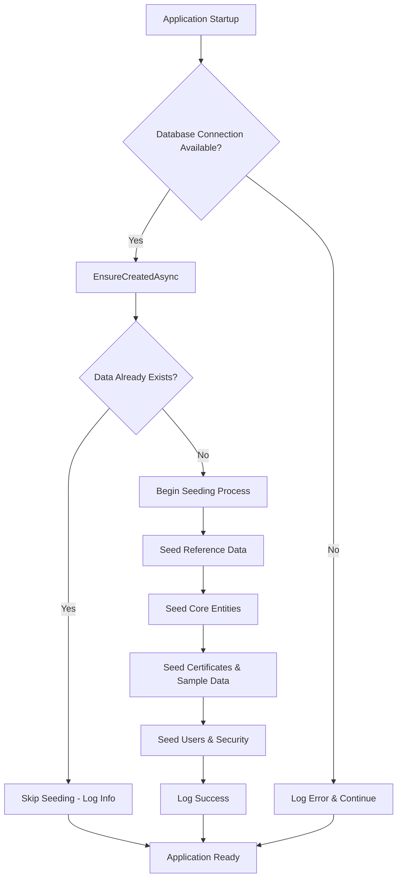
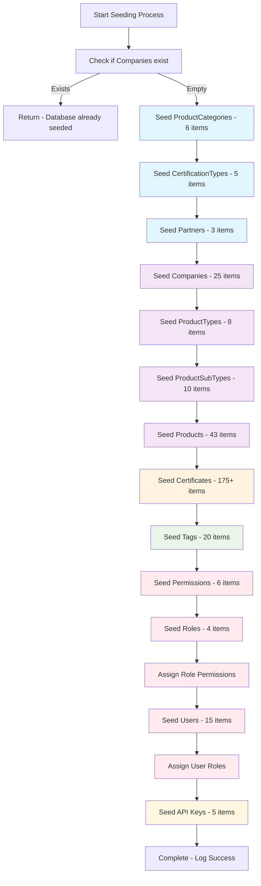
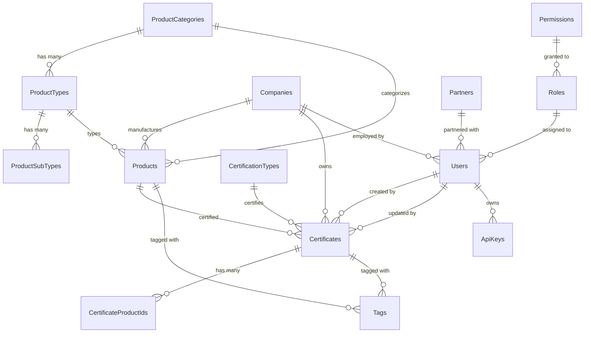
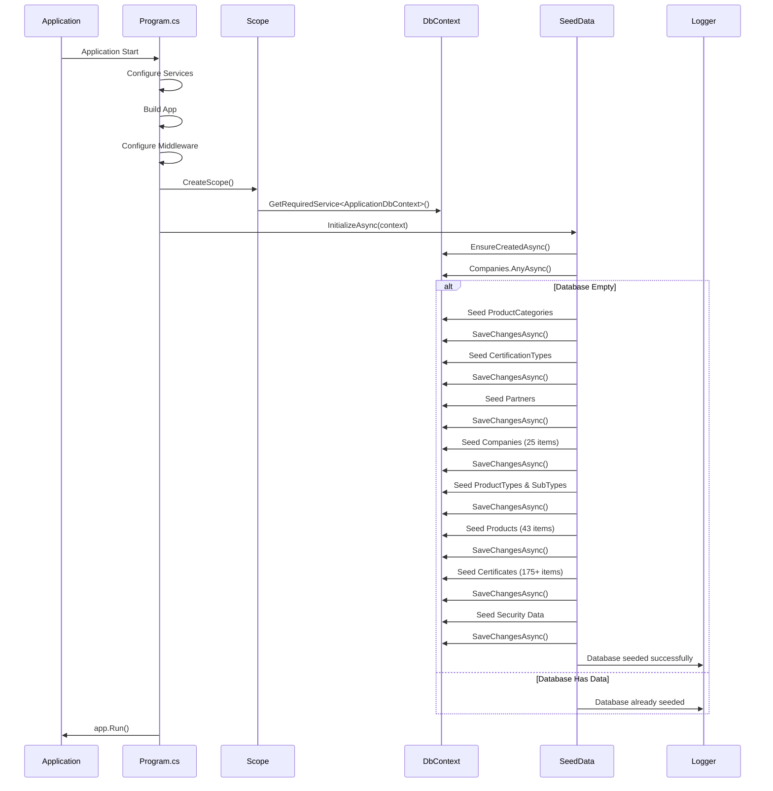
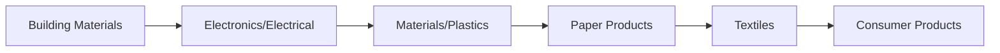
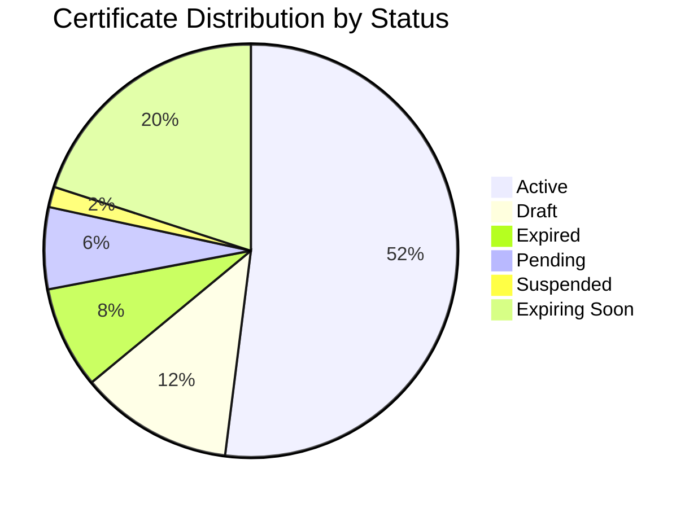
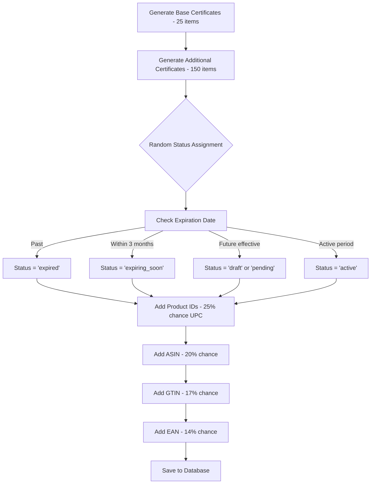
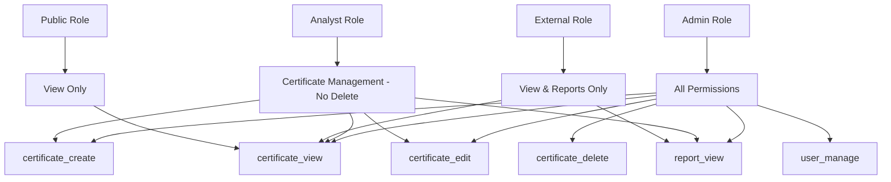
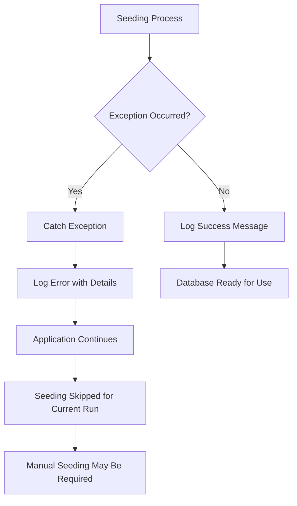

# GCC Database Seeding Process Documentation

## Overview

The GCC Database Solution implements a comprehensive seeding process that initializes the database with reference data, test users, and sample certificates. This process ensures the application has the necessary baseline data for development, testing, and initial production deployment.

## High-Level Seeding Flow



## Detailed Entity Seeding Sequence



## Database Schema Dependencies



## Startup Integration Flow



## Entity Seeding Details

### 1. Reference Data (Foundation Layer)

#### ProductCategories (6 items)


**Data Structure:**
- Name, Description, SortOrder, IsActive
- Used as foundation for product categorization

#### CertificationTypes (5 items)


#### Partners (3 items)


### 2. Core Business Entities

#### Companies (25 items)
**Sample Companies:**
- ASSA ABLOY Access & Egress Hardware Group
- Green Products Inc.
- 3M Company
- Shaw Industries Group
- Armstrong World Industries
- And 20 more manufacturing companies

#### Products (43 items)
**Categories Include:**
- Exit devices and hardware
- Insulation materials
- Carpet tiles and flooring
- LED lighting
- Office furniture
- Building materials

### 3. Certificate Data (175+ items)



**Certificate Generation Logic:**


### 4. Security & User Management

#### Roles & Permissions


#### Users (15 items)
**User Distribution:**
- 4 Admin users (including system admin)
- 4 Analyst users (certificate management)
- 6 External users (partner companies)
- 1 Public user

#### API Keys (5 items)
**Key Types:**
- Integration Test Key (Development)
- Partner API Access (Production)
- Mobile App Key (Production)
- Reporting Service (Production)
- Legacy Integration (Staging - Inactive)

## Performance Considerations

### Seeding Performance Metrics

```mermaid
gantt
    title Database Seeding Timeline
    dateFormat X
    axisFormat %s

    section Reference Data
    ProductCategories    :0, 1
    CertificationTypes   :1, 2
    Partners            :2, 3

    section Core Entities
    Companies           :3, 8
    ProductTypes        :8, 10
    Products            :10, 15

    section Certificates
    Base Certificates   :15, 25
    Generated Certs     :25, 45

    section Security
    Roles & Permissions :45, 48
    Users               :48, 52
    API Keys           :52, 55
```


**Estimated Seeding Time:** 3-8 seconds depending on hardware

### Database Size After Seeding
- **Tables:** 20+ core tables
- **Records:** 400+ total records
- **Indexes:** 50+ performance indexes
- **Size:** ~2-5 MB (SQLite)

## Error Handling



**Common Error Scenarios:**
1. **Database Connection Issues:** Application continues with limited functionality
2. **Constraint Violations:** Indicates data model issues
3. **Disk Space Issues:** Large certificate dataset generation fails
4. **Permission Issues:** Database write permissions required

## Environment-Specific Considerations

### Development Environment
- Full seeding with sample data
- Test users with known passwords
- Comprehensive certificate dataset for testing

### Production Environment
- Reference data seeding only
- No test users created
- Minimal sample certificates
- Security keys from environment variables

### Testing Environment
- Comprehensive test data
- Predictable random seed (42) for consistent data
- Extended certificate dataset for performance testing

## Maintenance & Updates

### Adding New Seed Data
1. Update `SeedData.cs` with new entities
2. Maintain referential integrity order
3. Test with empty database
4. Update documentation

### Seeding Validation
```bash
# Check if seeding completed successfully
dotnet run
# Look for log message: "Database seeded successfully"

# Verify data counts
# Should see: Companies(25), Products(43), Certificates(175+), Users(15)
```

## Conclusion

The GCC Database seeding process is designed to be:
- **Idempotent:** Safe to run multiple times
- **Comprehensive:** Covers all essential data
- **Realistic:** Uses industry-relevant sample data
- **Performance-optimized:** Efficient bulk operations
- **Environment-aware:** Adapts to different deployment scenarios

This seeding process ensures that the application is immediately functional after deployment with realistic data for testing and development purposes.