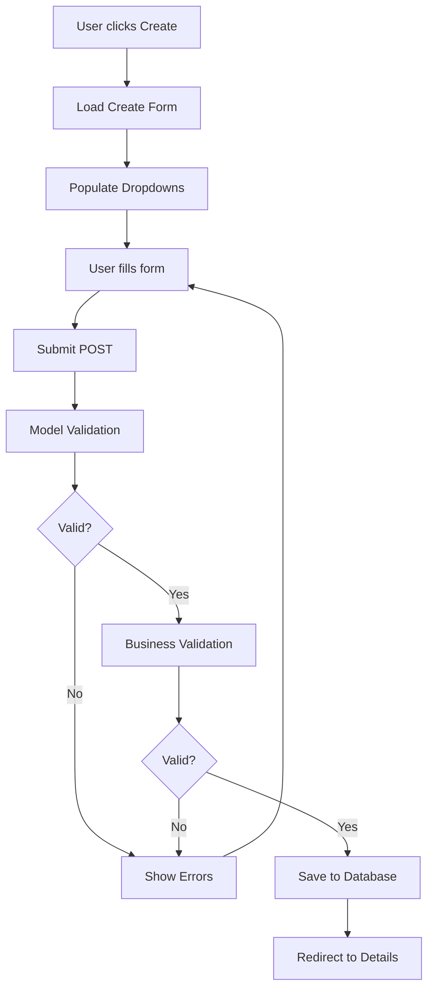
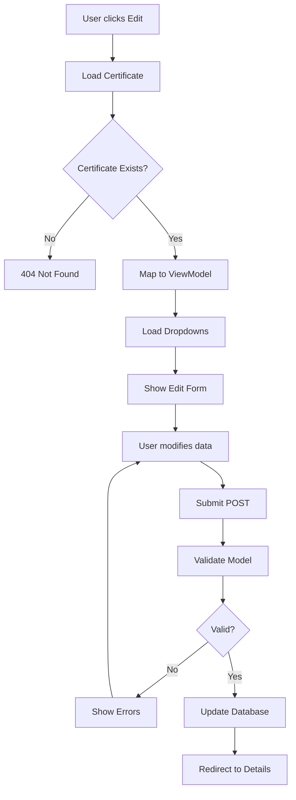
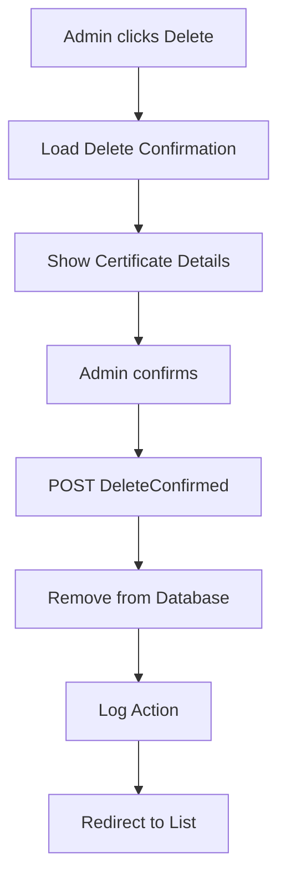

# Certificate Pages Functionality Documentation

## Executive Summary

The Certificate pages represent the core functionality of the GCC Database Solution, managing the complete lifecycle of environmental certifications. This documentation outlines all flows, validations, data models, and business logic for the most complex section of the application.

---

## 1. Certificate Data Model & Relationships

### Core Certificate Entity
```csharp
public class Certificate
{
    public int Id { get; set; }

    [Required, MaxLength(7)]
    public string Number { get; set; } // Unique certificate identifier

    [MaxLength(50)]
    public string Status { get; set; } = "active"; // Lifecycle status

    public DateTime EffectiveDate { get; set; }
    public DateTime ExpirationDate { get; set; }

    [MaxLength(175)]
    public string? Location { get; set; }

    [MaxLength(100)]
    public string? Country { get; set; }

    // Product Identification Fields
    public string? Asin { get; set; } // Amazon Standard ID
    public string? Upc { get; set; }  // Universal Product Code
    public string? Gtin { get; set; } // Global Trade Item Number
    public string? Ean { get; set; }  // European Article Number

    [MaxLength(100)]
    public string? Partner { get; set; } = "None"; // Amazon, Wayfair, None

    // Foreign Key Relationships
    public int CompanyId { get; set; }
    public int ProductId { get; set; }
    public int CertificationTypeId { get; set; }

    // Audit Fields
    public int? CreatedBy { get; set; }
    public int? UpdatedBy { get; set; }
    public DateTime CreatedAt { get; set; }
    public DateTime UpdatedAt { get; set; }

    // Navigation Properties
    public Company Company { get; set; }
    public Product Product { get; set; }
    public CertificationType CertificationType { get; set; }
    public ICollection<CertificateProductId> ProductIds { get; set; }
    public ICollection<Tag> Tags { get; set; }
    public ICollection<CustomFieldValue> CustomFieldValues { get; set; }
    public ICollection<CertificateDocument> Documents { get; set; }
}
```

### Related Entities
- **Company**: Certificate issuer/owner
- **Product**: Certified product
- **CertificationType**: Type of certification (CSF, RC, RE, CF, CoC)
- **CertificateProductId**: Multiple product IDs per certificate
- **Tags**: Categorization and metadata
- **CustomFieldValues**: Dynamic field support

---

## 2. Certificate Page Navigation Flow

### 2.1 Public Access Routes (No Authentication)
```
/                                    → Redirects to CertificateTileView
/Certificate/CertificateTileView     → Main public landing page
/Certificate/CertificateTileViewExternal → External partner view
/Certificate/CertificateSingleView/{id} → Individual certificate view
/Certificate/Details/{id}            → Certificate details
/Certificate/Download/{id}           → PDF download
/Certificate/DownloadByNumber/{number} → PDF by certificate number
```

### 2.2 Authenticated Routes (Role-Based Access)
```
# Analyst/Admin Only
/Certificate/Certificates            → Administrative list view
/Certificate/Create                  → Create new certificate
/Certificate/Edit/{id}              → Edit certificate
/Certificate/EditByNumber/{number}   → Edit by certificate number
/Certificate/CertificateTileViewInternal → Internal staff view

# Admin Only
/Certificate/Delete/{id}            → Delete confirmation
/Certificate/DeleteConfirmed        → POST delete action
```

### 2.3 API Endpoints
```
# Public API
GET  /Certificate/SearchApi          → Advanced search
GET  /Certificate/Statistics         → Certificate statistics
GET  /Certificate/ExportCertificates → Export in various formats

# Tile API Controllers
GET  /api/CertificateTiles/tiles     → Public tile data
GET  /api/CertificateTileInternal/   → Internal tile data
GET  /api/CertificateTileExternal/   → External partner data
GET  /api/v1/certificates           → RESTful API
```

---

## 3. Certificate Lifecycle & Status Management

### 3.1 Valid Certificate Statuses
```csharp
var validStatuses = new[] {
    "active",     // Certificate is valid and active
    "expired",    // Certificate has passed expiration date
    "pending",    // Certificate awaiting approval
    "suspended",  // Temporarily inactive
    "revoked"     // Permanently invalid
};
```

### 3.2 Status Transition Rules
- **Pending → Active**: Manual approval by Admin/Analyst
- **Active → Expired**: Automatic on expiration date
- **Active → Suspended**: Manual by Admin only
- **Active → Revoked**: Manual by Admin only (permanent)
- **Suspended → Active**: Manual restoration by Admin
- **Revoked**: Terminal state (cannot be changed)

### 3.3 Date-Based Business Rules
- Effective date cannot be > 30 days in future
- Expiration date must be after effective date
- Maximum validity period: 5 years
- Automatic expiration warnings at 30 days

---

## 4. Data Validation Rules

### 4.1 Model-Level Validations (DataAnnotations)
```csharp
[Required]
[MaxLength(7)]
public string Number { get; set; }

[Required]
[Display(Name = "Effective Date")]
[DataType(DataType.Date)]
public DateTime EffectiveDate { get; set; }

[Required]
[Display(Name = "Company")]
public int CompanyId { get; set; }
```

### 4.2 Business Rule Validations (ValidationService)

#### Certificate Number Validation
- **Uniqueness**: No duplicate certificate numbers
- **Format**: 7-character maximum alphanumeric
- **Required**: Cannot be null or empty

#### Date Range Validation
```csharp
// Effective date constraints
if (certificate.EffectiveDate > DateTime.Today.AddDays(30))
    result.AddError("Effective date cannot be more than 30 days in the future.");

// Date relationship validation
if (certificate.ExpirationDate <= certificate.EffectiveDate)
    result.AddError("Expiration date must be after the effective date.");

// Maximum validity period
if (certificate.ExpirationDate > certificate.EffectiveDate.AddYears(5))
    result.AddError("Certificate validity period cannot exceed 5 years.");
```

#### Product Code Validations
- **ASIN**: 10 alphanumeric characters
- **UPC**: 12 digits
- **GTIN**: 8, 12, 13, or 14 digits
- **EAN**: 8 or 13 digits

#### Related Entity Validation
- Company must exist in database
- Product must exist in database
- CertificationType must exist in database

---

## 5. Certificate CRUD Operations

### 5.1 Create Certificate Flow


**Controller Actions:**
- `GET Create()`: Load form with dropdown data
- `POST Create(CertificateEditViewModel)`: Process submission

**Required Dropdown Data:**
- Companies (from _unitOfWork.Companies.GetAllAsync())
- Products (from _unitOfWork.Products.GetAllAsync())
- CertificationTypes (from _unitOfWork.CertificationTypes.GetAllAsync())

### 5.2 Edit Certificate Flow


**Controller Actions:**
- `GET Edit(int id)`: Load edit form
- `GET EditByNumber(string number)`: Edit by certificate number
- `POST Edit(int id, CertificateEditViewModel)`: Process update

### 5.3 Delete Certificate Flow (Admin Only)


---

## 6. Search & Filtering System

### 6.1 Basic Search (Certificates Page)
```csharp
public async Task<IActionResult> Certificates(
    int page = 1,
    int pageSize = 10,
    string searchTerm = "",
    int? companyId = null,
    int? productId = null,
    string? partner = null)
```

**Search Capabilities:**
- Text search across: Certificate Number, Company Name, Product Name
- Company filter dropdown
- Product filter dropdown
- Partner filter (Amazon, Wayfair, None)
- Pagination support

### 6.2 Advanced Search API
```csharp
public async Task<IActionResult> SearchApi(
    string? searchTerm = null,
    int? companyId = null,
    int? productId = null,
    int? certificationTypeId = null,
    string? status = null,
    string? location = null,
    string? country = null,
    DateTime? effectiveDateFrom = null,
    DateTime? effectiveDateTo = null,
    DateTime? expirationDateFrom = null,
    DateTime? expirationDateTo = null,
    string? sortBy = "CreatedAt",
    bool sortDescending = true,
    int page = 1,
    int pageSize = 10)
```

**Advanced Filter Capabilities:**
- Multi-field text search
- Date range filtering (effective/expiration)
- Status filtering
- Location/Country filtering
- Custom sorting options
- JSON API response format

### 6.3 Search Response Format
```json
{
  "certificates": [
    {
      "id": 1,
      "number": "24-1605",
      "status": "active",
      "effectiveDate": "2024-01-01",
      "expirationDate": "2026-01-01",
      "company": { "id": 1, "name": "ABC Company" },
      "product": { "id": 1, "name": "Widget Pro" },
      "certificationType": { "id": 1, "name": "CSF" },
      "location": "Factory A",
      "country": "USA",
      "isExpired": false,
      "isExpiringSoon": false
    }
  ],
  "pagination": {
    "currentPage": 1,
    "pageSize": 10,
    "totalCount": 150,
    "totalPages": 15,
    "hasNextPage": true,
    "hasPreviousPage": false
  }
}
```

---

## 7. Export Functionality

### 7.1 Export Formats Supported
- **CSV**: Text format for spreadsheet import
- **Excel**: Professional .xlsx with formatting
- **PDF**: Printable report format

### 7.2 Export Controller Action
```csharp
public async Task<IActionResult> ExportCertificates(
    string format = "csv",
    string? searchTerm = null,
    string? sort = null,
    [FromQuery] List<string>? certificationTypes = null,
    [FromQuery] List<string>? countries = null,
    [FromQuery] List<string>? statuses = null,
    DateTime? effectiveDateStart = null,
    DateTime? effectiveDateEnd = null)
```

### 7.3 Export Data Fields
```
Certificate Number, Company Name, Product Name, Product Category,
Certification Type, Status, Partner Program, Effective Date,
Expiration Date, Location, Country, ASIN, UPC, GTIN, EAN
```

### 7.4 Export Security
- Role-based data filtering applied
- Export size limits (10,000 records max)
- User action logging
- File download security headers

---

## 8. PDF Generation System

### 8.1 Individual Certificate PDF
**Generated by**: `ICertificatePdfService.GenerateCertificatePdfAsync()`
**Library**: QuestPDF
**Features**:
- Professional certificate layout
- Company/Product details
- Certification type and validity dates
- Security watermark
- Verification note

### 8.2 PDF Content Structure
```
Header: Green Circle Certified Logo + Title
Certificate Number: Large, prominent display
Details Table:
  - Company Name
  - Product Name
  - Certification Type
  - Status
  - Effective Date
  - Expiration Date
  - Location/Country
Footer: Generation timestamp
```

### 8.3 PDF Download Endpoints
- `GET /Certificate/Download/{id}`: Download by ID
- `GET /Certificate/DownloadByNumber/{number}`: Download by certificate number

---

## 9. Role-Based Access Control

### 9.1 Permission Matrix
| Action | Public | External | Internal | Analyst | Admin |
|--------|--------|----------|----------|---------|-------|
| View Tile View | ✓ | ✓ | ✓ | ✓ | ✓ |
| View Details | ✓ | ✓ | ✓ | ✓ | ✓ |
| Download PDF | ✓ | ✓ | ✓ | ✓ | ✓ |
| View Internal Data | ✗ | ✗ | ✓ | ✓ | ✓ |
| Create Certificate | ✗ | ✗ | ✗ | ✓ | ✓ |
| Edit Certificate | ✗ | ✗ | ✗ | ✓ | ✓ |
| Delete Certificate | ✗ | ✗ | ✗ | ✗ | ✓ |
| Bulk Operations | ✗ | ✗ | ✗ | ✗ | ✓ |

### 9.2 Authorization Policies
```csharp
[Authorize(Policy = "AnalystOrAdmin")]  // Create, Edit
[Authorize(Policy = "AdminOnly")]       // Delete
[AllowAnonymous]                        // Public views
```

### 9.3 Data Filtering by Role
- **Public/External**: Active certificates only
- **Partner (External)**: Partner-specific + public certificates
- **Internal/Analyst/Admin**: All certificates with full details

---

## 10. Business Logic Services

### 10.1 CertificateService Responsibilities
- Certificate CRUD operations
- Search and filtering logic
- Export generation
- Statistics calculation
- Bulk operations
- Data transformation for views

### 10.2 ValidationService Responsibilities
- Model validation (DataAnnotations)
- Business rule validation
- Product code format validation
- Date range validation
- Uniqueness checks
- Related entity validation

### 10.3 CertificatePdfService Responsibilities
- PDF generation using QuestPDF
- Certificate layout and formatting
- Security watermarks
- Professional styling

---

## 11. Data Flow Diagrams

### 11.1 Certificate Creation Data Flow
```
User Input → Controller → ValidationService → Database
     ↓            ↓              ↓              ↓
 Form Data → ViewModel → Business Rules → Certificate Entity
     ↓            ↓              ↓              ↓
Validation → Mapping → Save → Audit Log
```

### 11.2 Certificate Search Data Flow
```
Search Request → Controller → Repository → Database
      ↓             ↓           ↓          ↓
  Parameters → Filter Builder → Query → Raw Data
      ↓             ↓           ↓          ↓
   Pagination → ViewModel → Transform → JSON Response
```

### 11.3 Export Data Flow
```
Export Request → Controller → Service → Repository
      ↓             ↓          ↓         ↓
   Parameters → Validation → Query → Raw Data
      ↓             ↓          ↓         ↓
 Format Choice → Generator → Transform → File Download
```

---

## 12. Error Handling & Logging

### 12.1 Exception Handling Strategy
```csharp
try
{
    // Certificate operation
}
catch (Exception ex)
{
    _logger.LogError(ex, "Error context: {Context}", context);
    return BadRequest("User-friendly error message");
}
```

### 12.2 Validation Error Handling
- Model validation errors displayed in form
- Business rule violations shown as alerts
- Field-level error highlighting
- Comprehensive error messages

### 12.3 Logging Strategy
- All CRUD operations logged with user context
- Search queries logged for analytics
- Export operations tracked
- Security events logged
- Performance metrics captured

---

## 13. Performance Considerations

### 13.1 Database Optimization
- Indexes on frequently searched fields (Number, Status, CompanyId, ProductId)
- Eager loading for related entities
- Pagination to prevent large result sets
- Query optimization for complex filters

### 13.2 Caching Strategy
- Static dropdown data cached
- Search result caching for common queries
- PDF generation caching
- View result caching

### 13.3 Large Dataset Handling
- Export size limits (10,000 records)
- Streaming for large exports
- Background processing for bulk operations
- Progressive loading for UI

---

## 14. Security Measures

### 14.1 Input Validation
- All user inputs validated
- SQL injection prevention via Entity Framework
- XSS prevention through proper encoding
- File upload validation for documents

### 14.2 Access Control
- Role-based authorization on all endpoints
- Data filtering based on user permissions
- Audit trail for all modifications
- Secure file downloads

### 14.3 Data Protection
- Personal data handling compliance
- Secure PDF generation
- Encrypted sensitive fields
- Audit logging for compliance

---

## 15. API Integration Points

### 15.1 Internal API Endpoints
```
GET    /api/certificates                    # List certificates
POST   /api/certificates                    # Create certificate
GET    /api/certificates/{id}               # Get certificate
PUT    /api/certificates/{id}               # Update certificate
DELETE /api/certificates/{id}               # Delete certificate
GET    /api/certificates/search             # Advanced search
GET    /api/certificates/statistics         # Get statistics
POST   /api/certificates/export             # Export data
```

### 15.2 External Partner API
```
GET    /api/CertificateTileExternal/tiles         # Partner certificates
GET    /api/CertificateTileExternal/suggestions   # Search suggestions
GET    /api/CertificateTileExternal/filters       # Available filters
POST   /api/CertificateTileExternal/export        # Export partner data
```

### 15.3 API Authentication
- JWT token authentication
- API key authentication for partners
- Role-based data filtering
- Rate limiting protection

---

## 16. Testing Strategy

### 16.1 Unit Testing Coverage
- Controller action testing
- Service method testing
- Validation rule testing
- Business logic testing

### 16.2 Integration Testing
- Full CRUD workflow testing
- Search functionality testing
- Export generation testing
- PDF generation testing

### 16.3 UI Testing
- Form validation testing
- Role-based access testing
- Search and filter testing
- Export download testing

---

## 17. Future Enhancements

### 17.1 Planned Features
- Advanced workflow engine
- Document management system
- Certificate versioning
- Automated renewal notifications
- Mobile-responsive improvements

### 17.2 Technical Improvements
- Real-time notifications
- Enhanced caching layer
- Microservices architecture
- Event-driven updates
- Enhanced analytics

---

## 18. Troubleshooting Guide

### 18.1 Common Issues
- **Certificate not found**: Check ID/number format
- **Validation errors**: Review business rules
- **Permission denied**: Verify user role
- **Export failures**: Check data size limits
- **PDF generation errors**: Verify QuestPDF configuration

### 18.2 Debug Endpoints
- `/Certificate/Statistics`: Health check data
- `/api/certificates/search`: Test search functionality
- Logs location: Application logs directory

---

This comprehensive documentation covers all aspects of the Certificate pages functionality, from data models to business logic, validation rules, and API endpoints. The Certificate section is indeed the most complex part of the application, handling the core business functionality with extensive security, validation, and integration requirements.