# GCC Web Application - Mermaid Diagrams

This document contains comprehensive Mermaid diagrams for the GCC (Global Certificate Compliance) Web Application system.

## Table of Contents

1. [Flowcharts](#flowcharts)
2. [Sequence Diagrams](#sequence-diagrams)
3. [Class Diagrams](#class-diagrams)
4. [State Diagrams](#state-diagrams)
5. [Entity Relationship Diagrams](#entity-relationship-diagrams)
6. [Gantt Charts](#gantt-charts)
7. [Pie Charts](#pie-charts)
8. [Git Graphs](#git-graphs)
9. [Mind Maps](#mind-maps)
10. [Timeline](#timeline)
11. [Requirement Diagrams](#requirement-diagrams)
12. [Quadrant Charts](#quadrant-charts)
13. [User Journey Diagrams](#user-journey-diagrams)

---

## Flowcharts

### Certificate Management Process Flow
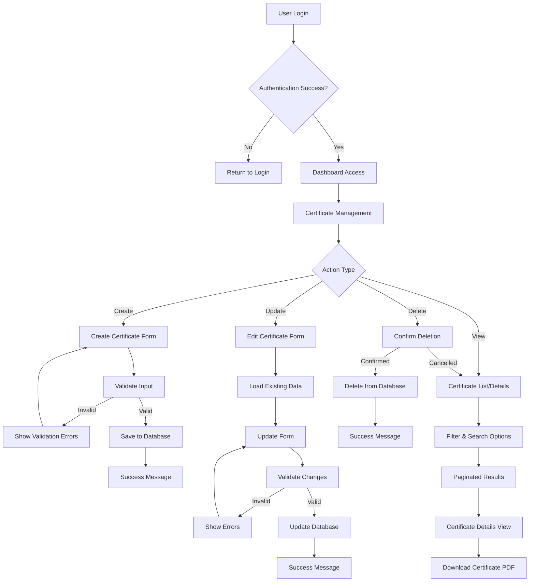

### API Request Processing Flow
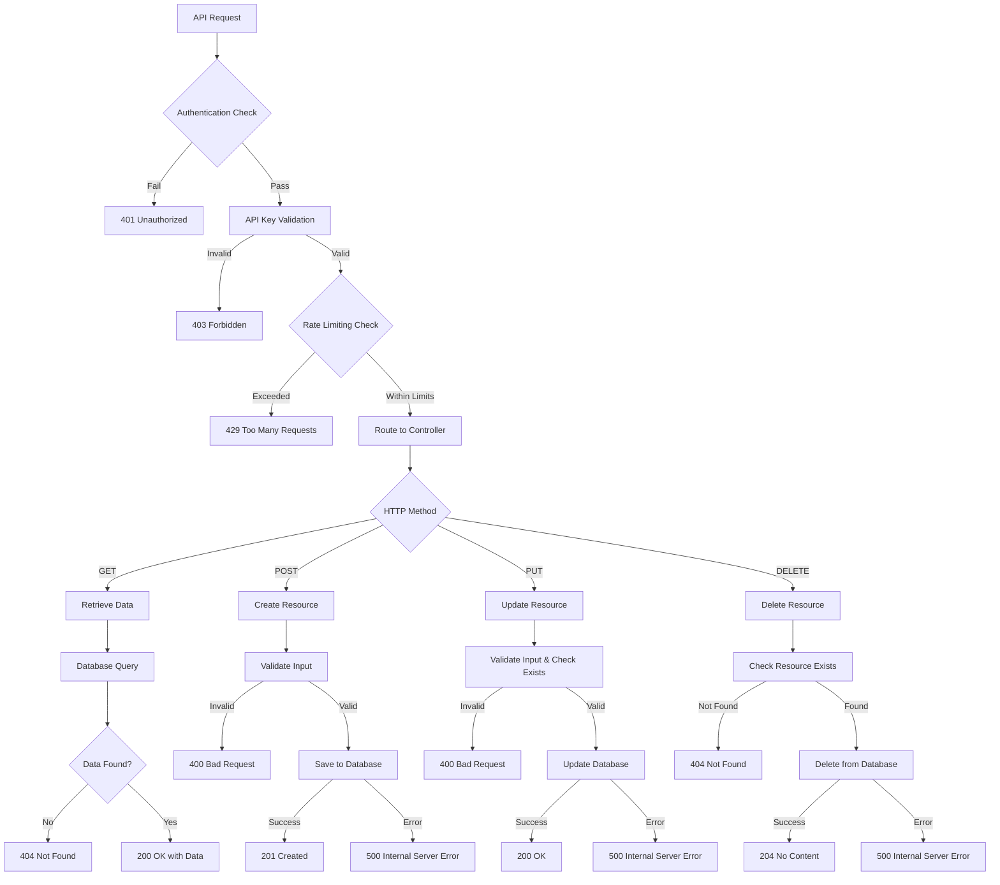

### ETL Data Processing Flow
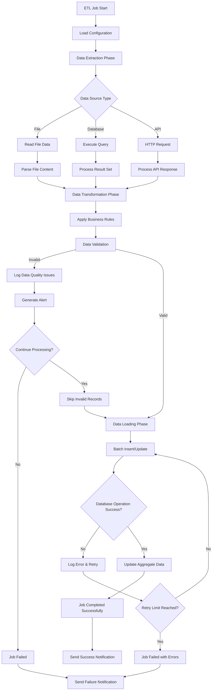

---

## Sequence Diagrams

### Certificate API Creation Sequence
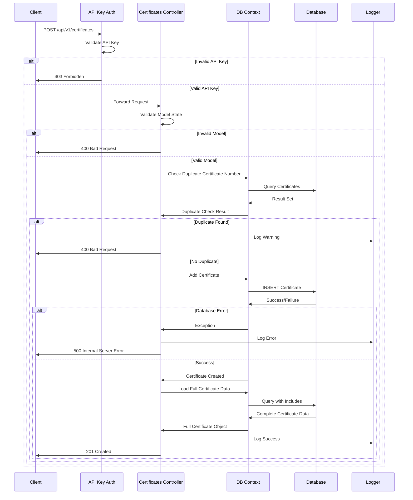

### User Authentication Sequence
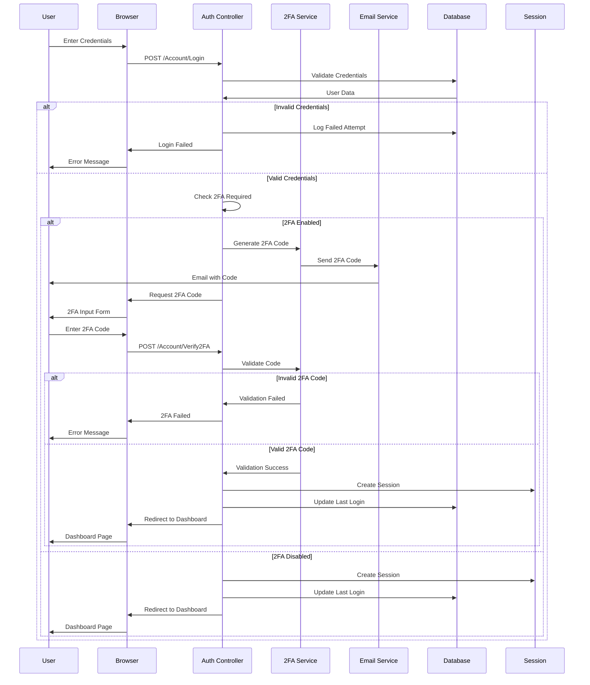

### ETL Data Processing Sequence
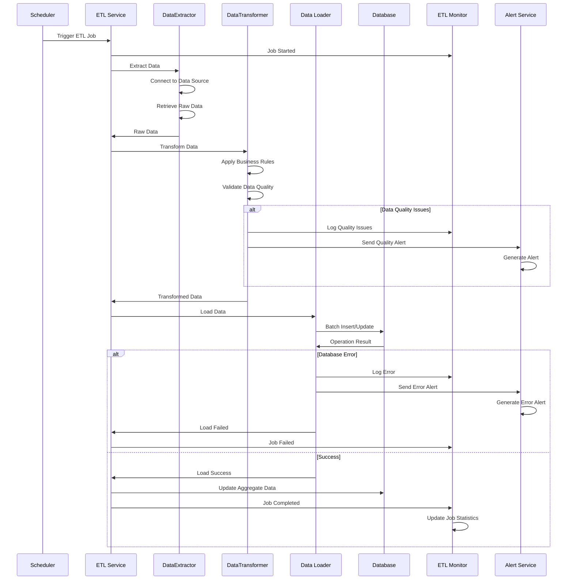

---

## Class Diagrams

### Core Domain Models
```mermaid
classDiagram
    class Certificate {
        +int Id
        +string Number
        +string Status
        +DateTime EffectiveDate
        +DateTime ExpirationDate
        +string Location
        +string Country
        +string Asin
        +string Upc
        +string Gtin
        +string Ean
        +string CertificateFile
        +int CompanyId
        +int ProductId
        +int CertificationTypeId
        +int? CreatedBy
        +int? UpdatedBy
        +DateTime CreatedAt
        +DateTime UpdatedAt
        +Company Company
        +Product Product
        +CertificationType CertificationType
        +User CreatedByUser
        +User UpdatedByUser
        +ICollection~Tag~ Tags
        +ICollection~CustomFieldValue~ CustomFieldValues
        +ICollection~CertificateDocument~ Documents
    }

    class Company {
        +int Id
        +string Name
        +string ContactInfo
        +string Email
        +string Website
        +string Location
        +string Country
        +bool IsActive
        +bool IsDeleted
        +DateTime CreatedAt
        +DateTime UpdatedAt
        +ICollection~Certificate~ Certificates
        +ICollection~Product~ Products
        +ICollection~User~ Users
    }

    class Product {
        +int Id
        +string Name
        +string Description
        +string Model
        +string Sku
        +string Upc
        +string Asin
        +int CategoryId
        +int? ProductTypeId
        +int? ProductSubcategoryId
        +int? CompanyId
        +bool IsActive
        +bool IsDeleted
        +DateTime CreatedAt
        +DateTime UpdatedAt
        +ProductCategory Category
        +ProductType ProductType
        +ProductSubcategory ProductSubcategory
        +Company Company
        +ICollection~Certificate~ Certificates
        +ICollection~Tag~ Tags
        +ICollection~ProductIdentifier~ ProductIdentifiers
    }

    class User {
        +int Id
        +string Username
        +string Email
        +string Name
        +string FullName
        +DateTime? LastLoginAt
        +bool IsDeleted
        +DateTime? DeletedAt
        +string PasswordHash
        +string Status
        +bool IsActive
        +bool IsStaff
        +bool IsSuperuser
        +bool RequirePasswordReset
        +DateTime? LastLogin
        +DateTime? PasswordChangedAt
        +int FailedLoginAttempts
        +DateTime? LockedUntil
        +string TwoFactorSecret
        +bool TwoFactorEnabled
        +string TwoFactorMethod
        +string PhoneNumber
        +bool IsPhoneVerified
        +bool IsEmailVerified
        +string RecoveryCodes
        +DateTime CreatedAt
        +DateTime UpdatedAt
        +ICollection~Certificate~ CreatedCertificates
        +ICollection~Certificate~ UpdatedCertificates
        +ICollection~Role~ Roles
        +ICollection~Company~ Companies
    }

    class CertificationType {
        +int Id
        +string Name
        +string Description
        +bool IsActive
        +DateTime CreatedAt
        +DateTime UpdatedAt
        +ICollection~Certificate~ Certificates
        +ICollection~CustomField~ CustomFields
    }

    class ProductCategory {
        +int Id
        +string Name
        +string Description
        +bool IsActive
        +DateTime CreatedAt
        +DateTime UpdatedAt
        +ICollection~Product~ Products
        +ICollection~ProductType~ ProductTypes
    }

    class Tag {
        +int Id
        +string Name
        +string Color
        +DateTime CreatedAt
        +DateTime UpdatedAt
        +ICollection~Certificate~ Certificates
        +ICollection~Product~ Products
    }

    Certificate ||--o{ Company : "belongs to"
    Certificate ||--o{ Product : "certifies"
    Certificate ||--o{ CertificationType : "has type"
    Certificate ||--o{ User : "created by"
    Certificate ||--o{ User : "updated by"
    Certificate }|--|| Tag : "tagged with"
    
    Product ||--o{ Company : "manufactured by"
    Product ||--o{ ProductCategory : "belongs to category"
    Product }|--|| Tag : "tagged with"
    
    User }|--|| Company : "works for"
    User }|--|| Role : "has roles"
```

### Service Layer Architecture
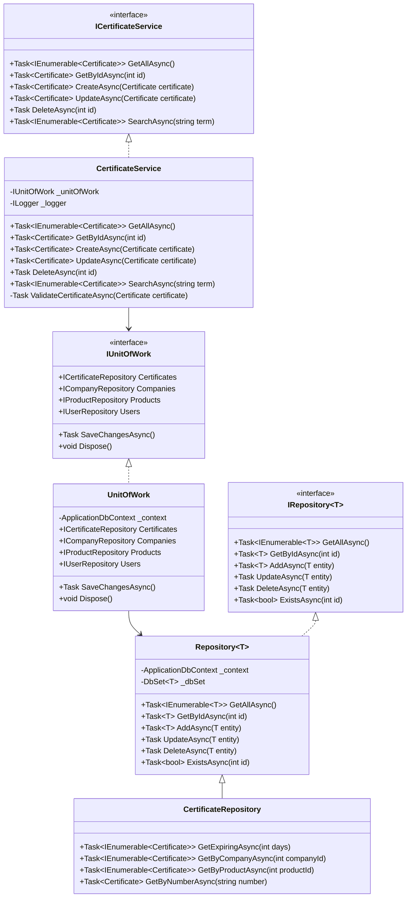

---

## State Diagrams

### User Authentication States
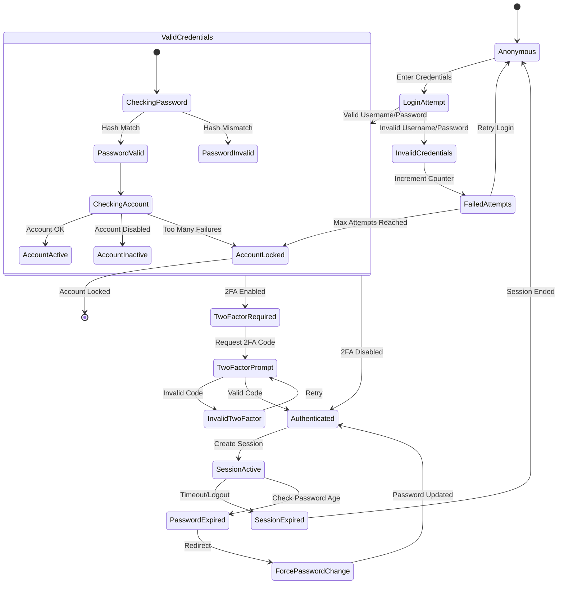

### Certificate Lifecycle States
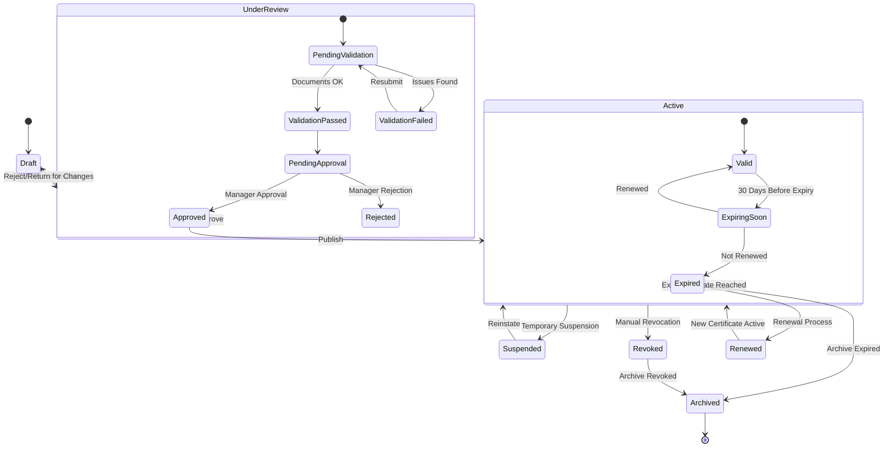

### ETL Job States
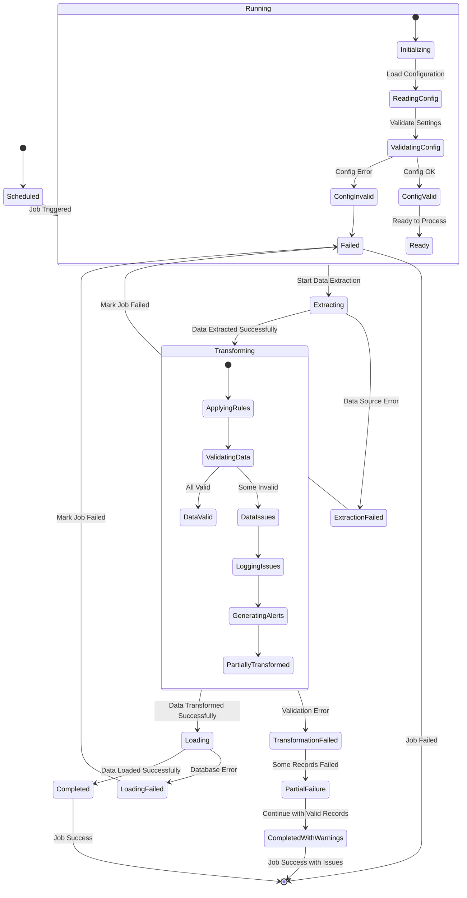

---

## Entity Relationship Diagrams

### Core Database Schema
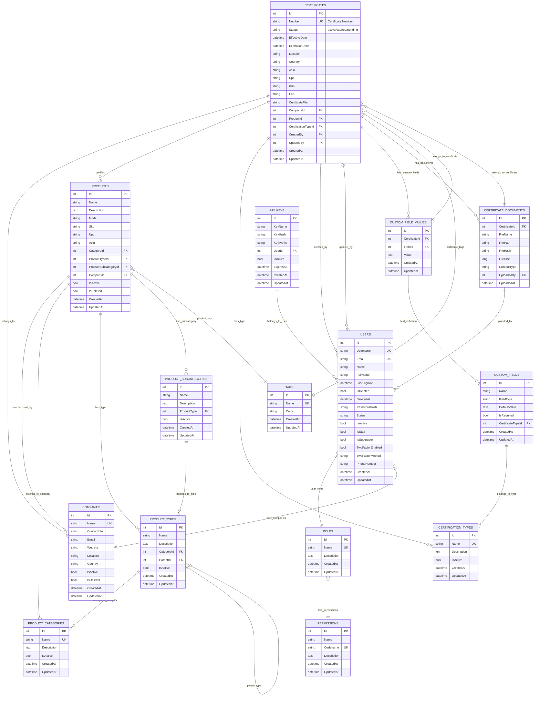

### ETL System Schema
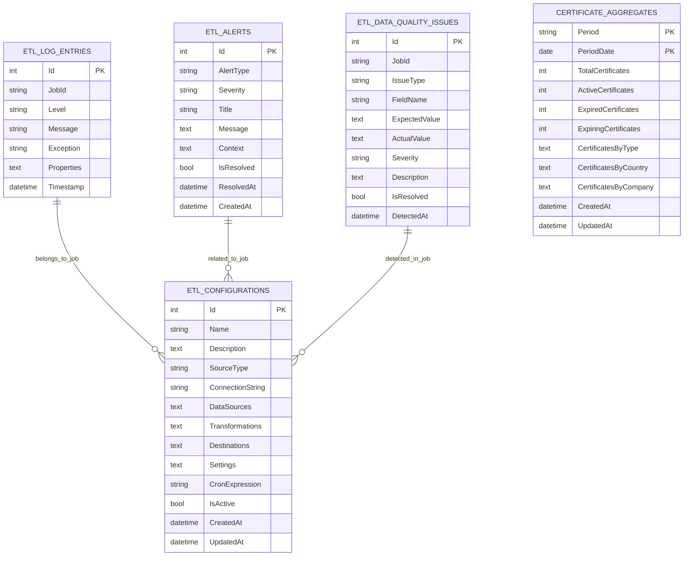

---

## Gantt Charts

### Project Development Timeline
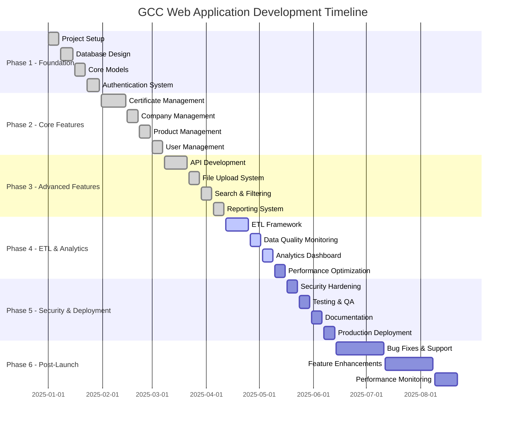

### Sprint Planning Gantt
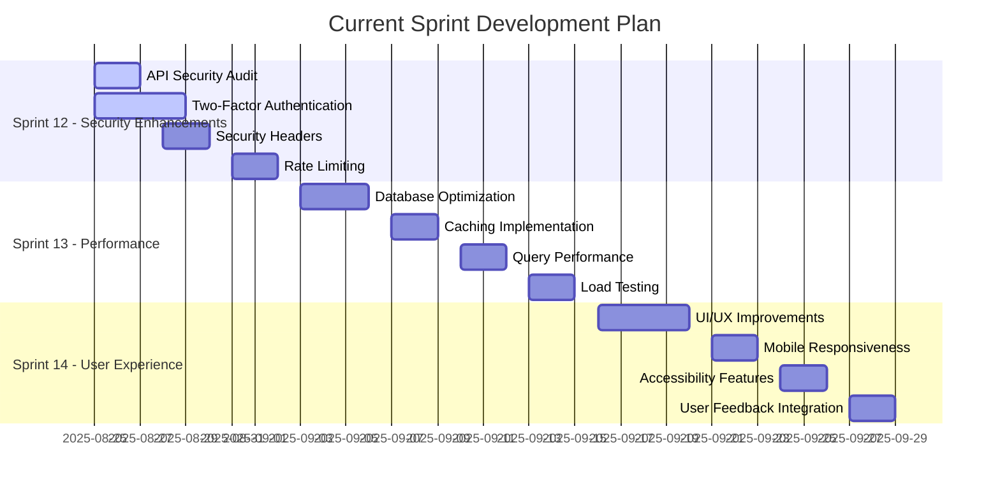

---

## Pie Charts

### Certificate Distribution by Status
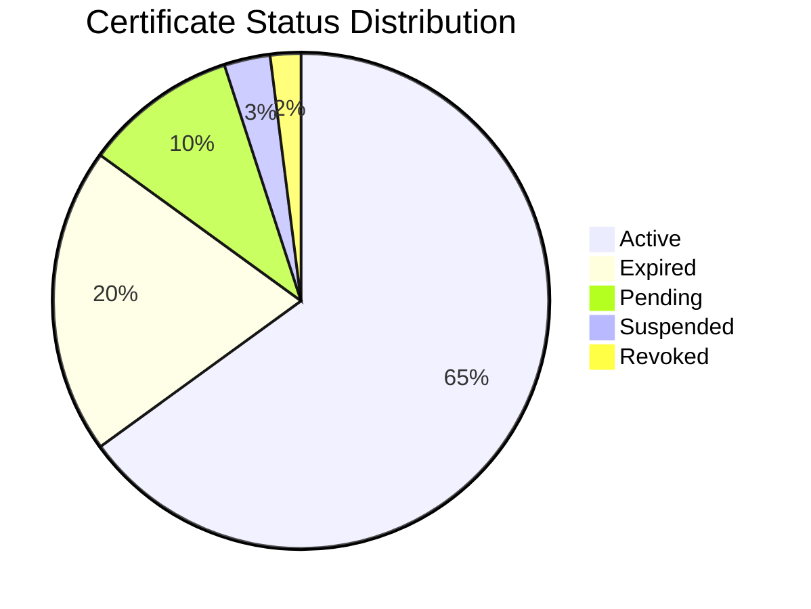

### User Role Distribution
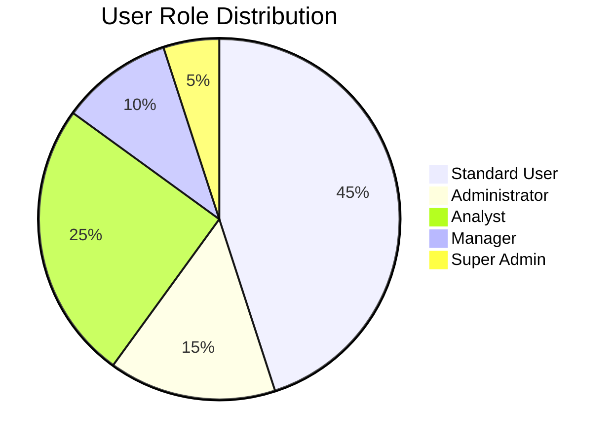

### API Usage by Endpoint
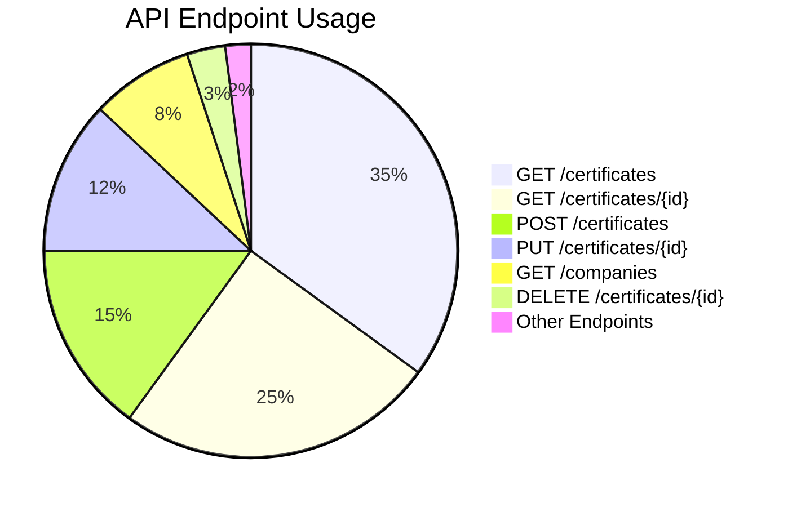

### Database Storage by Entity
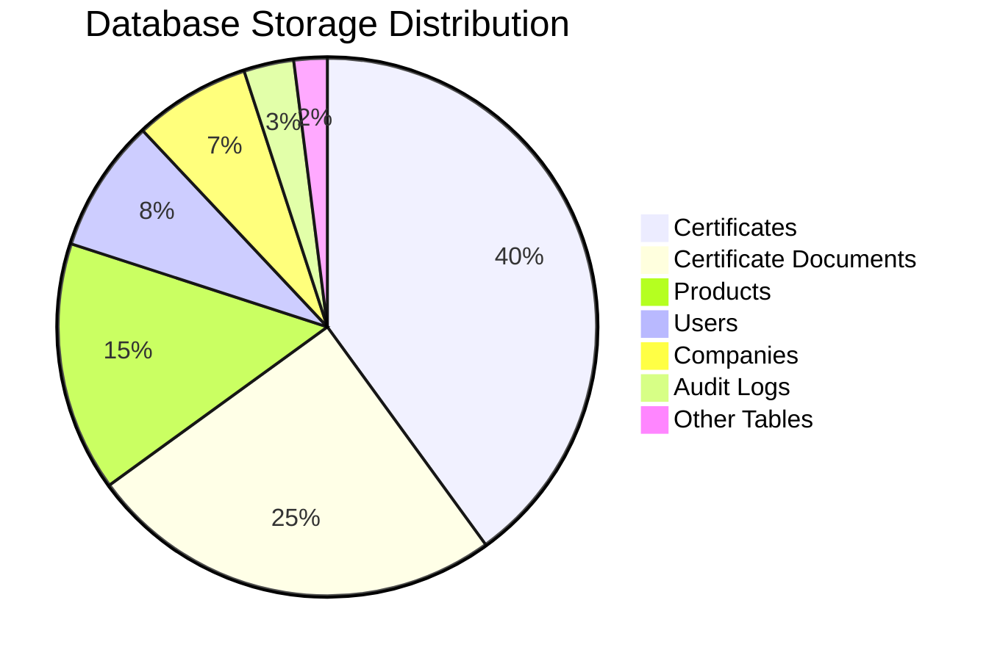

---

## Git Graphs

### Repository Branch Structure
```mermaid
gitgraph
    commit id: "Initial commit"
    commit id: "Setup project structure"
    commit id: "Add basic models"
    
    branch feature/authentication
    checkout feature/authentication
    commit id: "Add user model"
    commit id: "Implement login"
    commit id: "Add 2FA support"
    
    checkout main
    merge feature/authentication
    commit id: "Authentication complete"
    
    branch feature/certificate-management
    checkout feature/certificate-management
    commit id: "Add certificate model"
    commit id: "CRUD operations"
    commit id: "File upload support"
    
    branch feature/api-development
    checkout feature/api-development
    commit id: "API controllers"
    commit id: "Authentication middleware"
    commit id: "Swagger documentation"
    
    checkout main
    merge feature/certificate-management
    commit id: "Certificate management ready"
    
    merge feature/api-development
    commit id: "API endpoints complete"
    
    branch feature/etl-system
    checkout feature/etl-system
    commit id: "ETL framework"
    commit id: "Data transformation"
    commit id: "Quality monitoring"
    
    checkout main
    branch hotfix/security-patch
    checkout hotfix/security-patch
    commit id: "Fix security issue"
    
    checkout main
    merge hotfix/security-patch
    commit id: "Security patch applied"
    
    merge feature/etl-system
    commit id: "ETL system integrated"
    
    commit id: "Release v1.0"
```

### Feature Development Flow
```mermaid
gitgraph
    commit id: "Sprint start"
    
    branch feature/user-management
    checkout feature/user-management
    commit id: "User CRUD"
    commit id: "Role management"
    
    branch feature/advanced-search
    checkout feature/advanced-search
    commit id: "Search filters"
    commit id: "Pagination"
    
    checkout main
    branch feature/reporting
    checkout feature/reporting
    commit id: "Report templates"
    commit id: "Export functionality"
    
    checkout feature/user-management
    merge main
    commit id: "Merge latest changes"
    
    checkout main
    merge feature/user-management
    commit id: "User management complete"
    
    checkout feature/advanced-search
    merge main
    commit id: "Sync with main"
    
    checkout main
    merge feature/advanced-search
    commit id: "Search features ready"
    
    merge feature/reporting
    commit id: "Reporting system live"
```

---

## Mind Maps

### System Architecture Overview
```mermaid
mindmap
  root((GCC Web App))
    Frontend
      MVC Views
        Certificate Views
        Admin Views
        Account Views
      JavaScript
        jQuery
        Bootstrap
        Custom Scripts
      Responsive Design
        Mobile Support
        Tablet Support
    Backend
      Controllers
        Certificate Controller
        API Controllers
        Admin Controller
        Account Controller
      Services
        Certificate Service
        ETL Service
        Email Service
        Security Service
      Repositories
        Generic Repository
        Unit of Work
        Specific Repositories
    Database
      SQLite
        Core Tables
        Audit Tables
        ETL Tables
      Entity Framework
        Code First
        Migrations
        Relationships
    Security
      Authentication
        Cookie Auth
        API Key Auth
        2FA Support
      Authorization
        Role Based
        Permission Based
        Policy Based
      Data Protection
        Encryption
        Secure Headers
        Rate Limiting
    Integration
      APIs
        RESTful Design
        Versioning
        Swagger Docs
      ETL System
        Data Extraction
        Transformation
        Loading
        Monitoring
      File Management
        Upload System
        Storage
        Validation
```

### Feature Breakdown
```mermaid
mindmap
  root((Core Features))
    Certificate Management
      CRUD Operations
        Create Certificate
        View Certificate
        Update Certificate
        Delete Certificate
      File Management
        PDF Upload
        Document Storage
        File Validation
      Search & Filter
        Text Search
        Date Filters
        Status Filters
        Advanced Search
    User Management
      Authentication
        Login/Logout
        Password Reset
        Two-Factor Auth
        Session Management
      Authorization
        Role Assignment
        Permission Control
        Access Control
      Profile Management
        User Details
        Security Settings
        Preferences
    Data Management
      Import/Export
        Excel Import
        CSV Export
        PDF Export
        Data Validation
      ETL Processing
        Scheduled Jobs
        Data Quality
        Error Handling
        Monitoring
      Backup/Restore
        Database Backup
        File Backup
        Recovery Options
    System Administration
      Configuration
        System Settings
        Email Settings
        Security Settings
      Monitoring
        Performance Metrics
        Error Logging
        Audit Trail
        Health Checks
      Maintenance
        Database Cleanup
        Log Rotation
        System Updates
```

---

## Timeline

### Development Milestones
```mermaid
timeline
    title GCC Web Application Development Timeline
    
    2025-01-01 : Project Initiation
               : Requirements Gathering
               : Technology Stack Selection
    
    2025-01-15 : Database Design Complete
               : Initial Models Created
               : Entity Framework Setup
    
    2025-02-01 : Authentication System
               : Basic CRUD Operations
               : MVC Structure
    
    2025-03-01 : Certificate Management
               : File Upload System
               : Search Functionality
    
    2025-04-01 : API Development
               : Swagger Documentation
               : Security Implementation
    
    2025-05-01 : ETL Framework
               : Data Quality Monitoring
               : Performance Optimization
    
    2025-06-01 : Testing & QA
               : Documentation
               : Security Audit
    
    2025-07-01 : Production Deployment
               : User Training
               : Go-Live Support
    
    2025-08-01 : Post-Launch Support
               : Bug Fixes
               : Feature Enhancements
               
    2025-08-25 : Current Status
               : Security Enhancements
               : Performance Improvements
```

### Security Enhancement Timeline
```mermaid
timeline
    title Security Enhancement Implementation
    
    2025-08-01 : Security Assessment
               : Vulnerability Scan
               : Risk Analysis
    
    2025-08-05 : API Key Authentication
               : Rate Limiting Setup
               : Security Headers
    
    2025-08-10 : Two-Factor Authentication
               : Password Policies
               : Account Lockout
    
    2025-08-15 : Data Encryption
               : Secure Configuration
               : Logging Enhancement
    
    2025-08-20 : Security Testing
               : Penetration Testing
               : Code Review
    
    2025-08-25 : Current Phase
               : Final Security Audit
               : Documentation Update
    
    2025-08-30 : Security Certification
               : Compliance Check
               : Go-Live Approval
```

---

## Requirement Diagrams

### System Requirements
```mermaid
requirementDiagram
    requirement certificate_management {
        id: 1
        text: The system shall manage certificates
        risk: high
        verifymethod: test
    }

    requirement user_authentication {
        id: 2
        text: The system shall authenticate users
        risk: high
        verifymethod: test
    }

    requirement api_access {
        id: 3
        text: The system shall provide API access
        risk: medium
        verifymethod: test
    }

    requirement file_upload {
        id: 4
        text: The system shall support file uploads
        risk: medium
        verifymethod: test
    }

    requirement data_export {
        id: 5
        text: The system shall export data
        risk: low
        verifymethod: test
    }

    requirement security_compliance {
        id: 6
        text: The system shall be security compliant
        risk: high
        verifymethod: audit
    }

    requirement performance {
        id: 7
        text: The system shall meet performance requirements
        risk: medium
        verifymethod: performance_test
    }

    requirement etl_processing {
        id: 8
        text: The system shall process ETL data
        risk: medium
        verifymethod: test
    }

    element certificate_service {
        type: service
    }

    element authentication_service {
        type: service
    }

    element api_controller {
        type: controller
    }

    element file_service {
        type: service
    }

    element export_service {
        type: service
    }

    element security_middleware {
        type: middleware
    }

    element cache_service {
        type: service
    }

    element etl_service {
        type: service
    }

    certificate_management - satisfies -> certificate_service
    user_authentication - satisfies -> authentication_service
    api_access - satisfies -> api_controller
    file_upload - satisfies -> file_service
    data_export - satisfies -> export_service
    security_compliance - satisfies -> security_middleware
    performance - satisfies -> cache_service
    etl_processing - satisfies -> etl_service

    certificate_service - derives -> user_authentication
    api_controller - derives -> user_authentication
    file_service - derives -> security_compliance
    export_service - derives -> security_compliance
```

### Functional Requirements
```mermaid
requirementDiagram
    requirement user_registration {
        id: FR-001
        text: Users shall be able to register accounts
        risk: medium
        verifymethod: test
    }

    requirement certificate_crud {
        id: FR-002
        text: Users shall perform CRUD operations on certificates
        risk: high
        verifymethod: test
    }

    requirement certificate_search {
        id: FR-003
        text: Users shall search certificates by multiple criteria
        risk: medium
        verifymethod: test
    }

    requirement file_management {
        id: FR-004
        text: System shall manage certificate files
        risk: medium
        verifymethod: test
    }

    requirement role_management {
        id: FR-005
        text: Administrators shall manage user roles
        risk: high
        verifymethod: test
    }

    requirement audit_logging {
        id: FR-006
        text: System shall log all user activities
        risk: high
        verifymethod: audit
    }

    requirement data_validation {
        id: FR-007
        text: System shall validate all input data
        risk: high
        verifymethod: test
    }

    requirement notification_system {
        id: FR-008
        text: System shall send notifications for events
        risk: low
        verifymethod: test
    }

    element user_controller {
        type: controller
    }

    element certificate_controller {
        type: controller
    }

    element search_service {
        type: service
    }

    element file_upload_service {
        type: service
    }

    element admin_service {
        type: service
    }

    element audit_service {
        type: service
    }

    element validation_service {
        type: service
    }

    element notification_service {
        type: service
    }

    user_registration - satisfies -> user_controller
    certificate_crud - satisfies -> certificate_controller
    certificate_search - satisfies -> search_service
    file_management - satisfies -> file_upload_service
    role_management - satisfies -> admin_service
    audit_logging - satisfies -> audit_service
    data_validation - satisfies -> validation_service
    notification_system - satisfies -> notification_service
```

---

## Quadrant Charts

### Feature Priority Matrix
```mermaid
quadrantChart
    title Feature Priority Matrix
    x-axis Low Effort --> High Effort
    y-axis Low Impact --> High Impact
    
    quadrant-1 Do First
    quadrant-2 Schedule
    quadrant-3 Delegate
    quadrant-4 Don't Do
    
    Security Enhancements: [0.2, 0.9]
    Performance Optimization: [0.4, 0.8]
    Two-Factor Authentication: [0.3, 0.85]
    API Rate Limiting: [0.25, 0.7]
    Mobile Responsiveness: [0.6, 0.6]
    Advanced Reporting: [0.7, 0.65]
    Email Notifications: [0.15, 0.5]
    Dark Mode: [0.8, 0.3]
    Social Login: [0.75, 0.25]
    Chat Support: [0.9, 0.4]
    Bulk Operations: [0.5, 0.75]
    Data Export: [0.35, 0.6]
    User Preferences: [0.45, 0.35]
    Audit Logging: [0.3, 0.8]
    File Versioning: [0.65, 0.45]
```

### Technology Stack Evaluation
```mermaid
quadrantChart
    title Technology Stack Assessment
    x-axis Low Complexity --> High Complexity
    y-axis Low Value --> High Value
    
    quadrant-1 Adopt
    quadrant-2 Trial
    quadrant-3 Assess
    quadrant-4 Hold
    
    ASP.NET Core: [0.3, 0.9]
    Entity Framework: [0.25, 0.85]
    SQLite: [0.15, 0.8]
    Bootstrap: [0.2, 0.7]
    jQuery: [0.1, 0.6]
    Swagger: [0.2, 0.75]
    Serilog: [0.25, 0.7]
    Docker: [0.6, 0.8]
    Kubernetes: [0.9, 0.85]
    Redis: [0.4, 0.6]
    Elasticsearch: [0.7, 0.65]
    GraphQL: [0.75, 0.5]
    SignalR: [0.45, 0.4]
    Blazor: [0.65, 0.45]
    Angular: [0.8, 0.55]
    React: [0.85, 0.6]
```

---

## User Journey Diagrams

### Certificate Creation Journey
```mermaid
journey
    title Certificate Creation User Journey
    section Login
      Navigate to site: 5: User
      Enter credentials: 4: User
      Two-factor auth: 3: User
      Access dashboard: 5: User
    section Certificate Creation
      Click create certificate: 5: User
      Fill basic info: 4: User
      Select company: 4: User
      Select product: 3: User
      Enter dates: 4: User
      Upload certificate file: 2: User
      Add custom fields: 3: User
      Review information: 4: User
      Submit certificate: 5: User
    section Validation
      System validation: 3: System
      File processing: 2: System
      Success notification: 5: User, System
      View created certificate: 5: User
```

### Admin User Management Journey
```mermaid
journey
    title Admin User Management Journey
    section Access Admin Panel
      Login as admin: 5: Admin
      Navigate to user management: 5: Admin
      View user list: 4: Admin
    section User Creation
      Click add user: 5: Admin
      Fill user details: 4: Admin
      Assign roles: 4: Admin
      Set permissions: 3: Admin
      Configure security: 3: Admin
      Send invitation: 4: Admin, System
    section User Management
      Search users: 5: Admin
      Filter by role: 4: Admin
      View user details: 4: Admin
      Modify permissions: 3: Admin
      Deactivate user: 4: Admin
      Audit user activity: 5: Admin
    section Monitoring
      Check login attempts: 4: Admin
      Review security logs: 3: Admin
      Monitor system health: 4: Admin, System
```

### API Integration Journey
```mermaid
journey
    title API Integration User Journey
    section API Setup
      Register for API access: 4: Developer
      Generate API key: 5: Developer, System
      Read documentation: 3: Developer
      Test endpoints: 3: Developer
    section Integration Development
      Implement authentication: 2: Developer
      Create certificate queries: 4: Developer
      Handle pagination: 3: Developer
      Implement error handling: 3: Developer
      Add rate limiting logic: 2: Developer
    section Testing & Deployment
      Unit testing: 4: Developer
      Integration testing: 3: Developer
      Performance testing: 2: Developer
      Production deployment: 4: Developer
      Monitor API usage: 5: Developer, System
    section Maintenance
      Update API keys: 4: Developer
      Handle deprecations: 2: Developer
      Monitor rate limits: 3: Developer, System
      Review usage analytics: 4: Developer
```

### Certificate Expiry Management Journey
```mermaid
journey
    title Certificate Expiry Management Journey
    section Monitoring
      System checks expiring certificates: 5: System
      Generate expiry reports: 4: System
      Send email notifications: 3: System, User
    section User Response
      Receive notification: 2: User
      Login to system: 4: User
      Review expiring certificates: 4: User
      Prioritize renewals: 3: User
    section Renewal Process
      Contact certificate issuer: 2: User
      Prepare renewal documents: 3: User
      Submit renewal application: 3: User
      Upload new certificate: 4: User
      Update system records: 5: User
    section Verification
      Validate new certificate: 4: System
      Update expiry dates: 5: System
      Confirm renewal: 5: User, System
      Archive old certificate: 4: System
```

---

## Summary

This comprehensive collection of Mermaid diagrams provides detailed visualization of the GCC Web Application system architecture, processes, and user interactions. The diagrams cover:

- **Operational Flows**: Certificate management, API processing, ETL operations
- **System Architecture**: Class relationships, database schema, service layers
- **User Experience**: Authentication states, user journeys, admin workflows
- **Project Management**: Development timelines, feature priorities, sprint planning
- **System Analytics**: Usage statistics, performance metrics, technology evaluation

These diagrams serve as living documentation that can be updated as the system evolves and provide clear visual communication for stakeholders, developers, and system administrators.