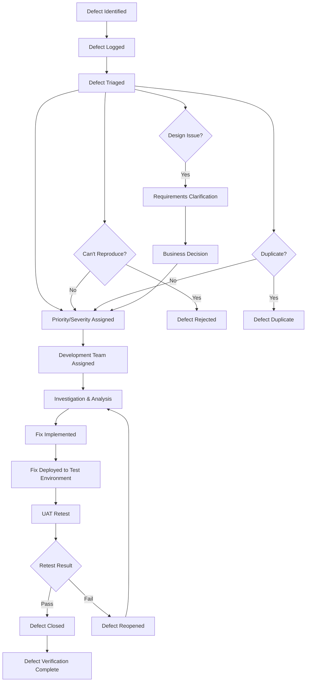

# UAT Defect Management Process
## GCC Web Application - User Acceptance Testing

**Document Version:** 1.0  
**Last Updated:** August 2025  
**Process Owner:** UAT Lead  
**Approval:** Project Manager, Product Owner

---

## 🎯 **Defect Management Objectives**

### **Primary Goals:**
✅ **Quality Assurance:** Ensure all defects are properly identified, documented, and resolved  
✅ **Traceability:** Maintain complete defect lifecycle tracking  
✅ **Prioritization:** Focus on critical issues that impact go-live readiness  
✅ **Communication:** Keep all stakeholders informed of defect status  
✅ **Continuous Improvement:** Learn from defects to prevent future issues  

### **Success Criteria:**
- 100% of identified defects logged and tracked
- <24 hours response time for critical defects
- >95% defect resolution within SLA
- Zero critical defects at UAT completion
- <5 high priority defects at go-live

---

## 🔄 **Defect Lifecycle**



---

## 📋 **Defect Classification**

### **Severity Levels**

#### **🔴 Critical (S1)**
**Definition:** Complete system failure or data corruption  
**Examples:**
- Application crashes or becomes unresponsive
- Data loss or corruption
- Security vulnerabilities
- Login completely broken for all users
- Complete loss of core functionality

**SLA:** 
- Response: <2 hours
- Resolution Target: <24 hours
- Stakeholder Notification: Immediate

#### **🟡 High (S2)**
**Definition:** Major functionality severely impacted  
**Examples:**
- Core feature not working (certificate creation/search)
- Major workflow broken
- Performance severely degraded
- Admin functions not accessible
- Data integrity issues

**SLA:**
- Response: <4 hours
- Resolution Target: <48 hours
- Stakeholder Notification: Same business day

#### **🟢 Medium (S3)**
**Definition:** Moderate impact with workaround available  
**Examples:**
- Minor functionality issues
- Usability problems
- Performance slightly degraded
- Cosmetic issues affecting user experience
- Non-critical validation errors

**SLA:**
- Response: <8 hours
- Resolution Target: <5 business days
- Stakeholder Notification: Weekly report

#### **⚪ Low (S4)**
**Definition:** Minor issues with minimal impact  
**Examples:**
- Minor cosmetic issues
- Spelling/grammar errors
- Minor alignment issues
- Enhancement requests
- Documentation errors

**SLA:**
- Response: <24 hours
- Resolution Target: Post go-live or next release
- Stakeholder Notification: Monthly summary

### **Priority Levels**

#### **🔥 P1 - Urgent**
- Blocks UAT progress
- Must be fixed before next test cycle
- Requires immediate attention

#### **⚡ P2 - High**
- Significant impact on testing
- Should be fixed within current sprint
- Affects multiple users or workflows

#### **📋 P3 - Normal**
- Standard defect processing
- Can be scheduled in normal development cycle
- Affects specific scenarios

#### **📝 P4 - Low**
- Nice to have fixes
- Can be deferred to post-launch
- Minimal business impact

---

## 📝 **Defect Logging Process**

### **Step 1: Defect Identification**

#### **When to Log a Defect:**
✅ Expected behavior differs from actual behavior  
✅ System error or exception occurs  
✅ Performance does not meet requirements  
✅ Usability issues impact user experience  
✅ Security concerns identified  
✅ Data accuracy or integrity issues  

#### **When NOT to Log a Defect:**
❌ Expected behavior (working as designed)  
❌ Missing features (scope/requirements issue)  
❌ Environment-specific issues  
❌ User error or misunderstanding  
❌ Enhancement requests outside scope  

### **Step 2: Defect Documentation**

#### **Required Information:**

**🔍 Defect Summary**
- Clear, concise title (max 80 characters)
- What happened vs. what was expected

**📋 Detailed Description**
```
STEPS TO REPRODUCE:
1. Navigate to [URL/page]
2. Perform [specific action]
3. Enter [specific data]
4. Click [specific button]
5. Observe result

EXPECTED RESULT:
[What should happen]

ACTUAL RESULT:
[What actually happened]

ADDITIONAL INFORMATION:
- Browser: [Chrome 116, Firefox 115, etc.]
- User Role: [Admin, Analyst, External]
- Test Case: [TC-AUTH-001]
- Environment: [UAT Test Environment]
```

**📷 Evidence**
- Screenshots of the issue
- Error messages (full text)
- Console logs (if applicable)
- Video recording (for complex issues)

**🏷️ Classification**
- Severity: S1/S2/S3/S4
- Priority: P1/P2/P3/P4
- Category: [Functional, UI, Performance, Security, etc.]
- Affected Component: [Authentication, Certificates, etc.]

### **Step 3: Defect Validation**

#### **Initial Review Checklist:**
- [ ] Can the defect be reproduced?
- [ ] Is it a duplicate of existing defect?
- [ ] Is the expected behavior correct per requirements?
- [ ] Is severity/priority appropriate?
- [ ] Is all required information provided?

#### **Review Outcomes:**
- **✅ Accepted:** Defect validated and ready for development
- **❌ Rejected:** Not a defect (working as designed, user error)
- **🔄 Duplicate:** Linked to existing defect
- **❓ Need More Info:** Additional details required
- **📋 Requirements Issue:** Needs business clarification

---

## 🔧 **Defect Resolution Process**

### **Development Team Workflow**

#### **Step 1: Analysis (Developer)**
- [ ] Reproduce the defect
- [ ] Analyze root cause
- [ ] Estimate effort for resolution
- [ ] Identify affected components
- [ ] Plan fix approach

#### **Step 2: Implementation (Developer)**
- [ ] Implement fix
- [ ] Perform unit testing
- [ ] Code review (if required)
- [ ] Update documentation

#### **Step 3: Deployment (DevOps/Developer)**
- [ ] Deploy fix to test environment
- [ ] Verify deployment successful
- [ ] Update environment status
- [ ] Notify UAT team fix is ready

#### **Step 4: Verification (UAT Team)**
- [ ] Execute original test case
- [ ] Verify defect is resolved
- [ ] Perform regression testing if needed
- [ ] Update defect status
- [ ] Close defect or reopen if needed

### **Defect Status Workflow**

| **Status** | **Description** | **Owner** | **Next Action** |
|------------|-----------------|-----------|-----------------|
| **New** | Just logged, awaiting triage | UAT Lead | Review and classify |
| **Open** | Accepted and ready for development | Dev Team | Analysis and assignment |
| **In Progress** | Being worked on by developer | Developer | Implement fix |
| **Resolved** | Fix completed, ready for testing | UAT Team | Retest and verify |
| **Closed** | Verified fixed by UAT team | - | Complete |
| **Reopened** | Retest failed, issue persists | Dev Team | Rework fix |
| **Rejected** | Not a defect or duplicate | - | Complete |
| **Deferred** | Will be addressed post-launch | Product Owner | Future planning |

---

## 📊 **Defect Tracking & Metrics**

### **Daily Defect Metrics**

#### **📈 Key Performance Indicators**
- **Defects Found:** Number of new defects logged
- **Defects Resolved:** Number moved to resolved status
- **Defects Closed:** Number verified and closed
- **Open Defects:** Total defects still open
- **Critical/High Defects:** Count of high-priority issues
- **Average Resolution Time:** By severity level

#### **📊 Daily Defect Dashboard**
```
UAT Defect Summary - [Date]

NEW TODAY: 
• Critical: X • High: X • Medium: X • Low: X

RESOLVED TODAY:
• Critical: X • High: X • Medium: X • Low: X

OPEN TOTAL:
• Critical: X • High: X • Medium: X • Low: X

AGING ANALYSIS:
• >5 days: X defects
• >10 days: X defects
• SLA Breaches: X defects

TOP CONCERNS:
• [Critical defect brief description]
• [Aging high priority defects]
• [Blocking issues]
```

### **Weekly Defect Analysis**

#### **🔍 Trend Analysis**
- Defect discovery rate trending
- Resolution rate trending
- Defect density by component
- Root cause analysis summary
- Process improvement opportunities

#### **📋 Quality Indicators**
- Defect leakage rate (post-resolution defects)
- Reopen rate
- SLA compliance
- Customer satisfaction with resolutions

---

## ⚠️ **Escalation Process**

### **Escalation Triggers**

#### **🚨 Immediate Escalation (Level 3)**
- Critical (S1) defects identified
- SLA breaches for High (S2) defects
- Multiple related defects suggesting systemic issue
- Defect resolution blocked by external dependencies
- Environment corruption preventing testing

#### **⚡ Same-Day Escalation (Level 2)**
- High (S2) defects impacting multiple test cases
- Defect volume exceeding capacity
- Resource conflicts preventing resolution
- Unclear requirements blocking defect resolution

#### **📋 Weekly Review Escalation (Level 1)**
- Medium (S3) defects aging >5 days
- Process improvement needs
- Resource optimization opportunities
- Quality trend concerns

### **Escalation Matrix**

| **Issue Type** | **Level 1: UAT Lead** | **Level 2: Project Manager** | **Level 3: Product Owner** |
|----------------|------------------------|-------------------------------|----------------------------|
| **Critical Defects** | Immediate notification | Resource mobilization | Go/No-Go decisions |
| **SLA Breaches** | Process adjustment | Resource reallocation | Timeline decisions |
| **Blocking Issues** | Workaround solutions | Escalation to vendors | Business decisions |
| **Quality Trends** | Process improvements | Resource planning | Scope decisions |

---

## 🛠️ **Defect Management Tools**

### **Primary Tools**

#### **📋 Defect Tracking System**
- **Tool:** Azure DevOps/Jira/ServiceNow
- **Purpose:** Complete defect lifecycle management
- **Features:** 
  - Automated workflows
  - Email notifications
  - Reporting and dashboards
  - Integration with development tools

#### **📊 Reporting Dashboard**
- **Tool:** Power BI/Tableau
- **Purpose:** Real-time defect metrics and trends
- **Features:**
  - Live data connections
  - Automated report generation
  - Mobile access
  - Stakeholder-specific views

### **Supporting Tools**

#### **📷 Screen Capture**
- **Tool:** Snagit/Greenshot
- **Purpose:** Defect evidence capture
- **Features:** Annotations, markup, integration

#### **📧 Communication**
- **Tool:** Teams/Slack
- **Purpose:** Defect discussions and notifications
- **Features:** Thread organization, file sharing

#### **🔄 Version Control**
- **Tool:** Git/Azure DevOps
- **Purpose:** Fix tracking and deployment
- **Features:** Branch management, merge tracking

---

## 📋 **Defect Templates**

### **Defect Report Template**

```
DEFECT ID: [Auto-generated]
DATE REPORTED: [MM/DD/YYYY]
REPORTED BY: [Tester Name]
TEST CASE: [TC-XXX-XXX]

SUMMARY: [Brief description of the issue]

SEVERITY: [ ] S1-Critical [ ] S2-High [ ] S3-Medium [ ] S4-Low
PRIORITY: [ ] P1-Urgent [ ] P2-High [ ] P3-Normal [ ] P4-Low

ENVIRONMENT:
• URL: https://localhost:5101
• Browser: [Chrome/Firefox/Edge + version]
• User Role: [Admin/Analyst/External/Public]
• Operating System: [Windows/Mac/iOS/Android]

STEPS TO REPRODUCE:
1. [Detailed step-by-step instructions]
2. [Include specific data used]
3. [Mention user credentials if applicable]
4. [Specify exact actions taken]

EXPECTED RESULT:
[What should have happened according to requirements]

ACTUAL RESULT:
[What actually happened - be specific]

WORKAROUND:
[If any workaround exists, describe it]

ATTACHMENTS:
[ ] Screenshot
[ ] Error logs
[ ] Video recording
[ ] Additional documentation

BUSINESS IMPACT:
[How this affects business operations or user experience]

ADDITIONAL NOTES:
[Any other relevant information]
```

### **Defect Status Update Template**

```
DEFECT UPDATE - [Defect ID]

STATUS CHANGE: [Previous Status] → [New Status]
UPDATED BY: [Name]
DATE: [MM/DD/YYYY]

WORK PERFORMED:
[Description of work done]

RESOLUTION DETAILS:
[How the issue was fixed]

TESTING NOTES:
[Verification steps performed]

NEXT STEPS:
[What needs to happen next]

ESTIMATED COMPLETION:
[When will this be ready for retest]
```

---

## 📈 **Success Metrics & KPIs**

### **Quality Metrics**

#### **🎯 Defect Resolution Effectiveness**
- **Target:** >95% defects resolved within SLA
- **Measurement:** (Defects resolved on time / Total defects) × 100
- **Reporting:** Daily dashboard, weekly trend

#### **🔄 Defect Reopen Rate**
- **Target:** <10% of resolved defects reopened
- **Measurement:** (Reopened defects / Total resolved defects) × 100
- **Reporting:** Weekly analysis

#### **⚡ Response Time Compliance**
- **Target:** 100% compliance with response SLAs
- **Measurement:** Average response time by severity
- **Reporting:** Daily monitoring, weekly summary

### **Process Metrics**

#### **📊 Defect Discovery Rate**
- **Target:** Decreasing trend over time
- **Measurement:** New defects per day/week
- **Reporting:** Trend analysis, milestone reviews

#### **🔧 Resolution Cycle Time**
- **Target:** Continuous improvement
- **Measurement:** Average time from open to closed
- **Reporting:** Weekly improvement tracking

#### **👥 Team Productivity**
- **Target:** Consistent resolution velocity
- **Measurement:** Defects resolved per team member per day
- **Reporting:** Resource optimization analysis

---

## ✅ **Quality Gates & Exit Criteria**

### **Defect-Based Exit Criteria**

#### **🚪 UAT Completion Criteria**
- ✅ Zero Critical (S1) defects open
- ✅ <5 High (S2) defects open (with approved risk assessment)
- ✅ All P1/P2 defects resolved or have approved mitigation
- ✅ >90% of all defects resolved
- ✅ No security vulnerabilities open
- ✅ All data integrity issues resolved

#### **🎯 Go-Live Readiness Criteria**
- ✅ All blocking defects resolved
- ✅ Acceptable defect volume and severity
- ✅ Business sign-off on remaining open defects
- ✅ Support team trained on known issues
- ✅ Contingency plans in place for identified risks

### **Process Quality Gates**

#### **📋 Weekly Quality Reviews**
- Defect trend analysis
- Root cause pattern identification
- Process improvement opportunities
- Resource adequacy assessment
- Risk mitigation effectiveness

---

This comprehensive defect management process ensures systematic tracking, resolution, and quality control throughout the UAT lifecycle, supporting successful project delivery with high-quality standards.