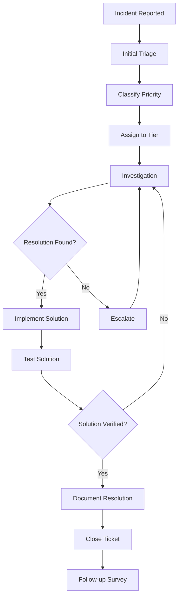

# GCC Database Solution - Support Procedures

## Table of Contents

1. [Support Framework Overview](#support-framework-overview)
2. [Support Tiers and Responsibilities](#support-tiers-and-responsibilities)
3. [Incident Management Process](#incident-management-process)
4. [Ticket Classification and Prioritization](#ticket-classification-and-prioritization)
5. [Escalation Procedures](#escalation-procedures)
6. [Communication Guidelines](#communication-guidelines)
7. [Support Tools and Systems](#support-tools-and-systems)
8. [Standard Operating Procedures](#standard-operating-procedures)
9. [Knowledge Management](#knowledge-management)
10. [Performance Metrics and SLAs](#performance-metrics-and-slas)
11. [Support Team Management](#support-team-management)
12. [Continuous Improvement](#continuous-improvement)

---

## Support Framework Overview

### Support Mission Statement

To provide timely, effective, and professional technical support for the GCC Database Solution, ensuring maximum system availability, user satisfaction, and business continuity while maintaining security and compliance standards.

### Support Objectives

**Primary Goals:**
- Minimize system downtime and user disruption
- Provide rapid resolution of technical issues
- Maintain high user satisfaction levels
- Ensure knowledge transfer and documentation
- Support business operations and compliance requirements
- Continuously improve support processes and procedures

**Key Performance Indicators:**
- First Call Resolution Rate: ≥ 75%
- Customer Satisfaction Score: ≥ 4.5/5.0
- Mean Time to Resolution (MTTR): ≤ 4 hours (Priority 1)
- Ticket Backlog: ≤ 5% of monthly volume
- Knowledge Base Accuracy: ≥ 95%

### Support Coverage

**Operating Hours:**
- **Standard Support:** Monday-Friday, 8:00 AM - 6:00 PM EST
- **Extended Support:** Monday-Friday, 6:00 AM - 10:00 PM EST
- **Emergency Support:** 24/7 for Priority 1 incidents
- **Holiday Support:** Emergency support only on holidays

**Support Channels:**
- Email: support@greencirclecertified.com
- Phone: [Support phone number]
- Web Portal: [Support portal URL]
- Emergency Hotline: [Emergency number] (Priority 1 only)
- Chat Support: Available during standard hours

**Supported Languages:**
- English (Primary)
- Spanish (Limited support)
- Additional languages on request

---

## Support Tiers and Responsibilities

### Tier 1 Support (Help Desk)

**Responsibilities:**
- Initial incident intake and classification
- Basic troubleshooting and resolution
- Password resets and account unlocks
- User guidance and basic training
- Ticket documentation and routing
- Knowledge base maintenance

**Required Skills:**
- Customer service excellence
- Basic system knowledge
- Troubleshooting methodology
- Communication skills
- Documentation skills

**Typical Issues Handled:**
- Login problems
- Password resets
- Basic navigation questions
- Simple configuration issues
- User account management
- Basic search and filter issues

**Resolution Targets:**
- Password Reset: 15 minutes
- Account Unlock: 15 minutes
- Basic Questions: 30 minutes
- Simple Issues: 1 hour

**Escalation Criteria:**
- Technical complexity beyond basic troubleshooting
- System-wide issues affecting multiple users
- Security-related incidents
- Database or infrastructure problems
- Issues requiring administrative access

### Tier 2 Support (Technical Support)

**Responsibilities:**
- Advanced troubleshooting and resolution
- System configuration support
- User training and guidance
- Application-specific issues
- Integration support
- Escalated Tier 1 tickets

**Required Skills:**
- Advanced system knowledge
- Technical troubleshooting expertise
- Database query capabilities
- Log analysis skills
- Integration knowledge
- Customer communication

**Typical Issues Handled:**
- Application performance problems
- Certificate management issues
- Export and download problems
- User permission and role issues
- API integration problems
- Data integrity concerns

**Resolution Targets:**
- Standard Issues: 4 hours
- Complex Issues: 8 hours
- User Training: 2 hours
- Configuration Changes: 1 hour

**Escalation Criteria:**
- Database administration required
- System architecture changes needed
- Security incidents requiring investigation
- Infrastructure-level problems
- Issues requiring development changes

### Tier 3 Support (Expert Level)

**Responsibilities:**
- Complex system administration
- Database administration and optimization
- Security incident response
- System architecture support
- Development coordination
- Root cause analysis

**Required Skills:**
- Expert system knowledge
- Database administration
- Security expertise
- System architecture understanding
- Development background
- Project management

**Typical Issues Handled:**
- Database performance optimization
- Security incident investigation
- System architecture problems
- Complex integration issues
- Data migration and recovery
- Custom development requests

**Resolution Targets:**
- Critical Issues: 2 hours
- Complex Issues: 24 hours
- Security Incidents: 1 hour initial response
- Development Issues: Coordinate with development team

**Escalation Criteria:**
- External vendor involvement required
- Major system changes needed
- Legal or compliance issues
- Executive-level decision required

---

## Incident Management Process

### Incident Lifecycle



### Incident Intake Process

**Step 1: Initial Contact**
- Record incident details
- Gather contact information
- Assign unique ticket number
- Acknowledge receipt within 15 minutes

**Step 2: Initial Assessment**
- Classify incident type and priority
- Identify affected systems/users
- Determine initial impact assessment
- Set initial response expectations

**Step 3: Assignment**
- Route to appropriate support tier
- Assign to available team member
- Update ticket status and priority
- Begin response timer

**Information Collection Standards:**
- User contact information
- System/browser being used
- Detailed problem description
- Steps to reproduce the issue
- Error messages (screenshots preferred)
- Business impact assessment
- Urgency level

### Incident Documentation Requirements

**Mandatory Fields:**
- Ticket ID and creation timestamp
- Reporter contact information
- Problem description and symptoms
- Priority and classification
- Assigned technician
- Initial troubleshooting steps
- Resolution details
- Time tracking information

**Progress Updates:**
- Initial response within SLA timeframe
- Progress updates every 2 hours for P1/P2
- Daily updates for P3/P4
- Stakeholder notifications for major incidents
- Final resolution summary

---

## Ticket Classification and Prioritization

### Priority Levels

**Priority 1 - Critical**
- **Definition:** Complete system outage or security breach
- **Response Time:** 15 minutes
- **Resolution Target:** 2 hours
- **Business Impact:** Severe - Complete business disruption
- **Examples:**
  - System completely unavailable
  - Database corruption or failure
  - Security breach or data compromise
  - Payment processing failure

**Priority 2 - High**
- **Definition:** Major functionality impaired
- **Response Time:** 1 hour
- **Resolution Target:** 4 hours
- **Business Impact:** High - Major business disruption
- **Examples:**
  - Login system failure
  - Certificate creation/editing broken
  - API endpoints completely down
  - Major performance degradation

**Priority 3 - Medium**
- **Definition:** Moderate functionality impaired
- **Response Time:** 4 hours
- **Resolution Target:** 24 hours
- **Business Impact:** Medium - Some business disruption
- **Examples:**
  - Search functionality issues
  - Export/download problems
  - User interface problems
  - Minor performance issues

**Priority 4 - Low**
- **Definition:** Minor issues or enhancement requests
- **Response Time:** 24 hours
- **Resolution Target:** 72 hours
- **Business Impact:** Low - Minimal business impact
- **Examples:**
  - Cosmetic issues
  - Enhancement requests
  - Documentation updates
  - User training requests

### Issue Classification

**Technical Issues:**
- Application errors
- Performance problems
- Integration failures
- Database issues
- Infrastructure problems

**User Issues:**
- Access problems
- Training needs
- Feature requests
- Configuration questions
- Process clarification

**Security Issues:**
- Unauthorized access attempts
- Data integrity concerns
- Compliance violations
- Policy enforcement
- Audit findings

**Business Issues:**
- Process improvements
- Requirements changes
- New feature requests
- Integration requirements
- Compliance updates

### Priority Matrix

| Impact / Urgency | High Urgency | Medium Urgency | Low Urgency |
|-----------------|--------------|----------------|-------------|
| **High Impact**     | Priority 1   | Priority 2     | Priority 3  |
| **Medium Impact**   | Priority 2   | Priority 3     | Priority 4  |
| **Low Impact**      | Priority 3   | Priority 4     | Priority 4  |

**Impact Definitions:**
- **High:** Affects critical business functions or multiple users
- **Medium:** Affects important functions or limited users
- **Low:** Affects non-critical functions or single user

**Urgency Definitions:**
- **High:** Immediate business need, workaround not available
- **Medium:** Important business need, limited workaround available
- **Low:** Can be delayed, workaround available

---

## Escalation Procedures

### Escalation Triggers

**Technical Escalation:**
- Issue complexity exceeds current tier capability
- Resolution time approaching SLA breach
- Multiple related incidents indicating systemic issue
- Customer request for escalation
- Security or compliance implications

**Management Escalation:**
- SLA breach has occurred
- Customer dissatisfaction expressed
- Media or public attention involved
- Legal implications identified
- Executive customer involvement

### Escalation Paths

**Technical Escalation Path:**
1. Tier 1 → Tier 2 Support
2. Tier 2 → Tier 3 Support
3. Tier 3 → Development Team
4. Development → Architecture Team
5. Architecture → External Vendors

**Management Escalation Path:**
1. Support Agent → Team Lead
2. Team Lead → Support Manager
3. Support Manager → IT Director
4. IT Director → CTO
5. CTO → Executive Team

### Escalation Procedures

**Step 1: Decision to Escalate**
- Document escalation rationale
- Update ticket with current status
- Notify customer of escalation
- Prepare escalation briefing

**Step 2: Escalation Handoff**
- Brief receiving team/person
- Transfer all relevant information
- Maintain ownership until handoff confirmed
- Update ticket assignment and status

**Step 3: Escalation Monitoring**
- Monitor progress of escalated ticket
- Provide updates to customer
- Coordinate with escalated team
- Document resolution for knowledge base

**Escalation Documentation:**
- Escalation trigger and rationale
- Current troubleshooting status
- Business impact assessment
- Customer communication history
- Technical details and logs
- Recommended next steps

---

## Communication Guidelines

### Customer Communication Standards

**Communication Principles:**
- Professional and courteous tone
- Clear and concise language
- Timely and proactive updates
- Empathy and understanding
- Technical accuracy
- Consistent messaging

**Initial Response Template:**
```
Subject: [Ticket #12345] Issue Acknowledgment - [Brief Description]

Dear [Customer Name],

Thank you for contacting GCC Database Solution Support. We have received your request and assigned ticket #12345 for tracking purposes.

Issue Summary: [Brief description of reported issue]
Priority Level: [Priority level and justification]
Assigned Technician: [Name and contact information]
Expected Response: [Next steps and timeline]

We will investigate this issue and provide an update within [timeframe] or sooner if resolved.

Best regards,
[Agent Name]
GCC Database Solution Support Team
```

**Progress Update Template:**
```
Subject: [Ticket #12345] Progress Update - [Brief Description]

Dear [Customer Name],

I wanted to provide you with an update on your support request #12345.

Current Status: [Current investigation status]
Actions Taken: [Steps completed so far]
Next Steps: [Planned next actions]
Expected Timeline: [Updated resolution estimate]

[Any additional relevant information]

Please don't hesitate to contact me if you have any questions.

Best regards,
[Agent Name]
```

**Resolution Template:**
```
Subject: [Ticket #12345] Issue Resolved - [Brief Description]

Dear [Customer Name],

I'm pleased to inform you that we have resolved your support request #12345.

Resolution Summary: [Brief description of solution]
Root Cause: [What caused the issue]
Actions Taken: [Steps taken to resolve]
Prevention: [Steps to prevent recurrence]

Please test the resolution and confirm that the issue is fully resolved. If you experience any further problems, please respond to this email or create a new support request.

We will be sending you a brief satisfaction survey shortly. Your feedback helps us improve our support services.

Thank you for your patience during the resolution process.

Best regards,
[Agent Name]
```

### Internal Communication Protocols

**Team Communication:**
- Daily standup meetings
- Weekly team meetings
- Monthly metrics reviews
- Quarterly process reviews
- Ad-hoc escalation calls

**Documentation Standards:**
- Use standardized templates
- Include all relevant technical details
- Document workarounds and solutions
- Update knowledge base entries
- Maintain ticket history integrity

**Escalation Communication:**
- Clear handoff procedures
- Complete information transfer
- Continued collaboration
- Regular status updates
- Post-resolution analysis

---

## Support Tools and Systems

### Ticketing System

**Primary Features:**
- Ticket creation and tracking
- Priority and classification management
- Assignment and routing
- Time tracking
- Customer communication history
- Knowledge base integration
- Reporting and analytics

**Ticket Workflow:**
1. Incident reported via various channels
2. Automatic ticket creation
3. Initial triage and classification
4. Assignment to appropriate tier
5. Investigation and resolution
6. Customer verification
7. Ticket closure and documentation

### Knowledge Base System

**Content Types:**
- Common issue resolutions
- Step-by-step procedures
- Configuration guides
- Troubleshooting flowcharts
- Error code explanations
- Best practices documentation

**Maintenance Procedures:**
- Regular content review and updates
- Accuracy verification
- Usage analytics monitoring
- Feedback incorporation
- Version control management

### Monitoring and Alerting Systems

**System Monitoring:**
- Application performance monitoring
- Database performance tracking
- Infrastructure health monitoring
- Security event monitoring
- User activity monitoring

**Alert Types:**
- System outages
- Performance degradation
- Security incidents
- Backup failures
- Capacity thresholds

### Remote Support Tools

**Available Tools:**
- Screen sharing software
- Remote desktop access (with permission)
- Log file analysis tools
- Database query tools
- Network diagnostic utilities

**Security Requirements:**
- Customer consent required
- Session recording for security
- Limited access permissions
- Audit trail maintenance
- Secure connection protocols

### Communication Tools

**Internal Communication:**
- Team chat system (Slack/Teams)
- Video conferencing
- Shared documentation platform
- Internal knowledge sharing
- Escalation notification system

**Customer Communication:**
- Email system integration
- Phone system with call logging
- Chat support platform
- Customer portal
- Status page updates

---

## Standard Operating Procedures

### Common Issue Resolution Procedures

#### Password Reset Procedure

**Symptoms:** User cannot log in, forgot password
**Priority:** P4 (unless urgent business need)
**Resolution Time:** 15 minutes

**Steps:**
1. Verify user identity
   - Confirm email address
   - Verify personal information
   - Check account status
2. Initiate password reset
   - Use admin panel reset function
   - Send reset email to user
   - Verify email delivery
3. Guide user through reset process
   - Explain reset email steps
   - Assist with new password creation
   - Verify password meets requirements
4. Test new login
   - Have user attempt login
   - Verify successful access
   - Update ticket with resolution

**Knowledge Base Link:** KB-001-Password-Reset
**Common Issues:** Email not received, password requirements not met

#### Account Unlock Procedure

**Symptoms:** Account locked due to failed login attempts
**Priority:** P3 (P2 if critical user)
**Resolution Time:** 15 minutes

**Steps:**
1. Verify lock status
   - Check admin panel for lock status
   - Review audit logs for lock cause
   - Confirm user identity
2. Unlock account
   - Use admin unlock function
   - Reset failed attempt counter
   - Document unlock action
3. Prevent recurrence
   - Educate user on password policy
   - Recommend password manager
   - Check for security concerns

**Knowledge Base Link:** KB-002-Account-Unlock
**Common Issues:** Caps lock issues, browser password managers

#### Search Not Working Procedure

**Symptoms:** Search returns no results or errors
**Priority:** P3 (P2 if affecting multiple users)
**Resolution Time:** 1 hour

**Steps:**
1. Reproduce issue
   - Test search functionality
   - Try different search terms
   - Check with different user accounts
2. Check system status
   - Verify database connectivity
   - Check application logs
   - Review recent deployments
3. Analyze search terms
   - Verify search syntax
   - Check for special characters
   - Test with known certificate data
4. Clear cache if needed
   - Clear browser cache
   - Clear application cache
   - Restart application if necessary

**Knowledge Base Link:** KB-003-Search-Issues
**Common Issues:** Browser cache, special characters, database connectivity

#### Certificate Download Failure

**Symptoms:** Download button not working or files corrupted
**Priority:** P3 (P2 if affecting business operations)
**Resolution Time:** 2 hours

**Steps:**
1. Test download functionality
   - Attempt download with different browsers
   - Try different certificate files
   - Check file integrity
2. Check file storage
   - Verify file exists on server
   - Check file permissions
   - Test storage connectivity
3. Browser troubleshooting
   - Clear browser cache
   - Disable browser extensions
   - Check popup blockers
4. Alternative download methods
   - Provide direct file link
   - Email file if necessary
   - Use different export format

**Knowledge Base Link:** KB-004-Download-Issues
**Common Issues:** Browser popup blockers, file permissions, storage issues

### System Administration Procedures

#### Database Connectivity Issues

**Symptoms:** Application can't connect to database
**Priority:** P1 (if system-wide) or P2 (if limited users)
**Resolution Time:** 1-2 hours

**Steps:**
1. Verify database status
   - Check database service status
   - Test direct database connection
   - Review database error logs
2. Check application configuration
   - Verify connection strings
   - Check application settings
   - Review recent configuration changes
3. Network diagnostics
   - Test network connectivity
   - Check firewall settings
   - Verify DNS resolution
4. Restart services if needed
   - Database service restart
   - Application service restart
   - Clear connection pools

**Knowledge Base Link:** KB-101-Database-Connectivity
**Escalation:** Tier 3 if database corruption suspected

#### Application Performance Issues

**Symptoms:** Slow page loads, timeouts, high resource usage
**Priority:** P2 (P1 if severely impacting users)
**Resolution Time:** 2-4 hours

**Steps:**
1. Performance monitoring
   - Check CPU and memory usage
   - Monitor database performance
   - Review network latency
2. Identify bottlenecks
   - Analyze application logs
   - Check slow query logs
   - Review recent code changes
3. Apply immediate fixes
   - Restart application pools
   - Clear caches
   - Kill long-running processes
4. Long-term optimization
   - Database index optimization
   - Query optimization
   - Infrastructure scaling

**Knowledge Base Link:** KB-102-Performance-Issues
**Escalation:** Tier 3 for infrastructure changes

### Emergency Procedures

#### System Outage Response

**Priority:** P1
**Response Time:** Immediate
**Initial Actions:**
1. Acknowledge outage
2. Assemble response team
3. Begin status page updates
4. Start incident communication

**Detailed Response:**
1. **Assessment (0-15 minutes)**
   - Confirm outage scope
   - Identify potential causes
   - Gather initial diagnostic information
   - Notify stakeholders

2. **Initial Response (15-30 minutes)**
   - Implement immediate fixes if known
   - Begin detailed investigation
   - Continue status updates
   - Coordinate with technical teams

3. **Investigation (30+ minutes)**
   - Deep dive into root cause
   - Test potential solutions
   - Coordinate with vendors if needed
   - Prepare rollback plans

4. **Resolution**
   - Implement verified solution
   - Monitor system stability
   - Verify user access
   - Update status and communications

5. **Post-Incident**
   - Conduct post-mortem
   - Document lessons learned
   - Update procedures
   - Communicate final resolution

**Knowledge Base Link:** KB-201-System-Outage
**Escalation:** Immediate to Tier 3 and management

---

## Knowledge Management

### Knowledge Base Structure

**Categories:**
- Common Issues and Resolutions
- Step-by-Step Procedures
- Error Code References
- Configuration Guides
- Best Practices
- Training Materials
- API Documentation
- Troubleshooting Flowcharts

**Content Standards:**
- Clear, concise language
- Step-by-step instructions
- Screenshots and examples
- Testing procedures
- Related articles links
- Feedback mechanisms

### Knowledge Creation Process

**Article Development:**
1. Identify knowledge gap
2. Research and document solution
3. Peer review and testing
4. Approval and publication
5. Feedback collection and updates

**Review Cycle:**
- Monthly accuracy review
- Quarterly content audit
- Annual complete review
- Immediate updates for errors

### Knowledge Sharing

**Internal Sharing:**
- Weekly knowledge sharing sessions
- Monthly best practices review
- Quarterly training updates
- Annual knowledge transfer

**Customer Sharing:**
- Public knowledge base
- FAQ sections
- Video tutorials
- User community forums

---

## Performance Metrics and SLAs

### Service Level Agreements

**Response Time SLAs:**
- Priority 1: 15 minutes
- Priority 2: 1 hour
- Priority 3: 4 hours
- Priority 4: 24 hours

**Resolution Time SLAs:**
- Priority 1: 2 hours
- Priority 2: 4 hours
- Priority 3: 24 hours
- Priority 4: 72 hours

**Availability SLAs:**
- System Availability: 99.9% uptime
- Support Availability: 99.5% during business hours
- Response Success Rate: 99% within SLA timeframes

### Key Performance Indicators

**Efficiency Metrics:**
- First Call Resolution Rate: ≥ 75%
- Average Resolution Time by Priority
- Ticket Backlog Size: ≤ 5% of monthly volume
- Escalation Rate: ≤ 15% of total tickets

**Quality Metrics:**
- Customer Satisfaction Score: ≥ 4.5/5.0
- Solution Accuracy Rate: ≥ 95%
- Knowledge Base Usage Rate: ≥ 80%
- Repeat Issue Rate: ≤ 10%

**Productivity Metrics:**
- Tickets Resolved per Agent per Day
- Time Spent per Ticket by Category
- Knowledge Base Article Usage
- Training Completion Rates

### Reporting and Analytics

**Daily Reports:**
- Ticket volume and priority distribution
- Response time performance
- Agent productivity metrics
- Critical issue status

**Weekly Reports:**
- SLA compliance summary
- Customer satisfaction trends
- Knowledge base effectiveness
- Training and development needs

**Monthly Reports:**
- Comprehensive performance analysis
- Trend analysis and forecasting
- Process improvement recommendations
- Resource planning insights

**Quarterly Reports:**
- Strategic performance review
- Customer feedback analysis
- Process optimization results
- Technology and tool evaluation

---

## Support Team Management

### Team Structure

**Support Manager:**
- Overall team leadership
- Process improvement
- SLA management
- Stakeholder communication

**Team Leads (by Tier):**
- Day-to-day team management
- Quality assurance
- Training coordination
- Escalation management

**Support Agents:**
- Direct customer support
- Issue resolution
- Documentation
- Knowledge sharing

### Staffing Model

**Coverage Requirements:**
- Tier 1: 4 agents during business hours
- Tier 2: 2 agents during business hours
- Tier 3: 1 agent on-call 24/7
- Management: 1 manager, 2 team leads

**Scheduling:**
- Standard business hours coverage
- Extended hours rotation
- Weekend emergency coverage
- Holiday coverage planning

### Training and Development

**Initial Training Program:**
- 2-week intensive training
- System knowledge certification
- Customer service training
- Process and procedure training

**Ongoing Development:**
- Weekly skill development sessions
- Monthly product updates
- Quarterly advanced training
- Annual professional development

**Career Progression:**
- Clear advancement paths
- Skill-based progression
- Leadership development
- Cross-functional opportunities

### Performance Management

**Individual Performance Metrics:**
- SLA compliance rates
- Customer satisfaction scores
- Quality assessment scores
- Knowledge sharing contributions

**Performance Review Process:**
- Weekly one-on-ones
- Monthly performance reviews
- Quarterly goal setting
- Annual comprehensive reviews

**Recognition and Incentives:**
- Monthly recognition programs
- Quarterly performance bonuses
- Annual awards ceremony
- Professional development opportunities

---

## Continuous Improvement

### Process Improvement Framework

**Improvement Process:**
1. Identify improvement opportunities
2. Analyze current state
3. Design improved process
4. Test and validate changes
5. Implement and monitor
6. Measure and adjust

**Improvement Sources:**
- Customer feedback
- Agent suggestions
- Performance metrics
- Industry best practices
- Technology advances

### Quality Assurance

**Quality Monitoring:**
- Random ticket reviews
- Customer interaction monitoring
- Process compliance audits
- Knowledge base accuracy checks

**Quality Standards:**
- Professional communication
- Accurate technical solutions
- Complete documentation
- Timely responses
- Customer satisfaction

### Feedback Mechanisms

**Customer Feedback:**
- Post-resolution surveys
- Annual satisfaction surveys
- Focus group sessions
- Community feedback

**Internal Feedback:**
- Agent suggestion program
- Team retrospectives
- Process improvement meetings
- Cross-team collaboration sessions

### Technology and Tool Evaluation

**Regular Assessments:**
- Annual tool evaluation
- Technology trend analysis
- Vendor relationship reviews
- ROI assessments

**Implementation Planning:**
- Phased rollout approach
- Training requirements
- Change management
- Success metrics definition

---

## Document Information

**Support Procedures Version:** 1.0
**Last Updated:** September 17, 2025
**Next Review Date:** December 17, 2025
**Document Owner:** GCC Support Team
**Approval:** [Support Manager Signature]

---

## Document History

| Version | Date | Changes | Author |
|---------|------|---------|--------|
| 1.0 | 2025-09-17 | Initial support procedures creation | GCC Support Team |

---

## Emergency Contacts

**Support Manager:** [Phone] [Email]
**Tier 3 On-Call:** [Phone] [Email]
**IT Director:** [Phone] [Email]
**Security Team:** [Phone] [Email]
**Executive Escalation:** [Phone] [Email]

---

*These support procedures should be regularly reviewed and updated to reflect current practices, technologies, and organizational needs. All support team members must be familiar with these procedures and follow them consistently.*