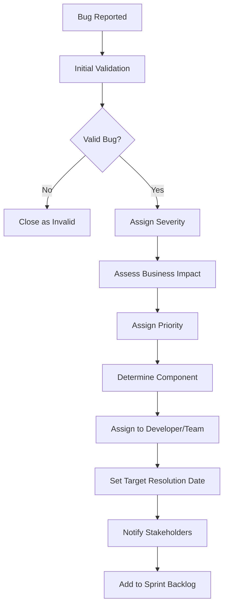
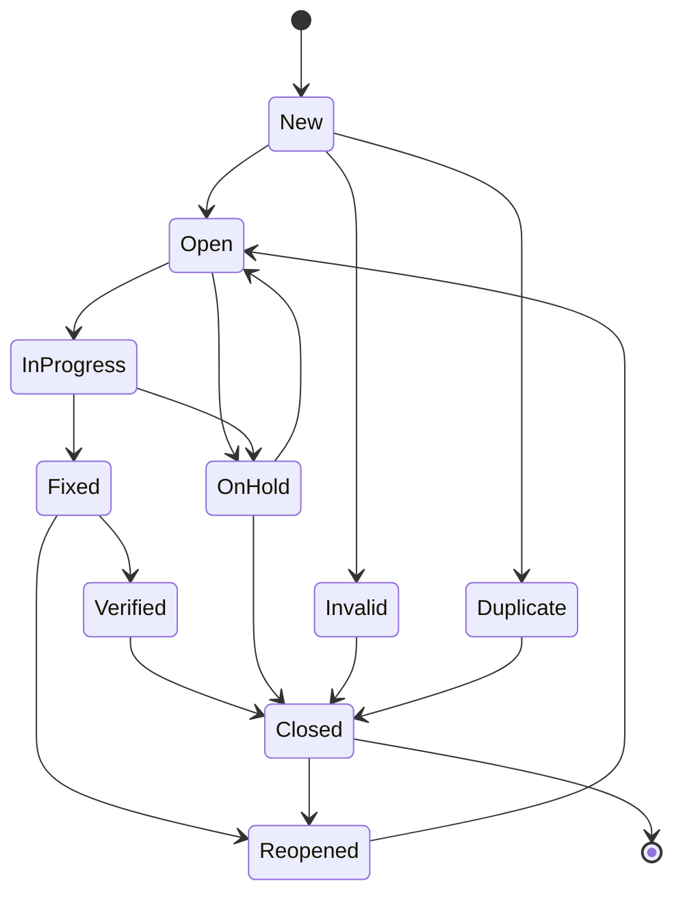

# Bug Triage & Escalation Process
## GCC Database Solution Project

### Document Information
- **Version:** 1.0
- **Created Date:** September 17, 2025
- **Document Type:** Bug Management Process and Procedures
- **Classification:** INTERNAL

---

## 1. Executive Summary

### 1.1 Purpose
This document defines the comprehensive bug triage and escalation process for the GCC Database Solution project. It establishes clear procedures for bug identification, classification, prioritization, assignment, tracking, and resolution to ensure efficient defect management throughout the software development lifecycle.

### 1.2 Scope
**In Scope:**
- Bug identification and reporting procedures
- Bug classification and severity assessment
- Priority assignment and escalation criteria
- Assignment workflows and responsibility matrix
- Bug lifecycle management and tracking
- Communication and notification protocols
- Resolution and verification procedures

**Out of Scope:**
- Feature requests and enhancement management
- Third-party vendor defect management
- Hardware-related issue management
- Infrastructure problem escalation

### 1.3 Objectives
- **Rapid Response:** Ensure critical bugs are addressed within defined SLAs
- **Clear Communication:** Maintain transparent communication about bug status
- **Efficient Resolution:** Optimize resource allocation for bug fixes
- **Quality Assurance:** Prevent bug recurrence through root cause analysis
- **Continuous Improvement:** Enhance development processes based on bug patterns

---

## 2. Bug Classification Framework

### 2.1 Severity Classification

#### 2.1.1 Severity Definitions
| Severity | Definition | Impact | Examples |
|----------|------------|--------|----------|
| **Critical (S1)** | System crashes, data loss, security vulnerabilities | Business operations halted | Application won't start, database corruption, security breach |
| **High (S2)** | Major feature completely broken, significant performance degradation | Major business impact | Cannot create certificates, login fails for all users |
| **Medium (S3)** | Feature partially works, minor performance issues | Moderate business impact | Search returns partial results, slow page loading |
| **Low (S4)** | Cosmetic issues, minor inconveniences | Minimal business impact | UI alignment issues, spelling errors |

#### 2.1.2 Priority Classification
| Priority | Definition | Business Impact | Response Time |
|----------|------------|-----------------|---------------|
| **P1 - Critical** | Immediate action required | Severe business disruption | 2 hours |
| **P2 - High** | Action required within current sprint | Significant business impact | 8 hours |
| **P3 - Medium** | Action required within next release | Moderate business impact | 24 hours |
| **P4 - Low** | Action can be scheduled for future release | Minor business impact | 72 hours |

### 2.2 Bug Categories

#### 2.2.1 Functional Categories
| Category | Description | Examples |
|----------|-------------|----------|
| **Authentication** | Login, logout, password reset issues | Cannot login, session timeout issues |
| **Authorization** | Access control and permission issues | Unauthorized access, role assignment problems |
| **Certificate Management** | Core certificate functionality issues | Cannot create/edit certificates, workflow problems |
| **Search & Filter** | Search and filtering functionality | Search returns wrong results, filters not working |
| **Dashboard** | Analytics and reporting issues | Charts not loading, incorrect data display |
| **API** | RESTful API endpoint issues | API returns errors, incorrect responses |
| **Data Export** | PDF, CSV, Excel export issues | Export fails, corrupted files |
| **UI/UX** | User interface and experience issues | Layout problems, accessibility issues |

#### 2.2.2 Technical Categories
| Category | Description | Examples |
|----------|-------------|----------|
| **Database** | Database-related issues | Slow queries, connection problems |
| **Performance** | System performance issues | Slow page loads, timeout errors |
| **Security** | Security vulnerabilities | XSS, SQL injection, authentication bypass |
| **Integration** | Third-party integration issues | Azure AD B2C problems, partner API failures |
| **Infrastructure** | Deployment and infrastructure issues | Container startup failures, configuration errors |

---

## 3. Bug Triage Process

### 3.1 Bug Identification and Reporting

#### 3.1.1 Bug Discovery Sources
```markdown
## Bug Discovery Channels
1. **Automated Testing**
   - Unit test failures
   - Integration test failures
   - UI test failures
   - Performance test alerts
   - Security scan results

2. **Manual Testing**
   - QA team testing
   - User acceptance testing
   - Exploratory testing
   - Regression testing

3. **Production Monitoring**
   - Application performance monitoring
   - Error tracking systems
   - User feedback
   - Support tickets

4. **Development Activities**
   - Code reviews
   - Static code analysis
   - Developer testing
   - Peer reviews
```

#### 3.1.2 Bug Reporting Template
```markdown
# Bug Report Template

## Bug Information
- **Bug ID:** [Auto-generated or BUG-YYYY-MM-DD-###]
- **Title:** [Brief, descriptive title]
- **Reporter:** [Name and role]
- **Date Reported:** [Date and time]
- **Environment:** [Development/Test/Staging/Production]
- **Version:** [Application version]

## Bug Details
### Summary
[Brief description of the bug]

### Steps to Reproduce
1. [Detailed step-by-step instructions]
2. [Include specific data used]
3. [Note any preconditions required]

### Expected Behavior
[What should happen]

### Actual Behavior
[What actually happens]

### Impact Assessment
- **Users Affected:** [Number or percentage]
- **Business Impact:** [Description of business impact]
- **Frequency:** [How often does this occur]
- **Workaround Available:** [Yes/No - describe if yes]

## Technical Information
### Environment Details
- **Browser:** [Chrome 118.0, Firefox 119.0, etc.]
- **Operating System:** [Windows 11, macOS 14, etc.]
- **Screen Resolution:** [1920x1080, 375x667, etc.]
- **Device Type:** [Desktop, Tablet, Mobile]

### Evidence
- [ ] Screenshot attached
- [ ] Video recording attached
- [ ] Log files attached
- [ ] Network traces attached
- [ ] Browser console errors captured

### Test Data
[Specific data that caused the issue]

## Classification (To be filled by triage team)
- **Severity:** [Critical/High/Medium/Low]
- **Priority:** [P1/P2/P3/P4]
- **Category:** [Functional category]
- **Component:** [Technical component]
- **Assignee:** [Developer/Team assigned]
- **Labels:** [Tags for tracking]

## Additional Information
[Any other relevant information]
```

### 3.2 Initial Triage Process

#### 3.2.1 Triage Team Structure
| Role | Responsibility | Authority |
|------|----------------|-----------|
| **Triage Lead** | Overall triage coordination, final decisions | Severity/Priority assignment |
| **QA Lead** | Technical assessment, test coverage validation | Classification recommendations |
| **Development Lead** | Technical feasibility, effort estimation | Assignment decisions |
| **Product Owner** | Business impact assessment, priority guidance | Business priority decisions |
| **Support Representative** | Customer impact assessment | User impact evaluation |

#### 3.2.2 Triage Process Flow


#### 3.2.3 Triage Criteria and Guidelines
```markdown
## Severity Assessment Guidelines

### Critical (S1) Criteria
- [ ] System completely unusable
- [ ] Data corruption or loss occurs
- [ ] Security vulnerability with immediate risk
- [ ] Complete loss of primary functionality
- [ ] Affects all users or critical user groups

### High (S2) Criteria
- [ ] Major feature completely broken
- [ ] Significant performance degradation (>50% slower)
- [ ] Affects large percentage of users (>25%)
- [ ] No reasonable workaround available
- [ ] Impacts primary business functions

### Medium (S3) Criteria
- [ ] Feature partially functional
- [ ] Moderate performance impact (<50% degradation)
- [ ] Affects moderate number of users (<25%)
- [ ] Workaround available but inconvenient
- [ ] Impacts secondary business functions

### Low (S4) Criteria
- [ ] Cosmetic or minor functional issues
- [ ] Minimal performance impact
- [ ] Affects few users (<5%)
- [ ] Easy workaround available
- [ ] No significant business impact
```

### 3.3 Automated Triage Support

#### 3.3.1 Automated Bug Classification
```csharp
// Automated bug classification service
public class BugClassificationService
{
    public async Task<BugClassification> ClassifyBugAsync(BugReport bugReport)
    {
        var classification = new BugClassification();

        // Analyze keywords for severity indicators
        classification.SuggestedSeverity = AnalyzeSeverityKeywords(bugReport);

        // Determine component based on error details
        classification.Component = DetermineComponent(bugReport);

        // Assess business impact based on affected features
        classification.BusinessImpact = AssessBusinessImpact(bugReport);

        // Calculate priority score
        classification.PriorityScore = CalculatePriorityScore(bugReport);

        // Suggest assignee based on component and expertise
        classification.SuggestedAssignee = await SuggestAssigneeAsync(classification.Component);

        return classification;
    }

    private Severity AnalyzeSeverityKeywords(BugReport bugReport)
    {
        var content = $"{bugReport.Title} {bugReport.Description}".ToLower();

        // Critical keywords
        var criticalKeywords = new[] { "crash", "hang", "data loss", "security", "cannot login", "complete failure" };
        if (criticalKeywords.Any(keyword => content.Contains(keyword)))
            return Severity.Critical;

        // High keywords
        var highKeywords = new[] { "broken", "error", "exception", "timeout", "performance" };
        if (highKeywords.Any(keyword => content.Contains(keyword)))
            return Severity.High;

        // Medium keywords
        var mediumKeywords = new[] { "slow", "inconsistent", "partial", "sometimes" };
        if (mediumKeywords.Any(keyword => content.Contains(keyword)))
            return Severity.Medium;

        return Severity.Low;
    }

    private string DetermineComponent(BugReport bugReport)
    {
        var stackTrace = bugReport.StackTrace?.ToLower() ?? "";
        var description = bugReport.Description.ToLower();

        if (stackTrace.Contains("certificate") || description.Contains("certificate"))
            return "Certificate Management";

        if (stackTrace.Contains("authentication") || description.Contains("login"))
            return "Authentication";

        if (stackTrace.Contains("dashboard") || description.Contains("dashboard"))
            return "Dashboard";

        if (stackTrace.Contains("api") || description.Contains("api"))
            return "API";

        return "General";
    }
}
```

#### 3.3.2 Automated Notification System
```csharp
// Bug notification service
public class BugNotificationService
{
    public async Task NotifyStakeholdersAsync(Bug bug, BugEventType eventType)
    {
        var notifications = await GenerateNotificationsAsync(bug, eventType);

        foreach (var notification in notifications)
        {
            switch (notification.DeliveryMethod)
            {
                case NotificationMethod.Email:
                    await _emailService.SendNotificationAsync(notification);
                    break;
                case NotificationMethod.Slack:
                    await _slackService.SendNotificationAsync(notification);
                    break;
                case NotificationMethod.Teams:
                    await _teamsService.SendNotificationAsync(notification);
                    break;
            }
        }

        // Log notification activity
        await _auditService.LogNotificationAsync(bug.Id, eventType, notifications.Count);
    }

    private async Task<List<Notification>> GenerateNotificationsAsync(Bug bug, BugEventType eventType)
    {
        var notifications = new List<Notification>();

        // Critical bugs - notify management immediately
        if (bug.Severity == Severity.Critical)
        {
            notifications.Add(new Notification
            {
                Recipients = await _stakeholderService.GetManagementTeamAsync(),
                Subject = $"CRITICAL BUG: {bug.Title}",
                Message = GenerateCriticalBugMessage(bug),
                DeliveryMethod = NotificationMethod.Email,
                Priority = NotificationPriority.Immediate
            });
        }

        // Component-specific notifications
        var componentTeam = await _teamService.GetComponentTeamAsync(bug.Component);
        notifications.Add(new Notification
        {
            Recipients = componentTeam,
            Subject = $"Bug Assigned: {bug.Title}",
            Message = GenerateBugAssignmentMessage(bug),
            DeliveryMethod = NotificationMethod.Slack,
            Priority = GetNotificationPriority(bug.Priority)
        });

        return notifications;
    }
}
```

---

## 4. Escalation Process

### 4.1 Escalation Criteria

#### 4.1.1 Automatic Escalation Triggers
| Trigger | Condition | Escalation Level | Notification |
|---------|-----------|------------------|-------------|
| **SLA Breach** | Bug exceeds response time SLA | Team Lead | Email + Slack |
| **Critical Bug** | Severity Critical assigned | Management | Immediate call |
| **Security Issue** | Security category assigned | Security Team | Immediate alert |
| **Production Impact** | Production environment affected | Operations Team | Real-time notification |
| **Customer Complaint** | Customer reports bug | Customer Success | Priority escalation |

#### 4.1.2 Manual Escalation Criteria
```markdown
## When to Escalate Manually

### Technical Escalation
- [ ] Bug requires architectural changes
- [ ] Multiple teams need coordination
- [ ] External vendor involvement required
- [ ] Security implications identified
- [ ] Performance impact significant

### Business Escalation
- [ ] Customer SLA at risk
- [ ] Revenue impact identified
- [ ] Compliance requirements affected
- [ ] Public relations concerns
- [ ] Competitive advantage impacted

### Resource Escalation
- [ ] Assigned developer unavailable
- [ ] Expertise not available in team
- [ ] Additional resources needed
- [ ] Timeline constraints
- [ ] Budget implications
```

### 4.2 Escalation Levels and Procedures

#### 4.2.1 Escalation Hierarchy
```
Level 4: Executive Leadership
├── CEO
├── CTO
└── VP Engineering

Level 3: Management Team
├── Engineering Manager
├── QA Manager
└── Product Manager

Level 2: Team Leads
├── Development Team Lead
├── QA Team Lead
└── DevOps Team Lead

Level 1: Individual Contributors
├── Senior Developers
├── QA Engineers
└── Support Engineers
```

#### 4.2.2 Escalation Process Flow
```csharp
// Escalation management service
public class BugEscalationService
{
    public async Task ProcessEscalationAsync(Bug bug, EscalationReason reason)
    {
        // Determine escalation level
        var escalationLevel = DetermineEscalationLevel(bug, reason);

        // Create escalation record
        var escalation = new BugEscalation
        {
            BugId = bug.Id,
            Reason = reason,
            Level = escalationLevel,
            EscalatedBy = _currentUser.Id,
            EscalatedAt = DateTime.UtcNow,
            Status = EscalationStatus.Active
        };

        await _escalationRepository.CreateAsync(escalation);

        // Notify appropriate stakeholders
        await NotifyEscalationStakeholdersAsync(escalation, bug);

        // Update bug priority if necessary
        if (ShouldIncreasePriority(bug, escalationLevel))
        {
            await IncreaseBugPriorityAsync(bug);
        }

        // Set escalation SLA
        escalation.TargetResolutionTime = CalculateEscalationSLA(escalationLevel);
        await _escalationRepository.UpdateAsync(escalation);

        // Log escalation activity
        await _auditService.LogEscalationAsync(escalation);
    }

    private EscalationLevel DetermineEscalationLevel(Bug bug, EscalationReason reason)
    {
        // Critical bugs or security issues escalate to management
        if (bug.Severity == Severity.Critical || bug.Category == BugCategory.Security)
            return EscalationLevel.Management;

        // SLA breaches escalate to team lead
        if (reason == EscalationReason.SLABreach)
            return EscalationLevel.TeamLead;

        // Technical complexity escalates to senior developer
        if (reason == EscalationReason.TechnicalComplexity)
            return EscalationLevel.SeniorDeveloper;

        return EscalationLevel.TeamLead;
    }
}
```

### 4.3 Communication Protocols

#### 4.3.1 Escalation Communication Template
```markdown
# Bug Escalation Notification

## Escalation Details
- **Bug ID:** {BugId}
- **Title:** {BugTitle}
- **Severity:** {Severity}
- **Priority:** {Priority}
- **Escalation Level:** {EscalationLevel}
- **Escalated By:** {EscalatedBy}
- **Escalation Reason:** {EscalationReason}

## Current Status
- **Assigned To:** {CurrentAssignee}
- **Days Open:** {DaysOpen}
- **Last Update:** {LastUpdate}
- **SLA Status:** {SLAStatus}

## Business Impact
{BusinessImpactDescription}

## Technical Summary
{TechnicalSummary}

## Requested Action
{RequestedAction}

## Next Steps
1. {NextStep1}
2. {NextStep2}
3. {NextStep3}

## Contact Information
- **Escalating Person:** {EscalatorContact}
- **Current Assignee:** {AssigneeContact}
- **Team Lead:** {TeamLeadContact}
```

#### 4.3.2 Escalation Response SLAs
| Escalation Level | Acknowledgment Time | Response Time | Resolution Time |
|------------------|-------------------|---------------|------------------|
| **Level 1 (Senior Dev)** | 1 hour | 4 hours | 24 hours |
| **Level 2 (Team Lead)** | 30 minutes | 2 hours | 12 hours |
| **Level 3 (Management)** | 15 minutes | 1 hour | 8 hours |
| **Level 4 (Executive)** | 5 minutes | 30 minutes | 4 hours |

---

## 5. Bug Lifecycle Management

### 5.1 Bug Status Workflow

#### 5.1.1 Bug Status Definitions
| Status | Description | Allowed Transitions | Responsible Party |
|--------|-------------|-------------------|-------------------|
| **New** | Newly reported, awaiting triage | Open, Invalid, Duplicate | Triage Team |
| **Open** | Triaged and assigned for resolution | In Progress, On Hold | Assigned Developer |
| **In Progress** | Actively being worked on | Fixed, On Hold | Assigned Developer |
| **Fixed** | Resolution implemented, awaiting verification | Verified, Reopened | QA Team |
| **Verified** | Fix confirmed working | Closed | QA Team |
| **Closed** | Bug resolution complete | Reopened | Bug Reporter |
| **On Hold** | Work suspended temporarily | Open, Closed | Team Lead |
| **Invalid** | Not a valid bug | Closed | Triage Team |
| **Duplicate** | Duplicate of existing bug | Closed | Triage Team |
| **Reopened** | Previously fixed bug reoccurred | Open | Bug Reporter |

#### 5.1.2 Status Transition Workflow


### 5.2 Bug Tracking and Monitoring

#### 5.2.1 Bug Metrics and KPIs
| Metric | Definition | Target | Measurement Frequency |
|--------|------------|--------|--------------------|
| **Bug Discovery Rate** | New bugs found per sprint | <10 per sprint | Weekly |
| **Bug Resolution Rate** | Bugs resolved per sprint | >95% of capacity | Weekly |
| **Average Resolution Time** | Average time from open to close | <5 days | Weekly |
| **SLA Compliance** | Percentage of bugs resolved within SLA | >95% | Daily |
| **Reopened Bug Rate** | Percentage of bugs reopened | <5% | Weekly |
| **Critical Bug Response Time** | Time to first response for critical bugs | <2 hours | Real-time |

#### 5.2.2 Bug Tracking Dashboard
```csharp
// Bug metrics dashboard service
public class BugMetricsDashboardService
{
    public async Task<BugMetricsDashboard> GetDashboardAsync(DateTime startDate, DateTime endDate)
    {
        var bugs = await _bugRepository.GetBugsInDateRangeAsync(startDate, endDate);

        return new BugMetricsDashboard
        {
            TotalBugs = bugs.Count,
            BugsBySeverity = CalculateBugsBySeverity(bugs),
            BugsByStatus = CalculateBugsByStatus(bugs),
            BugsByComponent = CalculateBugsByComponent(bugs),
            AverageResolutionTime = CalculateAverageResolutionTime(bugs),
            SLACompliance = CalculateSLACompliance(bugs),
            BugTrends = CalculateBugTrends(bugs),
            TopReporters = GetTopBugReporters(bugs),
            TopAssignees = GetTopBugAssignees(bugs),
            ResolutionTimeByPriority = CalculateResolutionTimeByPriority(bugs)
        };
    }

    private Dictionary<Severity, int> CalculateBugsBySeverity(List<Bug> bugs)
    {
        return bugs.GroupBy(b => b.Severity)
                  .ToDictionary(g => g.Key, g => g.Count());
    }

    private double CalculateSLACompliance(List<Bug> bugs)
    {
        var resolvedBugs = bugs.Where(b => b.Status == BugStatus.Closed).ToList();
        if (!resolvedBugs.Any()) return 100.0;

        var slaCompliantBugs = resolvedBugs.Count(b => IsSLACompliant(b));
        return (double)slaCompliantBugs / resolvedBugs.Count * 100;
    }

    private bool IsSLACompliant(Bug bug)
    {
        var slaTarget = GetSLATarget(bug.Priority);
        var resolutionTime = (bug.ClosedAt - bug.CreatedAt)?.TotalHours ?? 0;
        return resolutionTime <= slaTarget;
    }
}
```

### 5.3 Bug Resolution and Verification

#### 5.3.1 Resolution Process
```markdown
## Bug Resolution Checklist

### Developer Resolution Steps
- [ ] **Root Cause Analysis:** Identify underlying cause of bug
- [ ] **Solution Design:** Design appropriate fix approach
- [ ] **Code Implementation:** Implement fix with proper error handling
- [ ] **Unit Testing:** Create/update unit tests for the fix
- [ ] **Code Review:** Submit code for peer review
- [ ] **Documentation:** Update relevant documentation
- [ ] **Status Update:** Move bug to "Fixed" status with details

### Required Resolution Information
- **Root Cause:** Detailed explanation of what caused the bug
- **Solution Description:** Explanation of how the bug was fixed
- **Code Changes:** Summary of code modifications made
- **Test Coverage:** Description of tests added/modified
- **Risk Assessment:** Potential impact of the fix
- **Deployment Notes:** Special deployment considerations
```

#### 5.3.2 Verification Process
```markdown
## Bug Verification Checklist

### QA Verification Steps
- [ ] **Environment Setup:** Ensure fix is deployed to test environment
- [ ] **Test Case Execution:** Execute original test case that found the bug
- [ ] **Regression Testing:** Run related test cases to ensure no side effects
- [ ] **Exploratory Testing:** Perform additional testing around the fix area
- [ ] **Performance Testing:** Verify fix doesn't impact performance
- [ ] **User Acceptance:** Validate fix meets original requirements
- [ ] **Documentation Review:** Verify documentation is updated

### Verification Criteria
- Original bug symptoms no longer occur
- All related functionality works correctly
- No new bugs introduced by the fix
- Performance remains within acceptable limits
- Fix meets business requirements
- User experience is improved or maintained
```

#### 5.3.3 Automated Verification
```csharp
// Automated bug verification service
public class BugVerificationService
{
    public async Task<VerificationResult> VerifyBugFixAsync(Bug bug)
    {
        var verificationResult = new VerificationResult { BugId = bug.Id };

        try
        {
            // Run automated tests related to the bug
            var testResults = await RunRelatedTestsAsync(bug);
            verificationResult.AutomatedTestResults = testResults;

            // Check for regression issues
            var regressionResults = await RunRegressionTestsAsync(bug.Component);
            verificationResult.RegressionTestResults = regressionResults;

            // Verify performance impact
            var performanceResults = await CheckPerformanceImpactAsync(bug);
            verificationResult.PerformanceTestResults = performanceResults;

            // Overall verification status
            verificationResult.Status = CalculateOverallStatus(testResults, regressionResults, performanceResults);
            verificationResult.VerifiedAt = DateTime.UtcNow;

            // Generate verification report
            verificationResult.Report = await GenerateVerificationReportAsync(verificationResult);

            return verificationResult;
        }
        catch (Exception ex)
        {
            verificationResult.Status = VerificationStatus.Failed;
            verificationResult.ErrorMessage = ex.Message;
            _logger.LogError(ex, "Error during automated bug verification for bug {BugId}", bug.Id);
            return verificationResult;
        }
    }

    private async Task<List<TestResult>> RunRelatedTestsAsync(Bug bug)
    {
        // Find test cases related to the bug
        var relatedTests = await _testRepository.GetTestsByComponentAsync(bug.Component);

        // Execute the tests
        var testResults = new List<TestResult>();
        foreach (var test in relatedTests)
        {
            var result = await _testExecutor.ExecuteTestAsync(test);
            testResults.Add(result);
        }

        return testResults;
    }
}
```

---

## 6. Communication and Reporting

### 6.1 Stakeholder Communication

#### 6.1.1 Communication Matrix
| Stakeholder | Information Needed | Communication Method | Frequency |
|-------------|-------------------|---------------------|-----------|
| **Development Team** | Bug assignments, technical details, resolution updates | Slack, Email | Real-time |
| **QA Team** | Bug status, verification requirements, test results | Dashboard, Email | Daily |
| **Product Manager** | Business impact, priority changes, release impact | Email, Meetings | Weekly |
| **Project Manager** | Progress metrics, timeline impact, resource needs | Reports, Meetings | Weekly |
| **Customer Success** | Customer-facing bugs, resolution status | Email, CRM updates | As needed |
| **Management** | Critical issues, SLA compliance, trends | Executive reports | Monthly |

#### 6.1.2 Bug Status Reports

##### Daily Bug Status Report
```markdown
# Daily Bug Status Report - {Date}

## Summary
- **Total Active Bugs:** {TotalActive}
- **New Bugs (24h):** {NewBugs}
- **Resolved Bugs (24h):** {ResolvedBugs}
- **Critical Bugs:** {CriticalCount}

## Priority Breakdown
| Priority | Open | In Progress | Fixed | Total |
|----------|------|-------------|-------|-------|
| P1 | {P1Open} | {P1InProgress} | {P1Fixed} | {P1Total} |
| P2 | {P2Open} | {P2InProgress} | {P2Fixed} | {P2Total} |
| P3 | {P3Open} | {P3InProgress} | {P3Fixed} | {P3Total} |
| P4 | {P4Open} | {P4InProgress} | {P4Fixed} | {P4Total} |

## SLA Compliance
- **On Track:** {OnTrackCount} ({OnTrackPercentage}%)
- **At Risk:** {AtRiskCount} ({AtRiskPercentage}%)
- **Overdue:** {OverdueCount} ({OverduePercentage}%)

## Critical Issues
{CriticalIssuesList}

## Escalated Bugs
{EscalatedBugsList}

## Next 24 Hours Plan
{NextDayPlan}
```

##### Weekly Bug Metrics Report
```markdown
# Weekly Bug Metrics Report - Week of {WeekDate}

## Executive Summary
{ExecutiveSummary}

## Key Metrics
| Metric | This Week | Last Week | Trend | Target |
|--------|-----------|-----------|-------|--------|
| New Bugs | {NewBugsWeek} | {NewBugsLastWeek} | {Trend} | <10 |
| Resolved Bugs | {ResolvedWeek} | {ResolvedLastWeek} | {Trend} | >15 |
| Avg Resolution Time | {AvgResolutionWeek} | {AvgResolutionLastWeek} | {Trend} | <5 days |
| SLA Compliance | {SLAComplianceWeek}% | {SLAComplianceLastWeek}% | {Trend} | >95% |

## Component Analysis
{ComponentAnalysis}

## Quality Trends
{QualityTrends}

## Recommendations
{Recommendations}
```

### 6.2 Bug Reporting Automation

#### 6.2.1 Automated Report Generation
```csharp
// Automated bug reporting service
public class BugReportingService
{
    public async Task GenerateDailyReportAsync()
    {
        var today = DateTime.Today;
        var report = await GenerateDailyBugReportAsync(today);

        // Send to stakeholders
        await _emailService.SendReportAsync(report, GetDailyReportRecipients());

        // Update dashboard
        await _dashboardService.UpdateDailyMetricsAsync(report);

        // Store report for historical tracking
        await _reportRepository.SaveDailyReportAsync(report);
    }

    public async Task GenerateWeeklyReportAsync()
    {
        var weekStart = DateTime.Today.AddDays(-(int)DateTime.Today.DayOfWeek);
        var weekEnd = weekStart.AddDays(6);
        var report = await GenerateWeeklyBugReportAsync(weekStart, weekEnd);

        // Send to management
        await _emailService.SendReportAsync(report, GetWeeklyReportRecipients());

        // Generate executive summary
        var executiveSummary = await GenerateExecutiveSummaryAsync(report);
        await _emailService.SendReportAsync(executiveSummary, GetExecutiveRecipients());

        // Store report
        await _reportRepository.SaveWeeklyReportAsync(report);
    }

    private async Task<DailyBugReport> GenerateDailyBugReportAsync(DateTime date)
    {
        var bugs = await _bugRepository.GetActiveBugsAsync();
        var newBugs = await _bugRepository.GetBugsCreatedOnAsync(date);
        var resolvedBugs = await _bugRepository.GetBugsResolvedOnAsync(date);

        return new DailyBugReport
        {
            Date = date,
            TotalActiveBugs = bugs.Count,
            NewBugs = newBugs.Count,
            ResolvedBugs = resolvedBugs.Count,
            CriticalBugs = bugs.Count(b => b.Severity == Severity.Critical),
            PriorityBreakdown = CalculatePriorityBreakdown(bugs),
            SLACompliance = CalculateSLACompliance(bugs),
            CriticalIssues = GetCriticalIssuesSummary(bugs),
            EscalatedBugs = GetEscalatedBugsSummary(bugs)
        };
    }
}
```

#### 6.2.2 Real-time Notifications
```csharp
// Real-time bug notification system
public class BugNotificationHub : Hub
{
    public async Task JoinBugNotificationGroup(string userRole)
    {
        var groupName = GetNotificationGroup(userRole);
        await Groups.AddToGroupAsync(Context.ConnectionId, groupName);
    }

    public async Task LeaveBugNotificationGroup(string userRole)
    {
        var groupName = GetNotificationGroup(userRole);
        await Groups.RemoveFromGroupAsync(Context.ConnectionId, groupName);
    }

    private string GetNotificationGroup(string userRole)
    {
        return userRole switch
        {
            "Admin" => "AllBugNotifications",
            "QA" => "QABugNotifications",
            "Developer" => "DeveloperBugNotifications",
            "Manager" => "ManagementBugNotifications",
            _ => "GeneralBugNotifications"
        };
    }
}

public class BugEventNotificationService
{
    private readonly IHubContext<BugNotificationHub> _hubContext;

    public async Task NotifyBugCreatedAsync(Bug bug)
    {
        var notification = new BugNotification
        {
            Type = "BugCreated",
            BugId = bug.Id,
            Title = bug.Title,
            Severity = bug.Severity.ToString(),
            Priority = bug.Priority.ToString(),
            Timestamp = DateTime.UtcNow
        };

        // Notify all stakeholders
        await _hubContext.Clients.Group("AllBugNotifications")
            .SendAsync("BugCreated", notification);

        // Special notification for critical bugs
        if (bug.Severity == Severity.Critical)
        {
            await _hubContext.Clients.Group("ManagementBugNotifications")
                .SendAsync("CriticalBugAlert", notification);
        }
    }

    public async Task NotifyBugEscalatedAsync(Bug bug, EscalationLevel level)
    {
        var notification = new BugEscalationNotification
        {
            Type = "BugEscalated",
            BugId = bug.Id,
            Title = bug.Title,
            EscalationLevel = level.ToString(),
            Timestamp = DateTime.UtcNow
        };

        await _hubContext.Clients.Group("ManagementBugNotifications")
            .SendAsync("BugEscalated", notification);
    }
}
```

---

## 7. Quality Assurance and Continuous Improvement

### 7.1 Bug Pattern Analysis

#### 7.1.1 Root Cause Analysis Framework
```markdown
## Root Cause Analysis Process

### 1. Problem Definition
- **What happened?** Clear description of the bug
- **When did it happen?** Timeline and frequency
- **Where did it happen?** System components affected
- **Who was affected?** User groups impacted

### 2. Data Collection
- **Bug reports and logs** Gather all available evidence
- **System configurations** Review relevant settings
- **Code changes** Analyze recent modifications
- **Environmental factors** Consider infrastructure changes

### 3. Root Cause Identification
- **5 Whys Analysis** Ask "why" repeatedly to find root cause
- **Fishbone Diagram** Categorize potential causes
- **Timeline Analysis** Map events leading to the bug
- **Code Analysis** Review implementation details

### 4. Solution Development
- **Immediate Fix** Address the specific bug
- **Preventive Measures** Prevent similar bugs
- **Process Improvements** Enhance development practices
- **Training Needs** Address skill gaps

### 5. Implementation and Verification
- **Deploy Solution** Implement the fix and improvements
- **Monitor Results** Track effectiveness of changes
- **Update Processes** Modify procedures as needed
- **Share Learnings** Communicate insights to team
```

#### 7.1.2 Bug Pattern Detection
```csharp
// Bug pattern analysis service
public class BugPatternAnalysisService
{
    public async Task<BugPatternReport> AnalyzeBugPatternsAsync(DateTime startDate, DateTime endDate)
    {
        var bugs = await _bugRepository.GetBugsInDateRangeAsync(startDate, endDate);

        var report = new BugPatternReport
        {
            AnalysisPeriod = new DateRange(startDate, endDate),
            TotalBugsAnalyzed = bugs.Count
        };

        // Analyze patterns by component
        report.ComponentPatterns = AnalyzeComponentPatterns(bugs);

        // Analyze patterns by bug type
        report.CategoryPatterns = AnalyzeCategoryPatterns(bugs);

        // Analyze temporal patterns
        report.TemporalPatterns = AnalyzeTemporalPatterns(bugs);

        // Identify recurring issues
        report.RecurringIssues = IdentifyRecurringIssues(bugs);

        // Generate recommendations
        report.Recommendations = GeneratePatternBasedRecommendations(report);

        return report;
    }

    private List<ComponentPattern> AnalyzeComponentPatterns(List<Bug> bugs)
    {
        return bugs.GroupBy(b => b.Component)
                  .Select(g => new ComponentPattern
                  {
                      Component = g.Key,
                      BugCount = g.Count(),
                      SeverityDistribution = g.GroupBy(b => b.Severity)
                                             .ToDictionary(sg => sg.Key, sg => sg.Count()),
                      AverageResolutionTime = g.Where(b => b.ResolvedAt.HasValue)
                                              .Average(b => (b.ResolvedAt.Value - b.CreatedAt).TotalDays),
                      TrendDirection = CalculateTrendDirection(g.ToList())
                  })
                  .OrderByDescending(p => p.BugCount)
                  .ToList();
    }

    private List<string> GeneratePatternBasedRecommendations(BugPatternReport report)
    {
        var recommendations = new List<string>();

        // High-frequency components
        var topBuggyComponents = report.ComponentPatterns
            .Where(p => p.BugCount > 10)
            .Take(3);

        foreach (var component in topBuggyComponents)
        {
            recommendations.Add($"Consider refactoring {component.Component} component - {component.BugCount} bugs found");
        }

        // Recurring issues
        if (report.RecurringIssues.Any())
        {
            recommendations.Add("Implement automated regression tests for recurring issues");
        }

        // Temporal patterns
        if (report.TemporalPatterns.HasWeekendSpikes)
        {
            recommendations.Add("Review deployment processes - weekend spikes detected");
        }

        return recommendations;
    }
}
```

### 7.2 Process Improvement

#### 7.2.1 Bug Prevention Strategies
```markdown
## Bug Prevention Framework

### 1. Early Detection
- **Code Reviews** Mandatory peer reviews for all changes
- **Static Analysis** Automated code quality checks
- **Unit Testing** Comprehensive test coverage (>80%)
- **Integration Testing** End-to-end workflow validation

### 2. Quality Gates
- **Definition of Done** Clear completion criteria
- **Acceptance Criteria** Detailed requirements specification
- **Test-Driven Development** Write tests before implementation
- **Continuous Integration** Automated build and test pipeline

### 3. Knowledge Sharing
- **Architecture Reviews** Design validation sessions
- **Retrospectives** Regular process improvement meetings
- **Documentation** Comprehensive technical documentation
- **Training Programs** Skill development initiatives

### 4. Monitoring and Feedback
- **Production Monitoring** Real-time system health checks
- **User Feedback** Regular user satisfaction surveys
- **Performance Metrics** Continuous performance monitoring
- **Error Tracking** Proactive error detection and analysis
```

#### 7.2.2 Continuous Improvement Process
```csharp
// Bug process improvement service
public class BugProcessImprovementService
{
    public async Task<ProcessImprovementReport> GenerateImprovementReportAsync()
    {
        // Analyze current process effectiveness
        var processMetrics = await AnalyzeProcessMetricsAsync();

        // Identify improvement opportunities
        var opportunities = await IdentifyImprovementOpportunitiesAsync();

        // Generate recommendations
        var recommendations = await GenerateRecommendationsAsync(processMetrics, opportunities);

        // Track improvement initiatives
        var initiatives = await TrackImprovementInitiativesAsync();

        return new ProcessImprovementReport
        {
            ProcessMetrics = processMetrics,
            ImprovementOpportunities = opportunities,
            Recommendations = recommendations,
            OngoingInitiatives = initiatives,
            SuccessStories = await GetSuccessStoriesAsync()
        };
    }

    private async Task<List<ImprovementOpportunity>> IdentifyImprovementOpportunitiesAsync()
    {
        var opportunities = new List<ImprovementOpportunity>();

        // Analyze response time patterns
        var slowResponseBugs = await _bugRepository.GetBugsWithSlowResponseAsync();
        if (slowResponseBugs.Any())
        {
            opportunities.Add(new ImprovementOpportunity
            {
                Area = "Response Time",
                Description = "Several bugs have slow response times",
                Impact = ImprovementImpact.High,
                Effort = ImprovementEffort.Medium,
                Recommendation = "Implement automated triage and assignment"
            });
        }

        // Analyze bug recurrence
        var recurringBugs = await _bugRepository.GetRecurringBugsAsync();
        if (recurringBugs.Any())
        {
            opportunities.Add(new ImprovementOpportunity
            {
                Area = "Bug Recurrence",
                Description = "Multiple bugs are recurring",
                Impact = ImprovementImpact.High,
                Effort = ImprovementEffort.High,
                Recommendation = "Enhance root cause analysis and regression testing"
            });
        }

        return opportunities;
    }

    public async Task TrackImprovementInitiativeAsync(ImprovementInitiative initiative)
    {
        // Update initiative status
        await _improvementRepository.UpdateInitiativeAsync(initiative);

        // Measure impact
        var impact = await MeasureInitiativeImpactAsync(initiative);

        // Generate progress report
        var progressReport = new InitiativeProgressReport
        {
            Initiative = initiative,
            ImpactMeasurement = impact,
            ProgressPercentage = CalculateProgressPercentage(initiative),
            NextMilestones = GetNextMilestones(initiative)
        };

        // Notify stakeholders
        await _notificationService.NotifyProgressAsync(progressReport);
    }
}
```

### 7.3 Knowledge Management

#### 7.3.1 Bug Knowledge Base
```markdown
## Bug Knowledge Base Structure

### 1. Common Issues Database
- **Issue Description** Clear description of the problem
- **Symptoms** How the issue manifests
- **Root Cause** Technical explanation of the cause
- **Solution** Step-by-step resolution process
- **Prevention** How to prevent recurrence

### 2. Component-Specific Guides
- **Certificate Management** Common certificate-related issues
- **Authentication** Login and security issues
- **API Integration** Partner integration problems
- **Performance** Performance-related bugs
- **Database** Data access and integrity issues

### 3. Troubleshooting Workflows
- **Diagnostic Steps** Systematic approach to problem identification
- **Decision Trees** Flowcharts for issue resolution
- **Tool Usage** How to use debugging and monitoring tools
- **Best Practices** Proven approaches for common scenarios

### 4. Historical Analysis
- **Bug Trends** Long-term patterns and trends
- **Solution Effectiveness** Success rates of different approaches
- **Lessons Learned** Insights from past incidents
- **Process Evolution** How processes have improved over time
```

#### 7.3.2 Knowledge Sharing System
```csharp
// Bug knowledge management service
public class BugKnowledgeManagementService
{
    public async Task<KnowledgeArticle> CreateKnowledgeArticleAsync(Bug bug, BugResolution resolution)
    {
        // Extract knowledge from bug resolution
        var article = new KnowledgeArticle
        {
            Title = GenerateArticleTitle(bug),
            Description = bug.Description,
            Symptoms = ExtractSymptoms(bug),
            RootCause = resolution.RootCause,
            Solution = resolution.Solution,
            PreventionMeasures = resolution.PreventionMeasures,
            Tags = GenerateTags(bug),
            Component = bug.Component,
            Severity = bug.Severity,
            CreatedBy = resolution.ResolvedBy,
            CreatedAt = DateTime.UtcNow
        };

        // Save to knowledge base
        await _knowledgeRepository.CreateArticleAsync(article);

        // Index for search
        await _searchService.IndexArticleAsync(article);

        // Notify team
        await _notificationService.NotifyKnowledgeArticleCreatedAsync(article);

        return article;
    }

    public async Task<List<KnowledgeArticle>> SearchKnowledgeBaseAsync(string query, string component = null)
    {
        // Search articles by keywords
        var searchResults = await _searchService.SearchArticlesAsync(query);

        // Filter by component if specified
        if (!string.IsNullOrEmpty(component))
        {
            searchResults = searchResults.Where(a => a.Component == component).ToList();
        }

        // Rank by relevance and recency
        var rankedResults = searchResults.OrderByDescending(a => a.RelevanceScore)
                                        .ThenByDescending(a => a.CreatedAt)
                                        .ToList();

        return rankedResults;
    }

    public async Task UpdateArticleEffectivenessAsync(int articleId, bool wasHelpful)
    {
        var article = await _knowledgeRepository.GetArticleAsync(articleId);
        if (article != null)
        {
            // Update effectiveness metrics
            article.TimesUsed++;
            if (wasHelpful)
            {
                article.HelpfulVotes++;
            }
            else
            {
                article.UnhelpfulVotes++;
            }

            article.EffectivenessScore = CalculateEffectivenessScore(article);
            await _knowledgeRepository.UpdateArticleAsync(article);
        }
    }
}
```

---

## 8. Appendices

### Appendix A: Bug Report Templates

#### A.1 Standard Bug Report Template
```markdown
# Bug Report: [BUG-YYYY-MM-DD-###]

## Basic Information
- **Title:** [Brief, descriptive title]
- **Reporter:** [Name and role]
- **Date:** [YYYY-MM-DD HH:MM]
- **Environment:** [Development/Test/Staging/Production]
- **Version:** [Application version]
- **Browser:** [Chrome 118.0, Firefox 119.0, etc.]
- **OS:** [Windows 11, macOS 14, Ubuntu 22.04, etc.]

## Bug Description
### Summary
[Clear, concise description of the issue]

### Steps to Reproduce
1. [First step with specific details]
2. [Second step with specific data]
3. [Continue with all necessary steps]

### Expected Result
[What should have happened]

### Actual Result
[What actually happened]

## Impact Assessment
- **Severity:** [Critical/High/Medium/Low]
- **Priority:** [P1/P2/P3/P4]
- **Users Affected:** [Number or percentage]
- **Business Impact:** [Description]
- **Workaround Available:** [Yes/No - describe if yes]

## Technical Details
### Error Messages
```
[Exact error messages if any]
```

### Console Logs
```
[Browser console errors or application logs]
```

### Network Information
[Any relevant network requests/responses]

## Additional Information
### Test Data Used
[Specific data that triggered the issue]

### Attachments
- [ ] Screenshot
- [ ] Video recording
- [ ] Log files
- [ ] Network traces

### Related Issues
[Links to related bugs or tickets]

## For Triage Team (Internal Use)
- **Component:** [To be assigned]
- **Assignee:** [To be assigned]
- **Target Resolution:** [To be set]
- **Labels:** [To be added]
```

#### A.2 Critical Bug Report Template
```markdown
# CRITICAL BUG REPORT: [BUG-YYYY-MM-DD-###]

⚠️ **CRITICAL SEVERITY - IMMEDIATE ATTENTION REQUIRED** ⚠️

## Emergency Contact Information
- **Reporter:** [Name, Role, Phone, Email]
- **Reported Time:** [YYYY-MM-DD HH:MM UTC]
- **Environment:** [Production/Staging/Test]
- **Escalation Level:** [Management notified: Yes/No]

## Critical Issue Summary
### What Happened
[Brief, clear description of the critical issue]

### System Impact
- **Services Down:** [List affected services]
- **Users Affected:** [Number/percentage of users]
- **Data Integrity:** [Any data loss or corruption]
- **Security Impact:** [Any security implications]
- **Revenue Impact:** [Financial implications if known]

### Immediate Actions Taken
1. [Action 1 with timestamp]
2. [Action 2 with timestamp]
3. [Action 3 with timestamp]

## Technical Details
### Error Information
```
[System errors, stack traces, log entries]
```

### System Status
- **Application Status:** [Running/Down/Degraded]
- **Database Status:** [Accessible/Inaccessible/Slow]
- **External Services:** [Azure AD B2C, Partner APIs status]

### Monitoring Data
[Relevant metrics, alerts, performance data]

## Recovery Information
### Rollback Plan
[Steps to rollback if needed]

### Workaround
[Temporary solution if available]

### Recovery Timeline
[Estimated time to resolution]

## Communication Plan
- **Stakeholders Notified:** [List with timestamps]
- **Customer Communication:** [Status page, email, etc.]
- **Next Update:** [When next update will be provided]

## Investigation Team
- **Lead:** [Primary person responsible]
- **Developers:** [Team members involved]
- **DevOps:** [Infrastructure support]
- **Management:** [Management oversight]
```

### Appendix B: Escalation Contact Lists

#### B.1 Escalation Contact Matrix
```markdown
## Emergency Contact Information

### Level 1: Development Team
| Role | Name | Phone | Email | Backup |
|------|------|-------|-------|--------|
| **Lead Developer** | [Name] | [Phone] | [Email] | [Backup Name] |
| **Senior Developer** | [Name] | [Phone] | [Email] | [Backup Name] |
| **QA Lead** | [Name] | [Phone] | [Email] | [Backup Name] |

### Level 2: Team Leadership
| Role | Name | Phone | Email | Availability |
|------|------|-------|-------|-------------|
| **Engineering Manager** | [Name] | [Phone] | [Email] | Business Hours |
| **QA Manager** | [Name] | [Phone] | [Email] | Business Hours |
| **DevOps Lead** | [Name] | [Phone] | [Email] | 24/7 On-Call |

### Level 3: Management
| Role | Name | Phone | Email | Escalation Criteria |
|------|------|-------|-------|-------------------|
| **VP Engineering** | [Name] | [Phone] | [Email] | Critical bugs, SLA breaches |
| **CTO** | [Name] | [Phone] | [Email] | Security issues, data loss |
| **Product Manager** | [Name] | [Phone] | [Email] | Customer impact |

### Level 4: Executive
| Role | Name | Phone | Email | Escalation Criteria |
|------|------|-------|-------|-------------------|
| **CEO** | [Name] | [Phone] | [Email] | Public relations, legal issues |
| **COO** | [Name] | [Phone] | [Email] | Business operations impact |
```

### Appendix C: SLA Reference Tables

#### C.1 Bug Response SLAs
| Priority | Severity | Response Time | Resolution Time | Escalation Trigger |
|----------|----------|---------------|-----------------|-------------------|
| **P1** | Critical | 2 hours | 8 hours | 4 hours if no response |
| **P1** | High | 4 hours | 24 hours | 8 hours if no response |
| **P2** | High | 8 hours | 48 hours | 16 hours if no response |
| **P2** | Medium | 24 hours | 5 days | 48 hours if no response |
| **P3** | Medium | 24 hours | 2 weeks | 72 hours if no response |
| **P3** | Low | 72 hours | 1 month | 1 week if no response |
| **P4** | Low | 1 week | Next release | 2 weeks if no response |

#### C.2 Environment-Specific SLAs
| Environment | Severity | Response | Resolution | Notes |
|-------------|----------|----------|------------|-------|
| **Production** | Critical | 1 hour | 4 hours | 24/7 support |
| **Production** | High | 2 hours | 12 hours | Business hours priority |
| **Staging** | Critical | 2 hours | 8 hours | Development hours |
| **Staging** | High | 4 hours | 24 hours | Development hours |
| **Test** | Any | 8 hours | 48 hours | Development hours |
| **Development** | Any | 24 hours | 1 week | Development hours |

---

**Document Control:**
- **Version:** 1.0
- **Created Date:** September 17, 2025
- **Last Updated:** September 17, 2025
- **Next Review Date:** December 17, 2025
- **Document Owner:** QA Manager
- **Approved By:** Engineering Manager
- **Classification:** INTERNAL USE ONLY

**Change History:**
| Version | Date | Author | Changes |
|---------|------|--------|---------|
| 1.0 | 2025-09-17 | QA Team | Initial creation of comprehensive bug triage and escalation process |