# Certificate Create & Edit Page Flow

This document describes the flow of the Certificate Create and Edit pages in the GCC Web Application.

## Table of Contents
1. [Page Load Flow](#page-load-flow)
2. [Form Submission Flow](#form-submission-flow)
3. [Component Interactions](#component-interactions)
4. [File Upload Flow](#file-upload-flow)
5. [Tag Management Flow](#tag-management-flow)
6. [Product ID Management Flow](#product-id-management-flow)
7. [Custom Fields Flow](#custom-fields-flow)

---

## Page Load Flow

### Create Page Load
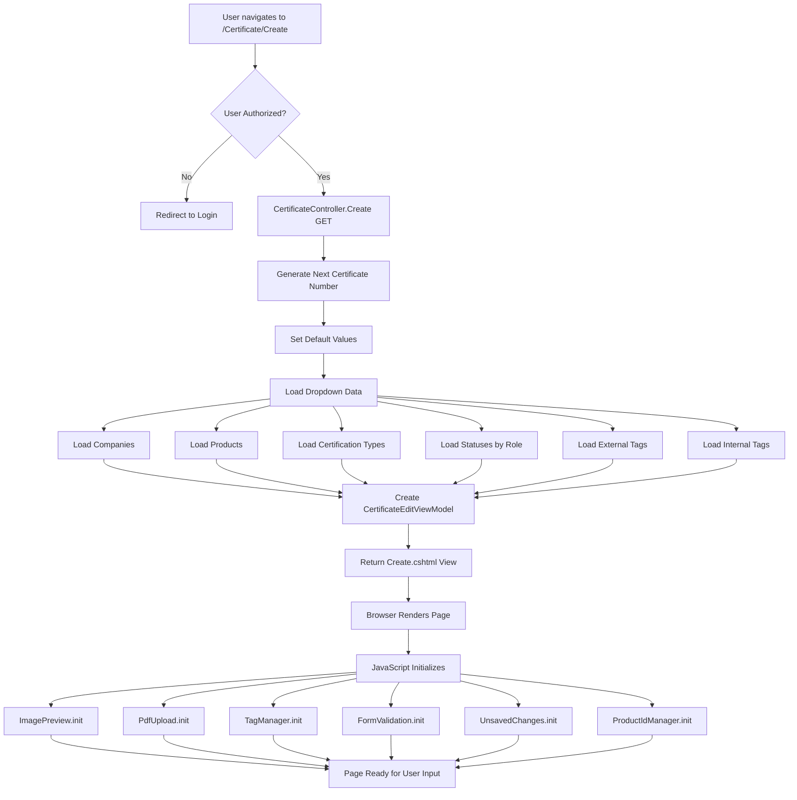

### Edit Page Load
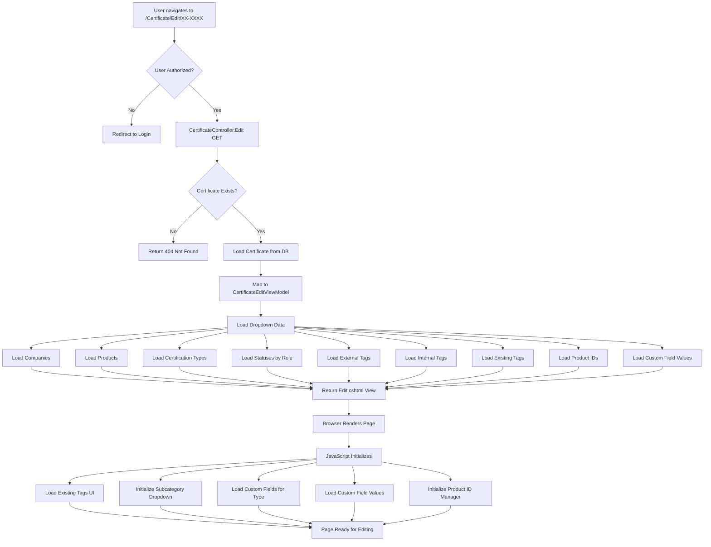

---

## Form Submission Flow

### Create Form Submission
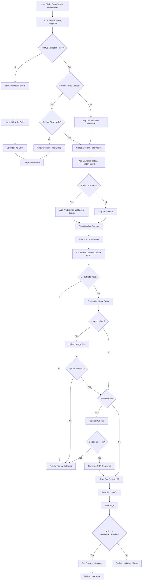

### Edit Form Submission
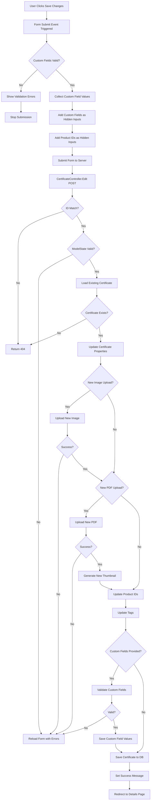

---

## Component Interactions

### Overall Page Architecture
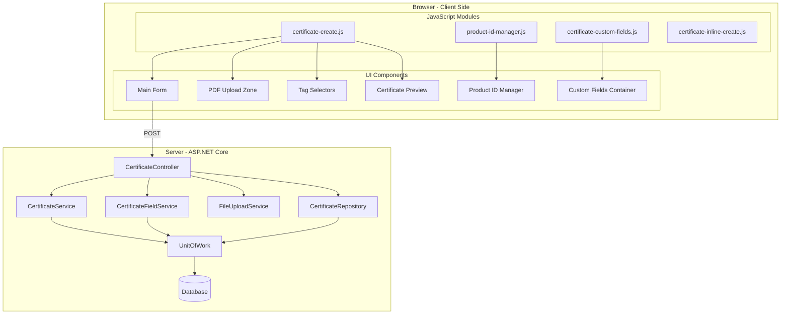

### JavaScript Module Dependencies
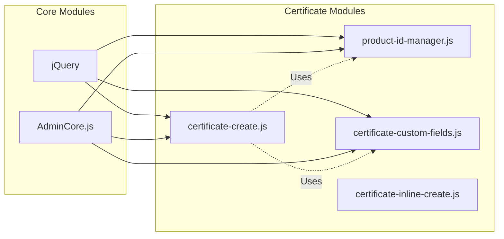

---

## File Upload Flow

### PDF Upload Process
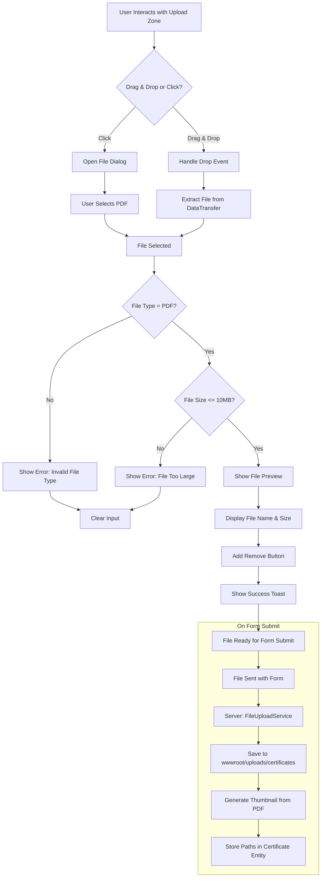

---

## Tag Management Flow

### Adding Tags
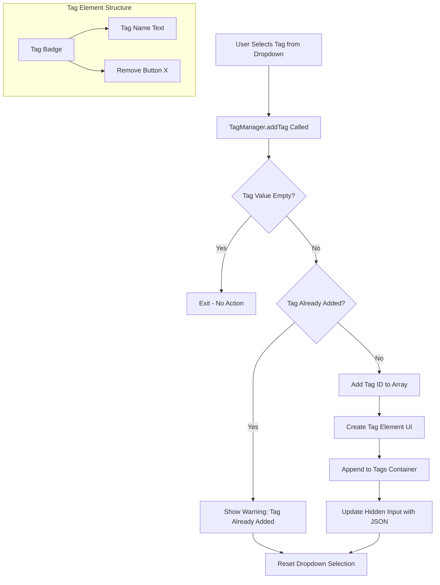

### Removing Tags
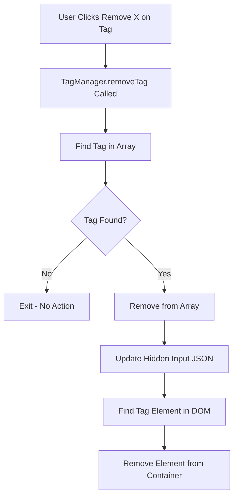

---

## Product ID Management Flow

### Product ID Manager Lifecycle
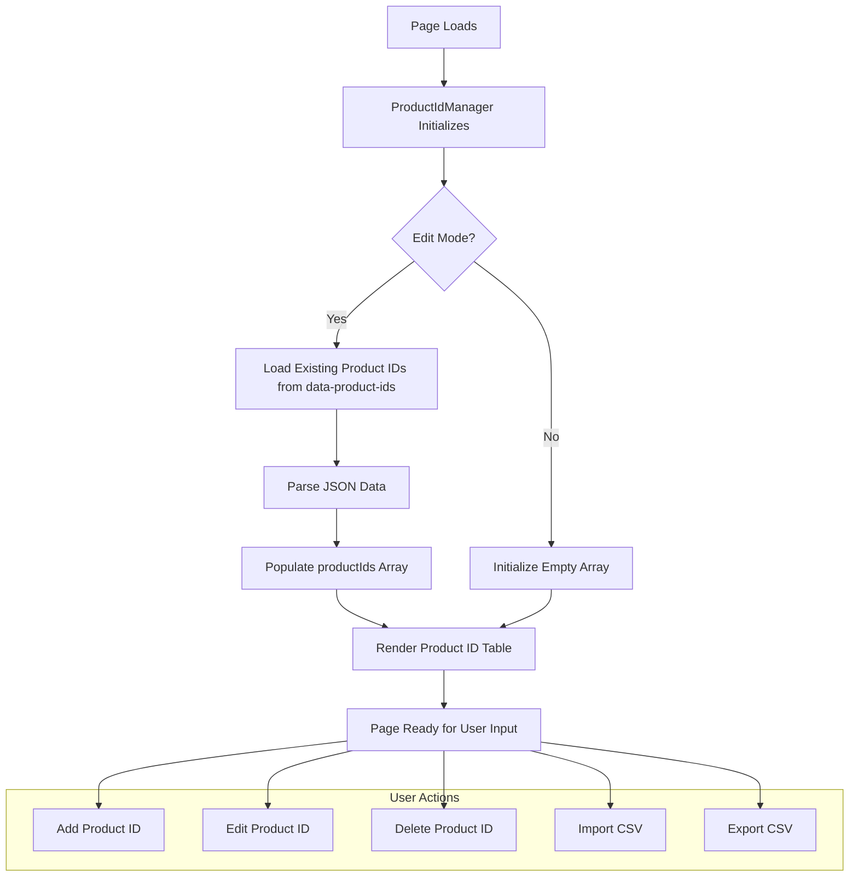

### Adding a Product ID
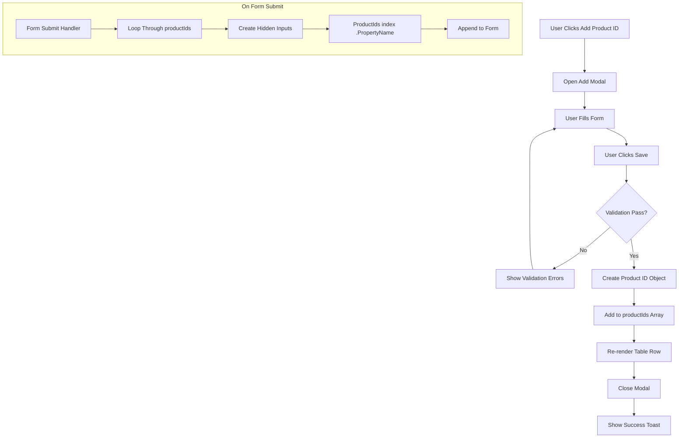

---

## Custom Fields Flow

### Loading Custom Fields
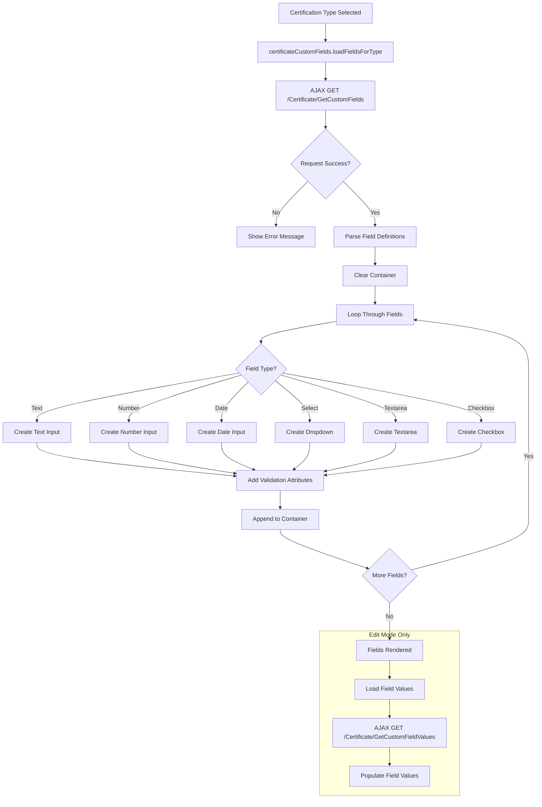

### Saving Custom Fields
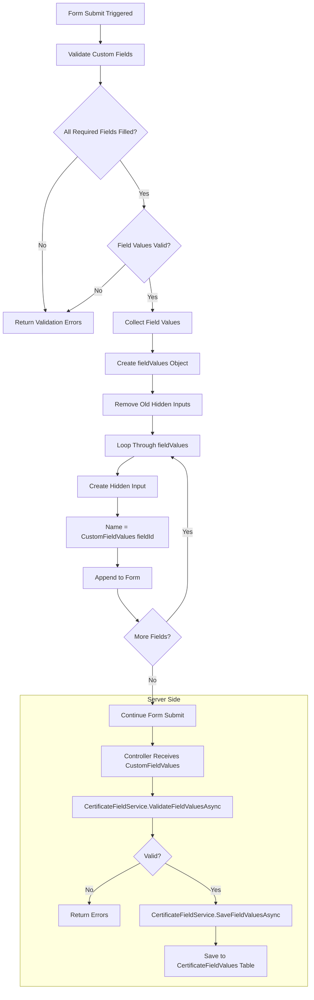

---

## Data Model Relationships

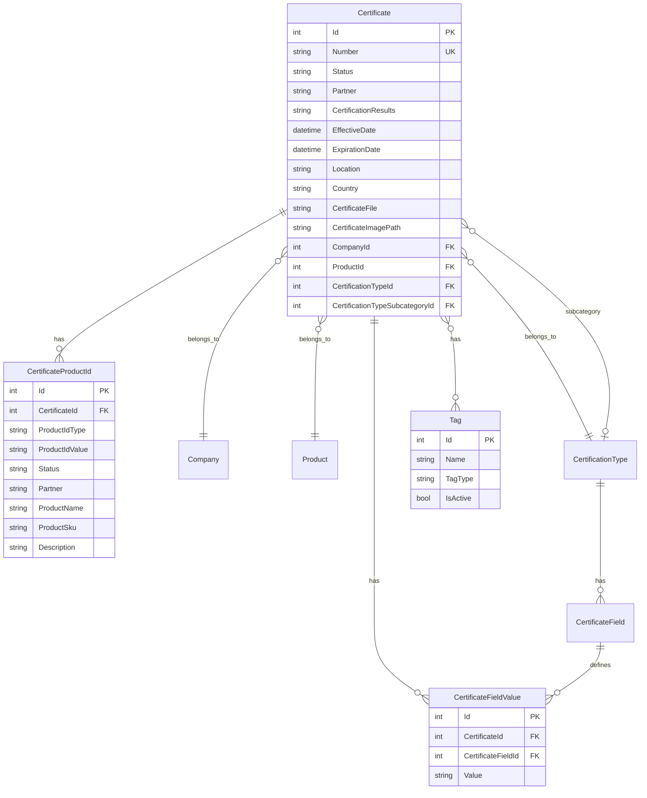

---

## Status Flow

### Certificate Statuses by Role
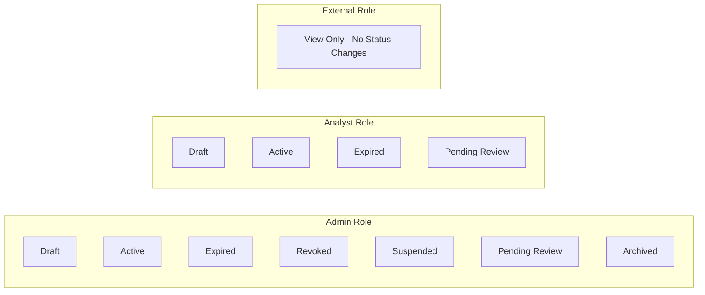

---

## Error Handling Flow

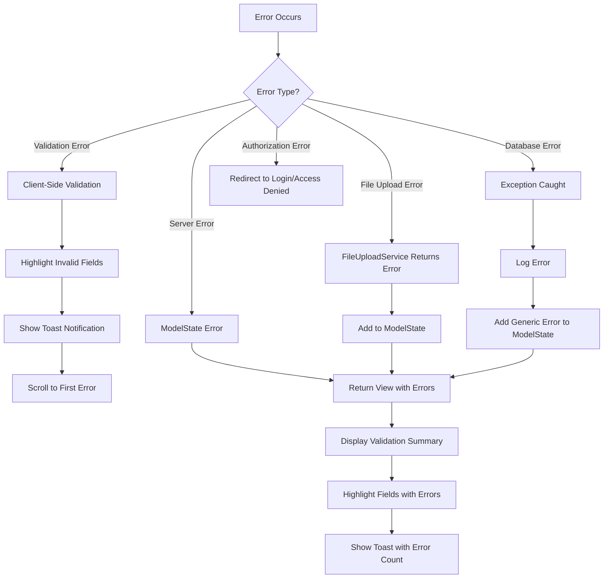

---

## Key Files Reference

| Component | File Path |
|-----------|-----------|
| Create Controller Action | `Controllers/CertificateController.cs:308-556` |
| Edit Controller Action | `Controllers/CertificateController.cs:580-849` |
| Create View | `Views/Certificate/Create.cshtml` |
| Edit View | `Views/Certificate/Edit.cshtml` |
| Main JavaScript | `wwwroot/js/certificate-create.js` |
| Product ID Manager | `wwwroot/js/product-id-manager.js` |
| Custom Fields | `wwwroot/js/certificate-custom-fields.js` |
| Inline Create | `wwwroot/js/certificate-inline-create.js` |
| CSS Styles | `wwwroot/css/certificate-create.css` |
| Product ID Styles | `wwwroot/css/product-id-manager.css` |

---

## Configuration Points

### ViewBag Data Loaded
- `ViewBag.Companies` - All companies for dropdown
- `ViewBag.Products` - All products for dropdown
- `ViewBag.ParentCertificationTypes` - Parent cert types for primary dropdown
- `ViewBag.AllCertificationTypes` - All cert types for subcategory filtering
- `ViewBag.Statuses` - Role-based status options
- `ViewBag.ExternalTags` - External tags for dropdown
- `ViewBag.InternalTags` - Internal tags for dropdown
- `ViewBag.ExistingExternalTags` - (Edit only) Currently assigned external tags
- `ViewBag.ExistingInternalTags` - (Edit only) Currently assigned internal tags

### Hidden Form Fields
- `Id` - Certificate ID (Edit only)
- `ExternalTags` - JSON array of external tag IDs
- `InternalTags` - JSON array of internal tag IDs
- `ProductIds[n].PropertyName` - Product ID collection
- `CustomFieldValues[fieldId]` - Custom field values
