# Product Identifiers Flow

This document describes the complete flow of the Product ID Manager component, which handles ASINs, UPCs, GTINs, EANs, ISBNs, SKUs, MPNs, and other product identifiers for certificates.

## Table of Contents
1. [Architecture Overview](#architecture-overview)
2. [Component Initialization](#component-initialization)
3. [CRUD Operations](#crud-operations)
4. [Validation System](#validation-system)
5. [Import/Export Flow](#importexport-flow)
6. [Filtering & Search](#filtering--search)
7. [Create vs Edit Page Behavior](#create-vs-edit-page-behavior)
8. [API Endpoints](#api-endpoints)
9. [Data Model](#data-model)

---

## Architecture Overview

### System Components
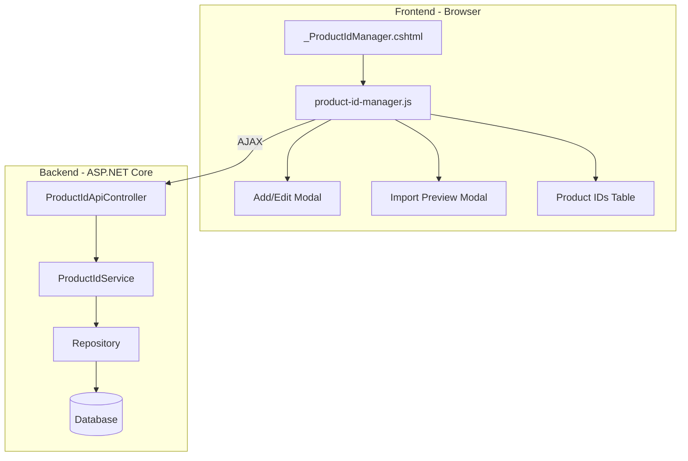

### Component Responsibility Matrix
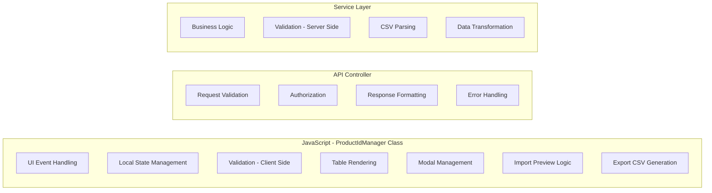

---

## Component Initialization

### Initialization Flow
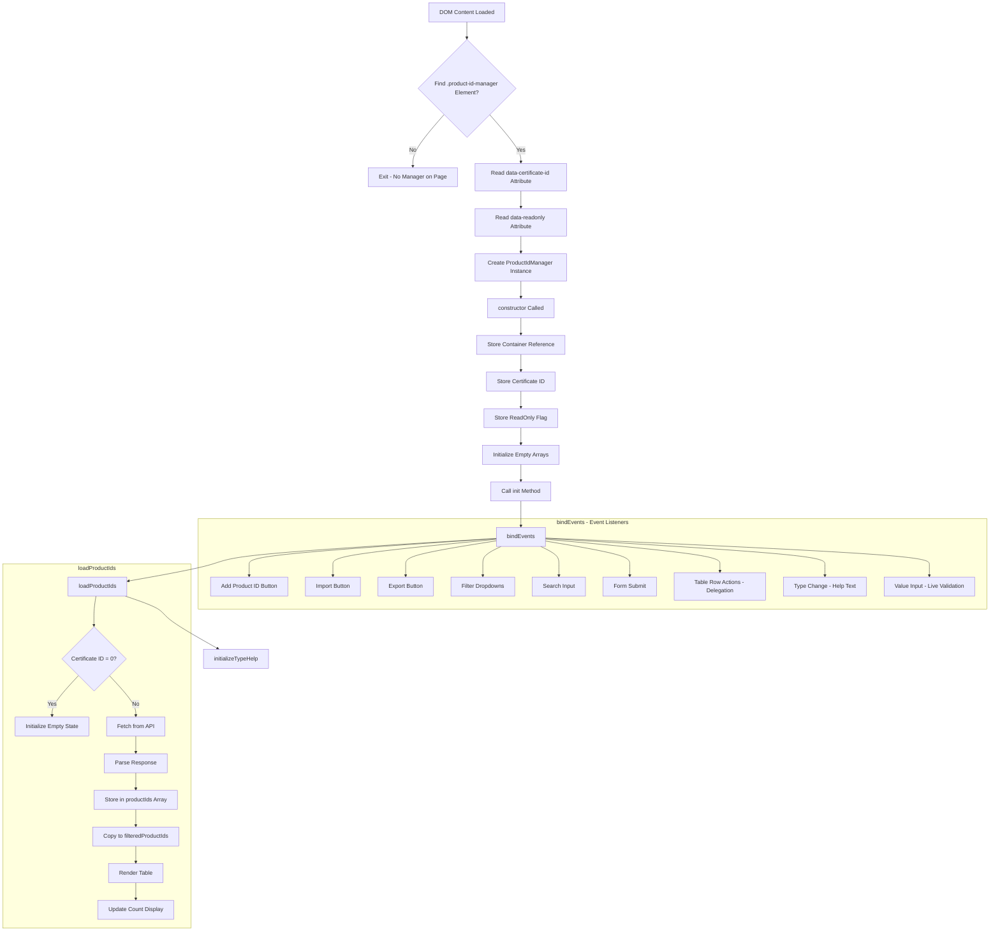

### State Management
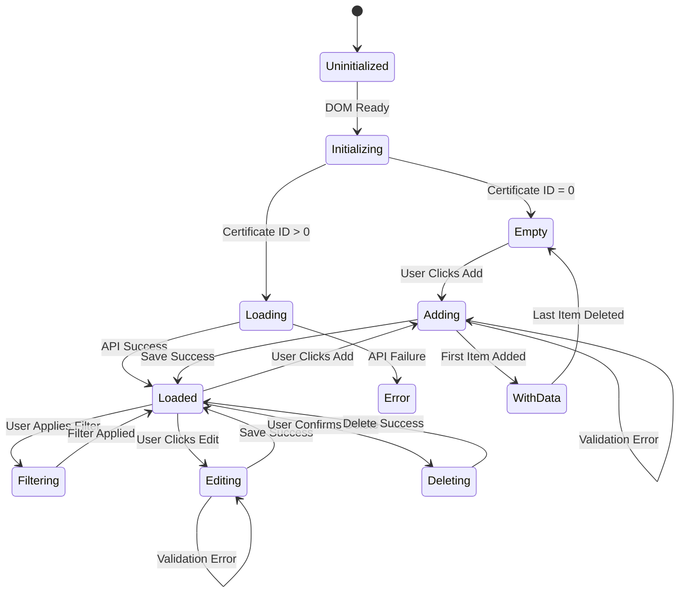

---

## CRUD Operations

### Add Product ID Flow
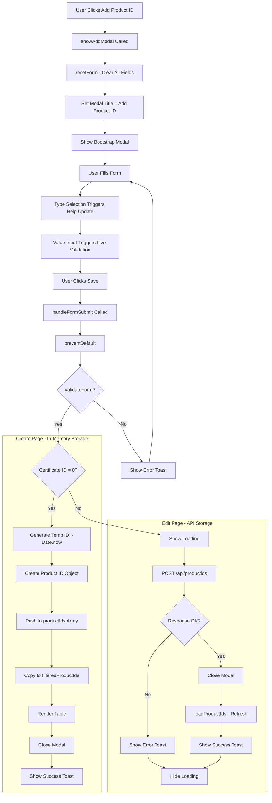

### Edit Product ID Flow
```mermaid
flowchart TD
    A[User Clicks Edit Button] --> B[handleTableAction - Event Delegation]
    B --> C[Extract data-product-id]
    C --> D[showEditModal Called]

    D --> E{Certificate ID = 0?}

    subgraph "Create Page - Find in Memory"
        E -->|Yes| F[Find in productIds Array by Temp ID]
        F --> G[populateForm with Data]
    end

    subgraph "Edit Page - Fetch from API"
        E -->|No| H[GET /api/productids/{id}]
        H --> I{Response OK?}
        I -->|No| J[Show Error Toast]
        I -->|Yes| K[populateForm with Response Data]
    end

    G --> L[Set Modal Title = Edit Product ID]
    K --> L
    L --> M[Show Bootstrap Modal]

    M --> N[User Modifies Form]
    N --> O[User Clicks Save]
    O --> P[handleFormSubmit Called]

    P --> Q{validateForm?}
    Q -->|No| R[Show Error Toast]
    R --> N

    Q -->|Yes| S{Certificate ID = 0?}

    subgraph "Create Page - Update Memory"
        S -->|Yes| T[Find Index by Temp ID]
        T --> U[Update Object in Array]
        U --> V[Render Table]
        V --> W[Close Modal]
        W --> X[Show Success Toast]
    end

    subgraph "Edit Page - Update via API"
        S -->|No| Y[PUT /api/productids/{id}]
        Y --> Z{Response OK?}
        Z -->|No| AA[Show Error Toast]
        Z -->|Yes| AB[Close Modal]
        AB --> AC[loadProductIds - Refresh]
        AC --> AD[Show Success Toast]
    end
```

### Delete Product ID Flow
```mermaid
flowchart TD
    A[User Clicks Delete Button] --> B[handleTableAction - Event Delegation]
    B --> C[Extract data-product-id]
    C --> D[handleDelete Called]

    D --> E[AdminCore.showConfirmation]
    E --> F{User Confirms?}
    F -->|No| G[Exit - No Action]

    F -->|Yes| H{Product ID < 0 OR Certificate ID = 0?}

    subgraph "In-Memory Delete"
        H -->|Yes| I[Filter Out from productIds]
        I --> J[Copy to filteredProductIds]
        J --> K[Render Table]
        K --> L[Update Count]
        L --> M[Show Success Toast]
    end

    subgraph "API Delete"
        H -->|No| N[Show Loading]
        N --> O[DELETE /api/productids/{id}]
        O --> P{Response OK?}
        P -->|No| Q[Show Error Toast]
        P -->|Yes| R[loadProductIds - Refresh]
        R --> S[Show Success Toast]
        Q --> T[Hide Loading]
        S --> T
    end
```

---

## Validation System

### Client-Side Validation
```mermaid
flowchart TD
    A[User Enters Value] --> B[validateProductIdValue Called]
    B --> C[Get Selected Type]
    C --> D{Type and Value Present?}
    D -->|No| E[Clear Validation State]

    D -->|Yes| F[isValidProductId Called]

    F --> G{Type = ISBN?}
    G -->|Yes| H[validateIsbn]
    G -->|No| I[Use Regex Pattern]

    subgraph "ISBN Validation"
        H --> H1{Length = 10?}
        H1 -->|Yes| H2[validateIsbn10Checksum]
        H1 -->|No| H3{Length = 13?}
        H3 -->|Yes| H4[validateIsbn13Checksum]
        H3 -->|No| H5[Invalid]

        H2 --> H6{Modulo 11 = 0?}
        H6 -->|Yes| H7[Valid]
        H6 -->|No| H5

        H4 --> H8{Starts with 978/979?}
        H8 -->|No| H5
        H8 -->|Yes| H9{Modulo 10 = 0?}
        H9 -->|Yes| H7
        H9 -->|No| H5
    end

    subgraph "Regex Patterns"
        I --> I1{Type?}
        I1 -->|ASIN| I2[/^A-Z0-9{10}$/]
        I1 -->|UPC| I3[/^0-9{12}$/]
        I1 -->|GTIN| I4[/^0-9{8}$|^0-9{12}$|^0-9{13}$|^0-9{14}$/]
        I1 -->|EAN| I5[/^0-9{13}$/]
        I1 -->|SKU| I6[/^A-Z0-9-_{3,50}$/i]
        I1 -->|MPN| I7[/^A-Z0-9-_.{1,50}$/i]
        I1 -->|OTHER| I8[/.{1,50}/]
    end

    H7 --> J[setValidationState - Valid]
    H5 --> K[setValidationState - Invalid]
    I2 & I3 & I4 & I5 & I6 & I7 & I8 --> L{Pattern Match?}
    L -->|Yes| J
    L -->|No| K

    J --> M[Add is-valid Class]
    M --> N[Clear Error Message]

    K --> O[Add is-invalid Class]
    O --> P[Show Error Message]
```

### Validation Format Reference
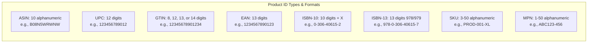

### Server-Side Validation
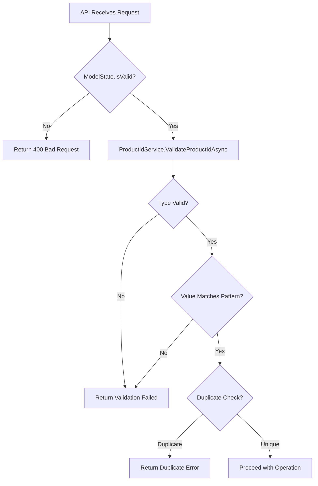

---

## Import/Export Flow

### CSV Import Flow
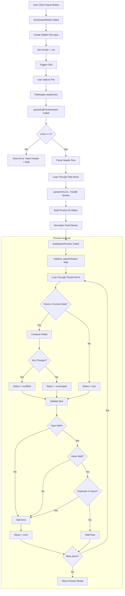

### Import Preview Modal
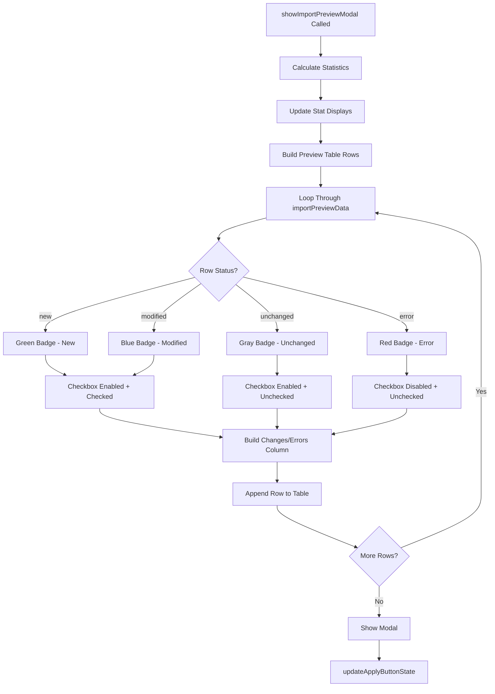

### Apply Import Flow
```mermaid
flowchart TD
    A[User Clicks Apply Import] --> B[applyImport Called]
    B --> C[Filter Selected + No Errors]

    C --> D{Any Rows to Import?}
    D -->|No| E[Show Error Toast]

    D -->|Yes| F{Certificate ID = 0?}

    subgraph "Create Page - Add to Memory"
        F -->|Yes| G[Loop Through Selected]
        G --> H[Generate Temp ID]
        H --> I[Add to productIds Array]
        I --> J{More Rows?}
        J -->|Yes| G
        J -->|No| K[Refresh Display]
        K --> L[Close Modal]
        L --> M[Show Success Toast]
    end

    subgraph "Edit Page - API Import"
        F -->|No| N[Loop Through Selected]
        N --> O{Action = update?}

        O -->|Yes| P[PUT /api/productids/{id}]
        O -->|No| Q[POST /api/productids]

        P & Q --> R{Response OK?}
        R -->|Yes| S[Increment Success Count]
        R -->|No| T[Increment Error Count]

        S & T --> U{More Rows?}
        U -->|Yes| N
        U -->|No| V[Close Modal]
        V --> W[loadProductIds - Refresh]
        W --> X[Show Result Toast]
    end
```

### CSV Export Flow
```mermaid
flowchart TD
    A[User Clicks Export Button] --> B[exportProductIds Called]
    B --> C[Show Loading]
    C --> D[GET /api/productids/certificate/{id}/export]

    D --> E{Response OK?}
    E -->|No| F[Show Error Toast]
    E -->|Yes| G[Get Blob from Response]

    G --> H[Create Object URL]
    H --> I[Create Hidden Anchor]
    I --> J[Set href and download attributes]
    J --> K[Trigger Click]
    K --> L[Revoke Object URL]
    L --> M[Remove Anchor]
    M --> N[Show Success Toast]

    F --> O[Hide Loading]
    N --> O
```

### Download Template Flow
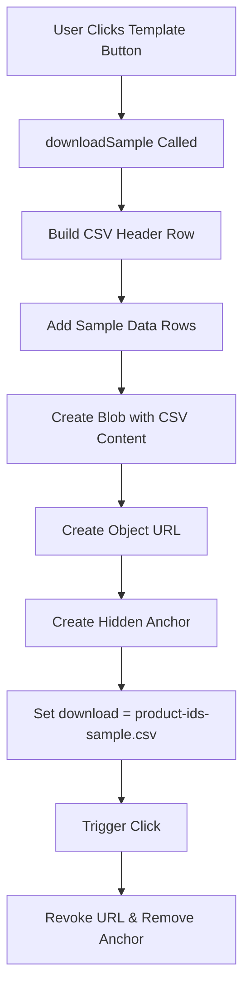

---

## Filtering & Search

### Filter Application Flow
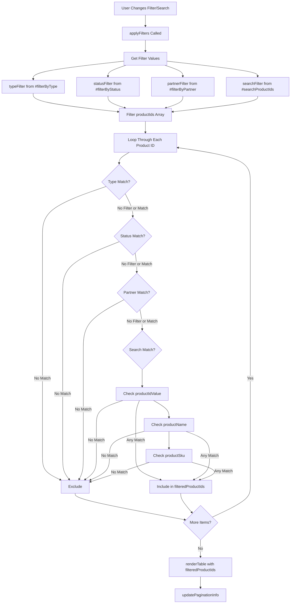

### Search Matching Logic
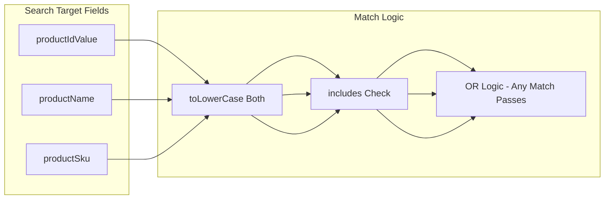

---

## Create vs Edit Page Behavior

### Behavioral Differences
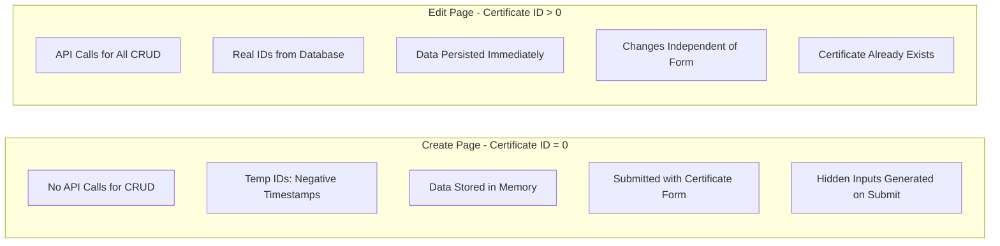

### Form Submission Integration
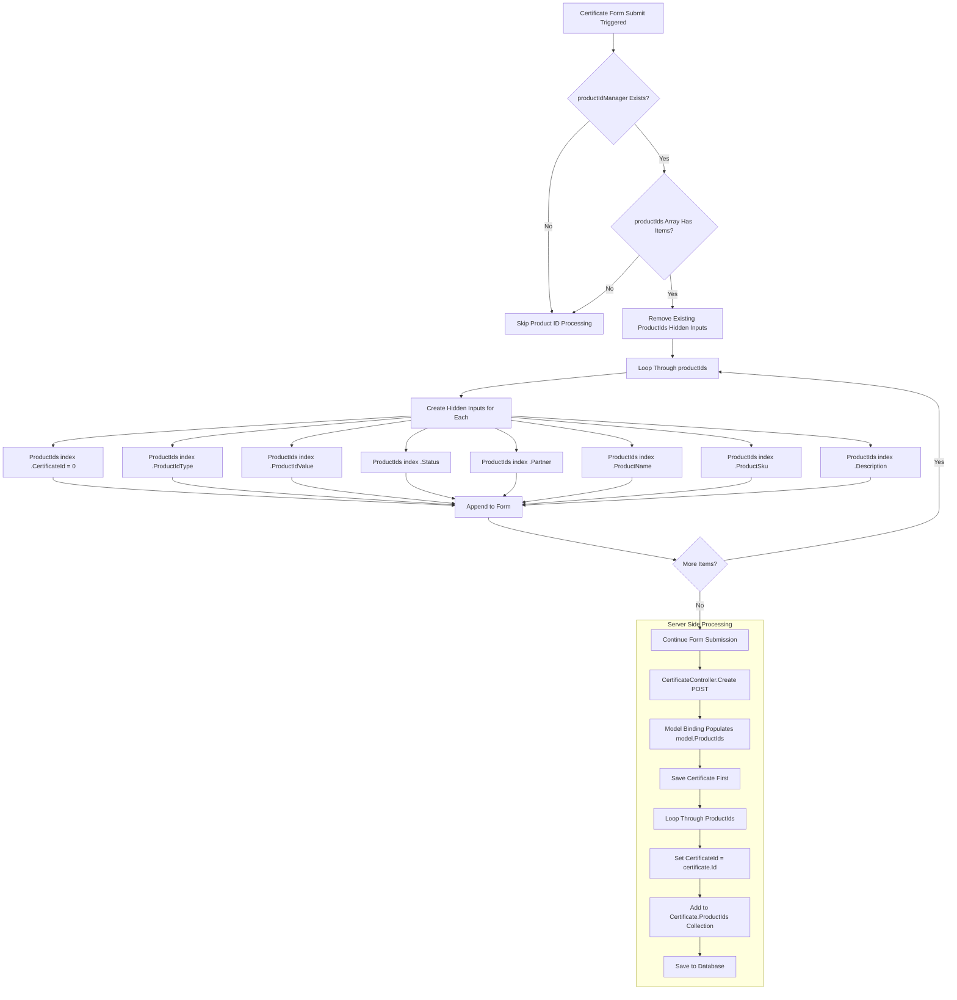

---

## API Endpoints

### Endpoint Reference
```mermaid
flowchart LR
    subgraph "Product ID API - /api/productids"
        A[GET /certificate/{id}] --> A1[Get All for Certificate]
        B[GET /{id}] --> B1[Get Single by ID]
        C[POST /] --> C1[Create New]
        D[PUT /{id}] --> D1[Update Existing]
        E[DELETE /{id}] --> E1[Delete by ID]
        F[POST /certificate/{id}/import] --> F1[Bulk Import CSV]
        G[GET /certificate/{id}/export] --> G1[Export to CSV]
        H[GET /sample-csv] --> H1[Download Template]
        I[POST /validate] --> I1[Validate Without Save]
    end
```

### API Request/Response Flow
```mermaid
sequenceDiagram
    participant Browser
    participant Controller
    participant Service
    participant Repository
    participant Database

    Browser->>Controller: POST /api/productids
    Controller->>Controller: Check Authorization
    Controller->>Controller: Validate ModelState

    alt Invalid Model
        Controller-->>Browser: 400 Bad Request
    end

    Controller->>Service: ValidateProductIdAsync
    Service->>Service: Check Type & Format

    alt Validation Failed
        Controller-->>Browser: 400 Validation Failed
    end

    Controller->>Service: CreateProductIdAsync
    Service->>Repository: Add Entity
    Repository->>Database: INSERT
    Database-->>Repository: New ID
    Repository-->>Service: Saved Entity
    Service-->>Controller: Created Entity

    Controller-->>Browser: 201 Created + Entity
```

---

## Data Model

### Entity Relationship
```mermaid
erDiagram
    Certificate ||--o{ CertificateProductId : has
    User ||--o{ CertificateProductId : creates
    User ||--o{ CertificateProductId : updates

    CertificateProductId {
        int Id PK
        int CertificateId FK
        string ProductIdType
        string ProductIdValue
        string Status
        string Partner
        string ProductName
        string ProductSku
        string Description
        DateTime CreatedAt
        int CreatedBy FK
        DateTime UpdatedAt
        int UpdatedBy FK
    }

    Certificate {
        int Id PK
        string Number
        string Status
        int CompanyId FK
        int ProductId FK
    }

    User {
        int Id PK
        string Username
        string Email
    }
```

### Product ID Types Enum
```mermaid
flowchart TB
    subgraph "Supported Product ID Types"
        ASIN[ASIN - Amazon Standard ID]
        UPC[UPC - Universal Product Code]
        GTIN[GTIN - Global Trade Item Number]
        EAN[EAN - European Article Number]
        ISBN[ISBN - International Standard Book Number]
        SKU[SKU - Stock Keeping Unit]
        MPN[MPN - Manufacturer Part Number]
        OTHER[OTHER - Custom Identifier]
    end

    subgraph "Status Options"
        S1[Active]
        S2[Inactive]
        S3[Pending]
        S4[Expired]
    end

    subgraph "Partner Options"
        P1[Amazon]
        P2[Novi]
        P3[None]
        P4[Other]
    end
```

---

## Key Files Reference

| Component | File Path | Lines |
|-----------|-----------|-------|
| Partial View | `Views/Shared/_ProductIdManager.cshtml` | 340 |
| JavaScript Class | `wwwroot/js/product-id-manager.js` | 1177 |
| API Controller | `Controllers/Api/ProductIdApiController.cs` | 428 |
| Service Interface | `Services/IProductIdService.cs` | - |
| Service Implementation | `Services/ProductIdService.cs` | - |
| Model | `Models/CertificateProductId.cs` | - |
| CSS Styles | `wwwroot/css/product-id-manager.css` | - |

---

## Error Handling

### Error Types and Responses
```mermaid
flowchart TD
    subgraph "Client-Side Errors"
        A1[Validation Error] --> A2[Show Toast + Highlight Field]
        A3[Network Error] --> A4[Show Error Toast]
        A5[Parse Error] --> A6[Show Error Toast]
    end

    subgraph "Server-Side Errors"
        B1[400 Bad Request] --> B2[Show Validation Message]
        B3[401 Unauthorized] --> B4[Redirect to Login]
        B5[404 Not Found] --> B6[Show Not Found Message]
        B7[500 Server Error] --> B8[Show Generic Error]
    end

    subgraph "Import Errors"
        C1[Invalid CSV Format] --> C2[Show Format Error]
        C3[Missing Required Field] --> C4[Mark Row as Error]
        C5[Duplicate Value] --> C6[Mark Row as Error]
        C7[Invalid Type] --> C8[Mark Row as Error]
    end
```

---

## Performance Considerations

```mermaid
flowchart LR
    subgraph "Optimization Strategies"
        A[Event Delegation for Table Actions]
        B[Debounced Search Input]
        C[In-Memory Filtering - No API Calls]
        D[Batch Import via Preview Modal]
        E[Lazy Loading for Large Datasets]
    end

    subgraph "Memory Management"
        F[Arrays Cleared on Page Unload]
        G[Modal Elements Reused]
        H[Toast Elements Self-Remove]
    end
```
