# GCC Database Solution - Entity Relationship Diagram (ERD)

**Last Updated:** 2025-11-17
**Database Version:** Entity Framework Core 9.0.9
**Total Entities:** 27 primary entities + 6 junction tables

---

## Visual ERD (Mermaid Diagram)

```mermaid
erDiagram
    %% Core Certificate Management
    Certificate ||--o{ CertificateProductId : "has many"
    Certificate ||--o{ CertificateDocument : "has many"
    Certificate ||--o{ CustomFieldValue : "has many"
    Certificate }o--|| Company : "belongs to"
    Certificate }o--|| Product : "belongs to"
    Certificate }o--|| CertificationType : "has type"
    Certificate }o--|| User : "created by"
    Certificate }o--|| User : "updated by"
    Certificate }o--o{ Tag : "tagged with"

    %% Product Management
    Product }o--|| ProductCategory : "belongs to"
    Product }o--|| ProductType : "has type"
    Product }o--|| ProductSubcategory : "belongs to"
    Product }o--|| Company : "owned by"
    Product ||--o{ ProductIdentifier : "has identifiers"
    Product }o--o{ Tag : "tagged with"

    %% Product Taxonomy
    ProductType }o--|| ProductCategory : "belongs to"
    ProductType }o--o| ProductType : "parent-child"
    ProductType ||--o{ ProductSubcategory : "has subcategories"

    %% Custom Fields
    CustomField }o--|| CertificationType : "applies to"
    CustomField ||--o{ CustomFieldValue : "has values"

    %% Certificate Types Hierarchy
    CertificationType }o--o| CertificationType : "parent-child"

    %% User & Authentication
    User }o--o{ Role : "has roles"
    User }o--o{ Company : "associated with"
    User }o--o{ Partner : "associated with"
    User ||--o{ ApiKey : "owns"

    %% Roles & Permissions
    Role }o--o{ Permission : "has permissions"

    %% Partners
    Partner ||--o{ PartnerApiKey : "has API keys"

    %% Google Analytics
    GoogleAnalyticsSettings }o--|| User : "updated by"

    %% Amazon Integration
    AmazonApiSettings }o--|| User : "updated by"
    AmazonApiSettings ||--o{ AmazonSyncHistory : "has history"

    %% ETL System
    ETLConfiguration ||--o{ ETLLogEntry : "generates logs"
    ETLConfiguration ||--o{ ETLAlert : "generates alerts"
    ETLConfiguration ||--o{ ETLDataQualityIssue : "identifies issues"

    %% Entity Definitions
    Certificate {
        int Id PK
        string Number UK "7 chars max, unique"
        string Status "14-state workflow"
        datetime EffectiveDate
        datetime ExpirationDate
        string Location
        string Country
        string Partner "Amazon/Wayfair/None"
        string CertificateFile
        string CertificateImagePath
        int CompanyId FK
        int ProductId FK
        int CertificationTypeId FK
        int CreatedBy FK
        int UpdatedBy FK
        datetime CreatedAt
        datetime UpdatedAt
    }

    CertificateProductId {
        int Id PK
        int CertificateId FK
        string ProductIdType "10 chars max"
        string ProductIdValue "50 chars max, UK composite"
        string Status
        string Partner
        string ProductName
        string ProductSku
        string Description
        bool IsActive
        bool IsPublic
        int DisplayOrder
        int CreatedBy FK
        int UpdatedBy FK
        datetime CreatedAt
        datetime UpdatedAt
    }

    CertificateDocument {
        int Id PK
        int CertificateId FK "Cascade delete"
        string FileName
        string OriginalFileName
        string FilePath
        string ContentType
        long FileSize
        string FileHash "SHA256"
        string DocumentType
        string Description
        int Version
        bool IsActive
        bool IsPublic
        bool IsVirusScanned
        bool PassedVirusScan
        datetime VirusScanDate
        int UploadedBy FK
        datetime UploadedAt
        datetime UpdatedAt
    }

    CertificationType {
        int Id PK
        string Name UK "255 chars, unique"
        string AmazonCode
        string Description
        bool IsActive
        int SortOrder
        int Level "1=parent, 2=child"
        int ParentId FK "Self-referencing"
    }

    CustomField {
        int Id PK
        string Name "100 chars"
        string FieldType "text/number/date/boolean/select"
        bool IsRequired
        bool IsVisible
        bool IsPublic
        int SortOrder
        string Options "JSON"
        string DefaultValue
        string ValidationRules "JSON"
        string Section "100 chars"
        int CertificateTypeId FK
    }

    CustomFieldValue {
        int Id PK
        int CertificateId FK
        int FieldId FK
        string TextValue
        decimal NumberValue "18,4"
        datetime DateValue
        bool BooleanValue
    }

    Product {
        int Id PK
        string Name "255 chars, required"
        string Description
        string Model
        string Sku
        string Upc
        string Asin
        int CategoryId FK
        int ProductTypeId FK
        int ProductSubcategoryId FK
        int CompanyId FK
        bool IsActive
        bool IsDeleted
        datetime CreatedAt
        datetime UpdatedAt
    }

    ProductCategory {
        int Id PK
        string Name UK "255 chars, unique"
        string Description
        int SortOrder
        bool IsActive
    }

    ProductType {
        int Id PK
        string Name "255 chars, required"
        int CategoryId FK
        int ParentId FK "Self-referencing"
        int Level
        int SortOrder
        bool IsActive
    }

    ProductSubcategory {
        int Id PK
        string Name "255 chars, required"
        int ProductTypeId FK
        string Description
        int SortOrder
        bool IsActive
    }

    ProductIdentifier {
        int Id PK
        int ProductId FK "Cascade delete"
        string IdentifierType "20 chars"
        string IdentifierValue "50 chars, UK composite"
        datetime CreatedAt
        datetime UpdatedAt
    }

    Company {
        int Id PK
        string Name UK "255 chars, unique"
        string ContactInfo
        string Email
        string Website
        string Location
        string Country
        bool IsActive
        bool IsDeleted
        datetime CreatedAt
        datetime UpdatedAt
    }

    Partner {
        int Id PK
        string Name UK "100 chars, unique"
        string Description
        string Website
        string ContactInfo
        string Email
        bool IsActive
        bool IsDeleted
        int SortOrder
        datetime CreatedAt
        datetime UpdatedAt
    }

    User {
        int Id PK
        string Username UK "255 chars, unique"
        string Email UK "255 chars, unique"
        string Name
        string FullName
        string PasswordHash "Required"
        string Status
        bool IsActive
        bool TwoFactorEnabled
        string TwoFactorMethod "Email/SMS/TOTP/Both"
        string TwoFactorSecret
        string PhoneNumber
        string RecoveryCodes "JSON"
        bool RequirePasswordReset
        datetime PasswordChangedAt
        datetime LastLoginAt
        int FailedLoginAttempts
        datetime LockedUntil
        bool IsDeleted
        datetime CreatedAt
        datetime UpdatedAt
    }

    Role {
        int Id PK
        string Name UK "50 chars, unique"
        string Description
        bool IsSystem
        bool IsActive
        datetime CreatedAt
        datetime UpdatedAt
    }

    Permission {
        int Id PK
        string Name "255 chars"
        string Codename UK "100 chars, unique"
        string Category
        string Description
        bool IsActive
        datetime CreatedAt
    }

    Tag {
        int Id PK
        string Name UK "50 chars, unique"
        string TagType "internal/external"
        string Description
        bool IsActive
    }

    ApiKey {
        int Id PK
        string Name "100 chars"
        string KeyHash UK "450 chars, unique"
        string Description
        bool IsActive
        int RateLimitPerMinute "Default 60"
        int RateLimitPerHour "Default 1000"
        int RateLimitPerDay "Default 10000"
        string AllowedIPs
        string AllowedOrigins
        string Scopes
        int MaxConcurrentRequests "Default 10"
        bool RequireTLS
        int CreatedBy FK
        datetime CreatedAt
        datetime LastUsedAt
        datetime ExpiresAt
    }

    PartnerApiKey {
        int Id PK
        int PartnerId FK
        string ApiKey "512 chars"
        string Description
        bool IsActive
        int RateLimitPerHour
        string AllowedEndpoints "JSON"
        string Permissions "JSON"
        string Notes
        int CreatedBy
        datetime CreatedAt
        datetime LastUsedAt
        datetime ExpiresAt
        datetime RevokedAt
        int RevokedBy
    }

    GoogleAnalyticsSettings {
        int Id PK
        string TrackingId "20 chars, required"
        bool IsEnabled
        string CustomScript
        bool AnonymizeIp
        bool EnhancedLinkAttribution
        bool DebugMode
        int UpdatedBy FK
        datetime CreatedAt
        datetime UpdatedAt
    }

    AmazonApiSettings {
        int Id PK
        bool IsEnabled
        int SyncIntervalHours "Default 24"
        string AccessKeyId "500 chars"
        string SecretAccessKey "500 chars"
        string RefreshToken "1000 chars"
        string Region "10 chars"
        string MarketplaceId "50 chars"
        bool SyncProducts
        bool SyncCertificates
        bool SyncCompliance
        string WebhookUrl
        datetime LastSync
        string LastSyncStatus "idle/running/success/error"
        int RecordsSynced
        string LastError
        int UpdatedBy FK
        datetime CreatedAt
        datetime UpdatedAt
    }

    AmazonSyncHistory {
        int Id PK
        datetime Timestamp
        string Type "Auto/Manual"
        int RecordsProcessed
        int RecordsSucceeded
        int RecordsFailed
        string Status "success/error/partial"
        int DurationSeconds
        string Message
        string ErrorDetails
        string TriggeredBy
    }

    ETLConfiguration {
        guid Id PK
        string Name
        string JobType "Full/Incremental/RealTime/OnDemand/Scheduled"
        bool IsIncremental
        datetime LastRunTime
        string DataSources "List, JSON"
        string Transformations "List, JSON"
        string Destinations "List, JSON"
        string Settings "Dictionary, JSON"
        bool IsActive
        string CronSchedule
        datetime CreatedAt
        datetime UpdatedAt
    }

    ETLLogEntry {
        guid Id PK
        guid JobId
        datetime Timestamp
        string LogLevel
        string Message
        string Category
        string Properties "Dictionary, JSON"
    }

    ETLAlert {
        guid Id PK
        string AlertType
        string Message
        string Severity "Info/Warning/Error/Critical"
        datetime CreatedAt
        bool IsResolved
        datetime ResolvedAt
        string Context "Dictionary, JSON"
    }

    ETLDataQualityIssue {
        guid Id PK
        string IssueType
        string Description
        string FieldName
        string RecordId
        string ExpectedValue "JSON"
        string ActualValue "JSON"
        string Severity
        datetime DetectedAt
    }

    CertificateAggregateData {
        string Period "Daily/Weekly/Monthly, PK composite"
        datetime PeriodDate "PK composite"
        int TotalCertificates
        int ActiveCertificates
        int ExpiredCertificates
        int ExpiringThisMonth
        string CertificatesByType "Dictionary, JSON"
        string CertificatesByCountry "Dictionary, JSON"
        string CertificatesByCompany "Dictionary, JSON"
        decimal AverageValidityPeriod
        datetime CreatedAt
    }
```



---

## Relationship Summary

### One-to-Many Relationships (15)

| Parent | Child | Cascade Delete | Notes |
|--------|-------|----------------|-------|
| Certificate | CertificateProductId | Yes | Supports 100+ ASINs per certificate |
| Certificate | CertificateDocument | Yes | Multiple documents per certificate |
| Certificate | CustomFieldValue | No | Dynamic custom fields |
| Company | Certificate | No | Company deletion restricted if certificates exist |
| Company | Product | No | Company deletion restricted if products exist |
| Product | Certificate | No | Product deletion restricted if certificates exist |
| Product | ProductIdentifier | Yes | Multiple IDs (ASIN, UPC, etc.) per product |
| CertificationType | Certificate | No | Type deletion restricted if certificates exist |
| CertificationType | CustomField | No | Custom fields per certification type |
| CustomField | CustomFieldValue | No | Field deletion restricted if values exist |
| ProductCategory | ProductType | No | Taxonomy structure |
| ProductType | Product | No | Product classification |
| ProductType | ProductSubcategory | No | Taxonomy hierarchy |
| ProductSubcategory | Product | No | Product subcategory classification |
| Partner | PartnerApiKey | No | Multiple API keys per partner |

### Many-to-Many Relationships (6)

| Entity A | Junction Table | Entity B | Notes |
|----------|----------------|----------|-------|
| Certificate | CertificateTag | Tag | Both internal and external tags |
| Product | ProductTag | Tag | Product tagging system |
| User | UserRole | Role | Role-based access control |
| Role | RolePermission | Permission | Granular permissions |
| User | CompanyUser | Company | External users filter by companies |
| User | UserPartner | Partner | External users filter by partners |

### Self-Referencing Relationships (2)

| Entity | Relationship | Purpose |
|--------|--------------|---------|
| CertificationType | Parent-Child | Hierarchical certification types (Level 1 = parent, Level 2 = child) |
| ProductType | Parent-Child | Hierarchical product types |

---

## Key Constraints & Indexes

### Unique Constraints (14)

1. **Certificate.Number** - 7-character unique certificate identifier
2. **Company.Name** - Unique company names
3. **ProductCategory.Name** - Unique category names
4. **CertificationType.Name** - Unique certification type names
5. **Tag.Name** - Unique tag names
6. **User.Username** - Unique usernames
7. **User.Email** - Unique email addresses
8. **Role.Name** - Unique role names
9. **Permission.Codename** - Unique permission codes
10. **ApiKey.KeyHash** - Unique API key hashes
11. **Partner.Name** - Unique partner names
12. **ProductIdentifier (ProductId, IdentifierType, IdentifierValue)** - Composite unique
13. **CertificateProductId (ProductIdType, ProductIdValue)** - Composite unique
14. **CertificateAggregateData (Period, PeriodDate)** - Composite unique

### Critical Composite Indexes (20+)

**Certificate Indexes:**
- (Status, ExpirationDate) - Status filtering with expiration
- (CompanyId, Status) - Company certificates by status
- (ProductId, Status) - Product certificates by status
- (Country, Status) - Geographic filtering
- (CertificateTypeId, Status) - Type filtering
- (ExpirationDate, Status, CompanyId) - Expiring certificates per company

**CertificateProductId Indexes:**
- (CertificateId, ProductIdType) - Product IDs by type
- (Partner, Status, IsActive) - Partner product filtering
- (Status, IsActive, CreatedAt) - Active product IDs timeline

**Company & Product Indexes:**
- Company: (Country, IsActive), (Name, Country)
- Product: (CategoryId, CompanyId), (ProductTypeId, IsActive), (CompanyId, IsActive)

**User & Security Indexes:**
- User: (Status, IsActive), (IsActive, CreatedAt)
- ApiKey: (KeyHash, IsActive, ExpiresAt), (CreatedBy, IsActive)
- Partner: (IsActive, SortOrder)

---

## Data Types Reference

| Type | Usage | Examples |
|------|-------|----------|
| `int` (Identity, PK) | Primary keys | Certificate.Id, User.Id |
| `guid` (PK) | ETL system IDs | ETLConfiguration.Id, ETLLogEntry.Id |
| `string` (nvarchar) | Text fields | Certificate.Number (7 max), Company.Name (255 max) |
| `datetime` | Timestamps | CreatedAt, UpdatedAt, EffectiveDate |
| `bool` | Flags | IsActive, IsDeleted, TwoFactorEnabled |
| `decimal(18,6)` | Financial | ApiKey.UsageCostPerRequest |
| `decimal(18,4)` | Precision numbers | CustomFieldValue.NumberValue |
| `long` | Large numbers | CertificateDocument.FileSize |
| `string` (JSON, TEXT) | Complex objects | CustomField.Options, ETLConfiguration.Settings |

---

## Database Features

### Audit Trail System
- **Automatic Tracking:** All entities have `CreatedAt`, `UpdatedAt` fields
- **User Tracking:** Sensitive entities track `CreatedBy`, `UpdatedBy`
- **Soft Deletion:** `IsDeleted`, `DeletedAt` fields on Company, Product, Partner, User

### Security Features
- **Password Hashing:** User.PasswordHash (BCrypt recommended)
- **API Key Hashing:** ApiKey.KeyHash (SHA256)
- **2FA Support:** User.TwoFactorSecret, User.TwoFactorEnabled
- **Rate Limiting:** ApiKey rate limits per minute/hour/day
- **Account Lockout:** User.FailedLoginAttempts, User.LockedUntil

### Performance Optimizations
- **50+ Indexes:** Covering common query patterns
- **JSON Storage:** Complex objects stored as TEXT with value converters
- **Composite Keys:** Multi-column primary keys for ETL aggregates
- **Selective Loading:** Navigation properties with lazy/eager loading options

### Data Quality
- **Validation Rules:** MaxLength constraints on all text fields
- **Required Fields:** NOT NULL constraints on business-critical fields
- **Referential Integrity:** Foreign key constraints with appropriate cascade rules
- **Business Rules:** Check constraints via EF Core validation

---

## Critical Database Requirement

**SCHEMA OWNERSHIP - MANDATORY:**

All tables MUST be in the `dbo` schema, NOT in user-owned schemas.

**Production User Requirements:**
1. DEFAULT_SCHEMA = dbo
2. db_owner role membership

**Verification Query:**
```sql
SELECT SCHEMA_NAME(schema_id) AS SchemaName, name AS TableName
FROM sys.tables
WHERE type = 'U'
ORDER BY SchemaName, TableName;
```

**Expected Output:** All tables should show `dbo` as SchemaName, NOT `GCC_adminxyz123` or any other user.

**See:** [CRITICAL_SCHEMA_REQUIREMENT.md](reference/CRITICAL_SCHEMA_REQUIREMENT.md)

---

## Migrations

**Total Migrations:** 18
**Latest Migration:** `20251113171055_AddSectionToCustomFields`
**Migration Strategy:** Auto-apply on application startup in production

**Key Migrations:**
- `20251015162223_InitialCreate_SqlServer_Final` - Initial schema
- `20251029003704_AddLevelToCertificationType` - Hierarchy support
- `20251111164931_AddAmazonApiIntegration` - Amazon integration
- `20251112144629_AddPartnerApiKeys` - Partner API system
- `20251113161816_AddGoogleAnalyticsSettings` - Analytics tracking
- `20251113171055_AddSectionToCustomFields` - Custom field sections

---

## Change Tracking

**Version:** 2.0
**Last Schema Update:** 2025-11-13
**Breaking Changes:** None since 2025-10-15 initial create
**Pending Changes:** None

---

## See Also

- [Database README](README.md) - Complete documentation index
- [Quick Start Guide](deployment/QUICK_START.md) - 5-minute setup
- [Schema Overview](reference/SCHEMA_OVERVIEW.md) - Table details
- [Connection Strings](reference/CONNECTION_STRINGS.md) - Database connections
- [Sync Guide](deployment/SYNC_DEV_TO_PROD.md) - Production sync process
